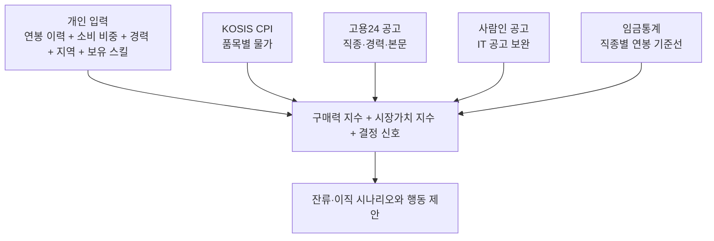
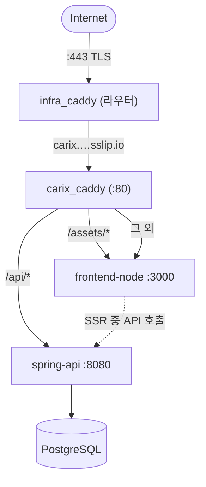

# Carix

> 내 소득, 물가, 스킬 수요를 연결해 커리어의 실질가치를 추적하는 개인 커리어 지수 플랫폼

## Carix란?

연봉이 올라도 물가가 더 빠르게 오르면 생활 수준은 낮아질 수 있습니다. 같은
스킬을 오래 사용해도 시장 수요가 줄면 커리어의 선택지는 좁아질 수 있습니다.

Carix는 명목연봉이나 채용공고 수처럼 분리된 숫자를 보여주는 데서 그치지
않습니다. 개인의 소득 변화와 소비 구조, 노동시장의 스킬 수요와 공개연봉을
연결해 다음 세 가지 질문에 답하는 것을 목표로 합니다.

1. 내 실질 구매력은 좋아지고 있는가?
2. 시장에서 내 스킬의 가치는 오르고 있는가?
3. 지금 남고, 옮기고, 배우는 선택 중 무엇이 유리한가?

## 핵심 지수

| 지수 | 설명 | 주요 입력 |
| --- | --- | --- |
| 구매력 지수 | 연봉 상승률에서 개인 소비구조를 반영한 물가 상승 영향을 제거 | 연봉 이력, 소비 비중, 품목별 CPI |
| 시장가치 지수 | 동일 직군 안에서 보유 스킬의 채용 수요 변화를 추적 | 경력, 지역, 보유 스킬, 채용공고(고용24·사람인) |
| 결정 신호 | 지표와 데이터 신뢰도를 규칙으로 조합해 다음 검토 행동을 제시 | 현재 보상, 시장 격차, 스킬 추세 |

두 지수를 하나의 불투명한 점수로 합치지 않고 결정 신호와 함께 공개합니다. 서로
다른 방향으로 움직이는 지표를 함께 해석하는 것이 Carix의 핵심입니다.

예를 들어 구매력은 하락하지만 시장가치는 상승한다면, 소비 절감만 권하기보다
연봉협상이나 이직을 검토할 시점으로 해석할 수 있습니다.

## 데이터 연결 구조



### 구매력 계산

```text
개인물가 변화율 = Σ(품목별 CPI 변화율 × 개인 소비 비중)
개인물가 지수 = 기준월부터 개인물가 변화율을 누적한 지수
실질 구매력 지수 = 명목소득 지수 ÷ 개인물가 지수 × 100
```

전체 소비자물가지수를 그대로 적용하지 않고 주거, 식비, 교통, 교육 등 사용자의
소비 비중을 반영합니다.

### 스킬 시장가치 계산

```text
스킬 수요율 = 해당 스킬 언급 공고 수 ÷ 동일 조건의 전체 공고 수 (원천별 계산)
연봉 격차 = (공식 임금통계 중앙값 - 사용자 세전연봉) ÷ 사용자 세전연봉
```

연봉 격차는 사용자 연봉이 시장 중앙값보다 낮을 때 양수입니다 (결정 규칙표와 동일 규약).

공고 수 자체가 아니라 동일 직군, 경력, 지역 안에서 차지하는 비율을 사용해 전체
채용시장 규모 변화에 따른 왜곡을 줄입니다. 연봉 비교 기준선은 결측률이 높은 공고
공개연봉 대신 공식 임금통계를 사용하며, 공고 공개연봉은 표본이 충분할 때 참고
범위로만 병기합니다.

## 주요 기능

- 연도별 명목연봉과 실질 구매력 비교
- 개인 소비구조를 반영한 개인물가 추적
- 보유 스킬의 수요 변화 추적 (최근 3개월을 그 이전 12개월과 비교, 비중첩)
- 동일 직군·경력·지역의 공개연봉 범위 비교
- 현 직장에 머물 때 발생하는 추정 기회비용 계산
- 잔류와 이직 시나리오 비교

## 결과 예시

```text
구매력 지수    94  하락
시장가치 지수 117  상승
결정 신호      이직 탐색

연봉은 3년간 6.0% 올랐지만 개인물가는 12.4% 상승해
실질 구매력은 감소했습니다. (106.0 ÷ 112.4 × 100 ≈ 94)

보유 스킬의 채용 수요는 같은 기간 증가했고, 현재 연봉은
동일 조건의 공식 임금통계 중앙값보다 낮습니다. 소비 절감보다
연봉협상 또는 이직 준비의 기대효과가 더 큰 상태입니다.
```

수치는 진단 근거와 표본 수를 함께 제공하며, 확정적인 연봉 예측이나 재무 조언으로
표현하지 않습니다.

## MVP 범위

첫 번째 버전은 개발·데이터·AI 직군에 집중하며, 초대받은 10~30명의 비공개 베타
사용자를 대상으로 합니다.

### 계정과 온보딩

- 초대 기반 이메일 매직링크 로그인 (비밀번호 없음, 링크 15분 유효)
- 프로필 → 소득 → 소비 → 스킬 → 검토 순서의 온보딩, 단계별 자동 저장과 중단 지점 재개
- 계정과 개인 데이터 전체 삭제

### 데이터 입력과 이력 관리

- 세전 연봉과 선택적 월 실수령액, 유효 시작일 기준 이력 관리
- 월 소비 금액 입력 (주거·공공요금, 식비, 교통, 의료, 교육·자기계발, 여가·기타)
- 미입력 카테고리는 통계청 전체 가구 평균 소비지출 비중으로 보완하고 `추정`으로 표시
- 표준 스킬 사전 검색 + 사용자 정의 스킬, 실무 사용 기간과 마지막 사용일 기록

### 지수와 결정 신호

- 구매력 지수: 첫 계산 가능 기준월을 100으로 한 소득 지수 ÷ 개인물가 지수 × 100
- 시장가치 지수: 동료집단(직무·경력·지역·고용 형태·선택적 회사규모) 내 스킬 수요 지수의 가중합 (원천별 계산 후 표본수 가중 결합)
- 연봉 격차: 공식 임금통계 중앙값을 기준선으로 판정, 공고 공개연봉은 중앙값·범위·표본 수·결측률을 참고로만 병기
- 결정 신호 5종: `협상 검토`, `이직 탐색`, `현 상태 유지`, `스킬 보강 우선`, `데이터 부족`
- 신호와 함께 적용된 규칙, 사용한 근거, 제외된 데이터 이유를 표시

### 의사결정 시나리오

- 12개월 잔류 vs 이직 보상 비교
- 입력값: 예상 인상률, 이직 목표 연봉, 이직 일회성 비용, 예상 공백 기간(0~6개월)
- 이직 보상에 실업급여 추정 반영 (세전 기준, 세금 미추정)
- 결과는 `추정 기회비용`/`추정 추가보상`으로 표시하고 보장된 수치로 표현하지 않음

### 데이터 신뢰성 표시

- 사용자 입력, 기본값 추정, 표본 부족 상태의 명확한 구분
- 표본 수, 공개연봉 결측률, 원천 데이터 기준일 상시 표시
- 외부 API 장애 시 마지막 성공 데이터 사용과 `업데이트 지연` 표시
- 월별 지수 스냅샷 저장과 이력 그래프

### 제외

- 은행·카드·급여 계좌 자동 연동
- 이력서·GitHub 자동 분석
- 생성형 AI 추천과 자연어 보고서 생성
- 실시간 알림과 이메일 리포트
- 관리자 웹 화면
- 모든 직군에 대한 범용 스킬 추출
- 개인의 실제 연봉을 보장하는 예측
- 자동 입사지원과 채용 중개
- 투자·세무·노무에 대한 전문 자문

## MVP 기능 상세

### 화면 구성

| 라우트 | 화면 | 접근 조건 |
| --- | --- | --- |
| `/` | 랜딩 | 공개 |
| `/login`, `/login/sent` | 매직링크 요청·발송 안내 | 공개 |
| `/auth/verify` | 토큰 검증 | 링크 토큰 |
| `/onboarding/{profile,income,expense,skills,review}` | 온보딩 5단계 | 세션 |
| `/dashboard` | 지수·신호·차트·시뮬레이터 | 세션 + 온보딩 완료 |
| `/dashboard/history` | 월별 스냅샷 이력 | 세션 + 온보딩 완료 |
| `/settings/records` | 소득·소비·스킬 이력 관리 | 세션 |
| `/settings/account` | 세션 관리·계정 삭제 | 세션 |

라우팅 가드: 세션 없으면 `/login`으로, 온보딩 미완료면 마지막 미완료 단계로,
온보딩 완료 후 `/onboarding/*` 접근은 `/dashboard`로 이동합니다
(검토 화면 `/onboarding/review`는 재진입 허용).

### 핵심 동작 규칙

**인증**
- 매직링크는 15분 유효, 1회 사용. 만료·재사용 시 재요청 화면으로 안내
- 미초대 이메일에도 동일한 발송 안내 화면 표시 (계정 열거 방지)
- 요청 속도 제한: 이메일당 5회/시간, IP당 20회/시간

**온보딩**
- 필드 변경 2초 후 또는 단계 이동 시 자동 저장, 재로그인 시 마지막 단계에서 재개
- 미입력 소비 카테고리는 통계청 기본 가중치로 보완하고 `통계청 평균 기준` 뱃지 표시
- 검토 단계에서 입력 요약, 기본값 대체 항목, 계산 제한 사항 확인 후 완료

**대시보드**
- 지수마다 이전 스냅샷 대비 변화, 근거(적용 규칙·데이터 기준일·규칙 버전) 제공
- 소비 가중치 출처 뱃지: `내 지출 기준` / `일부 추정 포함` / `이전 지출 기준` / `통계청 평균 기준`
- 동료집단 완화 적용 시 실제 비교 조건 명시 (예: `서울 전체 / 경력 4~7년(MID) / 회사규모 무관`)
- 표본 부족(N < 10) 시 수치 대신 `표본 부족` 상태와 표본 수 표시
- 외부 데이터 장애 시 마지막 성공 데이터 + `업데이트 지연` + 기준일 표시

**시나리오**
- 입력: 예상 인상률, 이직 목표 연봉, 이직 일회성 비용, 예상 공백 기간(0~6개월)
- 이직 보상에 실업급여 추정 반영, 세금·성과급·주식보상·퇴직금 미반영 명시
- 마지막 시나리오 입력과 결과를 저장해 재방문 시 복원

### 입력 검증 범위

| 필드 | 허용 범위 |
| --- | --- |
| 세전 연봉 / 이직 목표 연봉 | 1,000만 ~ 30억 원 |
| 월 실수령액 | 50만 ~ 2억 원 |
| 소비 카테고리 월 금액 | 0 ~ 5,000만 원 |
| 총 경력 | 0 ~ 50년 |
| 스킬 실무 사용 기간 | 1 ~ 600개월 |
| 예상 인상률 | -50% ~ +100% |
| 이직 일회성 비용 | 0 ~ 1억 원 |
| 보유 스킬 수 | 1 ~ 30개 |

미래 날짜(유효 시작일, 마지막 사용일)는 거부합니다. 값은 후보이며 베타
피드백으로 조정합니다.

### 계산 경계 규칙

- 스킬 수요 지수 분모 0(신규 스킬): 계산하지 않고 `신규 관측`으로 분리 표시
- 최근 3개월 관측 0: `최근 수요 없음` 표시, 가중합에 0 반영
- 수요 지수 이상치는 [25, 400]으로 클램프하고 `이상치 보정 적용` 표기 (후보값, 데이터 검증 후 확정)
- 사용자 정의 스킬은 가중합에서 제외하고 나머지 스킬로 재정규화
- 계산 가능 스킬 0개면 시장가치 지수 대신 `표본 부족` 반환
- CPI 결측 월은 보간하지 않고 `업데이트 지연` 표시
- 스냅샷은 `(사용자, 기준월, 데이터 버전, 규칙 버전)` 키로 멱등 — 재실행해도 중복 없음

전체 사용자 스토리와 인수 조건은
[`docs/specs/functional-specification.md`](docs/specs/functional-specification.md)를
참고하세요.

## 데이터 출처

- [KOSIS 공유서비스](https://kosis.kr/openapi/index/index.jsp): 소비자물가와 국가통계
- [고용24 채용정보 OpenAPI](https://www.work24.go.kr/cm/e/a/0110/selectOpenApiSvcInfo.do?fullApiSvcId=000000000000000000000000000000): 직종, 지역, 경력, 연봉, 채용공고 (스킬 수요 원천 1)
- [사람인 오픈 API](https://oapi.saramin.co.kr/): IT 직군 채용공고 (스킬 수요 원천 2, 커버리지 보완)
- 임금직무정보시스템 또는 KOSIS 직종별 임금통계: 연봉 격차 판정 기준선
- 사용자 직접 입력: 연봉 이력, 소비 비중, 경력, 지역, 보유 스킬

원천별 이용 조건과 필드 규격은 구현 전 선행 검증에서 확인하며, 검증 결과가 나쁜
원천은 어댑터 단위로 비활성화합니다.

향후 기업 안정성 분석이 필요할 경우
[OpenDART](https://opendart.fss.or.kr/guide/main.do?apiGrpCd=DS001) 연동을 검토합니다.

## 데이터 원칙과 한계

- 과거 API 목록은 아이디어 참고용으로만 사용하고 구현 전 공식 문서와 샘플 응답을 다시 확인합니다.
- 공개연봉이 없는 공고는 연봉 통계에서 제외하고 표본 수와 결측률을 함께 표시합니다.
- 고용24 데이터는 전체 노동시장의 완전한 표본이 아니므로 결과를 `시장 평균`으로 단정하지 않습니다.
- 스킬 수요 변화는 인과관계가 아닌 관측된 공고 비율의 변화로 설명합니다.
- 개인 데이터는 지수 계산에 필요한 최소 범위만 수집하고 민감정보 저장 여부를 명확히 고지합니다.
- 외부 API 중단과 스키마 변경에 대비해 수집 시점과 출처를 기록합니다.

## 기술 구성

| 계층 | 기술 | 책임 |
| --- | --- | --- |
| 프런트엔드 | Vite, React, TypeScript, React Router Framework Mode | UI, 라우팅, SSR·사전 렌더링 |
| Node SSR | Node.js 24 LTS, Express, `@react-router/express` | HTML 렌더링, SEO metadata, 공개 콘텐츠 |
| 클라이언트 데이터 | TanStack Query, React Hook Form, Zod | API 상태, 입력 폼, 검증 |
| UI·시각화 | Tailwind CSS, shadcn/ui, Recharts | 컴포넌트, 스타일, 지수 차트 |
| 백엔드 | Java 21, Spring Boot | 인증, 도메인 로직, REST API, 데이터 접근 |
| 데이터 | PostgreSQL, Spring Batch | 영속화, 외부 데이터 수집·집계 |
| 엣지·배포 | Caddy, Docker Compose, GitHub Actions, OCI | TLS, reverse proxy, 컨테이너 운영 |

엣지는 2단입니다. 서버의 라우터 Caddy가 80/443과 TLS를 소유하고 호스트명으로 분기하면,
프로젝트 전용 Caddy가 애플리케이션 라우팅을 맡습니다.

> **왜 2단인가.** 이 호스트는 여러 프로젝트를 함께 돌립니다. 80/443은 한 컨테이너만 바인딩할 수
> 있고 Let's Encrypt는 그 두 포트로만 검증하러 오므로, 포트를 나누면 한쪽이 정상 인증서를 받지
> 못합니다. 라우터를 한 단 두면 모든 프로젝트가 정상 TLS를 쓰면서 각자 자기 저장소에서 라우팅을
> 소유합니다. 초안의 단일 `nginx`를 이 구조로 대체했습니다
> ([배포 계획](docs/plans/oci-server-provisioning-plan.md)).



동일 출처에서 화면과 API를 제공해 CORS 구성을 최소화합니다. TLS 인증서 발급·갱신은
**라우터 Caddy만** 담당하고, `carix_caddy`는 `auto_https off`로 평문 :80만 받습니다.
Node 서버는 HTML과 SEO를 담당하고 Spring Boot는 인증과 비즈니스 로직을 담당합니다.
Node 서버는 DB에 직접 접근하거나 Spring Boot 로직을 복제하지 않습니다.

`/assets/*`는 장기 캐시 헤더를 붙여 `frontend-node`로 넘깁니다. 별도 정적 파일 서버는 없습니다.

### 렌더링 전략

- `/`: 빌드 시 사전 렌더링
- `/login`, `/login/sent`, `/auth/verify`: Node SSR
- `/onboarding/*`, `/dashboard/*`, `/settings/*`: SSR shell 후 hydration
- 차트·필터·사용자 데이터: hydration 이후 TanStack Query로 갱신
- `/about`, `/content/:slug` 등 공개 콘텐츠 페이지는 도입 시 사전 렌더링·SSR 적용 예정

공개 페이지는 title, description, canonical URL, Open Graph metadata, sitemap,
robots 정책과 필요한 구조화 데이터를 제공합니다.

### 테스트

- 단위·컴포넌트: Vitest, Testing Library
- API 모킹: MSW
- 브라우저 E2E: Playwright

OCI VM에서는 `carix-caddy`, `frontend-node`, `spring-api`, `postgres` 컨테이너를
Docker Compose로 운영합니다 (`spring-batch`는 배치 코드 도입 시 추가). 이미지는 GitHub Actions(ARM 러너)가 빌드해 GHCR에
올리고 서버는 pull만 합니다. 엣지는 2단으로, 서버의 라우터 Caddy가 TLS를 종료하고 호스트명으로
분기하면 프로젝트 전용 `carix-caddy`가 애플리케이션 라우팅을 맡습니다
([배포 계획](docs/plans/oci-server-provisioning-plan.md)).

## 프로젝트 상태

현재 단계는 **제품 발견 및 MVP 설계**입니다.

- [x] 프로젝트 이름과 핵심 문제 정의
- [x] 핵심 지수와 데이터 연결 구조 정의
- [x] GitHub 저장소 및 협업자 구성
- [x] MVP 상세 요구사항 정의 (임계값·표본 기준 등 세부 수치는 데이터 검증 후 확정)
- [x] 기술 스택 결정
- [ ] 데이터 수집 가능성 검증
- [ ] 애플리케이션 구현
- [x] Oracle Cloud Infrastructure(OCI) 배포 환경 구성 — 2026-07-26 첫 배포 성공.
      최소 스캐폴드 기준 빌드 → GHCR → SSH → 헬스체크 전 구간 검증 ([배포 계획](docs/plans/oci-server-provisioning-plan.md))

## 저장소 구성

```text
Carix/
├── README.md                  프로젝트 소개와 설계 요약 (현재 문서)
├── docker-compose.yml         OCI 배포 오케스트레이션 (로컬 실행용 아님)
├── .env.example               환경 변수 템플릿 (.env는 커밋 금지)
├── deploy/
│   ├── caddy/Caddyfile        Carix 전용 Caddy의 애플리케이션 라우팅
│   ├── caddy/router.caddy     라우터 Caddy가 import하는 호스트명 분기
│   └── postgres/initdb/       dev DB 분리 초기화 스크립트
├── config/                    CPI 분류 매핑, 기본 지출 가중치
├── verification/              데이터 원천 선행 검증 스크립트와 실측 노트
├── frontend/                  Node SSR (현재는 배포 검증용 스텁 — Vite·React 스캐폴드 예정)
├── backend/                   Spring Boot 4.1 + springdoc (최소 스캐폴드 — JPA·Batch 도입 예정)
├── docs/
│   ├── README.md             문서 맵 (주제별 인덱스 — 여기서 시작)
│   ├── specs/                설계 문서 정본 (MVP, API, DB, UI/UX 등)
│   ├── plans/                계획 문서 정본 (데이터 검증, OCI 배포)
│   ├── adr/                  아키텍처 결정 기록 (ADR)
│   ├── SECURITY.md           보안·개인정보 처리
│   ├── DEVELOPMENT.md        로컬 개발 가이드
│   └── superpowers/          최초 작성 원본 (동결, 갱신 안 함)
├── .github/workflows/         Deploy (main 푸시). PR 단계 CI는 없음
├── .claude/                   Claude Code 로컬 설정
└── .superpowers/              설계 워크플로우 작업 기록
```

## 개발 환경

로컬 개발은 순수 코드 중심이며, **Docker와 PostgreSQL은 OCI 서버에서만 기동**합니다.

- **docker-compose.yml은 OCI 배포 전용**입니다. 로컬에서 `docker compose up`으로 사용하지 않습니다.
- **로컬 프런트엔드:** Vite dev server를 띄우고 `/api`를 백엔드로 프록시합니다. Docker 불필요.
- **로컬 백엔드:** 로컬에 DB를 띄우지 않고 **OCI dev DB에 원격 연결**합니다 (`SPRING_DATASOURCE_URL` → SSH 터널 또는 방화벽 허용 주소). 운영 DB와 dev DB는 분리합니다.
- **통합 테스트:** 설계는 Testcontainers를 쓰지만 로컬 Docker가 필요하므로, 통합 테스트는 배포 워크플로(Docker 제공 러너) 또는 OCI dev DB 대상으로 실행하고 로컬에서는 단위 테스트를 중심으로 돌립니다. PR 단계 CI가 없으므로 자동 실행 지점은 main 푸시뿐입니다.
- 환경 변수는 [`.env.example`](.env.example)을 복사해 `.env`로 채웁니다. API 키·시크릿은 저장소에 커밋하지 않습니다.

버전 기준: 컨테이너는 Java 21, Node.js 24 LTS로 고정합니다 (로컬 개발 머신의 상위 버전과 별개).

구체적인 실행 절차(런타임 설치, SSH 터널, dev server, 테스트)는
[`docs/DEVELOPMENT.md`](docs/DEVELOPMENT.md)를, 배포는
[`.github/workflows/deploy.yml`](.github/workflows/deploy.yml)를 참조합니다.

PR 단계 CI는 두지 않습니다. 자동 검증은 배포 워크플로가 main 푸시에서 수행하는
`./gradlew build` 하나이며, 프런트엔드 lint·타입체크·테스트는 로컬에서 직접 돌립니다.

현재 스캐폴드 상태는 배포 파이프라인 검증용 최소 구성입니다. 백엔드는 Spring Boot 4.1 +
springdoc이며 도메인 API는 아직 없습니다(JPA·Flyway·Security·Batch 미도입). 프런트엔드는
`:3000`을 채우는 스텁입니다. 실제 기능 구현은 이후 단계입니다.

- API 문서: `https://carix.144.24.90.88.sslip.io/api/swagger-ui/index.html`
- `GET /api/health` — 배포 헬스체크 대상
- `POST /api/v1/demo/echo` — 임시. Swagger 확인용이며 도메인 API 도입 시 제거합니다

## 협업 방식

- `main`에 직접 작업하지 않고 기능 브랜치를 사용합니다.
- 변경 사항은 Pull Request로 공유하고 리뷰 후 병합합니다.
- 브랜치 이름은 `feature/`, `fix/`, `docs/`, `chore/` 접두사를 권장합니다.
- 커밋은 변경 목적이 드러나는 작은 단위로 작성합니다.
- API 키와 개인정보는 저장소에 커밋하지 않습니다.

전체 문서는 **[문서 맵(`docs/README.md`)](docs/README.md)**에서 주제별로 탐색할 수 있습니다. 정본은 `docs/specs/`·`docs/plans/`이며, 최초 작성 원본은 `docs/superpowers/`에 동결 보존합니다.

설계 기준: 제품 기능은 [MVP 설계](docs/specs/mvp-requirements.md)와 [기능 명세서](docs/specs/functional-specification.md), 데이터 아키텍처는 [파이프라인 재설계](docs/specs/data-architecture.md)를 따릅니다 (하이브리드 계보 결정은 [ADR 0001](docs/adr/0001-hybrid-design-lineage.md)).

