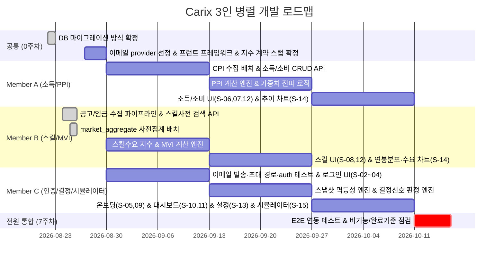
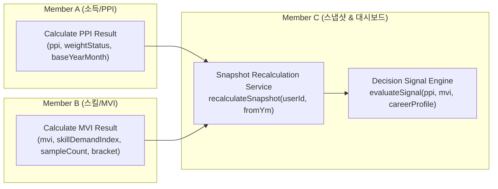

# Carix MVP 개발 계획서 (3인 도메인 수직 분업)

본 계획서는 3명의 풀스택 개발자가 각자의 핵심 가치 사슬(Value Stream)을 전담하여 **프론트엔드(UI)부터 백엔드(API/알고리즘), 데이터 수집/DB까지 End-to-End로 병렬 개발**할 수 있도록 구성된 실행 계획입니다.

---

## 1. 3인 역할 분담 요약

| 담당자 | 담당 도메인 | 프론트엔드 (UI) | 백엔드 & 핵심 알고리즘 | 데이터 수집 & DB |
| :--- | :--- | :--- | :--- | :--- |
| **Member A** | **소득 & 구매력 분석 (PPI & Cost of Living)** | • `S-06` 소득 입력 • `S-07` 소비 6대 카테고리 입력 • `S-12` 소득·소비 이력 관리 • `S-14` **소득 vs 개인물가 추이 차트** | • **구매력 지수(PPI) 계산 엔진** (§4.3) • 소비 가중치 전파 로직 (`PROPAGATED`) • 소득/소비 이력 CRUD API • 기본 소비 가중치 관리 (`DEFAULT_CPI`) | • 통계청 CPI(소비자물가) 수집 파이프라인 • `income_history` • `expense_history`, `expense_item` • `cpi_observation` |
| **Member B** | **스킬 & 시장가치 분석 (MVI & Market Worth)** | • `S-08` 스킬 입력 & 자동완성 • `S-12` 스킬 이력 관리 • `S-14` **연봉 분포 5수치 핀 차트** • `S-14` **스킬 수요 추이 차트** | • **시장가치 지수(MVI) 계산 엔진** (§4.2) • **스킬 수요 지수** 계산 엔진 (§4.1) • 동료집단 완화 알고리즘 (N<10) • 스킬 검색/자동완성 API | • 채용공고 & KOSIS 임금 수집 파이프라인 • 표준 스킬 사전 정제 • `skill`, `skill_alias`, `user_skill` • `wage_stat_observation` • `market_aggregate` |
| **Member C** | **인증, 의사결정 & 시뮬레이터 (Auth, Decision & Action)** | • `S-01~04` 랜딩 & 매직링크 로그인 • `S-05, 09` 프로필 & 온보딩 검토 • `S-10` **대시보드 메인 (3대 카드 종합)** • `S-11` 월별 스냅샷 이력 • `S-13` 계정 설정/탈퇴 • `S-15` **12개월 커리어 시뮬레이터** | • **결정 신호(Rule Matrix) 판정 엔진** • **12개월 잔류 vs 이직 시뮬레이터** (US-S1) • **월별 스냅샷 멱등성 저장/재계산** (§4.4) • 매직링크 인증 & 세션 관리 (US-A1~2) • 계정/데이터 완전 삭제 (US-C2) | • `auth-service` 모듈 • **auth 스키마**(auth-service 소유·Flyway): `users`, `invitation`, `session`, `magic_link_token` • **core 스키마**(직접 DDL): `career_profile`, `index_snapshot`, `career_scenario` |

> 표기 정정 — 초안의 `cpi_monthly_index`는 실제 테이블명 `core.cpi_observation`으로 바로잡았다
> ([상세 기술 명세](../specs/technical-specification.md), `deploy/postgres/schema/03_reference_and_aggregate.sql`).
> 초안의 `index_calc_log`는 DDL·명세·ERD 어디에도 정의가 없어 제거했다. 지수 계산 감사 로그가
> 필요하면 테이블을 먼저 명세에 정의한 뒤 다시 올린다.

---

## 2. 담당자별 상세 개발 범위

### 🧑‍💻 Member A : 소득 & 구매력 분석 (PPI 도메인)
- **사용자 스토리**: `US-O3`(소득 입력), `US-O4`(소비 입력), `US-R1`(소득/소비 이력 관리), `US-D3`(소득 vs 물가 차트)
- **Frontend**:
  - `S-06` 소득 입력 화면 (세전 연봉, 유효 시작일, 월 실수령액)
  - `S-07` 소비 입력 화면 (6대 카테고리 금액 입력, 실지출/추정 뱃지 처리)
  - `S-12` 이력 관리 내 소득/소비 탭
  - `S-14` 추이분석 내 소득 지수선(`incomeIndex`) vs 개인물가 지수선(`personalPriceIndex`) 2계열 차트 및 **구매력 손실 음영** 렌더링
- **Backend & Data**:
  - `collector`: 통계청 CPI 지수 수집 배치 및 카테고리 매핑 파이프라인
  - `core-api`: 
    - `POST /income`, `PUT /income/{id}`, `PUT /expenses/{ym}` API
    - **개인소비자물가지수 & 구매력 지수(PPI) 산출 엔진** 구현
    - 소비 가중치 상태 관리 (`USER_DEFINED`, `PARTIALLY_ESTIMATED`, `PROPAGATED`, `DEFAULT_CPI`)
    - 과거 소비 수정에 따른 미래 가중치 전파 로직

---

### 🧑‍💻 Member B : 스킬 & 시장가치 분석 (MVI 도메인)
- **사용자 스토리**: `US-O5`(스킬 입력), `US-R1`(스킬 이력 관리), `US-D2`(데이터 상태 구분), `US-D3`(연봉 분포 & 스킬 수요 차트)
- **Frontend**:
  - `S-08` 스킬 입력 화면 (표준 사전 자동완성, 실무 사용 기간/최종 사용일, 중복 방지)
  - `S-12` 이력 관리 내 스킬 탭
  - `S-14` 추이분석 내 **연봉 분포 5수치(최소/25%/중앙/75%/최대) 핀 차트** 및 **스킬 수요 추이 차트**
  - 표본 부족(`N < 10`), 업데이트 지연 배지 UI 처리
- **Backend & Data**:
  - `collector`: 원천 채용공고 크롤링/수집, KOSIS 임금통계 수집 및 deduplication 파이프라인
  - 표준 스킬 사전 시드 데이터 구축 및 검색 API (`GET /skills/search`)
  - `core-api`:
    - `POST /user-skills`, `DELETE /user-skills/{id}` API
    - **스킬 수요 지수 산출 엔진** (최근 3개월 vs 이전 12개월, 클램프 [25, 400] 처리)
    - **시장가치 지수(MVI) 산출 엔진** 및 동료집단 완화 알고리즘 (직무/경력/지역/규모 단계별 완화)

---

### 🧑‍💻 Member C : 인증, 의사결정 & 시뮬레이터 (Auth & Decision 도메인)
- **사용자 스토리**: `US-A1~2`(인증), `US-O1~2, 6`(온보딩 오케스트레이션), `US-D1, D4`(대시보드 종합/이력), `US-S1`(시뮬레이터), `US-C1~2`(설정/탈퇴)
- **Frontend**:
  - `S-01` 랜딩, `S-02~04` 로그인/매직링크 발송/검증 화면
  - `S-05` 프로필 입력, `S-09` 온보딩 검토·완료 화면 (2초 디바운스 자동 저장 오케스트레이션)
  - `S-10` **대시보드 메인** (구매력 카드 + 시장가치 카드 + **결정 신호 카드** + 근거 아코디언)
  - `S-11` 월별 스냅샷 이력 타임라인
  - `S-13` 설정 및 계정/데이터 완전 삭제 화면
  - `S-15` **12개월 잔류 vs 이직 시뮬레이터** (실업급여 요건, 공백기, 인상률 기반 실시간 비교)
- **Backend & Data**:
  - `auth-service`: 이메일 provider 실발송 연동(`MagicLinkNotifier` 스텁 교체), 초대 이메일 등록 경로,
    발송/검증·세션·Rate Limit 테스트 코드
  - `core-api`:
    - `PATCH /onboarding`, `PATCH /profile`, `DELETE /users` API
    - **결정 신호(Decision Signal) 판정 엔진** (Rule Matrix: 잔류 권고/이직 준비/소득 방어 등)
    - **월별 스냅샷 멱등성 저장/재계산 엔진** (`index_snapshot` 버전 관리, `(userId, ym, dataVer, ruleVer)`)
    - 12개월 시뮬레이터 계산 API (`POST /scenarios/simulate`)

---

## 3. 주차별 병렬 개발 로드맵 (7주 스프린트)

> **기준일 2026-08-27.** 최초 작성(08-22) 이후 Member B 레인의 1~2주차 전량과
> 3~4주차 일부가 선행 완료돼 기준을 다시 잡았다. 아래 "선행 완료" 표가 로드맵에서
> 제외된 항목이다. 잔여 일정은 이 기준일부터 센다.

### 선행 완료 (로드맵 제외)

| 원래 위치 | 항목 | 완료 |
| :--- | :--- | :--- |
| C 0주차 | DB 마이그레이션 방식 통일 (auth=Flyway, core=직접 DDL) | 결정·문서화 완료 |
| B 1~2주차 | 채용공고/임금 수집 파이프라인 (`wage_stat_observation`, 원천 간 중복제거) | 2026-08-25 |
| B 1~2주차 | 표준 스킬 사전 정제 & 검색 API (`GET /skills/search`, user-skills CRUD) | 2026-08-24 |
| B 3~4주차 | 월별 시장 데이터 사전 집계 (`market_aggregate`) 배치 엔진 | 2026-08-25 |

| 주차 | Member A (소득 & PPI) | Member B (스킬 & MVI) | Member C (인증 & 결정 & 시뮬레이터) |
| :--- | :--- | :--- | :--- |
| **0주차 (사전정렬)** | • CPI 수집 스키마 확정 • 소득/소비 DDL 확정 | ~~• 공고/임금 통계 스키마 확정~~ (완료) ~~• 표준 스킬 사전 포맷 정의~~ (완료) | • 이메일 provider 선정 & 도메인 인증(SPF/DKIM) 착수 — 외부 리드타임이 있어 최우선 ~~• DB 마이그레이션 방식 통일~~ (완료 — auth=Flyway, core=직접 DDL) • **PPI/MVI 결과 계약 DTO + 스텁 확정** (§4-1, C의 3~4주차 선행조건) • 프론트엔드 라우팅/레이아웃/Theme 세팅 |
| **1~2주차 (인프라 & 파이프라인)** | • 통계청 CPI 수집 배치 개발 • `income_history`, `expense_*` CRUD API | ~~• 채용공고/임금 데이터 수집 파이프라인~~ (08-25 완료) ~~• 표준 스킬 사전 정제 & 검색 API~~ (08-24 완료) • collector Spring Batch 잡·내부 API·배포 배선 (§5) | • 이메일 provider 실발송 연동 (`MagicLinkNotifier` 스텁 교체 — 스텁은 원본 토큰을 로그에 남긴다) • 초대 이메일 등록 경로 — 없으면 Member A·B 도 로그인 검증을 못 한다 • `auth-service` 테스트 코드 (발송/검증·세션·Rate Limit) • 프런트엔드 `/api` 프록시 & `S-02~04` 서빙 방식 결정 (현재 `ssr: false` + `/` 프리렌더) • `S-02~04` 로그인·발송 안내·검증 UI • Gateway 세션 검증 필터 활성화 ([선행 조건](../README.md#진행-상태)) |
| **3~4주차 (핵심 계산 엔진)** | • **개인물가 & 구매력 지수(PPI) 계산 엔진** • 소비 가중치 전파(`PROPAGATED`) 로직 | • **스킬 수요 지수 & MVI 계산 엔진** • 동료집단 완화 알고리즘 (N<10 클램프) ~~• `market_aggregate` 사전집계 배치~~ (08-25 완료) | • **월별 스냅샷 멱등성 저장/재계산 엔진** • **결정 신호(Decision Signal) 판정 엔진** |
| **5~6주차 (UI & 시각화 완성)** | • `S-06, S-07` 소득/소비 온보딩 UI • `S-12` 소득/소비 이력 관리 UI • `S-14` **소득 vs 물가 추이 차트** | • `S-08` 스킬 입력 & 자동완성 UI • `S-12` 스킬 이력 관리 UI • `S-14` **연봉 분포 & 스킬 수요 차트** | • `S-05, S-09` 프로필/검토 온보딩 UI • `S-10, S-11` **대시보드 메인 & 이력 UI** • `S-13` 계정 삭제 & `S-15` **시뮬레이터 UI** |
| **7주차 (E2E 통합 검증)** | • PPI 엣지케이스(지연/결측) 검증 • 민감 소득 금액 로깅 마스킹 점검 | • MVI 표본부족(N<10) 엣지케이스 검증 • 실데이터 파이프라인 통합 점검 | • 온보딩 $\rightarrow$ 대시보드 $\rightarrow$ 시뮬레이터 E2E 점검 • 계정 삭제 시 개인 데이터 완전 삭제 검증 |

---

## 4. 도메인 간 연동 인터페이스 (계약)

1. **지수 산출 결과 계약 (A, B $\rightarrow$ C)**:
   - Member A는 특정 사용자의 월별 PPI 지수 및 가중치 상태 객체를 반환하는 서비스 인터페이스 제공
   - Member B는 특정 사용자의 월별 MVI 지수, 동료집단 완화 브래킷, 표본 수 객체를 반환하는 서비스 인터페이스 제공
2. **스냅샷 재계산 트리거 (A, B $\rightarrow$ C)**:
   - 사용자가 소득/소비(Member A) 또는 스킬(Member B)을 추가/수정/삭제했을 때, Member C의 `recalculateSnapshot(userId, fromYm)`을 호출하여 해당 시점 이후의 스냅샷을 멱등하게 갱신
3. **완료 기준 10개 항목 점검**:
   - 구현 완료 시 `functional-specification.md` §7의 MVP 완료 기준 10개 항목을 전원이 크로스 체크

---

## 5. 미배정 작업 (담당자 결정 필요)

아래 넷은 §1~§3 어느 담당자 칸에도 들어 있지 않지만, 각각 다른 담당자의 산출물을
선행 조건으로 막고 있다. 담당은 **제안**이며 확정 전이다.

| 작업 | 현재 상태 | 무엇을 막는가 | 제안 담당 |
| :--- | :--- | :--- | :--- |
| `collector` Spring Batch 잡 · 내부 API · `docker-compose.yml`/`deploy.yml` 배선 | 모듈 추출만 완료. 운영 배포 목록에 `collector` 없음 | Member B의 수집 파이프라인이 운영에서 실행되지 않는다 → A·B·C 전원이 실데이터 없이 개발 | Member B |
| 프런트엔드 SSR Phase 2 전환 (Express + `@react-router/express`) | `ssr: false` + `/` 사전 렌더링만. `frontend/server.js`는 정적 서버 | `/login`, `/auth/verify`, `/onboarding/*`, `/dashboard/*`, `/mypage/*` 전 화면. C 화면 10개 전부의 선행조건 | Member C (0~2주차) |
| `core-api` Security (세션 컨텍스트 주입) | 없음. 세션 검증은 게이트웨이 필터 전제이나 기본 비활성 | 모든 도메인 API의 `userId` 확보 경로. A·B·C 공통 | Member C (인증 소관) |
| 운영 DB 일일 백업 · 복구 절차 | 미구축. `DEVELOPMENT.md §3` 최우선 후속 과제 | 개발 DB = 운영 DB 구조라 실수 시 복구 수단이 없다 | 미정 |
