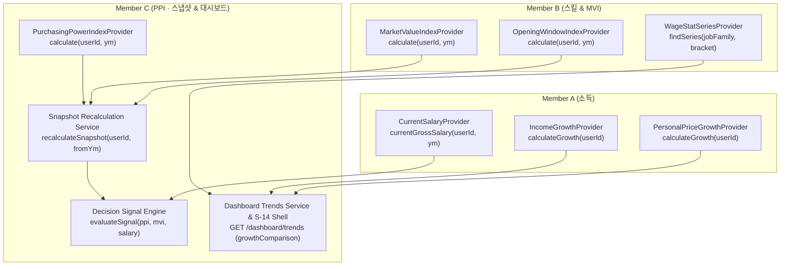

# Carix MVP 개발 계획서 (3인 도메인 수직 분업)

본 계획서는 3명의 풀스택 개발자가 각자의 핵심 가치 사슬(Value Stream)을 전담하여 **프론트엔드(UI)부터 백엔드(API/알고리즘), 데이터 수집/DB까지 End-to-End로 병렬 개발**할 수 있도록 구성된 실행 계획입니다.

> **표기 규약 — 이 계획서는 현재 배치만 적는다.**
>
> - 레인이 바뀌면 **옮긴 자리에 새로 적고 옛 자리는 지운다.** 누가 언제 무엇을 넘겼는지는
>   git 이력과 PR 이 갖는다. 계획서에 이관 흔적을 남기면 읽을 때마다 현재 배치와 옛 배치를
>   구별해야 한다.
> - 옮길 자리가 **없으면**(조건 미발생, 취소된 결정 등) 그냥 지운다. 취소 사유는 git 이력과
>   PR 이 갖는다.
> - 간트는 취소선을 못 쓴다. 완료는 `:done`, 주차 표는 완료분만 취소선으로 남긴다.
> - **이 계획서는 완료 목록을 갖지 않는다.** 무엇이 끝났고 무엇이 남았는지는
>   [`docs/README.md` 「진행 상태」](../README.md#진행-상태)가 소관이다. 여기는 간트의 `:done`
>   과 주차 표의 취소선으로 레인별 선후만 표시한다.

---

## 1. 3인 역할 분담

| 담당자 | 도메인 | 사용자 스토리 | 프론트엔드 (UI) | 백엔드 & 핵심 알고리즘 | 데이터 수집 & DB |
| :--- | :--- | :--- | :--- | :--- | :--- |
| **Member A** | **소득 & 구매력 (PPI & Cost of Living)** | `US-O3` 소득 입력(API 만) `US-O4` 소비 입력(API 만) `US-R1` 이력(API 만) `US-D3` 소득vs물가(데이터만) `US-D8` 상승률 엔진 | 없음 — 소득/소비 도메인의 화면은 C·B 가 낸다 _(근거는 아래 각주)_ | • 소득/소비 이력 CRUD API — `S-12` 탭이 쓴다 • **내 소득 상승률 산출 로직** (`US-D8`, 관문 2) — `IncomeGrowthProvider` • **임금 상승률 vs 개인물가 지표 엔진** (`US-D8`, 관문 2) — `PersonalPriceGrowthProvider` • ~~연봉 암호화 키·복호화 경계 ([SECURITY §3.2](../SECURITY.md))~~ — 완료 | • 통계청 CPI 수집 파이프라인 • `income_history` — `change_reason` 컬럼은 C • `expense_history`, `expense_item` • `cpi_observation` |
| **Member B** | **스킬 & 시장가치 (MVI & Market Worth)** | `US-O5` 스킬 입력 `US-D2` 데이터 상태 `US-D3` 분포·수요 차트 `US-D4` `S-11` 화면 `US-D8` 임금 시계열 `US-C1~2` `S-13` 화면 `US-M1` `S-16` | • `S-08` 스킬 입력 & 자동완성 • `S-11`·`S-13` — C 레인 부하 분산분. 쓰는 API 는 C 소유 • `S-14` **차트 3종 컴포넌트** — 연봉분포·수요·**소득vs물가**. 셸은 C • `S-10` **채용 활발도(OWI) 카드** — 셸은 C. 카드 자체는 `c6` 에서 이미 섰고 산출기 `b6`·`b22` 가 값을 채운다 • `S-10` **1층 판정 히어로 처방 블록** — 스킬 보강 처방 및 신호별 추천 노출 (`US-D6`). 셸은 C • `S-16` 관리자 파이프라인 콘솔 • `S-18` **스킬 분석** (관문 2) — 보유 스킬 수요와 동료집단 추천 스킬을 한 화면에 모은다. `S-14` 스킬 수요 섹션을 옮겨 온다 | • **시장가치 지수(MVI) 엔진** (기능 명세 §4.2) • **스킬 수요 지수** 엔진 (기능 명세 §4.1) • 동료집단 완화 (N<10) 및 표본부족 엣지케이스 검증 • 스킬 검색/자동완성 API • `GET /dashboard/salary-distribution` — 제시 연봉 추이·경력 사다리 포함 (기능 명세 §4.6) • 임금통계 출처 노출 & **연도 시계열 읽기 경로** (`US-D8`, `WageStatSeriesProvider`) • **채용 활발도(OWI) 엔진** (`OpeningWindowIndexProvider`, 기능 명세 §4.5) • `GET /skills/recommendations` — 스킬 보강 처방 (`US-D6`) | • 채용공고 & KOSIS 임금 수집 • 표준 스킬 사전 정제 • `skill`, `skill_alias`, `user_skill` • `wage_stat_observation` • `market_aggregate` |
| **Member C** | **인증 · 의사결정 · 시뮬레이터 (Auth, Decision & Action)** | `US-A1~2` 인증 `US-O1~2, 6` 온보딩 `US-D1` 대시보드 `US-D3` `S-14` 셸 `US-D8` 상승률 탭·차트 `US-R1` `S-12` 화면 `US-S1` 시뮬레이터 | • `S-01~03` 랜딩·로그인·가입 • **온보딩 4화면** `S-05`·`S-06`·`S-07`·`S-09` (`S-08` 은 B) • `S-10` **대시보드 메인** — 1층 판정 히어로·3층 신뢰와 2층 근거 지표 카드 셋 중 둘. **OWI 카드와 처방 블록은 B** • `S-12` **이력 관리 화면 전체** (API 는 A·B) • `S-14` **추이분석 셸 & 상승률 비교 탭 차트** (`US-D8`) • `S-15` **12개월 시뮬레이터** | • **결정 신호(Rule Matrix) 엔진** • **구매력 지수(PPI) 본 엔진** (기능 명세 §4.3, `a2`) — 소비 가중치 전파(`PROPAGATED`)·PPI 엣지케이스 포함. 전파 소급·복호화 경계 실환경 점검은 `a12` • **민감 금액 로깅 마스킹 감사** (완료 기준 10, `a7`) — 전 레인 경로를 가로지른다. 금액이 지나는 경로(시뮬레이터 본문·스냅샷 복호화·소득 API)가 대부분 C 것이다 • 협상 목표 인상률 (`US-D7`) • **12개월 잔류vs이직 시뮬레이터** (저장 목록 복원 포함, `US-S1`) • **월별 스냅샷 멱등성 저장/재계산** (Job 4 전담, 기능 명세 §4.4) • 회원가입·로그인, 계정 완전 삭제 • `GET /dashboard/summary`·`/trends`·`/history` — OWI 및 임금vs물가 확장 포함 ([API 규격 §5.1·§5.3·§5.4](../specs/api-specification.md)) • **상승률 비교 API 합성** (`US-D8`, A·B의 Provider 주입) • `income_history.change_reason` 컬럼 & API — 잔류·이직 판별 (`US-O3`) • 기본 소비 가중치 (`DEFAULT_CPI`) 및 `GET /expenses/applied` (`US-O6`) • 물가 기여도 1위 품목 (`US-D1` 뱃지) | • `auth-service` 모듈 • **세션 게이트** ([`backend/README.md`](../../backend/README.md), 3레인 공통 선행) • **auth 스키마**(Flyway): `users`, `session`, `rate_limit_bucket` • **core 스키마**(직접 DDL): `career_profile`, `index_snapshot`(OWI 컬럼 포함), `career_scenario` |

### 1.1 도메인 및 화면 소유권 원칙

- **화면 셸 및 합성 API 단일 소유**: 공통 화면인 `S-12`(이력 관리) 및 `S-14`(추이 분석) 셸과 합성 API는 Member C가 전담 소유하며, Member A·B는 내부 탭 및 차트 컴포넌트를 공급합니다.
- **온보딩 화면 통합**: 온보딩 4개 화면(`S-05`, `S-06`, `S-07`, `S-09`)은 Member C가 단일 소유하며, `S-08`(스킬)만 Member B가 담당합니다.
- **화면-API 교차 배정**: `S-11`(스냅샷 이력)·`S-13`(설정)은 C 레인 병목 완화를 위해 API는 Member C, UI는 Member B가 전담합니다.
- **지수 엔진 배선**:
  - **PPI 본 엔진(`a2`)**: 스냅샷 재계산 및 결정 신호의 직접 소비자인 Member C가 구현합니다.
  - **OWI 산출기(`b6`) 및 스킬 추천(`b9`)**: 공고 집계 및 동료집단 완화 알고리즘을 소유한 Member B가 전담하며, Member C는 대시보드 셸 컴포넌트로 수용합니다.
- **인수 조건 검증 책임**: UI를 직접 구현하지 않는 Member A의 스토리(`US-O3`, `US-O4`, `US-D3`)는 Member A가 인수 조건을 검증하고 구현은 Member C·B가 수행합니다.

**절 번호는 밖에서 불린다.** 저장소 스물일곱 곳이 이 문서의 절을 번호로 가리킨다 — `§4`(MVP
범위 판정) 열다섯(코드 열: `DashboardController` 여덟, `SnapshotReadServiceTest`,
`auth-service` 의 `OnboardingController` / 문서 다섯), `§2`(로드맵) 여덟, `§1` 둘,
`§3` 둘. **절을 더하거나 뺄 때는 뒤에 붙이거나 인용 스물일곱을 같이 고친다** — 번호를 당기면
인용이 통째로 어긋난다.

---

## 2. 주차별 개발 로드맵 (13주 · 베타 관문 2단계)

> **로드맵 관리 원칙**
>
> - **관문 2단계 체제**:
>   - **관문 1 (비공개 베타)**: 기능 명세 §7 10대 완료 기준 및 핵심 질문 검증에 직결된 블록 (`c9`, `b20`, `a7` 등).
>   - **관문 2 (베타 이후)**: `US-D8` 상승률 비교(`a9`, `a10`, `c14`) 및 시뮬레이션 사후 검증(`c20`, `c21`).
> - **임계 경로 및 일정 단축**:
>   - 관문 1의 임계 경로는 Member C의 `a7`(민감 금액 로깅 감사, 92일차)입니다.
>   - Member B는 관문 1 조기 완료(89일차) 후, 관문 2의 고도화 과제(`b14`, `b19`, `b22~b25`)를 102일차까지 앞당겨 완료했습니다.
> - **레인 및 블록 관리**:
>   - 동일 레인의 작업은 순차 사슬로 연결하며, 레인 간 의존성은 SPI 인터페이스 뒤로 격리합니다.
>   - 부분 완료 작업은 `b8a`, `c0a`와 같이 접미사 블록으로 분할하여 간트의 `:done` 및 주차 표 취소선과 1:1로 동기화합니다.

```mermaid
gantt
    title Carix 3인 병렬 개발 로드맵
    dateFormat X
    axisFormat %s
    section 공통 (0주차)
    DB 마이그레이션 방식 확정 :done, c0a, 0, 1s
    임금통계 기준선 데이터 확보 :done, a0, 3, 3s
    스냅샷 Job4 core-api 전담 결정 :done, i0, 7, 1s
    미배정 API 범위 결정 :done, c0, 7, 2s
    section Member A (소득/PPI)
    CPI 수집 파이프라인 & 소득/소비 CRUD API :done, a1, 12, 3s
    section Member B (스킬/MVI)
    공고/임금 수집 파이프라인 & 스킬사전 검색 API :done, b1, 2, 2s
    market_aggregate 사전집계 파이프라인 :done, b2a, 3, 1s
    collector 관리자 구동 연동·배포 배선(5-C) :done, b0, 7, 5s
    스킬수요 지수 & MVI 계산 엔진 :done, b2, 8, 4s
    S-16 관리자 파이프라인 콘솔(US-M1) :done, b16, 14, 1s
    salary-distribution API — 원 공고 직접 집계 :done, b3a, 15, 1s
    스킬 UI(S-08) & 차트 3종(연봉분포·수요·소득vs물가) :done, b3, after b3a, 10s
    스냅샷 이력(S-11) & 설정·탈퇴(S-13) UI :done, b4, after b3, 7s
    추이분석(S-14) 화면 셸 :done, b4a, after b4, 1s
    개방창 집계 & OWI Provider :done, b6, after b4, 6s
    브래킷 6구간 정합·연차 해상도 & 라우트 별칭 정리 :done, b7, after b6, 4s
    제시 연봉 추이(US-D3·§4.6) :done, b10, after b7, 3s
    market_aggregate 연봉 5수치 제거 :done, b11, after b10, 1s
    임금통계 출처 노출 & 연도 시계열 읽기 경로 :done, b13, after b11, 2s
    market_aggregate 기준월 필터 — MVI 100 고정 해소 :done, b18, after b13, 3s
    경력 사다리 & 기준선 출처 표기(§4.7) :done, b12, after b18, 2s
    MVI 임계값 외부화 :done, b8, after b12, 3s
    MVI 표본부족(N<10) 엣지케이스 검증 :done, b8a, after b8, 3s
    MVI 시장 데이터 수집 우선순위 산출 :done, b8b, after b8a, 3s
    스킬 보강 추천 API & 동시출현 근거(US-D6) :done, b9, after b8b, 3s
    S-10 1층 판정 히어로 처방 블록 — 스킬 보강 처방 노출 :done, b15, after b9, 1s
    S-10 처방 블록 문구 객관화 & 신호별 확장 정합 :done, b20, 83, 1s
    산출기 팬아웃 커넥션 예산 — 읽기 전용 풀 분리 :done, b17, after b20, 3s
    월별 크롤링 규모 고정 & 수요율 유량 정의 정합 :done, b21, after b17, 2s
    경력 사다리 연도 축(관문 2) :done, b14, after b21, 2s
    S-18 스킬 분석 화면(관문 2) :done, b19, after b14, 2s
    OWI 재정의 — 동료집단 채용 비중 추이(관문 2) :done, b22, after b19, 2s
    수요 상승률 기준 스킬 추천(관문 2) :done, b23, after b22, 2s
    경력별 실측 임금 원천 조사(관문 2) :done, b24, after b23, 2s
    동료집단 차원 집계 — 지역·규모·고용형태(관문 2) :done, b25, after b24, 3s
    section Member C (인증/결정/시뮬레이터)
    세션 게이트 배선 — Gateway 필터 + core-api X-User-Id 주입 :done, c0b, 7, 4s
    스냅샷 멱등성 엔진(Job 4) & 결정신호 판정 엔진 :done, c2, 8, 4s
    온보딩 4화면(S-05~S-07·S-09) & 대시보드(S-10) & 시뮬레이터 UI(S-15) :done, c3, after c2, 18s
    dashboard summary·trends·history 실데이터 전환 :done, c4a, 15, 1s
    이력관리(S-12) 화면 — S-14 셸은 B 납품분으로 빠짐 :done, c4, after c3, 6s
    OWI 스냅샷 컬럼 & 대시보드 3 API 확장 :done, c6, after c4, 4s
    스냅샷 쓰기 잔여 점검 — 자문 잠금·MVI 0 행 :done, c5, after c6, 3s
    소득 변경 사유(change_reason) 컬럼 & API :done, c10, after c5, 2s
    게이트웨이 DNS 캐시 상한 :done, c7, after c10, 1s
    S-12 소득 표 가로 스크롤 :done, c13, after c7, 1s
    세션 만료 리다이렉트 — dashboardMarketApi coreApi 전환 :done, c16, after c13, 1s
    적용된 소비 금액·가중치 API(US-O6) :done, c11, after c16, 1s
    S-09 검토 화면 — 적용 금액·가중치 노출(US-O6) :done, c17, after c11, 1s
    S-10 판정 우선 개편 — 판정·근거·신뢰 3층 :done, c15, after ui3, 3s
    물가 기여도 1위 품목(US-D1 뱃지) :done, c12, after c15, 1s
    MVI 동료집단 비교 조건 정합 — 실제 조회 조건 표시 :done, c22, after c12, 1s
    시장가치 없는 부분 판정 — 규칙 1.1.0 :done, c23, after c22, 1s
    과거 공고 표본 백필 & 잡코리아 직무군 규칙 통일 :done, c24, after c23, 2s
    관리자 데이터 상태 점검 :done, c25, after c24, 2s
    관리자 수집 데이터 탐색(1단계) :done, c26, after c25, 2s
    공고 연봉 공개 구분 :done, c27, after c26, 2s
    공개 연봉 10건 표본 규칙 :done, c28, after c27, 1s
    점핏 사람인 공고 보강 & 결합 가중치 상한 :done, c29, after c28, 2s
    원티드 공고 원천(2단계) — 정기 수집·표본 백필 :done, c30, after c29, 3s
    원티드·점핏 지수 편입 & 원천별 측정 프레임 :done, c32, after c30, 2s
    관리자 수집 데이터 화면 개편 — 점검 줄·월별 현황·탭 정리 :done, c31, after c26, 2s
    저장 시나리오 목록 & S-15 복원(US-S1) :done, c9, 83, 2s
    PPI 본 엔진 & 가중치 전파(PROPAGATED) & 엣지케이스 :done, a2, after c23, 2s
    소비 전파 소급 & 복호화 경계 실환경 점검 :done, a12, after a2 c9, 3s
    민감 금액 로깅 마스킹 감사(완료 기준 10) :done, a7, after a12, 4s
    협상 목표 인상률(US-D7) :done, c8, after a7, 2s
    S-15 한 화면 비교 — 지금 회사·오퍼 나란히 :done, c33, after c8, 2s
    section UI 일관성 통일 (C 레인)
    P0 — 결정신호 단일화 & 시각회귀 베이스라인 :done, ui0, 33, 2s
    P1 — 다크 변형(custom-variant) & carix-action 토큰 :done, ui1, after ui0, 2s
    P2 — 공용 표현 계층 & 어휘 계약 :done, ui2, after ui1, 2s
    P3~P4 — 프리미티브 재정의·규범 :done, ui3, after c11, 6s
    section 전원 통합 (13주차 · 관문 1)
    E2E 연동 테스트 & 비기능/완료기준 점검 :crit, e2e, after b21 a7, 5s
```

> **가로축은 달력이 아니라 착수 기준 일차(日次)다.** 눈금 `0`·`5`·`10` 은 첫 블록 착수로부터
> 며칠째인지를 뜻한다. 날짜를 쓰지 않으려고 `dateFormat X` 상대 축을 쓰므로 블록 길이의
> 단위 기호가 `s` 로 적히지만 **한 칸은 하루다** — `14s` 는 14일이다.

| 주차·관문 | Member A (소득 & PPI) | Member B (스킬 & MVI) | Member C (인증 & 결정 & 시뮬레이터) |
| :--- | :--- | :--- | :--- |
| **0주차** 사전정렬 | 완료 | 완료 | 완료 |
| **1~2주차** 인프라 & 파이프라인 | ~~`a1` CPI 수집 · 소득/소비 CRUD~~ | 완료 | 완료 |
| **3~4주차** 핵심 계산 엔진 | ~~연봉 암호화 키 로테이션·복호화 경계~~ | ~~동료집단 완화(`N<10`)~~ ~~`S-08` 스킬 입력 UI~~ ~~`S-14` 차트 3종~~ ~~`S-11` 스냅샷 이력 UI~~ ~~`S-13` 설정·계정 삭제 UI~~ | ~~온보딩 4화면~~ ~~`S-10` 대시보드~~ ~~`S-15` 시뮬레이터 UI~~ ~~온보딩 단계 갱신 API~~ |
| **5~6주차** 지표 확장 1 | — | ~~`b6` OWI 집계·Provider~~ ~~집계월 분포 확인~~ ~~`b7` 브래킷 6구간·라우트 별칭~~ | ~~`c4` `S-12` 이력 관리~~ ~~`c6` OWI 스냅샷 컬럼·3 API~~ |
| **7주차** 지표 확장 2 | — | ~~`b10` 제시 연봉 추이~~ ~~`b11` 연봉 5수치 제거~~ ~~`b13` 임금통계 출처·연도 시계열~~ | ~~`c16` 세션 만료 리다이렉트~~ ~~`c5` 스냅샷 쓰기 잔여 점검~~ ~~`c10` 소득 변경 사유~~ ~~`c7` 게이트웨이 DNS 캐시~~ ~~`c13` 소득 표 가로 스크롤~~ |
| **8주차** 처방 · 정합 | — | ~~`b18` 기준월 필터~~ ~~`b12` 경력 사다리·출처 표기~~ ~~`b8` MVI 임계값 외부화~~ ~~`b8a` 표본부족 엣지케이스~~ ~~`b8b` 수집 우선순위 산출~~ ~~`b9` 스킬 보강 추천 API~~ ~~`b15` 처방 블록~~ ~~KOSIS 커버리지·드리프트~~ | ~~`c11` 적용 소비 금액 API~~ ~~`c17` `S-09` 적용 금액 노출~~ ~~`ui3` UI 일관성 P3·P4~~ ~~`c15` `S-10` 판정 우선 개편~~ ~~`c12` 물가 기여도 1위 뱃지~~ |
| **9주차** 관문 1 | — | ~~`b20` 처방 문구 객관화~~ ~~`b17` 팬아웃 커넥션 예산~~ | ~~`c23` 부분 판정(1.1.0)~~ ~~`c22` 동료집단 조건 정합~~ ~~`c24` 과거 공고 표본 백필~~ ~~`c25` 데이터 상태 점검~~ ~~`c26` 수집 데이터 탐색~~ ~~`c27` 연봉 공개 구분~~ ~~`c28` 공개 연봉 10건 규칙~~ ~~`c29` 점핏 보강·가중치 상한~~ ~~`c30` 원티드 원천 2단계~~ ~~`c32` 지수 편입·측정 프레임~~ ~~`c31` 수집 데이터 화면 개편~~ ~~`c9` 저장 시나리오 & `S-15` 복원~~ ~~`a2` PPI 본 엔진~~ |
| **10주차** 관문 1 · B 관문 2 당김 | — | ~~`b21` 크롤링 규모 고정·유량 정합~~ ~~`b14` 경력 사다리 연도 축~~ | — |
| **11주차** 관문 1 · B 관문 2 당김 | — | ~~`b19` `S-18` 스킬 분석~~ | ~~`a12` 소비 전파 소급·복호화 점검~~ |
| **12주차** 관문 1 · B 관문 2 당김 | — | ~~`b22` OWI 재정의~~ ~~`b23` 상승률 기준 추천~~ ~~`b24` 실측 임금 원천 조사~~ ~~`b25` 동료집단 차원 집계~~ | ~~`a7` 민감 금액 로깅 감사~~ ~~`c8` 협상 목표 인상률~~ |
| **13주차** 관문 1 통합 · E2E | — | 실데이터 파이프라인 통합 점검 | ~~`c33` `S-15` 한 화면 비교~~ E2E · 계정 삭제 · 완료 기준 점검 |
| **14주차 이후** 관문 2 | `a9` 내 소득 상승률 `a10` 임금 vs 개인물가 | — | `c14` 상승률 비교 API·차트 `c20` 결정 신호 시점 근거 `c21` 시나리오 사후 검증 |

> - **관문 2 배치 근거**: `US-D8` 상승률 비교 묶음(`a9`, `a10`, `c14`)은 관문 1 완료 기준 외 항목이며 PPI 본 엔진(`a2`) 배선 이후 유효합니다.
> - **보안 준수 불변식 (완료 기준 10)**: 시나리오 평가/저장 요청 본문(`currentGrossOverride` 등) 및 스냅샷 복호화 등 전 경로에서 금액 평문 로깅을 엄격히 금지합니다.

### 남은 블록 상세

**Member B**

- **13주차** — 실데이터 파이프라인 통합 점검

**Member C**

- **13주차** — 온보딩 → 대시보드 → 시뮬레이터 E2E 점검 · 계정 삭제 시 개인 데이터 완전 삭제 검증 · 기능 명세 §7 완료 기준 10항목 크로스 체크

**관문 2 (14주차 이후)**

- **`a9` 내 소득 상승률 산출 로직** (A, `US-D8`)
- **`a10` 임금 상승률 vs 개인물가 지표 엔진** (A, `US-D8`) — `a2` 확장
- **`c14` 상승률 비교 API 합성 & `S-14` 차트** (C, `US-D8`) — 선행 `a9`·`a10`·`b13`
- **`c20` 결정 신호 시점 근거** (C) — 이직 탐색·협상 검토 판정에 동료집단 **채용 비중 추이**(`b22`)를 근거 문구로 붙인다(예: 「내 동료집단 공고 비중이 이전 12개월보다 늘었다」). 독립 카드·새 지수가 아니라 판정 근거 하나로 들여 「두 지수 + 결정 신호」 구성을 지킨다. 관측 사실만 적고 인과(「협상력」)를 주장하지 않는다. 표본·이력이 모자라면 문구를 생략하고, 판정 강도 조건으로 올리는 것은 아래 사후 검증 뒤다. 선행 `b22`
- **`c21` 시나리오 예측의 사후 검증** (C) — `career_scenario` 의 12개월 예측을 같은 기간 실제 소득(`income_history`)과 맞댄다. 맞댈 상대는 `index_snapshot` 이 아니다 — 예측은 원화 보상이고 스냅샷은 지수·신호다. 잔류·이직 중 어느 예측을 검증할지는 `change_reason`(`c10`)이 가른다. 12개월이 지나지 않은 예측은 「검증 대기 (N개월 남음)」으로 두고, `c10` 이전 소득 행은 판별 불가로 남는다

<b>완료 블록 상세</b> (펼치기)

**공통 · Member A**

- **0주차 C** — 세션 게이트 플래그 전환 완료 (`carix.gateway.session-validation.enabled: true`)
- **`a1`** — 통계청 CPI 수집 파이프라인 및 소득/소비 CRUD API 구축
- **보안** — 연봉 암호화 키 로테이션 및 스냅샷 복호화 경계 분리 완료 (SECURITY §3.2)
- **`a2` PPI 본 엔진** — 카테고리 CPI 전월비 및 가계 소비 가중치 기반 누적 개인물가 및 구매력 지수 엔진 구현
- **`a7` 민감 금액 로깅 마스킹 감사** — 요청 본문, 예외 응답, DTO toString, SQL 바인드 전 경로 금액 평문 비노출 검증 (완료 기준 10)
- **`a12` 소비 전파 소급 & 복호화 점검** — 과거 소비 수정 시 이후 스냅샷 소급 재계산 보장 및 기동 시 키 재암호화 점검/조건부 갱신 안정화

**Member B**

- **3~4주차** — 동료집단 완화 알고리즘(`N<10`), 스킬 입력 UI(`S-08`), 차트 3종(`S-14`), 스냅샷 이력(`S-11`), 설정/탈퇴(`S-13`) UI
- **`b6` OWI 집계·Provider** — 개방창 지수 집계, 완화 알고리즘 및 SPI Provider 구현
- **`b7` 경력 브래킷 6구간 정합** — KOSIS 기준선과 호환되는 6구간 연차 매핑 및 라우트 별칭 정리
- **`b10` 제시 연봉 추이** — 채용공고 실측 제시 연봉 통계 집계 및 표본 노출
- **`b11` market_aggregate 정비** — 집계 테이블 내 불필요한 연봉 5수치 컬럼 제거 및 스키마 경량화
- **`b12` 경력 사다리 & 기준선 출처 표기** — 연봉 분포 화면에 `careerLadder` 및 KOSIS 기준선 출처 메타데이터 연동
- **`b13` 임금통계 출처 노출 & 연도 시계열** — `wage_stat_observation` 테이블 소유권 원복 및 다년도 시계열 조회 경로 구축
- **`b14` 경력 사다리 연도 축** — 연도별 임금 기준선 선택 및 연도 축 전환 UI/API 구현 (`US-D8`)
- **`b15` 처방 블록 컴포넌트** — `S-10` 대시보드 1층 판정 히어로 내 스킬 보강 처방 블록 구현
- **`b17` 산출기 팬아웃 커넥션 예산** — 가상 스레드 팬아웃용 읽기 전용 풀(`CarixReadOnlyPool`) 분리로 쓰기 트랜잭션 락 경합 해소
- **`b18` market_aggregate 기준월 필터** — 활동월(`firstSeenMonth`~`lastSeenMonth`) 기준 귀속 필터링 적용으로 월별 지수 왜곡 해소
- **`b19` `S-18` 스킬 분석 화면** — 보유 스킬 수요와 동료집단 추천 스킬을 통합한 전용 분석 대시보드 구축 (`US-D9`)
- **`b20` 처방 블록 문구 객관화** — 자의적 인과 주장을 배제하고 시장 수요 사실 중심의 객관적 추천 문구로 정합
- **`b21` 크롤링 규모 고정 & 유량 정의 정합** — 월별 크롤링 규모 표준화 및 신규 수집 공고(유량) 기준 수요율 정합
- **`b22` OWI 재정의** — 개방일수 대신 동료집단 채용 비중 추이(최근 3개월 대 이전 12개월)로 지표 재정의
- **`b23` 수요 상승률 기준 스킬 추천** — 최근 3개월 대 12개월 성장률(수요 지수 > 100.0) 우선 정렬 및 표본 부족 시 점유율 폴백 구현
- **`b24` 실측 임금 원천 조사** — 현행 KOSIS 24등급 보간 모델 유지 확정 및 3중 안전장치(투명 고지, 부분 평가 격리, 실측 연봉 병행 노출) 정식화
- **`b25` 동료집단 다차원 집계** — 정확 일치 JPQL 쿼리, 17개 표준 시도 코드 정규화, 직무×경력×지역×고용형태×규모 다차원 롤업 구현

**Member C**

- **3~4주차** — 온보딩 4화면(`S-05~07, 09`), 대시보드 메인(`S-10`), 시뮬레이터 UI(`S-15`) 및 온보딩 API
- **`c4` 이력 관리 UI** — `S-12` 소득/소비/스킬 이력 관리 화면 전체 구축
- **`c5` 스냅샷 쓰기 직렬화** — 동일 초 동시 요청에 대한 스냅샷 시퀀스 정합성 보장
- **`c6` OWI 스냅샷 연동** — 스냅샷 엔티티 OWI 컬럼 추가 및 대시보드 요약/추이/이력 API 확장
- **`c7` 게이트웨이 DNS 캐시 상한** — Netty 리졸버 TTL(30초) 설정으로 컨테이너 재생성 시 구 IP 참조 방지
- **`c8` 협상 목표 인상률** — 판정 히어로 내 임금통계 중앙값, 피어 p75, 물가 상승분 기반 목표 인상률 노출 (`US-D7`)
- **`c9` 시뮬레이터 시나리오 저장/복원** — 시나리오 저장 목록 조회 및 폼 입력 복원 기능 구현 (`US-S1`)
- **`c10` 소득 변경 사유 컬럼 & API** — 잔류·이직 판별을 위한 `change_reason` 필드 도입 및 선택 컨트롤 연동
- **`c11` & `c17` 적용 소비 금액 API 및 화면 노출** — 가계동향 평균 대신 실제 적용된 소비 금액/가중치 노출 (`GET /expenses/applied`)
- **`c12` 물가 기여도 1위 품목 뱃지** — 전년비 물가 상승 기여도 1위 품목 산출 및 대시보드 뱃지 연동
- **`c13` 소득 표 가로 스크롤 정비** — 다열 구성에 따른 반응형 레이아웃 정비
- **`c15` 대시보드 판정 우선 개편** — 판정(1층)·근거(2층)·신뢰(3층) 레이아웃 개편
- **`c16` 세션 만료 처리** — 401 Unauthorized 발생 시 로그인 페이지 자동 리다이렉트
- **`c22` MVI 동료집단 비교 조건 정합** — 전국/경력전체/무관 등 실제 DB 질의 조건과 화면 비교 문구 완전 일치화
- **`c23` 시장가치 없는 부분 판정** — 15개월 수집 이력 미달 시 연봉 격차 중심의 안전한 부분 판정(규칙 버전 1.1.0) 격리
- **`c24` 과거 공고 표본 백필 & 직무군 통일** — MVI 이전 12개월 표본(월 200건) 백필 및 IT 직무 분류 기준 일원화
- **`c25` & `c26` & `c31` 관리자 콘솔 개편** — 데이터 상태 헬스체크(`S-20`), 공고·CPI·임금통계 탐색 탭 구축
- **`c27` 공고 연봉 공개/비공개 구분** — 급여 텍스트 분석 기반 공개 연봉과 비공개 검색 구간 분리 및 전수 재판정
- **`c28` 공개 연봉 10건 표본 규칙** — 동료집단 공고 및 공개 연봉 10건 이상 충족 시에만 분포/시뮬레이션 노출 규범화
- **`c29` & `c30` & `c32` 원천 확장 (점핏/원티드)** — 점핏/원티드 공고 수집, 다원천 표본 가중 결합 및 측정 프레임 분리
- **`c33` 시뮬레이터 한 화면 비교** — `S-15` 를 단계 없이 지금 회사·새 회사 오퍼 카드를 나란히 두고 아래에 누적 차이·첫해 내역으로 비교, 결과 배지는 화면에서 제외 (`US-S1`)
- **`ui3` UI 일관성 통일** — 디자인 시스템 가이드라인에 맞춘 전 화면 컴포넌트 규격화

---

## 3. 레인 간 인터페이스 계약 (확정 & 스텁)

1. **지수 산출 결과 계약 (A, B $\rightarrow$ C)** (`core-api` SPI 인터페이스):
   - **PPI**: `PurchasingPowerIndexProvider.calculate(userId, baseYearMonth)` (Member C 구현) $\rightarrow$ `PpiResult`(지수값, 상태, 소비 가중치 출처, 기준월, 원천 기준일) 반환
   - **MVI**: `MarketValueIndexProvider.calculate(userId, baseYearMonth)` (Member B 구현) $\rightarrow$ `MviResult`(지수값, 상태, 원천별 완화 단계·표본 수, 제외 스킬/사유, 기준선, 집계일) 반환
   - **현재 세전 연봉**: `CurrentSalaryProvider.currentGrossSalary(userId, baseYearMonth)` (Member A 구현) $\rightarrow$ 결정 신호 분모용 세전 연봉 반환 (복호화 경계 유지, 평문 로깅 방지)
   - **OWI**: `OpeningWindowIndexProvider.calculate(userId, baseYearMonth)` (Member B 구현) $\rightarrow$ `OwiResult`(지수값, 상태, 최근 3M/이전 12M 동료집단 표본 수 및 비중, 완화 조건) 반환 (`skill_id IS NULL` 기준)
   - 계산 불가는 예외가 아닌 `IndexStatus` Enum(`NOT_AVAILABLE`, `INSUFFICIENT_DATA` 등)과 `null` 값으로 안전하게 반환

2. **스냅샷 재계산 트리거 (A, B $\rightarrow$ C)**:
   - 사용자 소득/소비/스킬/프로필 변경 시 `SnapshotRecalculationService.recalculateSnapshot(userId, fromYearMonth)` 호출
   - 트랜잭션 내 동기 직접 호출 방식이며, `pg_advisory_xact_lock` 및 `data_version`을 통해 멱등성 보장

3. **스냅샷 갱신(Job 4) 주체**:
   - `core-api`가 스냅샷 계산/갱신 엔진을 전담 소유하며, `collector`는 `market_aggregate` 집계까지만 수행

4. **크로스 레인 연동**:
   - **시뮬레이터 실현 가능성(`feasibility`)**: Member B의 동료집단 공고 분포 직접 집계를 Member C 화면(`S-15`)에 연동
   - **연봉 분포 API(`GET /dashboard/salary-distribution`)**: 공고 직접 집계 및 동료집단 완화를 소유한 Member B가 전담

5. **상승률 비교 SPI 디커플링 (`US-D8`)**:
   - Member A: `IncomeGrowthProvider`(소득 상승률), `PersonalPriceGrowthProvider`(개인물가 상승률)
   - Member B: `WageStatSeriesProvider`(공식 임금통계 연도 시계열)
   - Member C: 두 레인의 Provider를 주입받아 대시보드 `trends` API 및 `S-14` 비교 탭 차트(`c14`) 합성

6. **완료 기준 점검**:
   - 기능 명세 §7의 MVP 10대 완료 기준에 대해 전 레인 크로스 체크 수행

---

## 4. MVP 범위 판정과 이후 후보

기능 명세 인수 조건 및 화면 요구사항을 기준으로 MVP 범위 포함 여부를 판정하며, 판정이 완료된 항목은 정본 명세로 이관하고 미결 항목만 관리합니다.

### MVP 범위 밖 API 판정 현황

- **판별 원칙**: 사용자 화면의 인수 조건(Acceptance Criteria)이 해당 API 응답을 직접 요구하는지 여부를 기준으로 판정합니다.

- **판정 결과**:
  - **정식 승격 (3건)**: `GET /skills/recommendations` (`US-D6`), `GET /scenarios` (`US-S1`), `GET /expenses/applied` (`US-O6`)
  - **폐기 확정 (1건)**: `POST /dashboard/predict` (머신러닝 단순 추세 예측의 이론적 결함으로 폐기 확정, API 규격 §6.5)
  - **범위 밖 유지 (2건)**: `DELETE /scenarios/{id}`, `GET /reference/cpi`
- **승격 규칙**: 신규 API를 프로덕션 범위로 승격하기 위해서는 기능 명세에 명확한 사용자 스토리 및 인수 조건을 먼저 정의해야 합니다.

### 미결 후보 데이터 상태

수집·저장은 진행 중이나 화면 소비처가 아직 정의되지 않은 데이터(`company_badge`, `position_level` 등)는 ERD 주석으로 관리하며, 현재 별도 미결 후보는 없습니다.

---

### b23~b25 기반 향후 개선 및 운영 고도화 후보

`b23`~`b25` 기능 구현 및 테스트 커버리지(91~100%) 확보 이후, 대규모 데이터 확장(Scale-out) 및 운영 안정성을 위해 도출된 후속 개선 후보 과제다:

1. **[b23] 스킬 추천 연산 최적화 및 캐싱 (성능 & DB 부하 분산)**
   - **후보 스킬 1차 프루닝(Pruning)**: 동료집단 공고 내 미보유 스킬이 많을 경우 DB 커넥션 풀(HikariCP) 경합을 방지하기 위해, 현재 수요율(`demandRate`) 상위 30~50개로 1차 필터링 후 시계열 지수를 계산하거나 15개월 시계열을 Batch In-query(`findBySkillIdInAndMonthsIn`)로 일괄 조회한다.
   - **MVI 수요 지수 캐싱 (`@Cacheable`)**: 기준월(`baseYearMonth`) 및 직군(`jobFamily`) 단위의 스킬별 MVI 지수는 월 단위 불변 데이터이므로 캐싱(Redis/Caffeine)을 적용해 API 응답 속도를 수십 ms 이내로 단축한다.

2. **[b24] KOSIS 공공데이터 최신 연도 자동 갱신 파이프라인 (자동화 & 관측성)**
   - **신규 연도 자동 감지 탐색 (Probe Polling)**: 매월 1회 스케줄러가 KOSIS OpenAPI(`DT_118N_PAYM39`)에 다음 연도(`최신 base_period + 1`) 파라미터를 요청하여 공시 여부를 경량 자동 감지한다.
   - **4단계 데이터 품질 검증 (Quality Gate)**:
     1. 완전성(Completeness): 24계층 × 5개 연령대 총 120개 레코드 누락 검사
     2. 수학적 정합성(Monotonicity): 계층별 누적 근로자 수 단조증가 검증
     3. 변동성 상식 범위(Sanity Check): 직전 연도 대비 비정상 급변(±10% 초과) 이상치 감지
     4. 드라이런 보간 검증: 6구간(`ENTRY`~`LEAD`) 보간 실행 및 연차 역전 현상 검증
   - **관측 가능성 메트릭(Observability)**: `AGE_BAND_PROXY` 프록시 기준선 노출 빈도 및 실측 수집 연봉과의 괴리율 분포를 추적하는 커스텀 메트릭(Micrometer/Prometheus)을 수집한다.

3. **[b25] 수집기 다차원 롤업 배치 안정성 및 지역 계층 확장 (확장성)**
   - **다차원 슬라이스 롤업 청크 분할 저장 (Batch Chunking)**: 수집 공고 대량 적재 시 인메모리 맵 부하 방지를 위해 유의미한 조합 선별 슬라이싱 또는 1,000건 단위 분할 `saveAll` + `flush`/`clear`를 적용한다.
   - **`market_aggregate` 복합 인덱스 선두 컬럼 정렬**: `market_aggregate_lookup_idx`의 선두 컬럼에 필수 조건인 `source`를 추가하여 `(source, base_year_month, job_family, region)` 순으로 재정렬한다.
   - **계층형 지역(Hierarchical Region) 확장 대비**: 17개 표준 시/도 정규화에서 향후 "강남/서초", "판교/분당", "가산/구로" 등 IT 핵심 클러스터 단위의 정밀 필터링을 지원할 수 있도록 `SIDO` -> `SIGUNGU` 계층 구조 인터페이스 확장을 대비한다.
