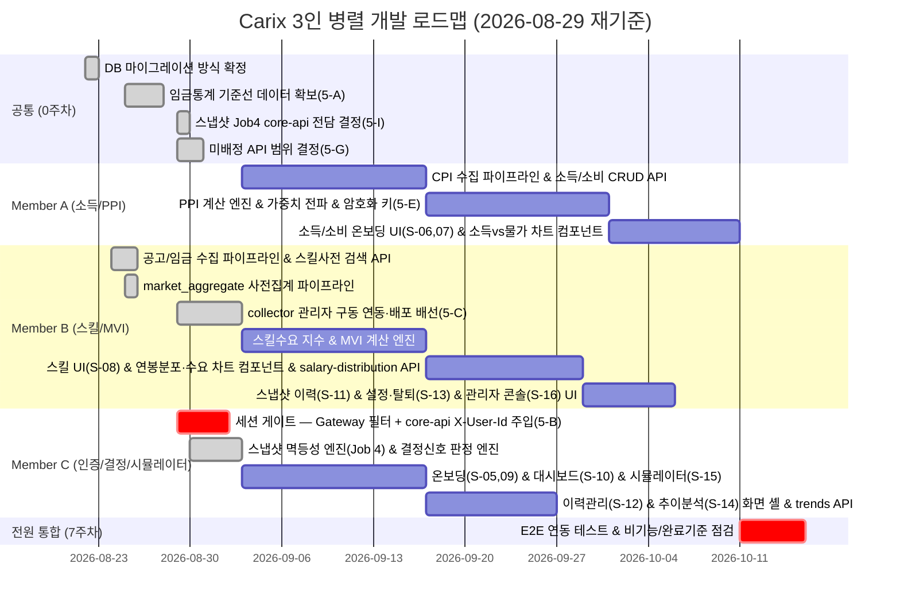
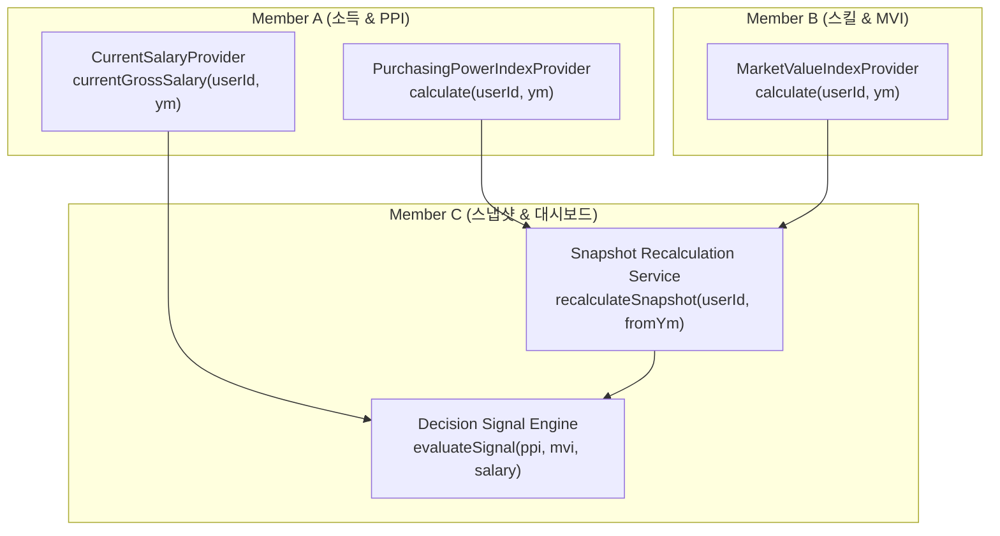

# Carix MVP 개발 계획서 (3인 도메인 수직 분업)

본 계획서는 3명의 풀스택 개발자가 각자의 핵심 가치 사슬(Value Stream)을 전담하여 **프론트엔드(UI)부터 백엔드(API/알고리즘), 데이터 수집/DB까지 End-to-End로 병렬 개발**할 수 있도록 구성된 실행 계획입니다.

---

## 1. 3인 역할 분담 요약

| 담당자 | 담당 도메인 | 프론트엔드 (UI) | 백엔드 & 핵심 알고리즘 | 데이터 수집 & DB |
| :--- | :--- | :--- | :--- | :--- |
| **Member A** | **소득 & 구매력 분석 (PPI & Cost of Living)** | • `S-06` 소득 입력 • `S-07` 소비 6대 카테고리 입력 • `S-14` **소득 vs 개인물가 차트 컴포넌트** | • **구매력 지수(PPI) 계산 엔진** ([기능 명세 §4.3](../specs/functional-specification.md)) • 소비 가중치 전파 로직 (`PROPAGATED`) • 소득/소비 이력 CRUD API • 기본 소비 가중치 관리 (`DEFAULT_CPI`) • 연봉 컬럼 암호화 키 주입·스냅샷 복호화 경계 ([§5-E](#5-교차-선행-작업-담당-확정)) | • **임금통계 기준선 데이터 확보 완료** (`core.wage_stat_observation`) • 통계청 CPI(소비자물가) 수집 파이프라인 • `income_history` • `expense_history`, `expense_item` • `cpi_observation` |
| **Member B** | **스킬 & 시장가치 분석 (MVI & Market Worth)** | • `S-08` 스킬 입력 & 자동완성 • `S-11` 월별 스냅샷 이력 • `S-13` 설정·계정 삭제 • `S-14` **연봉 분포·스킬 수요 차트 컴포넌트** | • **시장가치 지수(MVI) 계산 엔진** ([기능 명세 §4.2](../specs/functional-specification.md)) • **스킬 수요 지수** 계산 엔진 ([기능 명세 §4.1](../specs/functional-specification.md)) • 동료집단 완화 알고리즘 (N<10) • 스킬 검색/자동완성 API | • 채용공고 & KOSIS 임금 수집 파이프라인 • 표준 스킬 사전 정제 • `skill`, `skill_alias`, `user_skill` • `wage_stat_observation` • `market_aggregate` |
| **Member C** | **인증, 의사결정 & 시뮬레이터 (Auth, Decision & Action)** | • `S-01~03` 랜딩 & 로그인·계정 등록 • `S-05, 09` 프로필 & 온보딩 검토 • `S-10` **대시보드 메인 (3대 카드 종합)** • `S-12` **이력 관리 화면 전체** • `S-14` **추이분석 화면 셸** (A·B 차트 조립) • `S-15` **12개월 커리어 시뮬레이터** | • **결정 신호(Rule Matrix) 판정 엔진** • **12개월 잔류 vs 이직 시뮬레이터** (US-S1) • **월별 스냅샷 멱등성 저장/재계산** (Job 4 전담 소유, [기능 명세 §4.4](../specs/functional-specification.md)) • 회원가입·로그인 (US-A1~2) • 계정/데이터 완전 삭제 (US-C2) | • `auth-service` 모듈 • **세션 게이트** — Gateway 필터 + core-api `X-User-Id` 주입 ([§5-B](#5-교차-선행-작업-담당-확정), 3레인 공통 선행) • **auth 스키마**(auth-service 소유·Flyway): `users`, `session`, `rate_limit_bucket` • **core 스키마**(직접 DDL): `career_profile`, `index_snapshot`, `career_scenario` |

> **화면 셸 소유는 하나다.** `S-12`(`routes/mypage/records.tsx`)와
> `S-14`(`routes/dashboard/trends.tsx`)는 라우트 파일이 각각 하나이고
> `GET /dashboard/trends` 응답의 `trends[]` 배열에는 A 의 `incomeIndex`·`personalPriceIndex` 와
> B 의 `marketValueIndex` 가 함께 들어간다. 이전 판은 두 화면을 A 와 B 에 동시 배정해
> 같은 파일과 같은 DTO 를 겹치는 기간에 고치게 돼 있었다. **화면 셸과 합성 API 는 C 가
> 소유하고 A·B 는 차트·탭 컴포넌트를 낸다.**
>
> 표기 정정 — 초안의 `cpi_monthly_index`는 실제 테이블명 `core.cpi_observation`으로 바로잡았다
> ([상세 기술 명세](../specs/technical-specification.md), `deploy/postgres/schema/03_reference_and_aggregate.sql`).
> 초안의 `index_calc_log`는 DDL·명세·ERD 어디에도 정의가 없어 제거했다. 지수 계산 감사 로그가
> 필요하면 테이블을 먼저 명세에 정의한 뒤 다시 올린다.

---

## 2. 담당자별 상세 개발 범위

### 🧑‍💻 Member A : 소득 & 구매력 분석 (PPI 도메인)
- **사용자 스토리**: `US-O3`(소득 입력), `US-O4`(소비 입력), `US-R1`(소득/소비 이력 관리), `US-D3`(소득 vs 물가 차트)
- **Frontend**:
  - `S-06` 소득 입력 화면 (세전 연봉, 유효 시작일, 월 실수령액)
  - `S-07` 소비 입력 화면 (6대 카테고리 금액 입력, 실지출/추정 뱃지 처리)
  - `S-14` 소득 지수선(`incomeIndex`) vs 개인물가 지수선(`personalPriceIndex`) 2계열 차트와
    **구매력 손실 음영** — **차트 컴포넌트만**. 화면 셸과 `GET /dashboard/trends` 는 C 소유
  - `S-12` 소득·소비 탭에 쓰이는 조회·수정 API 제공 (화면은 C)
- **Backend & Data**:
  - `collector`: 통계청 CPI 지수 수집 파이프라인 (관리자 직접 구동 및 카테고리 매핑)
  - `core-api`: 
    - `POST /income`, `PUT /income/{id}`, `PUT /expenses/{ym}` API
    - **개인소비자물가지수 & 구매력 지수(PPI) 산출 엔진** 구현
    - 소비 가중치 상태 관리 (`USER_DEFINED`, `PARTIALLY_ESTIMATED`, `PROPAGATED`, `DEFAULT_CPI`)
    - 과거 소비 수정에 따른 미래 가중치 전파 로직

---

### 🧑‍💻 Member B : 스킬 & 시장가치 분석 (MVI 도메인)
- **사용자 스토리**: `US-O5`(스킬 입력), `US-D2`(데이터 상태 구분), `US-D3`(연봉 분포 & 스킬 수요 차트), `US-D4`(`S-11` 화면), `US-C1~2`(`S-13` 화면). `US-R1` 의 스킬 이력은 API 만 제공하고 화면은 C 가 만든다
- **Frontend**:
  - `S-08` 스킬 입력 화면 (표준 사전 자동완성, 실무 사용 기간/최종 사용일, 중복 방지)
  - `S-11` 월별 스냅샷 이력 타임라인, `S-13` 설정·계정 삭제 화면 — C 레인 부하 분산분.
    쓰는 API(`GET /dashboard/history`, `DELETE /users` 등)는 C 소유다
  - `S-14` **연봉 분포 5수치(최소/25%/중앙/75%/최대) 핀 차트**와 **스킬 수요 추이 차트** —
    **차트 컴포넌트만**. 화면 셸은 C 소유
  - `S-12` 스킬 탭에 쓰이는 조회·수정 API 제공 (화면은 C)
  - 표본 부족(`N < 10`), 업데이트 지연 배지 UI 처리
- **Backend & Data**:
  - `collector`: 원천 채용공고 크롤링/수집, KOSIS 임금통계 수집 및 deduplication 파이프라인
  - 표준 스킬 사전 시드 데이터 구축 및 검색 API (`GET /skills/search`)
  - `core-api`:
    - `POST /user-skills`, `DELETE /user-skills/{id}` API
    - **스킬 수요 지수 산출 엔진** (최근 3개월 vs 이전 12개월, 클램프 [25, 400] 처리)
    - **시장가치 지수(MVI) 산출 엔진** 및 동료집단 완화 알고리즘 (직무/경력/지역/규모 단계별 완화)

---

### 🧑‍💻 Member C : 인증, 의사결정 & 시뮬레이터 (Auth & Decision 도메인)
- **사용자 스토리**: `US-A1~2`(인증), `US-O1~2, 6`(온보딩 오케스트레이션), `US-D1`(대시보드 종합), `US-D3`(`S-14` 화면 셸), `US-R1`(`S-12` 이력 관리 화면), `US-S1`(시뮬레이터). `US-D4`·`US-C1~2` 는 **API 만** 소유하고 화면(`S-11`·`S-13`)은 B 가 만든다
- **Frontend**:
  - `S-01` 랜딩(가입 없이 시작), `S-02` 로그인, `S-03` 계정 등록
  - `S-05` 프로필 입력, `S-09` 온보딩 검토·완료 화면 (2초 디바운스 자동 저장 오케스트레이션)
  - `S-10` **대시보드 메인** (구매력 카드 + 시장가치 카드 + **결정 신호 카드** + 근거 아코디언)
  - `S-12` **이력 관리 화면 전체** (소득·소비·스킬 3개 탭 — API 는 A·B 제공)
  - `S-14` **추이분석 화면 셸** 과 A·B 차트 컴포넌트 조립
  - `S-15` **12개월 잔류 vs 이직 시뮬레이터** (실업급여 요건, 공백기, 인상률 기반 실시간 비교)
  - `S-11`·`S-13` 은 **화면을 B 가 만든다** (부하 분산). C 는 두 화면이 쓰는 API —
    `GET /dashboard/history`, `POST /auth/logout-all`, `DELETE /users` — 를 소유한다
- **Backend & Data**:
  - `auth-service`: 회원가입·로그인, 세션 토큰 해시 저장 전환,
    매직링크·초대·메일 코드 폐기, 인증 흐름 테스트 코드 (완료)
  - `core-api`:
    - `PATCH /onboarding`, `PATCH /profile`, `DELETE /users` API
    - **결정 신호(Decision Signal) 판정 엔진** (Rule Matrix: 잔류 권고/이직 준비/소득 방어 등)
    - **월별 스냅샷 멱등성 저장/재계산 엔진** (Job 4 전담 소유, `index_snapshot` 버전 관리, `(userId, ym, dataVer, ruleVer)`)
    - 12개월 시뮬레이터 계산 API (`POST /scenarios/simulate`)
    - `GET /dashboard/trends` — A·B 지수 계열을 하나의 `trends[]` 로 합성 (§5-J 의
      `salary-distribution` 은 B 소유)

---

## 3. 주차별 병렬 개발 로드맵 (7주 스프린트)

> **기준일 2026-08-29 (재기준).** 임금통계 기준선 데이터 확보(`core.wage_stat_observation` 24구간 보간 완료)와 스냅샷 갱신(Job 4) `core-api` 전담 실행 결정이 완료되어 불필요한 분기(`h1`)를 제거하고 간트를 최적화했습니다:
>
> - `c1`(인증 구현·auth 테스트·`S-01~03` UI)은 **잔여가 없어 제거**했다.
> - **임금통계 기준선 데이터가 충분히 확보(완료)**됨에 따라 §5-A/§5-H(규칙표 재작성) 이슈가 해소되어 기존 3변수 결정신호 규칙표를 유지한다.
> - **스냅샷 갱신(Job 4)은 `core-api`가 전담(완료)**하여 `recalculateSnapshot` 엔진에서 소유한다.
> - `S-12`·`S-14` 는 **화면 셸을 C 로 단일화**하고 A·B 는 탭·차트 컴포넌트만 낸다.
> - `e2e` 선행조건은 `a3 b4 c4` 세 개다.

### 선행 완료 (로드맵 제외)

| 원래 위치 | 항목 | 완료 |
| :--- | :--- | :--- |
| C 0주차 | DB 마이그레이션 방식 통일 (auth=Flyway, core=직접 DDL) | 결정·문서화 완료 |
| A/B 0주차 | KOSIS 임금통계 기준선 데이터 수집 및 24구간 보간 적재 완료 (`core.wage_stat_observation`) | 완료 |
| B/C 0주차 | 스냅샷 갱신(Job 4) `core-api` 전담 실행 주체 확정 (§5-I) | 결정 완료 |
| 공통 0주차 | 미배정 API 6개·가상 프로필 파라미터 MVP 범위 밖 확정 및 스텁 철거 (§5-G) | 결정·철거 완료 |
| B 1~2주차 | 채용공고/임금 수집 파이프라인 (`wage_stat_observation`, 원천 간 중복제거) | 2026-08-25 |
| B 1~2주차 | 표준 스킬 사전 정제 & 검색 API (`GET /skills/search`, user-skills CRUD) | 2026-08-24 |
| B 3~4주차 | 월별 시장 데이터 사전 집계 (`market_aggregate`) 파이프라인 | 2026-08-25 |
| C 1~2주차 | 인증 재설계 구현, `auth-service` 테스트, `/api` 프록시, `S-01~03` UI | 2026-08-28 (`c1` 제거 근거) |

| 주차 | Member A (소득 & PPI) | Member B (스킬 & MVI) | Member C (인증 & 결정 & 시뮬레이터) |
| :--- | :--- | :--- | :--- |
| **0주차 (사전정렬)** 08-29~09-03 | ~~• **임금통계 기준선 데이터 확보 (§5-A)**~~ (완료) • CPI 수집 스키마 확정 • 소득/소비 DDL 확정 • CPI 수집 파이프라인 대기 | ~~• 공고/임금 통계 스키마 확정~~ (완료) ~~• 표준 스킬 사전 포맷 정의~~ (완료) ~~• **collector 관리자 직접 구동 연동·배포 배선 (§5-C)**~~ (완료) ~~• **Job 4 core-api 전담 소유 결정 (§5-I)**~~ (완료) | ~~• 이메일 provider 선정~~ (불필요 — 메일 발송 경로 없음) ~~• DB 마이그레이션 방식 통일~~ (완료) ~~• PPI/MVI 계약 DTO + 스텁~~ (완료 — `com.carix.index`) ~~• 프론트엔드 라우팅/레이아웃/Theme~~ (완료) • **세션 게이트 (§5-B)** — 배선 완료, 플래그 전환만 남음 ~~• SSR Phase 2 범위 결정 (§5-F) 및 명세 3건 갱신~~ (완료) |
| **1~2주차 (인프라 & 파이프라인)** 09-03~09-17 | • 통계청 CPI 수집 파이프라인 (`b0` 기반) • `income_history`, `expense_*` CRUD API | ~~• 채용공고/임금 수집 파이프라인~~ (08-25 완료) ~~• 표준 스킬 사전 정제 & 검색 API~~ (08-24 완료) • **스킬 수요 지수 & MVI 계산 엔진** 착수 | ~~• 인증 재설계·테스트·프록시·`S-01~03` UI~~ (완료) ~~• `career_profile` 영속화~~ (완료 — 엔티티·리포지토리·실 `GET`/`PATCH /profile`. 화면 `S-05,09` 는 3~4주차) ~~• `CurrentSalaryProvider` 계약 합의 (§5-E 앞당김분)~~ (완료 — 스텁 포함) ~~• **월별 스냅샷 멱등성 저장/재계산 엔진 (Job 4)**~~ (완료) ~~• **결정 신호 판정 엔진** (기존 3변수 규칙표 기준)~~ (완료) • **세션 게이트 플래그 전환 (§5-B)** — **미실행.** 엔진은 이 전환 없이 착지했다. A·B 조율 후 실행 |
| **3~4주차 (핵심 계산 엔진)** 09-17~10-01 | • **개인물가 & 구매력 지수(PPI) 계산 엔진** • 소비 가중치 전파(`PROPAGATED`) 로직 • **연봉 암호화 키 로테이션·스냅샷 복호화 경계 (§5-E)** | • 동료집단 완화 알고리즘 (N<10 클램프) • `S-08` 스킬 입력 & 자동완성 UI • `S-14` 연봉분포·수요 **차트 컴포넌트** • `GET /dashboard/salary-distribution` (§5-J) | • `S-05, S-09` 프로필/검토 온보딩 UI • `S-10` **대시보드 메인** • `S-15` **시뮬레이터 UI** |
| **5~6주차 (UI & 시각화 완성)** 10-01~10-11 | • `S-06, S-07` 소득/소비 온보딩 UI • `S-14` 소득vs물가 **차트 컴포넌트** | • `S-11` 월별 스냅샷 이력 UI • `S-13` 설정·계정 삭제 UI • `S-16` **관리자 파이프라인 콘솔 UI** | • `S-12` **이력 관리 화면 전체** (소득·소비·스킬 탭) • `S-14` **추이분석 화면 셸** + A·B 차트 조립 • `GET /dashboard/trends` API |
| **7주차 (E2E 통합 검증)** 10-12~10-17 | • PPI 엣지케이스(지연/결측) 검증 • **민감 금액 로깅 마스킹 점검** (소득·소비 경로) | • MVI 표본부족(N<10) 엣지케이스 검증 • 실데이터 파이프라인 통합 점검 • **민감 금액 로깅 마스킹 점검** (집계·파이프라인 경로) | • 온보딩 $\rightarrow$ 대시보드 $\rightarrow$ 시뮬레이터 E2E 점검 • 계정 삭제 시 개인 데이터 완전 삭제 검증 • **민감 금액 로깅 마스킹 점검** (시나리오 요청·스냅샷 복호화 경로) |

> **주차 표의 날짜 구간은 최장 경로인 A 레인 기준이다.** B 는 `b0` 가 5일이라 이후 블록이
> 며칠씩 앞서고(`b3` 09-17~09-29, `b4` 09-29~10-06), C 는 `c0b` 가 4일이라 하루 앞선다
> (`c2` 09-04~09-18, `c3` ~10-02, `c4` ~10-12 — 안 C 귀결 시 `h1` 3일 포함).
> 정확한 시점은 위 간트를 따른다.

> **완료 기준 10번(민감 금액 로그 미기록)은 전 레인 공통이다**
> ([기능 명세 §7](../specs/functional-specification.md)). `POST /scenarios/simulate` 요청 본문의
> `currentGrossSalary`·`moveTargetGrossSalary` 와 스냅샷 재계산의 복호화 경로
> 등에서 금액이 평문으로 로그에 찍히면 안 된다.

---

## 4. 레인 간 인터페이스 계약 (확정 & 스텁)

1. **지수 산출 결과 계약 (A, B $\rightarrow$ C)** — `core-api` 의 `com.carix.index` 에 확정돼 있다:
   - Member A는 `PurchasingPowerIndexProvider.calculate(userId, baseYearMonth)` 를 구현해 `PpiResult`(지수값, 상태, 소비 가중치 출처, 지수 기준월, CPI 원천 기준일)를 반환
   - Member B는 `MarketValueIndexProvider.calculate(userId, baseYearMonth)` 를 구현해 `MviResult`(지수값, 상태, **원천별** 완화 단계·표본 수, 제외 스킬과 사유, 임금통계 기준선, 집계 기준일)를 반환
   - Member A는 `CurrentSalaryProvider.currentGrossSalary(userId, baseYearMonth)` 도 구현해 기준월 시점에 유효한 세전 연봉을 반환한다. 결정 신호 규칙표의 **소득 격차 비율**은 이 값을 분모로 쓰는데 `PpiResult`·`MviResult` 어디에도 없어 규칙 2·3·5 가 계산되지 않았다. 연봉을 `PpiResult` 에 실으면 평문 금액이 스냅샷 `rationale` 경로까지 흘러가므로 계약을 따로 둔다. 복호화 경계는 소득 도메인 안에 남는다(§5-E)
   - 계산 불가는 예외가 아니라 `IndexStatus` 로 돌려준다. 값은 `null` 이고 0 이나 100 으로 채우지 않는다
   - 구현 빈이 없는 동안 `com.carix.index.stub` 이 `NOT_AVAILABLE` 을 돌려주므로 C 는 A·B 를 기다리지 않고 3~4주차를 시작할 수 있다
2. **스냅샷 재계산 트리거 (A, B $\rightarrow$ C)**:
   - 사용자가 소득/소비(Member A) 또는 스킬(Member B)을 추가/수정/삭제했을 때, Member C의 `recalculateSnapshot(userId, fromYm)`을 호출하여 해당 시점 이후의 스냅샷을 멱등하게 갱신
   - 호출 대상은 `com.carix.snapshot.SnapshotRecalculationService.recalculateSnapshot(UUID userId, String fromYearMonth)` 이며 `fromYearMonth` 는 변경의 가장 이른 유효월(`YYYYMM`)이다. 한 번의 호출이 그 월부터 현재월까지를 하나의 `data_version` 으로 다시 쓴다
3. **스냅샷 갱신(Job 4) 실행 주체 — core-api 전담 확정**:
   - 스냅샷 계산/갱신 엔진은 `core-api`가 전담 소유한다. `collector`는 `market_aggregate` 집계까지 완료하며, `index_snapshot` 생성/갱신은 `core-api` 내부 API 호출 또는 사용자 프로필/소득/소비/스킬 변경 시 `core-api` 내에서 직접 `recalculateSnapshot(userId, fromYm)`을 수행한다.
   - `core.index_snapshot`에 대한 쓰기 권한과 연봉 복호화 키 접근(§5-E)도 `core-api`(Member C/A) 내에서 안전하게 격리된다.
4. **계약에 없던 크로스레인 의존 2건**:
   - 시뮬레이터 `feasibility`(`targetPercentile`, `difficultyGrade` — 정본은
     [API 규격 §6.1](../specs/api-specification.md))는 **B 의 동료집단 공고 분포**를 입력으로
     요구하나 화면은 C(`S-15`)다. 산출원은 §5.2 가 규정한 `job_posting` 직접 집계이며
     임금통계 기준선(`wage_stat_observation`)과는 별개 원천이다.
   - `GET /dashboard/salary-distribution`([API 규격 §5.2](../specs/api-specification.md))은 §1 에서 B 의
     `S-14` 차트로 배정됐으나 API 는 대시보드 도메인이다. 구현 소유를 명시한다
5. **완료 기준 10개 항목 점검**:
   - 구현 완료 시 `functional-specification.md` §7의 MVP 완료 기준 10개 항목을 전원이 크로스 체크

---

## 5. 교차 선행 작업 (담당 확정)

어느 담당자 칸에도 없으면서 다른 레인의 산출물을 막고 있던 항목들이다. 2026-08-29
검토에서 아래 작업 전부에 담당과 시점을 붙였으며, 5-A(임금통계 기준선 확보)와 5-I(스냅샷 실행 주체 확정)가 완료되어 5-H는 자연 해소되었다.

| # | 작업 | 담당 | 시점 | 잔여 범위 | 무엇을 막는가 |
| :--- | :--- | :--- | :--- | :--- | :--- |
| 5-A | ~~임금통계 기준선 데이터 확보~~ | A/B | 0주차 (`a0`, **완료**) | KOSIS 24구간 누적분포 보간 완료로 `core.wage_stat_observation`에 충분한 데이터 적재 완료됨 | MVI 연봉 격차, 결정 신호 3변수 규칙표 유지 |
| 5-B | 세션 게이트 — Gateway 세션 검증 필터 + core-api `X-User-Id` 주입 | C | 0주차 | 배선은 끝났다 — 게이트웨이 필터, `/api/health` 의 `core-health` 라우트 분리, core-api 수신부(`@CurrentUserId`·`UserContextArgumentResolver`, 헤더 없으면 401)까지 배포돼 있다. 하류가 헤더를 신뢰하는 구조라 Spring Security 스타터는 쓰지 않는다. **잔여는 운영 전환뿐** — `carix.gateway.session-validation.enabled=true` + `/actuator/refresh`, 그리고 아래 롤백 절차 | 모든 도메인 API 의 `userId` 확보 경로. **A·B·C 전원** |
| 5-C | ~~collector 관리자 직접 구동 및 Spring Scheduler 연동 · 배포 배선~~ | B | 0주차 (`b0`, **완료**) | 내부 API 및 배포 배선(`docker-compose.yml`·`deploy.yml`) 완료. 잔여는 **관리자 콘솔 화면(S-16 Admin UI) 연동 및 Spring Scheduler(`@Scheduled`) 도입 검토** | 수집 파이프라인 관리자 콘솔 연동 및 스케줄러 확정 |
| 5-E | 연봉 컬럼 암호화 키 로테이션 · 스냅샷 복호화 경계 | A (스냅샷 접근 경계는 core-api 내부 C 와 합의) | 계약 합의분 **완료**, 키 로테이션 절차는 3~4주차 | [SECURITY §3.2](../SECURITY.md)가 "구현 단계 처리"로 남긴 항목. ~~`CurrentSalaryProvider` 계약(§4)이 복호화 경계를 A 안에 고정하므로 먼저 합의한다~~ (완료 — 계약과 스텁이 `com.carix.index` 에 있다. **구현은 A 가 한다**). 잔여는 키 로테이션 절차, 로테이션 시 기존 암호문 재암호화 전략, 스냅샷 복호화 성능·키 접근 감사 | 소득 저장(A)과 스냅샷 재계산의 연봉 복호화(C) |
| 5-I | ~~스냅샷 갱신(Job 4) 실행 주체 결정~~ | B·C | 0주차 (**완료**) | `core-api`가 전담하여 스냅샷 갱신(`recalculateSnapshot`) 수행 확정 | C 의 스냅샷 엔진 실행 경로 확정 |
| 5-J | `GET /dashboard/salary-distribution` 구현 소유 | B | `b3` (3~4주차) | [API 규격 §5.2](../specs/api-specification.md)가 `market_aggregate` 가 아니라 **원 공고(`job_posting`) 직접 집계**를 규정한다 — `dedup_group_id` 중복 제거와 유효 공개연봉 필터가 필요해 수집 데이터를 아는 B 가 맡는다. 화면 셸은 C(`S-14`) | `S-14` 연봉 분포 차트, 시뮬레이터 `feasibility` |
| 5-K | 스냅샷 쓰기 경로 운영 Postgres 검증 | C | 3~4주차 배포 전 | `index_snapshot` 쓰기가 운영에서 처음 도는 시점에 세 가지가 동시에 처음 실행된다 — `@JdbcTypeCode(SqlTypes.JSON)` 의 `jsonb` 바인딩(테스트는 H2 로만 검증), `pg_advisory_xact_lock`(H2 에 없어 발급기 자동 검증 없음), `DataVersionIssuer` 의 `MANDATORY` 전파. 운영 `ddl-auto` 가 `none` 이라 매핑 오류는 기동이 아니라 **첫 쓰기 시점**에 터진다. OCI DB 에 붙여 `recalculateSnapshot` 을 한 사용자에 한 번 돌리면 셋이 함께 확인된다 | Job 4 의 운영 동작 전체 |
| 5-L | `rationale.salaryGapRatio` 저장 형태 결정 | 명세 소유자 | `S-10`·`S-14` 착수 전 (3~4주차) | `rationale` 의 격차 비율(소수점 6자리, 평문 JSONB)은 평문 `wage_stat_observation.wage_median` · 평문 `career_profile` 동료집단과 조인하면 `연봉 = 중앙값 / (1 + 격차비율)` 로 원 단위 복원된다 — `income_history` 의 AES-256-GCM 이 막으려던 결과다. 구현은 규칙의 문자를 지켰고(비율만 저장, 중앙값 미저장) 명세 §1.3 자체의 결함이다. 선택지: (a) 저장하지 않고 조회 시 재계산 (b) 구간 코드로 저장 (c) 자릿수 축소(가장 약함). `rulesApplied` 가 이미 구간을 담아 6자리는 복원 정밀도만 더한다 | 이 필드를 읽는 화면(`S-10` 근거 아코디언, `S-14`) |

세션 검증은 게이트웨이가 수행하고 하류 서비스는 `X-User-Id` 헤더를 신뢰한다
([SECURITY §3.2](../SECURITY.md), [Spring Cloud 아키텍처](../specs/spring-cloud-architecture.md)).
게이트웨이 쪽은 이미 구현돼 있다 — `SessionValidationGatewayFilterFactory` 가 검증 후
`X-User-Id` 를 주입하고 core-api 수신부도 배선돼 있어 5-B 의 잔여는 아래 플래그 전환 절차다.

> **⚠️ 플래그는 순서를 지켜 켠다.**
> core 라우트 술어는 `Path=/api/v1/**,/api/swagger-ui/**,/api/v3/api-docs/**` 이고 여기
> `SessionValidation` 필터가 붙는다 (`backend/gateway/src/main/resources/application.yml`).
> 필터에 경로 예외가 없어 `session_token` 쿠키가 없으면 즉시 401 이다.
>
> `/api/health` 는 필터가 붙지 않는 `core-health` 라우트(`order: -15`)로 분리돼 있다. 배포
> 워크플로가 쿠키 없이 `/api/health` 200 을 요구하는데(`.github/workflows/deploy.yml`) 필터가
> 붙어 있으면 배포가 401 로 죽고, 자동 롤백은 `.env`(이미지 태그)만 되돌리는 반면 플래그는
> `config/spring/gateway.yml` 에 있어 다음 배포도 같은 자리에서 죽기 때문이다. `order` 를 명시한
> 이유는 따로 있다 — `web`(`Path=/**`, order 0)과 같으면 `/api/health` 가 프런트엔드로 흘러
> SPA 셸을 200 으로 돌려주고, core-api 가 죽어 있어도 헬스체크가 통과한다.
>
> `/api/swagger-ui/**`·`/api/v3/api-docs/**` 는 `core` 라우트에 남긴다. 플래그를 켜면 문서도
> 세션을 요구하지만 같은 출처 요청이라 로그인한 개발자의 브라우저는 쿠키를 실어 보내 그대로
> 열리고, 쿠키 없는 접근에는 API 표면이 닫힌다. 쿠키 없이 스펙을 읽는 소비자는 현재 없다.
>
> 남은 절차:
> 1. 서버 config 체크아웃에서 `carix.gateway.session-validation.enabled=true` 로 올리고
>    게이트웨이 `/actuator/refresh` 를 호출한다
> 2. 되돌릴 때는 `.env` 롤백으로 부족하다 — `config/spring/gateway.yml` 을 직접 되돌리고
>    `/actuator/refresh` 를 다시 호출한다
>
> 실행 담당은 C 다. 켜는 순간 세션 없는 `core-api` 호출은 전부 401 이 되므로 팀 조율 후 켠다.

### 5-F. SSR Phase 2 — MVP 범위 밖으로 이동

`frontend/server.js` 를 Express + `@react-router/express` 로 바꾸는 Phase 2 전환은
**MVP 이후로 미룬다.** `S-05`~`S-15` 는 전부 세션을 요구해 SEO 대상이 아니고 진입
가드는 이미 클라이언트에서 동작한다. 남는 실익은 초기 로드뿐인데 최장 경로인 C
레인에 14일을 더한다. 현행 `ssr: false` + `/` 사전 렌더링 + SPA 셸을 유지한다.
이 결정으로 무효가 된 **소관 문서 세 곳은 모두 갱신했다** (담당 C).

| 문서 | 무효가 됐던 내용 |
| :--- | :--- |
| [기능 명세 §1 화면 맵](../specs/functional-specification.md) | 렌더링 열이 `S-02`·`S-03` 을 `Node SSR`, `S-05`~`S-15` 를 `SSR shell + hydration` 으로 지정 |
| [프런트엔드 설계 §렌더링 전략](../specs/frontend-design.md) | `/login` Node SSR, `/dashboard/*`·`/mypage/*` SSR shell 표 |
| [README 렌더링 전략](../../README.md) | Phase 2 조건("인증·대시보드 도입 시") |

세 곳 모두 현행 구성을 먼저 서술하고 Node SSR 구성은 "MVP 이후 목표"로 내렸다. 고치지
않았다면 구현자가 화면마다 SSR 방식이 지정된 명세를 그대로 보고 작업했을 것이다.

### 5-G. 미배정 API 6개 — MVP 범위 밖

[API 규격](../specs/api-specification.md)에는 있으나
[기능 명세 §8 추적 매트릭스](../specs/functional-specification.md)에는 없던 엔드포인트다.
판별 기준은 하나다 — **기존 화면의 인수 조건이 그 응답을 요구하는가.** 6개 전부와 가상
프로필 쿼리 파라미터가 이 기준을 통과하지 못해 **MVP 범위 밖**이다. 기능 명세에 구멍이
있던 게 아니라 API 규격이 더 넓었다.

**6개 모두 `core-api` 에서 철거했다.** 배제 판정만으로는 부족했다 — 여섯 개 다 `200` 과
그럴듯한 하드코딩 값을 돌려주고 있었다. `GET /reference/cpi` 는 고정 CPI 표를,
`POST /dashboard/predict` 는 상수 `94.2` 에 임의 계수를 곱한 값을 반환했다. 404 보다 나쁘다 —
프런트엔드가 붙으면 가짜 수치가 화면까지 올라가고, `predict` 의 조작 수치는 `US-D2` 의
`임의 수치를 만들지 않는다` 를 정면으로 위반한다.

| 엔드포인트 | 제외 근거 | 철거 범위 |
| :--- | :--- | :--- |
| `GET /skills/recommendations` (§5.6) | `S-14` 스킬수요 탭은 `GET /dashboard/skills` 로 충족한다. 대응 스토리·화면이 없다 | `SkillController` 매핑, `SkillService.getSkillRecommendations`, `SkillRecommendationsResponse`, `SkillControllerTest` 해당 케이스 |
| `POST /dashboard/predict` (§6.5) | 대응 스토리가 없다. `US-S1` 은 보상 비교이지 지수 예측이 아니고, [MVP 규격 §2.3](../specs/mvp-requirements.md)이 확정적 예측을 제외 기능으로 못박았다 | `DashboardController` 매핑, `IndexPredictionRequest`·`IndexPredictionResponse` |
| `GET /scenarios` (§6.3) | `US-S1` 은 마지막 시나리오 복원만 요구하고 `GET /scenarios/latest` 로 충족된다. 목록 비교 화면이 없다 | `ScenarioController` 매핑 (이전 판의 `미구현` 표기는 오류였다 — 고정 1건을 반환하고 있었다) |
| `DELETE /scenarios/{id}` (§6.4) | 시나리오 이력 삭제 화면이 없다. 계정 삭제는 `DELETE /users` 연쇄로 처리한다 | `ScenarioController` 매핑 (무조건 `200` 이었다) |
| `GET /reference/default-expenses` (§7.6) | `US-O4` 인수 조건은 `통계청 평균 기준` 뱃지와 월 요약 상태만 요구하고 추적 매트릭스 `S-07` 행도 `PUT /expenses/{ym}` 만 건다 — 카테고리별 `status` 로 충족된다 | `ReferenceController` 와 `com.carix.reference` 패키지 전체 |
| `GET /reference/cpi` (§7.7) | `US-D3` 는 `incomeIndex`·`personalPriceIndex` 2계열만 요구한다. 공식 CPI 원계열 대조는 인수 조건에 없다 | 위와 동일 |

DTO 도 함께 지웠다. 매핑을 걷어내면 참조가 0 이 되고, 응답 계약은 API 규격 §5.6·§6.3~6.5·
§7.6~7.7 에 JSON 예시까지 남아 있어 재도입 비용이 DTO 재작성분뿐이다.

가상 프로필 쿼리 파라미터(`jobFamily`·`yearsOfExperience`·`region`·`companySize` —
[API 규격 §5.1·§5.2·§5.5](../specs/api-specification.md))도 범위 밖이다. 다만 성격이 다르다.
이건 엔드포인트가 아니라 **MVP 에 포함된 엔드포인트 위의 파라미터**라 철거 대상이 아니다.
`GET /dashboard/summary`·`/salary-distribution`·`/skills` 는 그대로 남고 파라미터만 규격에
`MVP 범위 밖`으로 표기했다. 구현하면 동료집단 완화 알고리즘을 로그인 사용자 프로필과 무관한
임의 조건으로도 돌려야 해서 B 의 MVP 범위가 늘어난다.

**승격 조건.** `GET /reference/default-expenses` 는 `S-07` 이 기본값 **금액**까지 보여주기로
하면 A 의 필수 작업으로 올라온다. 그때 기능 명세 §8 의 `S-07` 행에 API 를 추가한다.

- [x] 6개 엔드포인트와 가상 프로필 쿼리 파라미터의 MVP 포함 여부 결정 — 전부 범위 밖
- [x] API 규격에 `MVP 범위 밖` 표기 (§5.1·§5.2·§5.5 파라미터, §5.6, §6.3, §6.4, §6.5, §7.6, §7.7)
- [x] `core-api` 스텁 철거 — 매핑·서비스 메서드·전용 DTO·해당 테스트

기능 명세 §8 추적 매트릭스는 바뀌지 않는다. 포함된 항목이 없기 때문이다.
