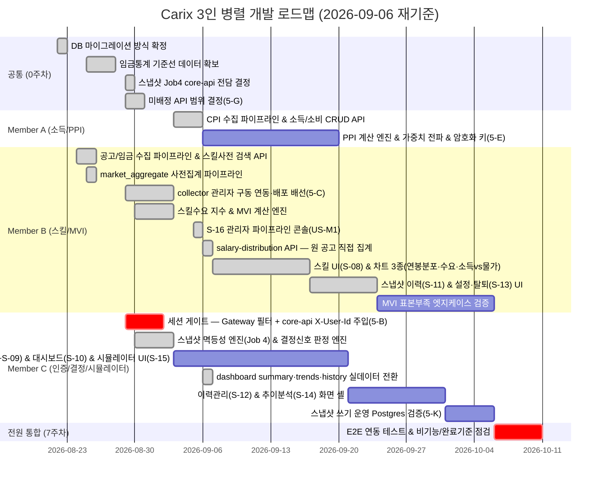
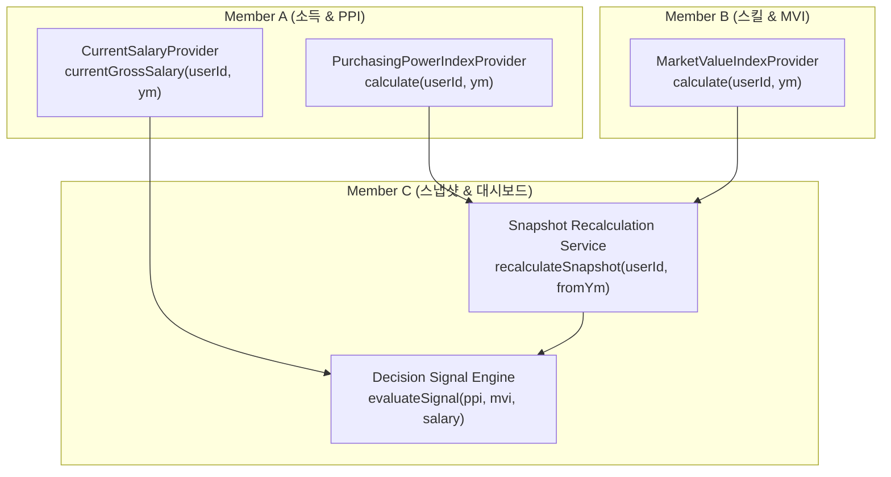

# Carix MVP 개발 계획서 (3인 도메인 수직 분업)

본 계획서는 3명의 풀스택 개발자가 각자의 핵심 가치 사슬(Value Stream)을 전담하여 **프론트엔드(UI)부터 백엔드(API/알고리즘), 데이터 수집/DB까지 End-to-End로 병렬 개발**할 수 있도록 구성된 실행 계획입니다.

> **표기 규약 — 끝난 것을 지우려면 갈 자리와 결번 선언이 먼저다.**
>
> - 옮길 자리가 **있으면** 원래 행을 지우고 **번호를 결번으로 선언한다.** 「선행 완료」 표나
>   다른 절에 내용이 남으므로 중복을 만들지 않는다. 결번 선언을 빼먹으면 §5-N 처럼 코드가
>   존재하지 않는 절을 가리키게 된다 — 실제로 그렇게 됐다.
> - 옮길 자리가 **없으면**(조건 미발생, 취소된 결정 등) 지우지 않고 ~~취소선~~ 으로 남기고
>   옆에 사유를 적는다. 근거가 사라지면 같은 논의를 다시 하게 된다.
> - 간트는 취소선을 못 쓴다. 완료는 `:done`, 이관·삭제는 레인 구간 표와 주차 표에 취소선으로
>   남긴다.

---

## 1. 3인 역할 분담

| 담당자 | 도메인 | 사용자 스토리 | 프론트엔드 (UI) | 백엔드 & 핵심 알고리즘 | 데이터 수집 & DB |
| :--- | :--- | :--- | :--- | :--- | :--- |
| **Member A** | **소득 & 구매력 (PPI & Cost of Living)** | `US-O3` 소득 입력(API 만) `US-O4` 소비 입력(API 만) `US-R1` 이력(API 만) `US-D3` 소득vs물가(데이터만) | **전량 이관.** • ~~`S-06` 소득 입력~~ → C • ~~`S-07` 소비 6대 카테고리~~ → C • ~~`S-14` 소득vs물가 차트 컴포넌트~~ → B _(근거는 아래 각주)_ | • **구매력 지수(PPI) 엔진** ([기능 명세 §4.3](../specs/functional-specification.md)) • 소비 가중치 전파 (`PROPAGATED`) • 소득/소비 이력 CRUD API — `S-12` 탭이 쓴다 • 기본 소비 가중치 (`DEFAULT_CPI`) • 연봉 암호화 키·복호화 경계 ([§5-E](#5-교차-선행-작업-담당-확정)) | • 통계청 CPI 수집 파이프라인 • `income_history` • `expense_history`, `expense_item` • `cpi_observation` |
| **Member B** | **스킬 & 시장가치 (MVI & Market Worth)** | `US-O5` 스킬 입력 `US-D2` 데이터 상태 `US-D3` 분포·수요 차트 `US-D4` `S-11` 화면 `US-C1~2` `S-13` 화면 `US-M1` `S-16` | • `S-08` 스킬 입력 & 자동완성 • `S-11`·`S-13` — C 레인 부하 분산분. 쓰는 API 는 C 소유 • `S-14` **차트 3종 컴포넌트** — 연봉분포·수요·**소득vs물가**(A 이관분). 셸은 C • `S-16` 관리자 파이프라인 콘솔 | • **시장가치 지수(MVI) 엔진** ([§4.2](../specs/functional-specification.md)) • **스킬 수요 지수** 엔진 ([§4.1](../specs/functional-specification.md)) • 동료집단 완화 (N<10) • 스킬 검색/자동완성 API • `GET /dashboard/salary-distribution` | • 채용공고 & KOSIS 임금 수집 • 표준 스킬 사전 정제 • `skill`, `skill_alias`, `user_skill` • `wage_stat_observation` • `market_aggregate` |
| **Member C** | **인증 · 의사결정 · 시뮬레이터 (Auth, Decision & Action)** | `US-A1~2` 인증 `US-O1~2, 6` 온보딩 `US-D1` 대시보드 `US-D3` `S-14` 셸 `US-R1` `S-12` 화면 `US-S1` 시뮬레이터 | • `S-01~03` 랜딩·로그인·가입 • ~~`S-05`~`S-09` **온보딩 5화면 전체**~~ `S-05`·`S-06`·`S-07`·`S-09` (`S-08`은 B. 근거: `c3`가 14d→18d로 늘어난 4d가 이관받은 `S-06`·`S-07` 두 화면분이라는 §3 기록과 같은 산수로, 이관 전 14d가 다섯 화면을 담당했을 수 없다) • `S-10` **대시보드 메인** (3대 카드) • `S-12` **이력 관리 화면 전체** (API 는 A·B) • `S-14` **추이분석 셸** (A·B 차트 조립) • `S-15` **12개월 시뮬레이터** | • **결정 신호(Rule Matrix) 엔진** • **12개월 잔류vs이직 시뮬레이터** • **월별 스냅샷 멱등성 저장/재계산** (Job 4 전담, [§4.4](../specs/functional-specification.md)) • 회원가입·로그인, 계정 완전 삭제 • `GET /dashboard/summary`·`/trends`·`/history` | • `auth-service` 모듈 • **세션 게이트** ([§5-B](#5-교차-선행-작업-담당-확정), 3레인 공통 선행) • **auth 스키마**(Flyway): `users`, `session`, `rate_limit_bucket` • **core 스키마**(직접 DDL): `career_profile`, `index_snapshot`, `career_scenario` |

> **화면 셸 소유는 하나다.** `S-12`(`routes/mypage/records.tsx`)와
> `S-14`(`routes/dashboard/trends.tsx`)는 라우트 파일이 각각 하나이고
> `GET /dashboard/trends` 응답의 `trends[]` 에는 A 의 `incomeIndex`·`personalPriceIndex` 와
> B 의 `marketValueIndex` 가 함께 들어간다. **화면 셸과 합성 API 는 C 가 소유하고 A·B 는
> 차트·탭 컴포넌트를 낸다.** 두 화면을 A·B 에 동시 배정하면 같은 파일과 같은 DTO 를 겹치는
> 기간에 고치게 된다.
>
> `US-D4`·`US-C1~2` 는 반대로 갈린다 — **API 는 C, 화면(`S-11`·`S-13`)은 B** 다. 배정 당시
> C 레인이 최장 경로라 화면만 넘겼다.
>
> **그 전제가 한 번 뒤집혔다 돌아왔다.** B·C 의 선행 블록이 앞당겨 끝나면서 임계 경로가 A 로
> 옮겨갔고, `b5`·`c5` 는 A 종료일에 맞춘 채움 블록이 돼 있었다. 그래서 A 의 `a3` 을 둘로 갈라
> **`S-06`·`S-07` 온보딩 UI 는 C, `S-14` 소득vs물가 차트는 B** 로 넘겼다. 그 결과 최장 경로는
> 다시 C 이므로 `S-11`·`S-13` 을 B 가 갖는 위 배정은 그대로 유효하다.
>
> 가른 기준은 소유가 이미 어디 있느냐다 — C 는 `S-05`·`S-09` 로 온보딩 셸을 갖고 있어 네
> 화면(`S-05`·`S-06`·`S-07`·`S-09`)이 한 사람에게 모이고, B 는 같은 `S-14` 셸 위에 차트 둘을
> 만들고 있어 세 번째가 같은 컴포넌트 세트에 붙는다. **A 는 소득/소비 API·`PROPAGATED` 전파·PPI 엔진과 §5-E 암호화
> 경계를 그대로 갖는다** — 화면만 넘겼고 도메인은 안 쪼갰다.
>
> 대가는 둘이다. `US-O3`·`US-O4`·`US-D3` 이 A 의 스토리인데 화면은 A 가 만들지 않으므로
> **인수 조건 확인은 A 가 하고 구현은 C·B 가 한다.** 그리고 A 레인에 09-20~10-06 유휴가
> 생긴다 (§3 레인 표).
>
> **차트만 B 로 넘기고 `S-06`·`S-07` 은 A 가 갖는 안(案)도 검토했다.** 일정만 보면 그쪽이 낫다
> — `S-06`·`S-07`(4d)이 임계 레인인 C 가 아니라 A 에 남아 C 가 `c3` 14d 를 유지하고, 통합 종료가
> 10-11 이 아니라 10-07 이 된다. A 유휴도 1주로 준다. **그럼에도 C 로 모은 이유는 온보딩 네
> 화면(`S-05`·`S-06`·`S-07`·`S-09`, `S-08`은 그대로 B)이 한 사람 손에 있는 편이 낫다는
> 판단이다** — `S-05`~`S-09` 는 한 흐름이고 진입 가드·단계 이동·검토 화면 재진입이 다섯 화면
> (라우트 기준, `S-08` 포함)에 걸쳐 있다. 4일과 A 의 유휴를 그 값으로 치렀다.
> 일정이 다시 빡빡해지면 여기가 첫 번째 되돌릴 자리다.

**§2 는 결번이다.** 「담당자별 상세 개발 범위」였는데 위 §1 표와 아래 로드맵이 같은 내용을
중복해 걷어냈다. 절 번호를 당기지 않는 이유는 `§4-1`·`§5-B`~`§5-P` 를 인용하는 코드 주석과
테스트가 30곳 넘게 있어서다 — 번호는 고정 식별자로 다룬다.

---

## 3. 주차별 병렬 개발 로드맵 (7주 스프린트)

> **기준일 2026-09-06.** 결정 신호는 3변수 규칙표를 쓰고, 스냅샷 갱신(Job 4)은 `core-api`
> 가 전담한다. `S-12`·`S-14` 는 화면 셸을 C 로 단일화하고 A·B 는 탭·차트 컴포넌트만 낸다.
>
> `e2e` 선행은 `a2 b5 c5` 세 개다. **실질 임계 경로는 `c5` — C 레인이다.** `a3`(소득/소비 온보딩
> UI·소득vs물가 차트)를 C·B 로 이관하면서 A 는 `a2` 에서 끝나고 임계 경로가 A→C 로 옮겨졌다.
> 통합 종료는 10-16 에서 **10-11 로 5일 당겨졌다** (근거는 아래 레인 구간 표).
>
> **간트 블록은 쪼개지 않으면 부분 완료를 담지 못한다.** 한 블록의 일부만 끝났을 때는
> 완료분을 `b3a`·`c4a` 처럼 별도 블록으로 떼어 `done` 을 붙이고 잔여를 원래 ID 로 남긴다.
> 블록 ID 하나에 완료·미완이 섞이면 「선행 완료」 표와 간트가 서로 다른 말을 한다.

### 선행 완료 (로드맵 제외)

| 원래 위치 | 항목 | 완료 |
| :--- | :--- | :--- |
| C 0주차 | DB 마이그레이션 방식 통일 (auth=Flyway, core=직접 DDL) | 결정·문서화 완료 |
| A/B 0주차 | KOSIS 임금통계 기준선 데이터 수집 및 24구간 보간 적재 완료 (`core.wage_stat_observation`) | 완료 |
| B/C 0주차 | 스냅샷 갱신(Job 4) `core-api` 전담 실행 주체 확정 | 결정 완료 |
| 공통 0주차 | 미배정 API 6개·가상 프로필 파라미터 MVP 범위 밖 확정 및 스텁 철거 (§5-G) | 결정·철거 완료 |
| B 1~2주차 | 채용공고/임금 수집 파이프라인 (`wage_stat_observation`, 원천 간 중복제거) | 2026-08-25 |
| B 1~2주차 | 표준 스킬 사전 정제 & 검색 API (`GET /skills/search`, user-skills CRUD) | 2026-08-24 |
| B 1~2주차 | 스킬 수요 지수 & MVI 계산 엔진 (`SkillWeightCalculator`, `PeerGroupFallbackResolver`, `SkillDemandCalculator`, `MarketValueIndexServiceImpl`, `GET /dashboard/skills` 연동) | 2026-09-02 (완료) |
| B 3~4주차 | 월별 시장 데이터 사전 집계 (`market_aggregate`) 파이프라인 | 2026-08-25 |
| B 5~6주차 | `S-16` 관리자 파이프라인 콘솔 UI (`US-M1`) — 라우트·API 클라이언트·컴포넌트·테스트 | 2026-09-05 |
| C 5~6주차 | 시나리오 시뮬레이터 실데이터 전환 (§5-O) — 실현 가능성·실업급여 공식·저장 배선·`GET /scenarios/latest` | 완료 |
| C 1~2주차 | 인증 재설계 구현, `auth-service` 테스트, `/api` 프록시, `S-01~03` UI | 2026-08-28 |
| B `b3a` | `GET /dashboard/salary-distribution` — 원 공고 직접 집계 (`SalaryDistributionService`). `b3` 의 API 분만이고 `S-08` UI·차트는 잔여다 | 2026-09-06 |
| C `c4a` | `GET /dashboard/summary`·`/trends`·`/history` 실데이터 전환. `c4` 의 API 분만이고 `S-12`·`S-14` 화면 셸은 잔여다 | 2026-09-06 |
| A·B·C | 스냅샷 재계산 트리거 배선 — 소득 3·소비 1·스킬 3·프로필 1. `fromYm` 규약은 `YearMonths` | 2026-09-06 |
| A `a1` | CPI 수집 파이프라인(`POST /internal/pipeline/cpi` → `core.cpi_observation`) & 소득/소비 이력 CRUD API (`/v1/income` 4개, `/v1/expenses` 조회·월단위 upsert) | 2026-09-06 |
| B 3~4주차 | `S-08` 스킬 온보딩 UI (자동완성 검색·커스텀 스킬 등록·경력 입력 및 관리) | 2026-09-12 (PR #144) |
| B 3~4주차 | `S-14` 연봉분포 & 스킬수요 차트 2종 (`SalaryDistributionChart`, `SkillDemandSection`) | 2026-09-12 (PR #144) |
| B 3~4주차 | `S-13` 설정 화면 셸 및 온보딩 재시작(`POST /v1/auth/onboarding/reset`) 실화면 연동 | 2026-09-12 (PR #147) |
| B 3~4주차 | `S-14` 소득 vs 물가 차트 연동 (`IncomeVsPriceChart`, 기준월 100 2계열 및 구매력 손실 밴드) | 2026-09-12 |
| B 3~4주차 | `S-11` 월별 스냅샷 이력 화면 UI (실데이터 연동, 테이블·상세 근거 패널, 갭 처리) | 2026-09-12 |
| B 3~4주차 | `S-13` 계정 삭제/탈퇴 및 세션 관리 (`DELETE /v1/users`, `POST /v1/auth/logout-all`, 탈퇴 UI) | 2026-09-12 |

| 주차 | Member A (소득 & PPI) | Member B (스킬 & MVI) | Member C (인증 & 결정 & 시뮬레이터) |
| :--- | :--- | :--- | :--- |
| **0주차 (사전정렬)** 08-29~09-03 | 완료 | 완료 | 완료. **세션 게이트 플래그 전환(§5-B)만 미실행** |
| **1~2주차 (인프라 & 파이프라인)** 09-03~09-17 | ~~`a1` — CPI 수집 파이프라인, 소득/소비 CRUD API~~ 완료 (2026-09-06) | 완료 | 완료 |
| **3~4주차 (핵심 계산 엔진)** 09-17~10-01 | • **개인물가 & 구매력 지수(PPI) 계산 엔진** • 소비 가중치 전파(`PROPAGATED`) 로직 • **연봉 암호화 키 로테이션·스냅샷 복호화 경계 (§5-E)** _(간트 `a2` 는 09-06~09-20 로 이 칸보다 앞선다)_ | • ~~동료집단 완화 알고리즘 (`N<10` 클램프)~~ — 2026-09-02 완료 • ~~`S-08` 스킬 입력 & 자동완성 UI~~ — 2026-09-12 완료 (PR #144) • ~~`S-14` **차트 3종** (연봉분포·수요·소득vs물가)~~ — 2026-09-12 완료 • ~~`S-11` 월별 스냅샷 이력 UI~~ — 2026-09-12 완료 • ~~`S-13` 설정·계정 삭제 UI (세션 관리 & 완전 삭제)~~ — 2026-09-12 완료 | • ~~`S-05`~`S-09` **온보딩 5화면 전체**~~ `S-05`·`S-06`·`S-07`·`S-09` (`S-08`은 B — 근거는 §1 각주) • `S-10` **대시보드 메인** • `S-15` **시뮬레이터 UI** • `auth-service` 온보딩 단계 갱신(`PATCH /v1/auth/onboarding`) — `c3` 의 18d 에 없던 작업이다. `S-08` 이 B 로 정리되며 회수한 구간에서 낸다 |
| **5~6주차 (UI & 시각화 완성)** 10-01~10-06 | ~~`a3` — `S-06`·`S-07` 온보딩 UI, `S-14` 소득vs물가 차트~~ → C·B 이관 **유휴 구간(09-20~10-06).** 7주차 몫을 앞당기거나 §5-K 검증에 합류 — 아래 레인 표 참조 | • MVI 표본부족(`N<10`) 엣지케이스 검증 (`b5`) | • `S-12` **이력 관리 화면 전체** (소득·소비·스킬 탭) • `S-14` **추이분석 화면 셸** + A·B 차트 조립 • **스냅샷 쓰기 운영 Postgres 검증 (§5-K)** |
| **7주차 (E2E 통합 검증)** 10-06~10-11 | • PPI 엣지케이스(지연/결측) 검증 • **민감 금액 로깅 마스킹 점검** (소득·소비 경로) | • ~~MVI 표본부족(`N<10`) 엣지케이스 검증~~ — `b5`(5~6주차)와 중복 • 실데이터 파이프라인 통합 점검 • **민감 금액 로깅 마스킹 점검** (집계·파이프라인 경로) | • 온보딩 $\rightarrow$ 대시보드 $\rightarrow$ 시뮬레이터 E2E 점검 • 계정 삭제 시 개인 데이터 완전 삭제 검증 • **민감 금액 로깅 마스킹 점검** (시나리오 요청·스냅샷 복호화 경로) |

> **주차 표의 날짜 구간은 최장 경로인 C 레인 기준이다.** `a3` 이관 뒤 A 는 `a2`(09-20)에서
> 끝나고 B 도 09-24 면 추정 작업이 없다. 간트에서 계산한 실제 구간은 아래와 같고, 정확한
> 시점은 항상 간트를 따른다.
>
> | 레인 | 블록 | 구간 |
> | :--- | :--- | :--- |
> | A | `a1`(완료) → `a2` | 09-03~09-06 → 09-06~**09-20** |
> | B | `b3a` → `b3` → `b4` → `b5` | 09-06~09-07 → 09-07~09-17 → 09-17~09-24 → 09-24~**10-06** |
> | C | `c4a`(병렬) · `c3` → `c4` → `c5` | 09-06~09-07 · 09-03~09-21 → 09-21~10-01 → 10-01~**10-06** |
>
> **이제 채움 값은 `b5` 하나(12d)뿐이다.** C 레인 종료일 10-06 에 맞춘 값이라 C 가 움직이면
> 다시 계산해야 한다. `c5` 는 반대로 채움을 걷어냈다 — 14d 는 옛 A 종료일(10-11)에 맞춘
> 값이었고, 5-K 는 한 사용자에 `recalculateSnapshot` 을 한 번 돌리는 검증이라 5d 로 잡았다.
>
> `b3a`·`c4a` 는 원래 블록에서 떼어낸 부분 완료분이다 — 09-06 에 끝난 것은 `b3`·`c4` 전체가
> 아니라 그 안의 API 분이고, 잔여는 여전히 `c3`·`b3` 사슬에 걸려 있다.
>
> **`c3` 의 18d 는 화면 작업만이다.** 시뮬레이터의 실데이터 백엔드(`POST /scenarios/simulate`,
> 실업급여 공식, 저장 배선, `GET /scenarios/latest`)는 §5-O 로 이미 끝났고 「선행 완료」 표에
> 있다 — `c3` 에 남은 `S-15` 는 그 API 를 쓰는 UI 다. 14d 에서 18d 로 늘린 4d 는 이관받은
> `S-06`·`S-07` 두 화면분이다.
>
> **A 레인에 09-20~10-06 유휴가 생긴다.** 이관의 대가다. 7주차로 잡힌 A 의 몫(PPI 엣지케이스
> 검증, 민감 금액 로깅 마스킹 점검)을 앞당기거나, 5-K 운영 검증을 C 와 함께 도는 것이 이
> 구간의 후보다. 세 사람이 정한다.

> **완료 기준 10번(민감 금액 로그 미기록)은 전 레인 공통이다**
> ([기능 명세 §7](../specs/functional-specification.md)). `POST /scenarios/simulate` 요청 본문의
> `currentGrossSalary`·`moveTargetGrossSalary` 와 스냅샷 재계산의 복호화 경로
> 등에서 금액이 평문으로 로그에 찍히면 안 된다.

---

## 4. 레인 간 인터페이스 계약 (확정 & 스텁)

1. **지수 산출 결과 계약 (A, B $\rightarrow$ C)** — `core-api` 의 `com.carix.index` (인터페이스 SPI), `com.carix.index.dto` (결과 Record), `com.carix.index.enums` (도메인 Enum) 에 확정돼 있다:
   - Member A는 `PurchasingPowerIndexProvider.calculate(userId, baseYearMonth)` 를 구현해 `PpiResult`(지수값, 상태, 소비 가중치 출처, 지수 기준월, CPI 원천 기준일)를 반환
   - Member B는 `MarketValueIndexProvider.calculate(userId, baseYearMonth)` 를 구현해 `MviResult`(지수값, 상태, **원천별** 완화 단계·표본 수, 제외 스킬과 사유, 임금통계 기준선, 집계 기준일)를 반환 (실제 구현체 `MarketValueIndexServiceImpl` 배선 완료)
   - Member A는 `CurrentSalaryProvider.currentGrossSalary(userId, baseYearMonth)` 도 구현해 기준월 시점에 유효한 세전 연봉을 반환한다. 결정 신호 규칙표의 **소득 격차 비율**은 이 값을 분모로 쓰는데 `PpiResult`·`MviResult` 어디에도 없어 규칙 2·3·5 가 계산되지 않았다. 연봉을 `PpiResult` 에 실으면 평문 금액이 스냅샷 `rationale` 경로까지 흘러가므로 계약을 따로 둔다. 복호화 경계는 소득 도메인 안에 남는다(§5-E)
   - 계산 불가는 예외가 아니라 `IndexStatus` 로 돌려준다. 값은 `null` 이고 0 이나 100 으로 채우지 않는다
   - 구현 빈이 없는 동안 `com.carix.index.stub` 이 `NOT_AVAILABLE` 을 돌려주므로 C 는 A·B 를 기다리지 않고 3~4주차를 시작할 수 있다
2. **스냅샷 재계산 트리거 (A, B $\rightarrow$ C)**:
   - 사용자가 소득/소비(Member A) 또는 스킬(Member B)을 추가/수정/삭제했을 때, Member C의 `recalculateSnapshot(userId, fromYm)`을 호출하여 해당 시점 이후의 스냅샷을 멱등하게 갱신
   - 호출 대상은 `com.carix.snapshot.SnapshotRecalculationService.recalculateSnapshot(UUID userId, String fromYearMonth)` 이며 `fromYearMonth` 는 변경의 가장 이른 유효월(`YYYYMM`)이다. 한 번의 호출이 그 월부터 현재월까지를 하나의 `data_version` 으로 다시 쓴다
   - **호출 방식은 트랜잭션 안의 동기 직접 호출로 확정한다.** [아키텍처 로드맵 §4](../specs/architecture-roadmap.md)가 같은 트리거를 `ProfileUpdatedEvent`·`IncomeUpdatedEvent` + `@EventListener`/`@Async` 로 규정하면서 머리말에 "MVP 구현에서도 채택 가능"이라 적어 두 안이 경합했다. MVP 는 스레드풀·재시도·실패 관측 경로를 늘리지 않는다. 멱등성은 이미 `pg_advisory_xact_lock` 과 `data_version` 이 보증한다. 응답 지연이 실측으로 문제가 되면 그때 로드맵 §4 로 이관한다
   - 호출부는 소득 3경로·소비 1·스킬 3·프로필 1 이다. `fromYm` 규약은 `com.carix.snapshot.YearMonths` 한 곳에 있다 — 값에 유효월이 있으면 그 달, 없으면 변경 시점의 달이고, 유효월을 앞으로 당기는 수정은 옛 달부터 다시 계산한다
3. **스냅샷 갱신(Job 4) 실행 주체 — core-api 전담 확정**:
   - 스냅샷 계산/갱신 엔진은 `core-api`가 전담 소유한다. `collector`는 `market_aggregate` 집계까지 완료하며, `index_snapshot` 생성/갱신은 `core-api` 내부 API 호출 또는 사용자 프로필/소득/소비/스킬 변경 시 `core-api` 내에서 직접 `recalculateSnapshot(userId, fromYm)`을 수행한다.
   - `core.index_snapshot`에 대한 쓰기 권한과 연봉 복호화 키 접근(§5-E)도 `core-api`(Member C/A) 내에서 안전하게 격리된다.
4. **계약에 없던 크로스레인 의존 2건**:
   - 시뮬레이터 `feasibility`(`targetPercentile`, `difficultyGrade` — 정본은
     [API 규격 §6.1](../specs/api-specification.md))는 **B 의 동료집단 공고 분포**를 입력으로
     요구하나 화면은 C(`S-15`)다. 산출원은 [API 규격 §5.2](../specs/api-specification.md)가 규정한 `job_posting` 직접 집계이며
     임금통계 기준선(`wage_stat_observation`)과는 별개 원천이다.
   - `GET /dashboard/salary-distribution`([API 규격 §5.2](../specs/api-specification.md))은 §1 에서 B 의
     `S-14` 차트로 배정됐으나 API 는 대시보드 도메인이다. **구현 소유는 B 로 확정했다**(§5-J) —
     원 공고 직접 집계라 중복제거·동료집단 조건이 전부 B 소유물이기 때문이다
5. **완료 기준 10개 항목 점검**:
   - 구현 완료 시 `functional-specification.md` §7의 MVP 완료 기준 10개 항목을 전원이 크로스 체크

---

## 5. 교차 선행 작업 (담당 확정)

어느 담당자 칸에도 없으면서 다른 레인의 산출물을 막는 항목들이다. 전부 담당과 시점이 붙어
있다. 해소된 항목은 표에서 지우지 않고 취소선으로 남기며, 로드맵에 자리가 있던 것은 위
「선행 완료」 표에도 한 줄 남긴다.

| # | 작업 | 담당 | 시점 | 잔여 범위 | 무엇을 막는가 |
| :--- | :--- | :--- | :--- | :--- | :--- |
| 5-B | 세션 게이트 — Gateway 세션 검증 필터 + core-api `X-User-Id` 주입 | C | 0주차 — **기한 초과.** `config/spring/gateway.yml` 이 아직 `enabled: false` 다 | 배선은 끝났다 — 게이트웨이 필터, `/api/health` 의 `core-health` 라우트 분리, core-api 수신부(`@CurrentUserId`·`UserContextArgumentResolver`, 헤더 없으면 401)까지 배포돼 있다. 하류가 헤더를 신뢰하는 구조라 Spring Security 스타터는 쓰지 않는다. **잔여는 운영 전환뿐** — `carix.gateway.session-validation.enabled=true` + `/actuator/refresh`, 그리고 아래 롤백 절차 | 모든 도메인 API 의 `userId` 확보 경로. **A·B·C 전원** — 다만 실제로는 막지 않은 채 1~2주차가 진행됐다. 차단 항목이 아니라 **배포 전 필수 전환**으로 읽는다 |
| ~~5-C~~ | ~~collector 수집 주기 자동화~~ | B | — | **수동 구동으로 확정.** 관리자가 `S-16` 콘솔에서 원천별로 직접 돌린다. `@Scheduled` 는 도입하지 않는다 — 수집 실패 재시도·중복 실행 방지·관측 경로가 함께 따라오는데 MVP 표본 규모에서 그만한 값을 하지 않는다. 정기 실행이 필요해지면 그때 다시 올린다 | (해소) |
| 5-E | 연봉 컬럼 암호화 키 로테이션 · 스냅샷 복호화 경계 | A (스냅샷 접근 경계는 core-api 내부 C 와 합의) | 계약 합의분 **완료**, 키 로테이션 절차는 3~4주차 | [SECURITY §3.2](../SECURITY.md)가 "구현 단계 처리"로 남긴 항목. `CurrentSalaryProvider` 계약이 복호화 경계를 A 안에 고정한다(계약·스텁은 `com.carix.index`, **구현은 A**). 남은 것은 키 로테이션 절차, 로테이션 시 기존 암호문 재암호화 전략, 스냅샷 복호화 성능·키 접근 감사 | 소득 저장(A)과 스냅샷 재계산의 연봉 복호화(C) |
| ~~5-H~~ | ~~5-A 가 안 C 로 귀결될 경우 결정 신호 규칙표 재작성~~ | 명세 소유자 | — | **조건 미발생.** 5-A 가 원천 교체 없이 해소돼 규칙표를 다시 쓸 이유가 사라졌다. 결정 신호는 3변수 규칙표를 그대로 쓴다 | (해소) |
| 5-Q | MVI 임계값 Config Server 외부화 | B | MVP 이후 | 값은 확정됐다(N≥10, 클램프 [25,400] — [기능 명세 §6.2](../specs/functional-specification.md)). 위치만 코드 상수다 — `PeerGroupFallbackResolver.MIN_SAMPLE_SIZE`, `SkillDemandCalculator.MIN_CLAMP`·`MAX_CLAMP`. [MVP 규격](../specs/mvp-requirements.md)이 "초기값을 코드 여러 위치에 하드코딩하지 않는다"를, [Spring Cloud 아키텍처](../specs/spring-cloud-architecture.md)가 Config Server 소관에 "지수 계산 임계값·가중치"를 각각 요구해 두 규격이 외부화를 가리킨다. `@ConfigurationProperties` 주입으로 옮기면 `/actuator/refresh` 로 재배포 없이 조정된다 | 아무것도 막지 않는다 — 값이 확정돼 동작에 영향이 없다 |
| 5-K | 스냅샷 쓰기 경로 운영 Postgres 검증 | C | **배포 전 필수** | `index_snapshot` 쓰기가 운영에서 처음 도는 시점에 세 가지가 동시에 처음 실행된다 — `@JdbcTypeCode(SqlTypes.JSON)` 의 `jsonb` 바인딩(테스트는 H2 로만 검증), `pg_advisory_xact_lock`(H2 에 없어 발급기 자동 검증 없음), `DataVersionIssuer` 의 `MANDATORY` 전파. 운영 `ddl-auto` 가 `none` 이라 매핑 오류는 기동이 아니라 **첫 쓰기 시점**에 터진다. OCI DB 에 붙여 `recalculateSnapshot` 을 한 사용자에 한 번 돌리면 셋이 함께 확인된다. **이 경로는 배치가 아니라 소득·소비·스킬·프로필 저장에 동기로 걸린다** — 잠금이나 `jsonb` 바인딩이 운영에서 깨지면 사용자 쓰기가 통째로 실패한다. H2 통합 테스트는 `pg_advisory_xact_lock` 이 없어 `H2DataVersionIssuerConfiguration` 으로 대체하므로 자동 검증이 여기서 멈춘다. **첫 배포 전까지만 유효한 여유가 하나 있다** — `rationale` 은 `jsonb` 라 운영 행이 없는 지금은 형상을 자유롭게 바꿀 수 있지만(5-L·5-M 이 그렇게 들어갔다), 배포 후에는 같은 변경에 마이그레이션이 필요하다 | Job 4 + **모든 도메인 쓰기** |
| ~~5-L~~ | ~~`rationale.salaryGapRatio` 저장 형태 결정~~ | 명세 소유자 | **결정 완료 — 구간 코드** | `rationale` 의 격차 비율(소수점 6자리, 평문 JSONB)은 평문 `wage_stat_observation.wage_median` · 평문 `career_profile` 동료집단과 조인하면 `연봉 = 중앙값 / (1 + 격차비율)` 로 원 단위 복원된다 — `income_history` 의 AES-256-GCM 이 막으려던 결과다. 구현은 규칙의 문자를 지켰고(비율만 저장, 중앙값 미저장) 명세 §1.3 자체의 결함이다. **구간 코드로 저장한다** (`SalaryGapBucket` — 경계는 결정 규칙표의 -0.05/0.05/0.15 와 같다). `rulesApplied` 가 이미 같은 구간을 문구로 담고 있어 화면 근거에서 잃는 정보가 없고, 6자리는 복원 정밀도만 더했다. 조회 시 재계산 안(案)은 완화 결과가 당시 프로필에 의존해 이력이 깨진다 | (해소) |
| ~~5-M~~ | ~~`index_snapshot.rationale` 페이로드 확장 여부~~ | 명세 소유자 (데이터 제공 B, 쓰기 C) | **결정 완료 — 둘 다 기록** | 지금 `rationale`은 `rulesApplied`·`salaryGapRatio`·`excludedSkills`(이름)·원천 기준일 3종·`runId`만 담는다. 이력을 읽는 화면이 붙으면 두 가지가 빈다 — **원천별 커버리지**(완화 단계·표본 수·결측률. `MviResult`에만 있고 저장되지 않아 "표본이 부족해 조건을 넓혔다"는 이력이 남지 않는다)와 **스킬별 기여도**(가중치 × 수요 지수. 빠진 스킬의 *이름*만 남아 어떤 스킬이 지수를 끌어올렸는지 시간축으로 볼 수 없다). 둘 다 §1.1 암호화 컬럼으로 가는 경로를 더하지 않아 5-L 과 무관하다 — 판단 대상은 페이로드 비대함과 저장량이다. **둘 다 기록한다.** 소급이 불가능해 미루는 동안 계산되는 달의 데이터가 영원히 사라지는 것이 결정적이었다 — `jsonb` 라 DDL 변경은 없고 비용은 페이로드 몇 KB 다. `MviResult` 에 `skillContributions` 를 더해 `SnapshotRationale.sourceCoverages`·`skillContributions` 로 저장한다. `GET /dashboard/summary` 의 `metadata` 커버리지 4필드가 이걸로 채워진다 | (해소) |
| ~~5-P~~ | ~~`career_scenario` 평문 연봉 복원~~ | 명세 소유자 (구현 C) | **결정 완료 — 금액 컬럼 암호화** | `stay_compensation_12m = 현재연봉 × (1 + stay_expected_raise_rate/100)` 이고 두 컬럼 다 평문이라 나눗셈 한 번으로 현재 연봉이 ±1원까지 복원됐다. `move_target_gross_salary` 는 아예 평문이었다 — §5-L 과 같은 결함의 두 번째 사례인데, 화면이 금액을 그대로 쓰므로 구간으로 접을 수 없다. **금액 컬럼을 `income_history` 와 같은 `EncryptedConverter` 로 암호화한다**(§5-O 가 더한 `current_gross_salary` 까지 여섯). 비용이 거의 없어 갈렸다 — 테이블이 0행이라 데이터 마이그레이션이 없고, 인덱스가 `(user_id, calculated_at DESC, id DESC)` 뿐이라 금액으로 조회·정렬하는 경로가 없다. `move_one_time_cost` 만 평문으로 남긴다(사용자 입력 부대비용이라 연봉 복원에 쓰이지 않는다). "평문 유지 + 접근 통제" 안(案)은 실재하지 않았다 — `income_history` 의 보호가 곧 암호화고 별도 행 단위 ACL 은 없다 | (해소) |
| ~~5-O~~ | ~~시나리오 시뮬레이터 실데이터 전환~~ | C | **완료** | 막힌 것으로 적혀 있던 `GET /scenarios/latest` 외에 여섯 가지가 더 열려 있었다. 가장 큰 것은 `POST /simulate` 쪽이었다 — 실현 가능성이 코드에 박힌 5수치(45M/58M/65M/74M/95M)를 보간했고 이 엔드포인트에는 스텁 배지가 없어 프런트가 백분위를 실데이터로 취급했다. 규격 §6.1 이 요구한 §5.2 동료집단 분포로 바꿨다. 실업급여도 `isEligible ? 3960000 : 0` 고정이라 공백 0개월에도 396만원이 나왔다 — 도메인 정의서 §4.1 공식으로 대체하고 상·하한 가정치와 기준 시점을 설정으로 뺐다. `@CurrentUserId` 주입, `60000000L` 기본값 제거(`CurrentSalaryProvider` 경유, 둘 다 없으면 400), 엔티티·리포지토리 신설, `scenario_name`·`current_gross_salary` 컬럼 추가. `04_snapshot_and_scenario.sql` **재적용은 2026-09-06 운영 DB 에 완료했다** — 0행이라 `DROP` 후 정본 정의로 재생성하고 `career_scenario_user_latest_idx` 도 다시 만들었다. `core` 는 Flyway 를 쓰지 않아 자동 이력이 없으므로 적용 기록은 [ERD 운영 스키마 적용 이력](../specs/erd.md)이 정본이다 | (해소) |

번호 `5-A`·`5-D`·`5-I`·`5-J`·`5-N` 은 결번이다. 재사용하지 않는다 — 다른 문서가 옛 번호를
가리킬 때 결번임이 드러나야 한다. `5-A`(임금통계 기준선 원천 재선정)와 `5-I`(스냅샷 Job 4
실행 주체)는 「선행 완료」 표로, `5-J`(`salary-distribution` 구현 소유)는 §4-4 로 옮겨 갔다.

`5-N` 은 사정이 다르다 — **이 문서에 실린 적이 없는데 코드가 인용했다.** 스냅샷 재계산 트리거
배선을 가리키려던 번호로 보이고, 그 작업은 §5 항목이 아니라 계약 §4-2 와 「선행 완료」
표(2026-09-06)로 들어갔다. 인용하던 네 곳(`SnapshotQueryService`·`SnapshotTriggerWiringTest`·
`SnapshotReadServiceTest`·`H2DataVersionIssuerConfiguration`)은 `§4-2` 로 고쳤다. 그중 앞의 둘은
"트리거가 아직 배선되지 않았다"고 적어 사실과 반대이기도 했다.

세션 검증은 게이트웨이가 수행하고 하류 서비스는 `X-User-Id` 헤더를 신뢰한다
([SECURITY §3.2](../SECURITY.md), [Spring Cloud 아키텍처](../specs/spring-cloud-architecture.md)).
게이트웨이 쪽은 이미 구현돼 있다 — `SessionValidationGatewayFilterFactory` 가 검증 후
`X-User-Id` 를 주입하고 core-api 수신부도 배선돼 있어 5-B 의 잔여는 아래 플래그 전환 절차다.

> **⚠️ 플래그는 순서를 지켜 켠다.**
> core 라우트 술어는 `Path=/api/v1/**,/api/swagger-ui/**,/api/v3/api-docs/**` 이고 여기
> `SessionValidation` 필터가 붙는다 (`backend/gateway/src/main/resources/application.yml`).
> 필터에 경로 예외가 없어 `session_token` 쿠키가 없으면 즉시 401 이다.
>
> `/api/health` 는 필터가 붙지 않는 `core-health` 라우트(`order: -15`)로 분리돼 있다. 배포
> 워크플로가 쿠키 없이 `/api/health` 200 을 요구하는데(`.github/workflows/deploy.yml`) 필터가
> 붙어 있으면 배포가 401 로 죽고, 자동 롤백은 `.env`(이미지 태그)만 되돌리는 반면 플래그는
> `config/spring/gateway.yml` 에 있어 다음 배포도 같은 자리에서 죽기 때문이다. `order` 를 명시한
> 이유는 따로 있다 — `web`(`Path=/**`, order 0)과 같으면 `/api/health` 가 프런트엔드로 흘러
> SPA 셸을 200 으로 돌려주고, core-api 가 죽어 있어도 헬스체크가 통과한다.
>
> `/api/swagger-ui/**`·`/api/v3/api-docs/**` 는 `core` 라우트에 남긴다. 플래그를 켜면 문서도
> 세션을 요구하지만 같은 출처 요청이라 로그인한 개발자의 브라우저는 쿠키를 실어 보내 그대로
> 열리고, 쿠키 없는 접근에는 API 표면이 닫힌다. 쿠키 없이 스펙을 읽는 소비자는 현재 없다.
>
> 남은 절차:
> 1. 서버 config 체크아웃에서 `carix.gateway.session-validation.enabled=true` 로 올리고
>    게이트웨이 `/actuator/refresh` 를 호출한다
> 2. 되돌릴 때는 `.env` 롤백으로 부족하다 — `config/spring/gateway.yml` 을 직접 되돌리고
>    `/actuator/refresh` 를 다시 호출한다
>
> 실행 담당은 C 다. 켜는 순간 세션 없는 `core-api` 호출은 전부 401 이 되므로 팀 조율 후 켠다.

### 5-F. SSR Phase 2 — MVP 범위 밖으로 이동

`frontend/server.js` 를 Express + `@react-router/express` 로 바꾸는 Phase 2 전환은
**MVP 이후로 미룬다.** `S-05`~`S-15` 는 전부 세션을 요구해 SEO 대상이 아니고 진입
가드는 이미 클라이언트에서 동작한다. 남는 실익은 초기 로드뿐인데 최장 경로인 C
레인에 14일을 더한다. 현행 `ssr: false` + `/` 사전 렌더링 + SPA 셸을 유지한다.
이 결정으로 무효가 된 **소관 문서 세 곳은 모두 갱신했다** (담당 C).

| 문서 | 무효가 됐던 내용 |
| :--- | :--- |
| [기능 명세 §1 화면 맵](../specs/functional-specification.md) | 렌더링 열이 `S-02`·`S-03` 을 `Node SSR`, `S-05`~`S-15` 를 `SSR shell + hydration` 으로 지정 |
| [프런트엔드 설계 §렌더링 전략](../specs/frontend-design.md) | `/login` Node SSR, `/dashboard/*`·`/mypage/*` SSR shell 표 |
| [README 렌더링 전략](../../README.md) | Phase 2 조건("인증·대시보드 도입 시") |

세 곳 모두 현행 구성을 먼저 서술하고 Node SSR 구성은 "MVP 이후 목표"로 내렸다. 고치지
않았다면 구현자가 화면마다 SSR 방식이 지정된 명세를 그대로 보고 작업했을 것이다.

### 5-G. MVP 범위 밖 API — 판별 기준과 잔여

판별 기준은 하나다 — **기존 화면의 인수 조건이 그 응답을 요구하는가.** [API 규격](../specs/api-specification.md)에는
있으나 [기능 명세 §8 추적 매트릭스](../specs/functional-specification.md)에는 없던 6개가 이
기준을 통과하지 못했다. 기능 명세에 구멍이 있던 게 아니라 API 규격이 더 넓었다.

여섯은 `core-api` 에서 철거했다 — 전부 `200` 과 하드코딩 값을 돌려주고 있어서 배제 판정만으로는
부족했다. 응답 계약은 API 규격 §5.6·§6.3~6.5·§7.6~7.7 에 `MVP 범위 밖` 배지와 근거,
JSON 예시까지 남아 있어 재도입 비용은 DTO 재작성분뿐이다.

가상 프로필 쿼리 파라미터(`jobFamily`·`yearsOfExperience`·`region`·`companySize`)는 성격이
다르다 — 엔드포인트가 아니라 **MVP 에 포함된 엔드포인트 위의 파라미터**라 철거 대상이 아니고
규격에 표기만 했다. 구현하면 동료집단 완화를 로그인 사용자와 무관한 임의 조건으로도 돌려야 해
B 의 범위가 늘어난다.

**승격 조건 둘**

- `GET /reference/default-expenses` — `S-07` 이 기본값 **금액**까지 보여주기로 하면 A 의 필수
  작업이 된다. 그때 기능 명세 §8 의 `S-07` 행에 API 를 추가한다.
- `GET /skills/recommendations` — 배제 근거는 "대응 스토리·화면이 없다"였는데, `UPSKILL` 신호가
  **"대체 스킬 학습을 권장합니다"에서 끝나 무엇을 배우라는지 말하지 않는다.** 다섯 결정 신호 중
  하나가 처방 없는 진단이다. 처방을 만들면 스토리는 그 신호, 화면은 `S-10` 근거 아코디언이다.
  산출은 `job_posting_skill` self-join — `market_aggregate` 는 스킬별 독립 집계라 조합 정보를
  버리므로 **원 공고 직접 조인이 필수**다. 동료집단 조건은 `PeerGroupFallbackResolver`, 중복
  제거는 `dedup_group_id` 를 그대로 쓴다(소유는 B). 경계 — `skill.is_custom` 제외, 동시출현에도
  최소 표본 기준 필요. 품질 상한: `raw_ingest` 가 원문을 보관하지 않아 스킬 사전을 개선해도 이미
  수집된 공고에는 반영되지 않는다. 승격하려면 기능 명세에 인수 조건을 먼저 세운다.

**같은 기준에 걸리는 잔여 셋**

| 항목 | 상태 | 담당 |
| :--- | :--- | :--- |
| ~~`POST /v1/demo/echo`~~ | 철거 완료. 규격·명세 양쪽에 없었고 Swagger 확인 외 목적이 없었다 | — |
| `GET /v1/demo/thresholds` | **데모가 아니다 — 유지 확정.** [DEVELOPMENT.md](../DEVELOPMENT.md) §3 이 Config Server 연동 확인 절차로 이 경로를 규정했고 `backend/README.md` 도 같은 용도로 적었다. 서버 `config/spring/core-api.yml` 값이 실제로 주입됐는지 보는 유일한 경로라 대체 수단이 나오기 전에는 지우지 않는다. 경로가 `demo` 로 시작하는 것만 오해를 부르므로 이름은 그대로 두고 문서로 구분한다 | C (유지) |
| ~~가상 프로필 파라미터의 동작~~ | **해소.** `DashboardController` 의 네 파라미터(`jobFamily`·`yearsOfExperience`·`region`·`companySize`)는 `@Parameter` 에 "받기만 하고 쓰지 않는다"로 표기됐고 서비스 호출은 `userId`·`baseYearMonth` 만 넘긴다 — `/summary`·`/salary-distribution` 양쪽 확인 | (해소) |
| `/admin/pipeline` 별칭 | `routes.ts` 가 `admin/collector` 와 함께 매핑하는데 [기능 명세 §1](../specs/functional-specification.md)은 `/admin/collector` 만 규정한다. 유지할지 지울지 정해 한쪽을 맞춘다 | B |

## 6. 아직 쓰이지 않는 수집 데이터

수집·저장은 되는데 어떤 화면도 읽지 않는 컬럼들이다. 전부 MVP 범위 밖이고, 여기 적는 목적은
착수가 아니라 **선행 조건과 소급 가능 여부를 잃지 않는 것**이다. 스킬 동시출현 추천은 §5-G 의
승격 조건으로 옮겼다.

| 후보 | 원천 | 쓸 수 있게 하려면 | 소급 |
| :--- | :--- | :--- | :--- |
| 수집 우선순위 산출 | `market_aggregate.posting_count` | 차원별로 집계해 표본 10건 미달 조합을 찾으면 그게 곧 크롤링 타깃이다. **화면도 명세 개정도 필요 없는 유일한 후보** | 가능 |
| 공고 연봉과 공식 통계의 괴리 | `market_aggregate.salary_median` × `wage_stat_observation.wage_median` | 같은 세그먼트의 두 중앙값 차이를 과열 지표로. `US-D3` 는 병기만 하고 차이를 지표로 삼지 않는다. `salary_missing_rate` 가 높은 세그먼트는 공고 중앙값 자체가 편향되므로(연봉 공개 회사가 특정 성향) 결측률로 신뢰 구간을 잘라야 쓸 수 있다 | 가능 |
| 경력 연차 해상도 | `job_posting.experience_min`·`experience_max` | 원본은 연 단위인데 `market_aggregate.experience_bracket` 이 세 구간으로 뭉갠다. 연 단위가 살아 있으면 완화 Level 4 의 인접 확장이 브래킷이 아니라 실제 연차 범위로 정밀해진다 | 가능 |
| 공고 체류기간 | `posted_start_date`·`posted_end_date`·`first_seen_month`·`last_seen_month` | 네 컬럼 모두 수집되지만 읽는 코드가 없다. 오래 열려 있는 자리는 대체 인력이 희소하다는 신호이고 공고 **수**만 세는 현재 지수가 못 잡는 차원이다. 다만 수집이 회차 단위라 관측이 편향되고 해상도가 월 단위라, **연속 수집이 쌓이기 전에는 못 쓴다** | 조건부 |

**시나리오 예측의 사후 검증** — `career_scenario` 의 12개월 예측을 같은 기간 `index_snapshot` 과
맞대면 이 서비스의 조언이 맞았는지 검증된다. 저장 배선이 붙었고 DDL 에 `UNIQUE` 가 없어 행이 쌓이므로 그대로 두면 된다. 결과가 나오기까지 12개월이
걸려 **시작 시점이 곧 결과 시점을 정한다.**

---

## 7. 배포 전 필수 체크리스트

§5 에 흩어진 「배포 전 필수」 항목의 색인이다. 새 작업이 아니라 소관 절을 가리키므로 §5 번호를
받지 않는다 — §5 는 다른 레인의 산출물을 막는 항목만 담는다.

| 순서 | 항목 | 소관 | 담당 | 완료 |
| :--- | :--- | :--- | :--- | :--- |
| 1 | `core.career_scenario` DDL 재적용 (`04_snapshot_and_scenario.sql`) | §5-O | C | **2026-09-06 완료** |
| 2 | 스냅샷 쓰기 경로 운영 Postgres 검증 — `jsonb` 바인딩 · `pg_advisory_xact_lock` · `MANDATORY` 전파를 한 사용자 `recalculateSnapshot` 한 번으로 동시 확인. **이것이 첫 운영 쓰기다 — 돌리기 전에 아래 2-a 를 끝낸다** | §5-K | C | 미완 (`c5`) |
| 2-a | `CARIX_ENCRYPTION_KEY` 를 `/home/opc/carix/.env` 밖으로 백업 (비밀번호 관리자 또는 OCI Vault) | [OCI 프로비저닝 §Phase 7](oci-server-provisioning-plan.md) | C | 미완. **2번 이후 분실은 복구 불가** |
| 3 | 세션 게이트 플래그 전환 — `carix.gateway.session-validation.enabled=true` + 게이트웨이 `/actuator/refresh` | §5-B | C | 미완. `config/spring/gateway.yml` 이 아직 `false` |
| 4 | 연봉 암호화 키 로테이션 절차 확정 (기존 암호문 재암호화 전략 포함) | §5-E | A | 미완 |

**2번을 3번보다 먼저 한다.** 플래그를 켜 놓고 2번을 돌리면 실패가 401 로 돌아왔을 때 게이트
설정 탓인지 `jsonb`·자문 잠금 탓인지 갈리지 않는다. 순서를 지키면 원인이 하나씩 남는다.

4번은 §5-E 가 3~4주차로 잡은 항목이라 배포 시점과 직결되지는 않지만, 운영 키로 실제 연봉을
암호화하기 시작한 뒤에는 절차 없이 키를 바꿀 수 없어 같이 둔다.

1번은 끝났지만 목록에 남긴다 — `core` 는 Flyway 이력이 없어 [ERD 적용 이력](../specs/erd.md)이
유일한 근거이고, 재배포로 스키마를 다시 세울 때 같은 절차를 되짚어야 한다. **`rationale` 형상을
자유롭게 바꿀 수 있는 여유는 운영에 행이 쌓이기 전까지만이다** (§5-K) — 2번을 돌리는 순간 그
여유가 닫힌다.
