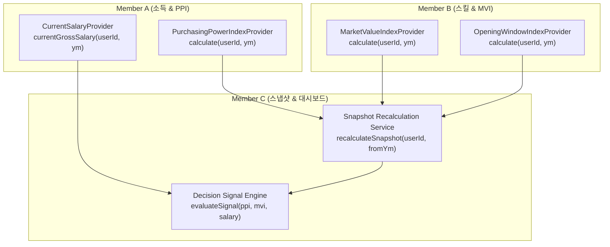

# Carix MVP 개발 계획서 (3인 도메인 수직 분업)

본 계획서는 3명의 풀스택 개발자가 각자의 핵심 가치 사슬(Value Stream)을 전담하여 **프론트엔드(UI)부터 백엔드(API/알고리즘), 데이터 수집/DB까지 End-to-End로 병렬 개발**할 수 있도록 구성된 실행 계획입니다.

> **표기 규약 — 끝난 것을 지우려면 갈 자리와 결번 선언이 먼저다.**
>
> - 옮길 자리가 **있으면** 원래 행을 지우고 **번호를 결번으로 선언하며 행선지를 적는다.**
>   내용은 소관 문서나 다른 절에 남으므로 중복을 만들지 않는다. 결번 선언을 빼먹으면
>   코드가 존재하지 않는 절을 가리키게 된다 — 실제로 그렇게 됐고, 인용 네 곳을 뒤늦게 고쳤다.
> - 옮길 자리가 **없으면**(조건 미발생, 취소된 결정 등) 지우지 않고 ~~취소선~~ 으로 남기고
>   옆에 사유를 적는다. 근거가 사라지면 같은 논의를 다시 하게 된다.
> - 간트는 취소선을 못 쓴다. 완료는 `:done`, 이관·삭제는 주차 표에 취소선으로 남긴다.
> - **이 계획서는 완료 목록을 갖지 않는다.** 무엇이 끝났고 무엇이 남았는지는
>   [`docs/README.md` 「진행 상태」](../README.md#진행-상태)가 소관이다. 여기는 간트의 `:done`
>   과 주차 표의 취소선으로 레인별 선후만 표시한다.

---

## 1. 3인 역할 분담

| 담당자 | 도메인 | 사용자 스토리 | 프론트엔드 (UI) | 백엔드 & 핵심 알고리즘 | 데이터 수집 & DB |
| :--- | :--- | :--- | :--- | :--- | :--- |
| **Member A** | **소득 & 구매력 (PPI & Cost of Living)** | `US-O3` 소득 입력(API 만) `US-O4` 소비 입력(API 만) `US-R1` 이력(API 만) `US-D3` 소득vs물가(데이터만) | **전량 이관.** • ~~`S-06` 소득 입력~~ → C • ~~`S-07` 소비 6대 카테고리~~ → C • ~~`S-14` 소득vs물가 차트 컴포넌트~~ → B _(근거는 아래 각주)_ | • **구매력 지수(PPI) 엔진** ([기능 명세 §4.3](../specs/functional-specification.md)) • 소비 가중치 전파 (`PROPAGATED`) • 소득/소비 이력 CRUD API — `S-12` 탭이 쓴다 • `income_history.change_reason` — 잔류·이직 판별 (`US-O3`) • 기본 소비 가중치 (`DEFAULT_CPI`) 및 `GET /reference/default-expenses` (`US-O6`) • 물가 기여도 1위 품목 (`US-D1` 뱃지) • 연봉 암호화 키·복호화 경계 ([SECURITY §3.2](../SECURITY.md)) | • 통계청 CPI 수집 파이프라인 • `income_history` • `expense_history`, `expense_item` • `cpi_observation` |
| **Member B** | **스킬 & 시장가치 (MVI & Market Worth)** | `US-O5` 스킬 입력 `US-D2` 데이터 상태 `US-D3` 분포·수요 차트 `US-D4` `S-11` 화면 `US-C1~2` `S-13` 화면 `US-M1` `S-16` | • `S-08` 스킬 입력 & 자동완성 • `S-11`·`S-13` — C 레인 부하 분산분. 쓰는 API 는 C 소유 • `S-14` **차트 3종 컴포넌트** — 연봉분포·수요·**소득vs물가**(A 이관분). 셸은 C • `S-16` 관리자 파이프라인 콘솔 | • **시장가치 지수(MVI) 엔진** ([§4.2](../specs/functional-specification.md)) • **스킬 수요 지수** 엔진 ([§4.1](../specs/functional-specification.md)) • 동료집단 완화 (N<10) • 스킬 검색/자동완성 API • `GET /dashboard/salary-distribution` — 제시 연봉 추이·경력 사다리 포함 ([기능 명세 §4.6](../specs/functional-specification.md)) • **개방창 지수(OWI) 엔진** (`OpeningWindowIndexProvider`, [기능 명세 §4.5](../specs/functional-specification.md)) • `GET /skills/recommendations` — 스킬 보강 처방 (`US-D6`) | • 채용공고 & KOSIS 임금 수집 • 표준 스킬 사전 정제 • `skill`, `skill_alias`, `user_skill` • `wage_stat_observation` • `market_aggregate` |
| **Member C** | **인증 · 의사결정 · 시뮬레이터 (Auth, Decision & Action)** | `US-A1~2` 인증 `US-O1~2, 6` 온보딩 `US-D1` 대시보드 `US-D3` `S-14` 셸 `US-R1` `S-12` 화면 `US-S1` 시뮬레이터 | • `S-01~03` 랜딩·로그인·가입 • ~~`S-05`~`S-09` **온보딩 5화면 전체**~~ `S-05`·`S-06`·`S-07`·`S-09` (`S-08`은 B. 근거: `c3`가 14d→18d로 늘어난 4d가 이관받은 `S-06`·`S-07` 두 화면분이라는 §2 기록과 같은 산수로, 이관 전 14d가 다섯 화면을 담당했을 수 없다) • `S-10` **대시보드 메인** (지표 카드 4종) • `S-12` **이력 관리 화면 전체** (API 는 A·B) • `S-14` **추이분석 셸** (A·B 차트 조립) • `S-15` **12개월 시뮬레이터** | • **결정 신호(Rule Matrix) 엔진** • 협상 목표 인상률 (`US-D7`) • **12개월 잔류vs이직 시뮬레이터** (저장 목록 복원 포함, `US-S1`) • **월별 스냅샷 멱등성 저장/재계산** (Job 4 전담, [§4.4](../specs/functional-specification.md)) • 회원가입·로그인, 계정 완전 삭제 • `GET /dashboard/summary`·`/trends`·`/history` — OWI 계열 확장 포함 ([API 규격 §5.1·§5.3·§5.4](../specs/api-specification.md)) | • `auth-service` 모듈 • **세션 게이트** ([`backend/README.md`](../../backend/README.md), 3레인 공통 선행) • **auth 스키마**(Flyway): `users`, `session`, `rate_limit_bucket` • **core 스키마**(직접 DDL): `career_profile`, `index_snapshot`(OWI 컬럼 포함), `career_scenario` |

> **화면 셸 소유는 하나다.** `S-12`(`routes/mypage/records.tsx`)와
> `S-14`(`routes/dashboard/trends.tsx`)는 라우트 파일이 각각 하나이고
> `GET /dashboard/trends` 응답의 `trends[]` 에는 A 의 `incomeIndex`·`personalPriceIndex` 와
> B 의 `marketValueIndex` 가 함께 들어간다. **화면 셸과 합성 API 는 C 가 소유하고 A·B 는
> 차트·탭 컴포넌트를 낸다.** 두 화면을 A·B 에 동시 배정하면 같은 파일과 같은 DTO 를 겹치는
> 기간에 고치게 된다.
>
> `US-D4`·`US-C1~2` 는 반대로 갈린다 — **API 는 C, 화면(`S-11`·`S-13`)은 B** 다. 배정 당시
> C 레인이 최장 경로라 화면만 넘겼다.
>
> **`a3` 은 둘로 갈라 이관했다** — `S-06`·`S-07` 온보딩 UI 는 C, `S-14` 소득vs물가 차트는 B.
> 온보딩 네 화면(`S-05`·`S-06`·`S-07`·`S-09`)이 한 사람 손에 모이고, B 는 같은 `S-14` 셸 위에
> 차트 둘을 이미 만들고 있었다. **A 는 소득/소비 API·`PROPAGATED` 전파·PPI 엔진과 암호화
> 경계를 그대로 갖는다** — 화면만 넘겼고 도메인은 안 쪼갰다.
>
> **대가가 하나 남아 있다.** `US-O3`·`US-O4`·`US-D3` 이 A 의 스토리인데 화면은 A 가 만들지
> 않으므로 **인수 조건 확인은 A 가 하고 구현은 C·B 가 한다.**

**§2 는 결번이다.** 「담당자별 상세 개발 범위」였는데 위 §1 표와 아래 로드맵이 같은 내용을
중복해 걷어냈다. **절 번호는 고정 식별자가 아니다.** 한때 코드 주석과 테스트가 `§4-1`·`§5-B` 처럼 이 문서의 절
번호를 인용해 번호를 못 당겼는데, 그 인용을 전부 소관 문서(API 규격·기술 명세·SECURITY)로
옮겨 지금은 이 문서 밖에서 절 번호를 부르는 곳이 없다. 절이 늘거나 줄면 번호를 당긴다.

---

## 2. 주차별 병렬 개발 로드맵 (9주 스프린트)

> 결정 신호는 3변수 규칙표를 쓰고, 스냅샷 갱신(Job 4)은 `core-api` 가 전담한다. `S-12`·`S-14` 는 화면 셸을 C 로 단일화하고 A·B 는 탭·차트 컴포넌트만 낸다.
>
> `e2e` 선행은 `a10 b14 c9` 세 개다. **실질 임계 경로는 `b14` — B 레인이다.** 종료 일차는
> `b14` 60, `a10` 53, `c9` 50 이다. **임금통계 연도 시계열이 들어오며 A 레인이 45 → 53,
> B 레인이 55 → 60 으로 늘었다.** 인수 조건과 계산 정의는
> [기능 명세 US-D8·§4.9](../specs/functional-specification.md)가 갖는다.
>
> **7주 → 9주로 늘리며 B 를 직렬로 폈다.** 한 사람이 `b5`·`b6`·`b7`·`b10` 을 겹쳐 도는 그림이었다
> — 간트는 병렬로 그렸지만 담당은 하나다. 블록을 사슬로 잇고, 12d 짜리 `b5`(MVI 표본부족 검증)는
> A 로 넘겼다. 그 12d 는 옛 C 종료에 맞춘 채움 값이라 실측 근거가 없었고, 검증 작업이라 B 도메인
> 구현 지식이 덜 든다 — **인수 조건 확인은 B 가 하고 실행은 A 가 한다**(§1 각주와 같은 분업).
> 팀 합의가 선행이다.
>
> **A 유휴가 22일에서 0으로 줄었다.** `a7`(PPI 엣지케이스·민감 금액 로깅 마스킹)은 옛 7주차 공통
> 항목을 A 의 빈 구간으로 당긴 것이다.
>
> **간트 블록은 쪼개지 않으면 부분 완료를 담지 못한다.** 한 블록의 일부만 끝났을 때는
> 완료분을 `b3a`·`c4a` 처럼 별도 블록으로 떼어 `done` 을 붙이고 잔여를 원래 ID 로 남긴다.
> 블록 ID 하나에 완료·미완이 섞이면 간트와 아래 주차 표가 서로 다른 말을 한다.

```mermaid
gantt
    title Carix 3인 병렬 개발 로드맵
    dateFormat X
    axisFormat %s
    section 공통 (0주차)
    DB 마이그레이션 방식 확정 :done, c0a, 0, 1s
    임금통계 기준선 데이터 확보 :done, a0, 3, 3s
    스냅샷 Job4 core-api 전담 결정 :done, i0, 7, 1s
    미배정 API 범위 결정 :done, c0, 7, 2s
    section Member A (소득/PPI)
    CPI 수집 파이프라인 & 소득/소비 CRUD API :done, a1, 12, 3s
    PPI 계산 엔진 & 가중치 전파 & 암호화 키 :a2, after a1, 14s
    소득 변경 사유(change_reason) 컬럼 & API :a4, after a2, 2s
    물가 기여도 1위 품목(US-D1 뱃지) :a5, after a4, 1s
    기본 소비 기준값 API(US-O6) :a6, after a5, 1s
    PPI 엣지케이스 & 민감 금액 로깅 마스킹 점검 :a7, after a6, 4s
    MVI 표본부족(N<10) 엣지케이스 검증 — b5 에서 이관 :a8, after a7, 8s
    내 상승률 vs 시장 상승률(US-D8) :a9, after a8, 5s
    임금 상승률 vs 개인물가 — a2 확장 :a10, after a9, 3s
    section Member B (스킬/MVI)
    공고/임금 수집 파이프라인 & 스킬사전 검색 API :done, b1, 2, 2s
    market_aggregate 사전집계 파이프라인 :done, b2a, 3, 1s
    collector 관리자 구동 연동·배포 배선(5-C) :done, b0, 7, 5s
    스킬수요 지수 & MVI 계산 엔진 :done, b2, 8, 4s
    S-16 관리자 파이프라인 콘솔(US-M1) :done, b16, 14, 1s
    salary-distribution API — 원 공고 직접 집계 :done, b3a, 15, 1s
    스킬 UI(S-08) & 차트 3종(연봉분포·수요·소득vs물가) :done, b3, after b3a, 10s
    스냅샷 이력(S-11) & 설정·탈퇴(S-13) UI :done, b4, after b3, 7s
    추이분석(S-14) 화면 셸 — c4 에서 이관 :done, b4a, after b4, 1s
    개방창 집계 & OWI Provider :b6, after b4, 6s
    브래킷 6구간 정합·연차 해상도 & 라우트 별칭 정리 :b7, after b6, 4s
    제시 연봉 추이(US-D3·§4.6) :b10, after b7, 3s
    market_aggregate 연봉 5수치 제거 :b11, after b10, 1s
    경력 사다리 & 기준선 출처 표기(§4.7) :b12, after b11, 2s
    MVI 임계값 외부화 & 수집 우선순위 산출 :b8, after b12, 3s
    스킬 보강 추천 API & 동시출현 근거(US-D6) :b9, after b8, 3s
    임금통계 출처 노출 & 연도 시계열 읽기 경로 :b13, after b9, 3s
    경력 사다리 연도 축 — b12 확장 :b14, after b13, 2s
    section Member C (인증/결정/시뮬레이터)
    세션 게이트 배선 — Gateway 필터 + core-api X-User-Id 주입 :done, c0b, 7, 4s
    스냅샷 멱등성 엔진(Job 4) & 결정신호 판정 엔진 :done, c2, 8, 4s
    온보딩 4화면(S-05~S-07·S-09) & 대시보드(S-10) & 시뮬레이터 UI(S-15) :done, c3, after c2, 18s
    dashboard summary·trends·history 실데이터 전환 :done, c4a, 15, 1s
    이력관리(S-12) 화면 — S-14 셸은 B 납품분으로 빠짐 :c4, after c3, 6s
    OWI 스냅샷 컬럼 & 대시보드 3 API 확장 :c6, after c4, 4s
    스냅샷 쓰기 운영 Postgres 검증(5-K) :c5, after c6, 5s
    S-10 근거 아코디언 — 스킬 보강 처방 노출 :c7, after c5, 1s
    협상 목표 인상률(US-D7) :c8, after c7, 2s
    저장 시나리오 목록 & S-15 복원(US-S1) :c9, after c8, 2s
    section UI 일관성 통일 (로드맵 밖 · C)
    P0 — 결정신호 단일화 & 시각회귀 베이스라인 :done, ui0, 33, 2s
    P1 — 다크 변형(custom-variant) & carix-action 토큰 :done, ui1, after ui0, 2s
    P2 — 공용 표현 계층 & 어휘 계약 :done, ui2, after ui1, 2s
    P3~P4 — 프리미티브 재정의·규범 :ui3, after ui2, 6s
    section 전원 통합 (9주차)
    E2E 연동 테스트 & 비기능/완료기준 점검 :crit, e2e, after a10 b14 c9, 5s
```

> **가로축은 달력이 아니라 착수 기준 일차(日次)다.** 눈금 `0`·`5`·`10` 은 첫 블록 착수로부터
> 며칠째인지를 뜻한다. 날짜를 쓰지 않으려고 `dateFormat X` 상대 축을 쓰므로 블록 길이의
> 단위 기호가 `s` 로 적히지만 **한 칸은 하루다** — `14s` 는 14일이다.

| 주차 | Member A (소득 & PPI) | Member B (스킬 & MVI) | Member C (인증 & 결정 & 시뮬레이터) |
| :--- | :--- | :--- | :--- |
| **0주차 (사전정렬)** | 완료 | 완료 | 완료. **세션 게이트 플래그 전환만 미실행** ([OCI 실행 순서](oci-server-provisioning-plan.md)) |
| **1~2주차 (인프라 & 파이프라인)** | ~~`a1` — CPI 수집 파이프라인, 소득/소비 CRUD API~~ 완료 | 완료 | 완료 |
| **3~4주차 (핵심 계산 엔진)** | • **개인물가 & 구매력 지수(PPI) 계산 엔진** • 소비 가중치 전파(`PROPAGATED`) 로직 • **연봉 암호화 키 로테이션·스냅샷 복호화 경계** ([SECURITY §3.2](../SECURITY.md)) _(`a2` 는 이 칸보다 앞선다)_ | • ~~동료집단 완화 알고리즘 (`N<10` 클램프)~~ — 완료 • ~~`S-08` 스킬 입력 & 자동완성 UI~~ — 완료 • ~~`S-14` **차트 3종** (연봉분포·수요·소득vs물가)~~ — 완료 • ~~`S-11` 월별 스냅샷 이력 UI~~ — 완료 • ~~`S-13` 설정·계정 삭제 UI (세션 관리 & 완전 삭제)~~ — 완료 | • ~~`S-05`·`S-06`·`S-07`·`S-09` **온보딩 4화면**~~ — 완료. `S-08` 은 B — 근거는 §1 각주 • ~~`S-10` **대시보드 메인**~~ — 완료 • ~~`S-15` **시뮬레이터 UI**~~ — 완료 • ~~`auth-service` 온보딩 단계 갱신(`PATCH /v1/auth/onboarding`)~~ — 완료. `c3` 의 18d 에 없던 작업이고 `S-08` 이 B 로 정리되며 회수한 구간에서 냈다 |
| **5~6주차 (UI & 지표 확장 1)** | ~~`a3` — `S-06`·`S-07` 온보딩 UI, `S-14` 소득vs물가 차트~~ → C·B 이관 • **소득 변경 사유 컬럼 & API** (`a4`) • **물가 기여도 1위 품목 뱃지** (`a5`) • **기본 소비 기준값 API** (`a6`) | • **개방창 지수(OWI) 집계·완화·Provider** (`b6`) • **경력 브래킷 6구간 정합 & 라우트 별칭 정리** (`b7`) | • `S-12` **이력 관리 화면 전체** (`c4`) • 소득 탭에 **변경 사유 선택** (`a4` API) • **OWI 스냅샷 컬럼 & 대시보드 3 API 확장** (`c6`) — **`c5` 보다 먼저** |
| **7주차 (지표 확장 2 · 검증 착수)** | • **PPI 엣지케이스 & 민감 금액 로깅 마스킹 점검** (`a7`) — 옛 7주차 공통 항목을 당겼다 | • **제시 연봉 추이** (`b10`) • **`market_aggregate` 연봉 5수치 제거** (`b11`) • **집계월 분포 확인** — `b6` 착수 전 SQL 한 줄 | • **스냅샷 쓰기 운영 Postgres 검증** (`c5`) • `S-10` 근거 아코디언 — **스킬 보강 처방** (`c7`) |
| **8주차 (처방 · 정합)** | • **MVI 표본부족(`N<10`) 엣지케이스 검증** (`a8`) — B 에서 이관. 인수 조건 확인은 B | • **경력 사다리 & 기준선 출처 표기** (`b12`) • **MVI 임계값 외부화 & 수집 우선순위 산출** (`b8`) • **스킬 보강 추천 API & 동시출현 근거** (`b9`) | • **협상 목표 인상률** (`c8`) • **저장 시나리오 목록 & `S-15` 복원** (`c9`) • **UI 일관성 통일** — P3~P4 (`ui3`). 계획은 [ui-unification-plan.md](ui-unification-plan.md) |
| **9주차 (임금 시계열)** | • **내 상승률 vs 시장 상승률** (`a9`) • **임금 상승률 vs 개인물가** (`a10`) — `a2` 확장 | • **임금통계 출처 노출 & 연도 시계열 읽기 경로** (`b13`) • **경력 사다리 연도 축** (`b14`) — `b12` 확장 • **KOSIS 연도 커버리지 확인** — `b13` 착수 전 `S-16` 범위 수집 한 번 | • 잔여 없음 |
| **10주차 (E2E 통합 검증)** | • 실데이터 통합 점검 합류 | • 실데이터 파이프라인 통합 점검 | • 온보딩 → 대시보드 → 시뮬레이터 E2E 점검 • 계정 삭제 시 개인 데이터 완전 삭제 검증 |

> **주차 배치는 최장 경로 기준이고, 그 레인은 C 다.** `a3` 이관 뒤 A 는 `a6`(33일차)에서
> 끝나고, §4 잔여가 올라오며 C 가 `c9`(50일차)로 B(`b9` 48)를 앞섰다. 정확한 선후와 기간은
> 항상 간트를 따른다.
>
> **`b7` 에 `c5` 의존을 걸지 않았다.** 브래킷 수정은 차단이 아니라 배포 전 **결정**이라 안 고치기로
> 정하면 블록 자체가 사라진다. 늦게 하면 무엇을 치르는지는
> [OCI 서버 구성·배포 「배포 전 실행 순서」](oci-server-provisioning-plan.md)가 갖는다.
>
> **개방창 지수(OWI, [기능 명세 §4.5](../specs/functional-specification.md))가 들어오며 C 레인이 4일 늘었다**(`c6`). `c6` 를 `c5` 앞에 둔 것은 일정이 아니라 `rationale` 형상 여유 때문이다 — 운영 스냅샷에 행이 쌓인 뒤에는 `index_snapshot` 컬럼 추가에 마이그레이션이 붙는다. B 쪽은 `b6`(6d)+`b7`(4d)+`b8`(3d)+`b9`(2d)=15d 로 **`b5`(12d) 채움 구간을 넘어서며 임계 경로가 됐다.** `e2e` 선행에 `b9`·`c7` 을 거는 이유다 — 각 레인의 마지막 블록이다. `b5` 는 이제 채움이 아니라 병렬 블록이다.
>
> **채움 값은 없다.** 옛 `b5`(12d)와 `c5`(14d)는 다른 레인 종료일에 맞춘 값이었다. `c5` 는
> 진작 걷어 5d 로 잡았고(한 사용자에 `recalculateSnapshot` 한 번), `b5` 는 A 로 넘기며 8d 로
> 다시 잡았다(`a8`). 지금 모든 기간은 작업 자체의 추정이고, 실측이 나오면 다시 잡는다.
>
> `b3a`·`c4a` 는 원래 블록에서 떼어낸 부분 완료분이다 — 먼저 끝난 것은 `b3`·`c4` 전체가
> 아니라 그 안의 API 분이고, 잔여는 여전히 `c3`·`b3` 사슬에 걸려 있다.
>
> **A 유휴는 메웠다.** `a3` 이관으로 생긴 빈 구간에 `a4`~`a6`(도메인 잔여), `a7`(옛 마지막 주차
> 공통 검증), `a8`(B 에서 넘긴 MVI 표본부족 검증)을 넣어 A 가 45일차까지 찬다.

> **완료 기준 10번(민감 금액 로그 미기록)은 전 레인 공통이다**
> ([기능 명세 §7](../specs/functional-specification.md)). `POST /scenarios/simulate` 요청 본문의
> `currentGrossSalary`·`moveTargetGrossSalary` 와 스냅샷 재계산의 복호화 경로
> 등에서 금액이 평문으로 로그에 찍히면 안 된다.

---

## 3. 레인 간 인터페이스 계약 (확정 & 스텁)

1. **지수 산출 결과 계약 (A, B $\rightarrow$ C)** — `core-api` 의 `com.carix.index` (인터페이스 SPI), `com.carix.index.dto` (결과 Record), `com.carix.index.enums` (도메인 Enum) 에 확정돼 있다:
   - Member A는 `PurchasingPowerIndexProvider.calculate(userId, baseYearMonth)` 를 구현해 `PpiResult`(지수값, 상태, 소비 가중치 출처, 지수 기준월, CPI 원천 기준일)를 반환 (품목별 CPI 모듈 완성 전까지 사용자의 최초 소득월 100.0 및 소득 변동 기반 구매력 지수를 제공하는 기본 산출기 `DefaultPurchasingPowerIndexProvider` 배선 완료)
   - Member B는 `MarketValueIndexProvider.calculate(userId, baseYearMonth)` 를 구현해 `MviResult`(지수값, 상태, **원천별** 완화 단계·표본 수, 제외 스킬과 사유, 임금통계 기준선, 집계 기준일)를 반환 (실제 구현체 `MarketValueIndexServiceImpl` 배선 완료)
   - Member A는 `CurrentSalaryProvider.currentGrossSalary(userId, baseYearMonth)` 도 구현해 기준월 시점에 유효한 세전 연봉을 반환한다 (`IncomeCurrentSalaryProvider` 배선 완료). 결정 신호 규칙표의 **소득 격차 비율**은 이 값을 분모로 쓰는데 `PpiResult`·`MviResult` 어디에도 없어 규칙 2·3·5 가 계산되지 않았다. 연봉을 `PpiResult` 에 실으면 평문 금액이 스냅샷 `rationale` 경로까지 흘러가므로 계약을 따로 둔다. 복호화 경계는 소득 도메인 안에 남는다([SECURITY §3.2](../SECURITY.md))
   - Member B는 `OpeningWindowIndexProvider.calculate(userId, baseYearMonth)` 도 구현해 `OwiResult`(지수값, 상태, 동료집단 표본 수, 마감일 보유 표본 수, 중앙 개방일수, 상시채용 비율, 완화 단계·조건 문구, 기준 모수 중앙 개방일수)를 반환한다. 산출은 `market_aggregate` 가 아니라 원 공고 직접 집계다 ([기능 명세 §4.5](../specs/functional-specification.md))
   - 계산 불가는 예외가 아니라 `IndexStatus` 로 돌려준다. 값은 `null` 이고 0 이나 100 으로 채우지 않는다
   - 구현 빈이 없는 동안 `com.carix.index.stub` 이 `NOT_AVAILABLE` 을 돌려주도록 설계되었으나, 현재 실제 연봉 공급자(`IncomeCurrentSalaryProvider`) 및 기본 지수 공급자(`DefaultPurchasingPowerIndexProvider`)가 배선되어 소득 이력이 존재하는 사용자의 스냅샷 지수 결측 및 결정 신호 `데이터 부족`(`INSUFFICIENT_DATA`) 문제가 정상 해소되었다.
2. **스냅샷 재계산 트리거 (A, B $\rightarrow$ C)**:
   - 사용자가 소득/소비(Member A) 또는 스킬(Member B)을 추가/수정/삭제했을 때, Member C의 `recalculateSnapshot(userId, fromYm)`을 호출하여 해당 시점 이후의 스냅샷을 멱등하게 갱신
   - 호출 대상은 `com.carix.snapshot.SnapshotRecalculationService.recalculateSnapshot(UUID userId, String fromYearMonth)` 이며 `fromYearMonth` 는 변경의 가장 이른 유효월(`YYYYMM`)이다. 한 번의 호출이 그 월부터 현재월까지를 하나의 `data_version` 으로 다시 쓴다
   - **호출 방식은 트랜잭션 안의 동기 직접 호출로 확정한다.** 이벤트 + `@Async` 안(案)은 택하지 않았다 — MVP 는 스레드풀·재시도·실패 관측 경로를 늘리지 않는다. 멱등성은 이미 `pg_advisory_xact_lock` 과 `data_version` 이 보증한다. 응답 지연이 실측으로 문제가 되면 그때 비동기로 이관한다
   - 호출부는 소득 3경로·소비 1·스킬 3·프로필 1 이다. `fromYm` 규약은 `com.carix.snapshot.YearMonths` 한 곳에 있다 — 값에 유효월이 있으면 그 달, 없으면 변경 시점의 달이고, 유효월을 앞으로 당기는 수정은 옛 달부터 다시 계산한다
3. **스냅샷 갱신(Job 4) 실행 주체 — core-api 전담 확정**:
   - 스냅샷 계산/갱신 엔진은 `core-api`가 전담 소유한다. `collector`는 `market_aggregate` 집계까지 완료하며, `index_snapshot` 생성/갱신은 `core-api` 내부 API 호출 또는 사용자 프로필/소득/소비/스킬 변경 시 `core-api` 내에서 직접 `recalculateSnapshot(userId, fromYm)`을 수행한다.
   - `core.index_snapshot`에 대한 쓰기 권한과 연봉 복호화 키 접근([SECURITY §3.2](../SECURITY.md))도 `core-api`(Member C/A) 내에서 안전하게 격리된다.
4. **계약에 없던 크로스레인 의존 2건**:
   - 시뮬레이터 `feasibility`(`targetPercentile`, `difficultyGrade`)는 **B 의 동료집단 공고 분포**를
     입력으로 요구하나 화면은 C(`S-15`)다. 산출원은 `job_posting` 직접 집계이며 임금통계
     기준선(`wage_stat_observation`)과는 별개 원천이다.
   - `GET /dashboard/salary-distribution` 은 §1 에서 B 의
     `S-14` 차트로 배정됐으나 API 는 대시보드 도메인이다. **구현 소유는 B 로 확정했다**(API 규격 §5.2) —
     원 공고 직접 집계라 중복제거·동료집단 조건이 전부 B 소유물이기 때문이다
5. **완료 기준 10개 항목 점검**:
   - 구현 완료 시 `functional-specification.md` §7의 MVP 완료 기준 10개 항목을 전원이 크로스 체크

---

## 4. MVP 범위 판정과 이후 후보

**범위를 가르는 기준과, 아직 판정하지 않은 후보**의 소관이다. 아무것도 막지 않아 로드맵에 두지
않고, 확정되지 않아 명세도 못 받는다 — 그 사이에 있는 것만 여기 남는다. 판정이 끝난 항목은
소관 문서로 가고 여기서 지운다. 적는 목적은 착수가 아니라 **선행 조건과 소급 가능 여부를 잃지
않는 것**이다.

### MVP 범위 밖 API — 판별 기준

판별 기준은 하나다 — **기존 화면의 인수 조건이 그 응답을 요구하는가.** [API 규격](../specs/api-specification.md)에는
있으나 [기능 명세 §8 추적 매트릭스](../specs/functional-specification.md)에는 없던 6개가 이
기준을 통과하지 못했다. 기능 명세에 구멍이 있던 게 아니라 API 규격이 더 넓었다. **판정 결과와
각 사유는 API 규격의 해당 절이 갖는다** — 이 기준은 규격이 또 넓어질 때 다시 쓴다.

승격하려면 **기능 명세에 인수 조건을 먼저 세운다.** 화면이 요구하지 않는 응답을 먼저 만들면
판별 기준 자체가 무의미해진다.

### 아직 판정하지 않은 것

수집·저장은 되는데 어떤 화면도 읽지 않는 데이터 중 **만들 것이 보이는 후보**만 적는다. 소비자가
없다는 사실 자체는 [기술 명세 §1.2](../specs/technical-specification.md)가 갖는다 — 거기 적힌
`title`·`company_name`·`position_level`·`company_badge`·`dedup_rule_version` 은 재료로만 남기고
후보로 올리지 않았다. `cpi_observation` 도 후보가 아니다: 버려진 게 아니라 품목별 PPI 본
엔진(`a2`)이 미착수라 소비자가 아직 없는 것이다.

**실측 경력별 임금 원천 확보** — 현재 기준선은 KOSIS 연령대를 경력구간으로 옮긴 값이라
사용자가 입력한 경력이 기준선에 직접 반영되지 않는다([기술 명세 §1.2](../specs/technical-specification.md)).
결정 규칙 2·3·5 가 전부 이 비율에 걸린다. 경력별 실측 원천이 생기면 프록시가 사라지지만
`5-A`(임금통계 원천 재선정)를 다시 여는 일이라 **언제 될지 모른다.** 그때까지는 화면이
기준선의 성격을 밝혀 정직을 지킨다(`b12`).

**`wage_stat_observation` 연도 시계열 — 판정 끝났다.** MVP 안으로 승격했고 인수 조건은
[기능 명세 US-D8·§4.9](../specs/functional-specification.md), 일정은 §2 `a9`·`a10`·`b13`·`b14`
가 갖는다. 여기 적어둘 게 하나 남는다 — **KOSIS 가 여러 해를 주는지는 아직 확인 안 됐다.**
수집 경로는 이미 범위를 받고(`S-16` 콘솔의 연도 범위 모드), 출처 컬럼도 섰으므로 한 번
돌려보면 판정된다. 실측 연도가 하나뿐이면 `a9`·`b14` 가 성립하지 않으므로 **되돌릴지를
결정으로 올린다** — 자동으로 축소하지 않는다.

**시나리오 예측의 사후 검증** — `career_scenario` 의 12개월 예측을 같은 기간 실제 소득과 맞대면
이 서비스의 조언이 맞았는지 검증된다. 맞댈 상대는 `index_snapshot` 이 **아니다** — 예측은 원화
보상이고 스냅샷은 지수·신호라 비교가 성립하지 않는다. 실적은 `income_history` 에 있다.

성립 조건은 **잔류·이직 판별**이었고 저장소 어디에도 없었다(`income_history` 는 `(연봉, 유효일)`
뿐, `career_profile` 에 고용주 식별자 없음 — 인상과 이직이 구별되지 않는다). `a4` 가 그
`change_reason` 을 더한다. 예측 저장 배선은 이미 붙었고 `UNIQUE` 가 없어 행이 쌓인다.

**남은 것은 시간뿐이다** — 결과가 나오기까지 12개월이라 `a4` 착수 시점이 곧 검증 가능 시점을
정한다. `a4` 가 늦어진 만큼 그 이전 소득 행은 영구히 판별 불가로 남는다.
