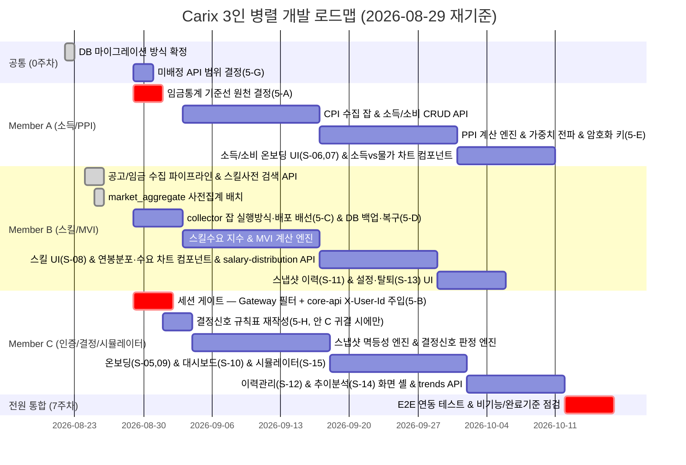
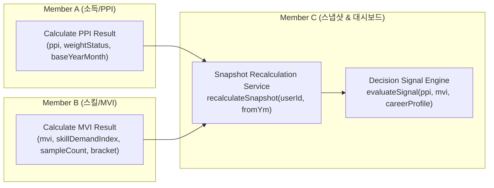

# Carix MVP 개발 계획서 (3인 도메인 수직 분업)

본 계획서는 3명의 풀스택 개발자가 각자의 핵심 가치 사슬(Value Stream)을 전담하여 **프론트엔드(UI)부터 백엔드(API/알고리즘), 데이터 수집/DB까지 End-to-End로 병렬 개발**할 수 있도록 구성된 실행 계획입니다.

---

## 1. 3인 역할 분담 요약

| 담당자 | 담당 도메인 | 프론트엔드 (UI) | 백엔드 & 핵심 알고리즘 | 데이터 수집 & DB |
| :--- | :--- | :--- | :--- | :--- |
| **Member A** | **소득 & 구매력 분석 (PPI & Cost of Living)** | • `S-06` 소득 입력 • `S-07` 소비 6대 카테고리 입력 • `S-14` **소득 vs 개인물가 차트 컴포넌트** | • **구매력 지수(PPI) 계산 엔진** (§4.3) • 소비 가중치 전파 로직 (`PROPAGATED`) • 소득/소비 이력 CRUD API • 기본 소비 가중치 관리 (`DEFAULT_CPI`) • 연봉 컬럼 암호화 키 주입·배치 복호화 경계 (§5-E) | • **임금통계 기준선 원천 재선정** (§5-A — 결과는 B·C 가 소비) • 통계청 CPI(소비자물가) 수집 파이프라인 • `income_history` • `expense_history`, `expense_item` • `cpi_observation` |
| **Member B** | **스킬 & 시장가치 분석 (MVI & Market Worth)** | • `S-08` 스킬 입력 & 자동완성 • `S-11` 월별 스냅샷 이력 • `S-13` 설정·계정 삭제 • `S-14` **연봉 분포·스킬 수요 차트 컴포넌트** | • **시장가치 지수(MVI) 계산 엔진** (§4.2) • **스킬 수요 지수** 계산 엔진 (§4.1) • 동료집단 완화 알고리즘 (N<10) • 스킬 검색/자동완성 API | • 채용공고 & KOSIS 임금 수집 파이프라인 • 표준 스킬 사전 정제 • `skill`, `skill_alias`, `user_skill` • `wage_stat_observation` • `market_aggregate` |
| **Member C** | **인증, 의사결정 & 시뮬레이터 (Auth, Decision & Action)** | • `S-01~03` 랜딩 & 로그인·계정 등록 • `S-05, 09` 프로필 & 온보딩 검토 • `S-10` **대시보드 메인 (3대 카드 종합)** • `S-12` **이력 관리 화면 전체** • `S-14` **추이분석 화면 셸** (A·B 차트 조립) • `S-15` **12개월 커리어 시뮬레이터** | • **결정 신호(Rule Matrix) 판정 엔진** • **12개월 잔류 vs 이직 시뮬레이터** (US-S1) • **월별 스냅샷 멱등성 저장/재계산** (§4.4) • 회원가입·로그인 (US-A1~2) • 계정/데이터 완전 삭제 (US-C2) | • `auth-service` 모듈 • **세션 게이트** — Gateway 필터 + core-api `X-User-Id` 주입 (§5-B, 3레인 공통 선행) • **auth 스키마**(auth-service 소유·Flyway): `users`, `session`, `rate_limit_bucket` • **core 스키마**(직접 DDL): `career_profile`, `index_snapshot`, `career_scenario` |

> **화면 셸 소유는 하나다.** `S-12`(`routes/mypage/records.tsx`)와
> `S-14`(`routes/dashboard/trends.tsx`)는 라우트 파일이 각각 하나이고
> `GET /dashboard/trends` 응답의 `trends[]` 배열에는 A 의 `incomeIndex`·`personalPriceIndex` 와
> B 의 `marketValueIndex` 가 함께 들어간다. 이전 판은 두 화면을 A 와 B 에 동시 배정해
> 같은 파일과 같은 DTO 를 겹치는 기간에 고치게 돼 있었다. **화면 셸과 합성 API 는 C 가
> 소유하고 A·B 는 차트·탭 컴포넌트를 낸다.**
>
> 표기 정정 — 초안의 `cpi_monthly_index`는 실제 테이블명 `core.cpi_observation`으로 바로잡았다
> ([상세 기술 명세](../specs/technical-specification.md), `deploy/postgres/schema/03_reference_and_aggregate.sql`).
> 초안의 `index_calc_log`는 DDL·명세·ERD 어디에도 정의가 없어 제거했다. 지수 계산 감사 로그가
> 필요하면 테이블을 먼저 명세에 정의한 뒤 다시 올린다.

---

## 2. 담당자별 상세 개발 범위

### 🧑‍💻 Member A : 소득 & 구매력 분석 (PPI 도메인)
- **사용자 스토리**: `US-O3`(소득 입력), `US-O4`(소비 입력), `US-R1`(소득/소비 이력 관리), `US-D3`(소득 vs 물가 차트)
- **Frontend**:
  - `S-06` 소득 입력 화면 (세전 연봉, 유효 시작일, 월 실수령액)
  - `S-07` 소비 입력 화면 (6대 카테고리 금액 입력, 실지출/추정 뱃지 처리)
  - `S-14` 소득 지수선(`incomeIndex`) vs 개인물가 지수선(`personalPriceIndex`) 2계열 차트와
    **구매력 손실 음영** — **차트 컴포넌트만**. 화면 셸과 `GET /dashboard/trends` 는 C 소유
  - `S-12` 소득·소비 탭에 쓰이는 조회·수정 API 제공 (화면은 C)
- **Backend & Data**:
  - `collector`: 통계청 CPI 지수 수집 배치 및 카테고리 매핑 파이프라인
  - `core-api`: 
    - `POST /income`, `PUT /income/{id}`, `PUT /expenses/{ym}` API
    - **개인소비자물가지수 & 구매력 지수(PPI) 산출 엔진** 구현
    - 소비 가중치 상태 관리 (`USER_DEFINED`, `PARTIALLY_ESTIMATED`, `PROPAGATED`, `DEFAULT_CPI`)
    - 과거 소비 수정에 따른 미래 가중치 전파 로직

---

### 🧑‍💻 Member B : 스킬 & 시장가치 분석 (MVI 도메인)
- **사용자 스토리**: `US-O5`(스킬 입력), `US-D2`(데이터 상태 구분), `US-D3`(연봉 분포 & 스킬 수요 차트), `US-D4`(`S-11` 화면), `US-C1~2`(`S-13` 화면). `US-R1` 의 스킬 이력은 API 만 제공하고 화면은 C 가 만든다
- **Frontend**:
  - `S-08` 스킬 입력 화면 (표준 사전 자동완성, 실무 사용 기간/최종 사용일, 중복 방지)
  - `S-11` 월별 스냅샷 이력 타임라인, `S-13` 설정·계정 삭제 화면 — C 레인 부하 분산분.
    쓰는 API(`GET /dashboard/history`, `DELETE /users` 등)는 C 소유다
  - `S-14` **연봉 분포 5수치(최소/25%/중앙/75%/최대) 핀 차트**와 **스킬 수요 추이 차트** —
    **차트 컴포넌트만**. 화면 셸은 C 소유
  - `S-12` 스킬 탭에 쓰이는 조회·수정 API 제공 (화면은 C)
  - 표본 부족(`N < 10`), 업데이트 지연 배지 UI 처리
- **Backend & Data**:
  - `collector`: 원천 채용공고 크롤링/수집, KOSIS 임금통계 수집 및 deduplication 파이프라인
  - 표준 스킬 사전 시드 데이터 구축 및 검색 API (`GET /skills/search`)
  - `core-api`:
    - `POST /user-skills`, `DELETE /user-skills/{id}` API
    - **스킬 수요 지수 산출 엔진** (최근 3개월 vs 이전 12개월, 클램프 [25, 400] 처리)
    - **시장가치 지수(MVI) 산출 엔진** 및 동료집단 완화 알고리즘 (직무/경력/지역/규모 단계별 완화)

---

### 🧑‍💻 Member C : 인증, 의사결정 & 시뮬레이터 (Auth & Decision 도메인)
- **사용자 스토리**: `US-A1~2`(인증), `US-O1~2, 6`(온보딩 오케스트레이션), `US-D1`(대시보드 종합), `US-D3`(`S-14` 화면 셸), `US-R1`(`S-12` 이력 관리 화면), `US-S1`(시뮬레이터). `US-D4`·`US-C1~2` 는 **API 만** 소유하고 화면(`S-11`·`S-13`)은 B 가 만든다
- **Frontend**:
  - `S-01` 랜딩(가입 없이 시작), `S-02` 로그인, `S-03` 계정 등록
  - `S-05` 프로필 입력, `S-09` 온보딩 검토·완료 화면 (2초 디바운스 자동 저장 오케스트레이션)
  - `S-10` **대시보드 메인** (구매력 카드 + 시장가치 카드 + **결정 신호 카드** + 근거 아코디언)
  - `S-12` **이력 관리 화면 전체** (소득·소비·스킬 3개 탭 — API 는 A·B 제공)
  - `S-14` **추이분석 화면 셸** 과 A·B 차트 컴포넌트 조립
  - `S-15` **12개월 잔류 vs 이직 시뮬레이터** (실업급여 요건, 공백기, 인상률 기반 실시간 비교)
  - `S-11`·`S-13` 은 **화면을 B 가 만든다** (부하 분산). C 는 두 화면이 쓰는 API —
    `GET /dashboard/history`, `POST /auth/logout-all`, `DELETE /users` — 를 소유한다
- **Backend & Data**:
  - `auth-service`: 회원가입·로그인, 세션 토큰 해시 저장 전환,
    매직링크·초대·메일 코드 폐기, 인증 흐름 테스트 코드 (완료)
  - `core-api`:
    - `PATCH /onboarding`, `PATCH /profile`, `DELETE /users` API
    - **결정 신호(Decision Signal) 판정 엔진** (Rule Matrix: 잔류 권고/이직 준비/소득 방어 등)
    - **월별 스냅샷 멱등성 저장/재계산 엔진** (`index_snapshot` 버전 관리, `(userId, ym, dataVer, ruleVer)`)
    - 12개월 시뮬레이터 계산 API (`POST /scenarios/simulate`)
    - `GET /dashboard/trends` — A·B 지수 계열을 하나의 `trends[]` 로 합성 (§5-J 의
      `salary-distribution` 은 B 소유)

---

## 3. 주차별 병렬 개발 로드맵 (7주 스프린트)

> **기준일 2026-08-29 (재기준).** 08-27 판은 B 레인 선행 완료만 반영했고 레인 길이는
> 그대로 뒀다. 이번 재기준에서 적대 검토 결과 13건을 반영해 간트를 다시 짰다. 바뀐 것:
>
> - `c1`(인증 구현·auth 테스트·`S-01~03` UI)은 **잔여가 없어 제거**했다. 남아 있던
>   Gateway 세션 검증 필터는 `c0b`(§5-B)로 옮겼다
> - `a1`·`c0b`·`b0` 의 `after c0` 를 걷었다. `c0` 는 임금통계 기준선 결정(§5-A)이고
>   셋 다 그 산출물을 쓰지 않는다. **실제로 `c0` 를 기다리는 것은 `b2`·`c2` 뿐이다**
> - `a1`(CPI 수집 잡)은 `b0` **뒤로** 걸었다. 둘 다 `collector` 모듈이고, `b0` 가 잡 실행
>   방식(Spring Batch 도입 vs 기존 `/internal/pipeline/*` 내부 API 패턴)을 정하기 전에는
>   A 가 무엇으로 짜야 할지 알 수 없다
> - **§5-A(임금통계 기준선 결정)를 B 에서 A 로 옮겼다.** B 는 0주차에 이미 §5-C·§5-D·§5-I
>   를 5일 안에 해야 하고, `b2` 가 그 뒤에 직렬로 붙어 있어 여유가 없다. 반면 A 는
>   `a1` 이 `b0` 게이트에 막혀 0주차가 통째로 비어 있다. §5-A 는 MVI 구현이 아니라
>   **원천 실측·결정**이고 A 는 같은 시기에 KOSIS 어댑터를 다루므로 A 가 맡는다.
>   결과는 B(MVI)·C(규칙표)가 소비한다
> - §5-H(안 C 귀결 시 규칙표 재작성)에 `h1` 바를 만들고 `c2` 를 그 뒤로 걸었다.
>   이전 판은 "`c2` 착수 전"이라고만 적어 실제로 하루도 배정돼 있지 않았다
> - `S-12`·`S-14` 는 라우트 파일과 응답 DTO 가 각각 하나인데 소유자가 둘이었다.
>   **화면 셸을 C 로 단일화**하고 A·B 는 탭·차트 컴포넌트만 낸다 (§1 표 참조)
> - C 에 몰려 있던 `S-11`·`S-13` 을 B 로 넘겨(`b4`) B 의 유휴 9일을 채웠다
> - `e2e` 선행조건을 `a3 b4 c4` 세 개로 바꿨다. 이전 판은 `c3` 하나만 걸어, C 가 먼저
>   끝나는 순간 A 산출물 없이 E2E 가 시작되는 구조였다
>
> **최장 경로는 §5-A 의 결론에 따라 갈린다.** 간트는 보수적으로 **안 C 귀결**을 그렸고,
> 그 경우 `h1` 이 `c2` 를 3일 밀어 최장 경로가 `c4`(10-12 종료)다. **안 B 가 채택되면
> `h1` 이 빠져** C 레인이 3일 당겨지고 `a3`(10-11)가 최장이 된다.
> 작업일 총량은 C 가 42일로 가장 많고 A 는 38일이다 — `a3` 가 뒤로 밀리는 이유는 분량이
> 아니라 A 가 `b0` 게이트 때문에 5일 늦게 출발하기 때문이다.
> 전체 종료 10-17(안 C) 또는 10-16(안 B), 기준일부터 7주.

### 선행 완료 (로드맵 제외)

| 원래 위치 | 항목 | 완료 |
| :--- | :--- | :--- |
| C 0주차 | DB 마이그레이션 방식 통일 (auth=Flyway, core=직접 DDL) | 결정·문서화 완료 |
| B 1~2주차 | 채용공고/임금 수집 파이프라인 (`wage_stat_observation`, 원천 간 중복제거) | 2026-08-25 |
| B 1~2주차 | 표준 스킬 사전 정제 & 검색 API (`GET /skills/search`, user-skills CRUD) | 2026-08-24 |
| B 1~2주차 | KOSIS 임금통계 수집 (`collector/wagestat`, 임금계층 보간) | 구현 완료 — **원천 재선정(§5-A) 결과에 따라 재작업 가능** |
| B 3~4주차 | 월별 시장 데이터 사전 집계 (`market_aggregate`) 배치 엔진 | 2026-08-25 |
| C 1~2주차 | 인증 재설계 구현, `auth-service` 테스트, `/api` 프록시, `S-01~03` UI | 2026-08-28 (`c1` 제거 근거) |

| 주차 | Member A (소득 & PPI) | Member B (스킬 & MVI) | Member C (인증 & 결정 & 시뮬레이터) |
| :--- | :--- | :--- | :--- |
| **0주차 (사전정렬)** 08-29~09-03 | • **임금통계 기준선 원천 재선정 (§5-A)** • CPI 수집 스키마 확정 • 소득/소비 DDL 확정 • `b0` 의 잡 실행방식 결정 대기 | ~~• 공고/임금 통계 스키마 확정~~ (완료) ~~• 표준 스킬 사전 포맷 정의~~ (완료) • **collector 잡 실행방식·배포 배선 (§5-C)** • **운영 DB 백업·복구 (§5-D)** • **Job 4 실행 주체 결정 (§5-I)** | ~~• 이메일 provider 선정~~ (불필요 — 메일 발송 경로 없음) ~~• DB 마이그레이션 방식 통일~~ (완료) ~~• PPI/MVI 계약 DTO + 스텁~~ (완료 — `com.carix.index`) ~~• 프론트엔드 라우팅/레이아웃/Theme~~ (완료) • **세션 게이트 (§5-B)** — `/api/health` 예외 처리가 선행 ~~• SSR Phase 2 범위 결정 (§5-F) 및 명세 3건 갱신~~ (완료) • **결정신호 규칙표 재작성 (§5-H)** — §5-A 가 안 C 로 귀결될 때만 |
| **1~2주차 (인프라 & 파이프라인)** 09-03~09-17 | • 통계청 CPI 수집 잡 (`b0` 가 정한 실행방식) • `income_history`, `expense_*` CRUD API | ~~• 채용공고/임금 수집 파이프라인~~ (08-25 완료) ~~• 표준 스킬 사전 정제 & 검색 API~~ (08-24 완료) • **스킬 수요 지수 & MVI 계산 엔진** 착수 | ~~• 인증 재설계·테스트·프록시·`S-01~03` UI~~ (완료) • **월별 스냅샷 멱등성 저장/재계산 엔진** • **결정 신호 판정 엔진** (§5-H 규칙표 확정본 기준) |
| **3~4주차 (핵심 계산 엔진)** 09-17~10-01 | • **개인물가 & 구매력 지수(PPI) 계산 엔진** • 소비 가중치 전파(`PROPAGATED`) 로직 • **연봉 암호화 키 로테이션·배치 복호화 경계 (§5-E)** | • 동료집단 완화 알고리즘 (N<10 클램프) • `S-08` 스킬 입력 & 자동완성 UI • `S-14` 연봉분포·수요 **차트 컴포넌트** • `GET /dashboard/salary-distribution` (§5-J) | • `S-05, S-09` 프로필/검토 온보딩 UI • `S-10` **대시보드 메인** • `S-15` **시뮬레이터 UI** |
| **5~6주차 (UI & 시각화 완성)** 10-01~10-11 | • `S-06, S-07` 소득/소비 온보딩 UI • `S-14` 소득vs물가 **차트 컴포넌트** | • `S-11` 월별 스냅샷 이력 UI • `S-13` 설정·계정 삭제 UI | • `S-12` **이력 관리 화면 전체** (소득·소비·스킬 탭) • `S-14` **추이분석 화면 셸** + A·B 차트 조립 • `GET /dashboard/trends` API |
| **7주차 (E2E 통합 검증)** 10-12~10-17 | • PPI 엣지케이스(지연/결측) 검증 • **민감 금액 로깅 마스킹 점검** (소득·소비 경로) | • MVI 표본부족(N<10) 엣지케이스 검증 • 실데이터 파이프라인 통합 점검 • **민감 금액 로깅 마스킹 점검** (집계·배치 경로) | • 온보딩 $\rightarrow$ 대시보드 $\rightarrow$ 시뮬레이터 E2E 점검 • 계정 삭제 시 개인 데이터 완전 삭제 검증 • **민감 금액 로깅 마스킹 점검** (시나리오 요청·스냅샷 복호화 경로) |

> **주차 표의 날짜 구간은 최장 경로인 A 레인 기준이다.** B 는 `b0` 가 5일이라 이후 블록이
> 며칠씩 앞서고(`b3` 09-17~09-29, `b4` 09-29~10-06), C 는 `c0b` 가 4일이라 하루 앞선다
> (`c2` 09-04~09-18, `c3` ~10-02, `c4` ~10-12 — 안 C 귀결 시 `h1` 3일 포함).
> 정확한 시점은 위 간트를 따른다.

> **완료 기준 10번(민감 금액 로그 미기록)은 전 레인 공통이다**
> ([기능 명세 §7](../specs/functional-specification.md)). `POST /scenarios/simulate` 요청 본문의
> `currentGrossSalary`·`moveTargetGrossSalary` 와 스냅샷 배치의 복호화 경로
> ([SECURITY §3.2](../SECURITY.md))가 A 레인 점검만으로는 덮이지 않아 세 칸 모두에 넣었다.

> **7주차 버퍼는 여전히 5일뿐이다.** 3레인 통합, 완료 기준 10개 항목, 비기능 점검을
> 그 안에 넣었다. 통합에서 결함이 나오면 종료일이 밀린다 — 이 위험을 감수하고 진행하거나,
> 완료 기준 점검을 각 레인의 마지막 주로 앞당긴다.

---

## 4. 도메인 간 연동 인터페이스 (계약)

1. **지수 산출 결과 계약 (A, B $\rightarrow$ C)** — `core-api` 의 `com.carix.index` 에 확정돼 있다:
   - Member A는 `PurchasingPowerIndexProvider.calculate(userId, baseYearMonth)` 를 구현해 `PpiResult`(지수값, 상태, 소비 가중치 출처, 지수 기준월, CPI 원천 기준일)를 반환
   - Member B는 `MarketValueIndexProvider.calculate(userId, baseYearMonth)` 를 구현해 `MviResult`(지수값, 상태, **원천별** 완화 단계·표본 수, 제외 스킬과 사유, 임금통계 기준선, 집계 기준일)를 반환
   - 계산 불가는 예외가 아니라 `IndexStatus` 로 돌려준다. 값은 `null` 이고 0 이나 100 으로 채우지 않는다
   - 구현 빈이 없는 동안 `com.carix.index.stub` 이 `NOT_AVAILABLE` 을 돌려주므로 C 는 A·B 를 기다리지 않고 3~4주차를 시작할 수 있다
2. **스냅샷 재계산 트리거 (A, B $\rightarrow$ C)**:
   - 사용자가 소득/소비(Member A) 또는 스킬(Member B)을 추가/수정/삭제했을 때, Member C의 `recalculateSnapshot(userId, fromYm)`을 호출하여 해당 시점 이후의 스냅샷을 멱등하게 갱신
3. **스냅샷 배치(Job 4) 실행 주체 — 미정**:
   - [애플리케이션 워크플로우 §2.3](../specs/application-workflow.md)은 Job 3(원천별 집계) 성공 직후
     Job 4(사용자 스냅샷)가 연쇄 실행되는 Spring Batch 파이프라인으로 그렸다. 그런데 §1·§2 는
     스냅샷 엔진을 C 의 `core-api` 에 두었다
   - collector 가 `core.index_snapshot` 을 직접 쓸지, core-api 내부 API 를 호출할지 정해야 한다.
     **B·C 경계다. 담당·시점은 §5-I 에 있다 — `b0`(0주차) 안에서 결정한다**
4. **계약에 없던 크로스레인 의존 2건**:
   - 시뮬레이터 `feasibility`(`targetPercentile`, `difficultyGrade` — 정본은
     [API 규격 §6.1](../specs/api-specification.md))는 **B 의 동료집단 공고 분포**를 입력으로
     요구하나 화면은 C(`S-15`)다. 산출원은 §5.2 가 규정한 `job_posting` 직접 집계이며
     임금통계 기준선(`wage_stat_observation`)과는 별개 원천이다 — **§5-A 에서 안 C 를 택해도
     이 필드는 살아남는다**
   - `GET /dashboard/salary-distribution`([API 규격 §5.2](../specs/api-specification.md))은 §1 에서 B 의
     `S-14` 차트로 배정됐으나 API 는 대시보드 도메인이다. 구현 소유를 명시한다
5. **완료 기준 10개 항목 점검**:
   - 구현 완료 시 `functional-specification.md` §7의 MVP 완료 기준 10개 항목을 전원이 크로스 체크

---

## 5. 교차 선행 작업 (담당 확정)

어느 담당자 칸에도 없으면서 다른 레인의 산출물을 막고 있던 항목들이다. 2026-08-29
검토에서 아래 9건 전부에 담당과 시점을 붙였다 — §4 의 미해결 항목도 §5-I·§5-J 로
끌어올렸으므로 이 문서에 담당 없는 작업은 §5-G(범위 결정 선행) 하나만 남는다.
배정 기준은 **B 레인이 선행 완료로 여유가 있고 A 는 선행 완료분이 없는 유일한 레인**이라는 것이다.

| # | 작업 | 담당 | 시점 | 잔여 범위 | 무엇을 막는가 |
| :--- | :--- | :--- | :--- | :--- | :--- |
| 5-A | 임금통계 기준선 원천 재선정 | A | 0주차 (`a0`) | 안 B(`한국고용정보원_직업별_임금정보`)는 [외부 API 연동 명세 §3.3](../specs/external-api-integration.md) 표 기준 **경력·지역 차원이 이미 없다** — 실측 대상은 직업 분류 세분 수준뿐이다. 채택 시 `wage_stat_observation` 의 `experience_bracket`·`region` `NOT NULL` 과 UNIQUE 키를 어떻게 바꿀지 함께 정한다. 실패 시 안 C(연봉 격차 MVP 제외) | MVI 연봉 격차, 결정 신호 규칙표(§5-H), API 규격 §5.2 의 `baseline`, §5.1 의 `decisionSignal.rationale`·`metadata.wageStat`. **§5 나머지보다 앞선다** |
| 5-B | 세션 게이트 — Gateway 세션 검증 필터 + core-api `X-User-Id` 주입 | C | 0주차 | **선행: `/api/health` 를 필터 적용 대상에서 뺀다** (아래 경고 참조). 그 다음 두 작업을 하나로 묶는다. `carix.gateway.session-validation.enabled=true` + `/actuator/refresh`, core-api 는 인터셉터·ArgumentResolver 로 `X-User-Id` 를 주입한다 — 하류가 헤더를 신뢰하는 구조라 Spring Security 스타터는 필요 없다 | 모든 도메인 API 의 `userId` 확보 경로. **A·B·C 전원** |
| 5-C | collector Spring Batch 잡 · 배포 배선 | B | 1~2주차 | 내부 API 는 이미 있다 (`pipeline/CollectorPipelineController`·`CollectorPipelineService`). 잔여는 **Spring Batch 도입**(`spring-boot-starter-batch` 의존성 없음)과 **배포 배선**(`docker-compose.yml`·`deploy.yml` 에 `collector` 부재) | 수집 파이프라인이 운영에서 실행되지 않는다 → A·B·C 전원이 실데이터 없이 개발 |
| 5-D | 운영 DB 일일 백업 · 복구 절차 | B | 1~2주차 (5-C 와 한 묶음) | 둘 다 서버·compose 작업이라 컨텍스트가 같다. 운영 DB = 개발 DB 라 상시 위험이며, B 레인 끝단 여유까지 미루지 않는다 | 실수 시 복구 수단이 없다 ([DEVELOPMENT.md §3](../DEVELOPMENT.md)) |
| 5-E | 연봉 컬럼 암호화 키 로테이션 · 배치 복호화 | A (배치 접근 경계는 §5-I 결정에 따라 B 또는 C 와 합의) | 3~4주차 | [SECURITY §3.2](../SECURITY.md)가 "구현 단계 처리"로 남긴 항목. 키 로테이션 절차, 로테이션 시 기존 암호문 재암호화 전략, 배치 복호화 성능·키 접근 감사 | 소득 저장(A)과 스냅샷 배치의 연봉 복호화(§5-I) |
| 5-H | 5-A 가 안 C 로 귀결될 경우 결정 신호 규칙표 재작성 | C | `h1` (09-01~09-04, `c2` 선행) | [상세 기술 명세 §2.2](../specs/technical-specification.md) 판정 5개 중 **우선순위 2·3·5 가 전부 `SalaryGapRatio` 조건**이고 `데이터 부족` 발동 조건에도 기준선 미확보가 들어 있다. 안 C 면 §2.1 변수 정의와 §2.2 규칙표를 구매력·시장가치 2입력으로 다시 쓴다 | C 의 결정 신호 판정 엔진(`c2`). 규칙표가 안 정해지면 무엇을 구현할지 모르는 채 착수한다 |
| 5-I | 스냅샷 배치(Job 4) 실행 주체 결정 | B·C 공동 | 0주차 (`b0` 안에서) | collector 가 `core.index_snapshot` 을 직접 쓸지, core-api 내부 API 를 호출할지. 배경과 충돌 지점은 §4 항목 3 | C 의 스냅샷 엔진 배치 실행 경로, A 의 §5-E 배치 복호화 경계 |
| 5-J | `GET /dashboard/salary-distribution` 구현 소유 | B | `b3` (3~4주차) | [API 규격 §5.2](../specs/api-specification.md)가 `market_aggregate` 가 아니라 **원 공고(`job_posting`) 직접 집계**를 규정한다 — `dedup_group_id` 중복 제거와 유효 공개연봉 필터가 필요해 수집 데이터를 아는 B 가 맡는다. 화면 셸은 C(`S-14`) | `S-14` 연봉 분포 차트, 시뮬레이터 `feasibility` |

세션 검증은 게이트웨이가 수행하고 하류 서비스는 `X-User-Id` 헤더를 신뢰한다
([SECURITY §3.2](../SECURITY.md), [Spring Cloud 아키텍처](../specs/spring-cloud-architecture.md)).
게이트웨이 쪽은 이미 구현돼 있다 — `SessionValidationGatewayFilterFactory` 가 검증 후
`X-User-Id` 를 주입하므로 5-B 의 잔여는 core-api 수신부와 아래 경고 처리다.

> **⚠️ 플래그를 그냥 켜면 배포 파이프라인이 멈춘다.**
> core 라우트 술어는 `Path=/api/v1/**,/api/health,/api/swagger-ui/**,/api/v3/api-docs/**`
> 이고 여기 `SessionValidation` 필터가 붙는다
> (`backend/gateway/src/main/resources/application.yml`). 필터에는 **경로 예외가 없어**
> `session_token` 쿠키가 없으면 즉시 401 이다. 배포 워크플로는 쿠키 없이
> `/api/health` 를 호출해 200 을 요구하고(`.github/workflows/deploy.yml`), 실패하면 자동
> 롤백이 도는데 그 롤백은 `.env`(이미지 태그)만 되돌린다. 플래그는
> `config/spring/gateway.yml` 에 있고 config-server 는 서버 git 체크아웃을 읽으므로
> **다음 배포도 같은 자리에서 죽는다.**
>
> 따라서 5-B 는 이 순서로만 진행한다:
> 1. `/api/health` 를 core 라우트 술어에서 분리하거나 필터 예외로 뺀다.
>    `/api/swagger-ui/**`·`/api/v3/api-docs/**` 도 운영 노출 여부와 함께 판단한다
> 2. 그 변경을 먼저 배포하고 헬스체크 통과를 확인한다
> 3. 그 뒤에 `carix.gateway.session-validation.enabled=true` 로 올린다
> 4. 되돌릴 때는 `.env` 롤백으로 부족하다 — `config/spring/gateway.yml` 을 직접 되돌리고
>    `/actuator/refresh` 를 호출한다. 이 절차의 실행 담당은 C 다
>
> 켜는 순간 세션 없는 `core-api` 호출은 전부 401 이 되므로 팀 조율 후 켠다.

### 5-F. SSR Phase 2 — MVP 범위 밖으로 이동

`frontend/server.js` 를 Express + `@react-router/express` 로 바꾸는 Phase 2 전환은
**MVP 이후로 미룬다.** `S-05`~`S-15` 는 전부 세션을 요구해 SEO 대상이 아니고 진입
가드는 이미 클라이언트에서 동작한다. 남는 실익은 초기 로드뿐인데 최장 경로인 C
레인에 14일을 더한다. 현행 `ssr: false` + `/` 사전 렌더링 + SPA 셸을 유지한다.
이 결정으로 무효가 된 **소관 문서 세 곳은 모두 갱신했다** (담당 C).

| 문서 | 무효가 됐던 내용 |
| :--- | :--- |
| [기능 명세 §1 화면 맵](../specs/functional-specification.md) | 렌더링 열이 `S-02`·`S-03` 을 `Node SSR`, `S-05`~`S-15` 를 `SSR shell + hydration` 으로 지정 |
| [프런트엔드 설계 §렌더링 전략](../specs/frontend-design.md) | `/login` Node SSR, `/dashboard/*`·`/mypage/*` SSR shell 표 |
| [README 렌더링 전략](../../README.md) | Phase 2 조건("인증·대시보드 도입 시") |

세 곳 모두 현행 구성을 먼저 서술하고 Node SSR 구성은 "MVP 이후 목표"로 내렸다. 고치지
않았다면 구현자가 화면마다 SSR 방식이 지정된 명세를 그대로 보고 작업했을 것이다.

### 5-G. 범위 결정이 남은 항목 — 미배정 API 6개

[API 규격](../specs/api-specification.md)에는 있으나
[기능 명세 §8 추적 매트릭스](../specs/functional-specification.md)에는 없는
엔드포인트다. **API 명세가 기능 명세보다 넓다.** MVP 포함 여부를 먼저 정해야 배정할
수 있다.

| 엔드포인트 | 규격 | 현재 | 도메인 |
| :--- | :--- | :--- | :--- |
| `GET /skills/recommendations` | §5.6 동료집단 기반 스킬 보강 추천 | `SkillRecommendationsResponse` DTO 스텁 존재 | B |
| `POST /dashboard/predict` | §6.5 소득·소비 변화 지수 예측 | `IndexPredictionRequest`·`IndexPredictionResponse` DTO 스텁 존재 | A |
| `GET /scenarios` | §6.3 가상 시나리오 목록(비교용) | 미구현 | C |
| `DELETE /scenarios/{id}` | §6.4 시나리오 이력 삭제 | 미구현 | C |
| `GET /reference/default-expenses` | §7.6 기본 지출 가중치 조회 | `ReferenceController` 스텁 존재 | A |
| `GET /reference/cpi` | §7.7 CPI 기준 데이터 조회 | `ReferenceController` 스텁 존재 | A |

API 규격 §5.1·§5.5 의 가상 프로필 쿼리 파라미터(`jobFamily`·`yearsOfExperience`·
`region`·`companySize`)도 같은 성격이다 — 대응하는 스토리와 화면이 없다.

`GET /reference/default-expenses` 는 확인해 봤다. `US-O4` 인수 조건은 미입력 카테고리에
`통계청 평균 기준`(`DEFAULT_CPI`) **뱃지와 월 요약 상태**만 요구하고, 추적 매트릭스의
`S-07` 행도 `PUT /expenses/{ym}` 만 건다 — 카테고리별 `status` 로 충족된다. 화면이 기본값
**금액**까지 보여주기로 하면 그때 A 의 필수 작업이 된다.

- [ ] 6개 엔드포인트와 가상 프로필 쿼리 파라미터를 MVP 에 포함할지 결정
- [ ] 제외 시 API 규격에서 걷거나 `MVP 범위 밖`으로 표기
- [ ] 포함 시 기능 명세 §8 추적 매트릭스와 위 주차 표에 반영
