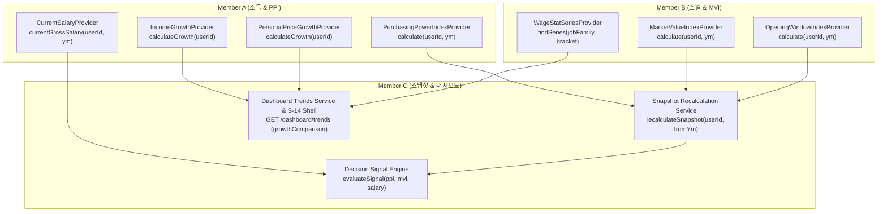

# Carix MVP 개발 계획서 (3인 도메인 수직 분업)

본 계획서는 3명의 풀스택 개발자가 각자의 핵심 가치 사슬(Value Stream)을 전담하여 **프론트엔드(UI)부터 백엔드(API/알고리즘), 데이터 수집/DB까지 End-to-End로 병렬 개발**할 수 있도록 구성된 실행 계획입니다.

> **표기 규약 — 이 계획서는 현재 배치만 적는다.**
>
> - 레인이 바뀌면 **옮긴 자리에 새로 적고 옛 자리는 지운다.** 누가 언제 무엇을 넘겼는지는
>   git 이력과 PR 이 갖는다. 계획서에 이관 흔적을 남기면 읽을 때마다 현재 배치와 옛 배치를
>   구별해야 한다.
> - 옮길 자리가 **없으면**(조건 미발생, 취소된 결정 등) 지우지 않고 ~~취소선~~ 으로 남기고
>   옆에 사유를 적는다. 근거가 사라지면 같은 논의를 다시 하게 된다.
> - 간트는 취소선을 못 쓴다. 완료는 `:done`, 주차 표는 완료분만 취소선으로 남긴다.
> - **이 계획서는 완료 목록을 갖지 않는다.** 무엇이 끝났고 무엇이 남았는지는
>   [`docs/README.md` 「진행 상태」](../README.md#진행-상태)가 소관이다. 여기는 간트의 `:done`
>   과 주차 표의 취소선으로 레인별 선후만 표시한다.

---

## 1. 3인 역할 분담

| 담당자 | 도메인 | 사용자 스토리 | 프론트엔드 (UI) | 백엔드 & 핵심 알고리즘 | 데이터 수집 & DB |
| :--- | :--- | :--- | :--- | :--- | :--- |
| **Member A** | **소득 & 구매력 (PPI & Cost of Living)** | `US-O3` 소득 입력(API 만) `US-O4` 소비 입력(API 만) `US-R1` 이력(API 만) `US-D3` 소득vs물가(데이터만) `US-D8` 상승률 엔진 | 없음 — 소득/소비 도메인의 화면은 C·B 가 낸다 _(근거는 아래 각주)_ | • **구매력 지수(PPI) 엔진** ([기능 명세 §4.3](../specs/functional-specification.md)) • 소비 가중치 전파 (`PROPAGATED`) • 소득/소비 이력 CRUD API — `S-12` 탭이 쓴다 • **내 소득 상승률 산출 로직** (`US-D8`) — `IncomeGrowthProvider` • **임금 상승률 vs 개인물가 지표 엔진** (`US-D8`) — `PersonalPriceGrowthProvider` • 소비 전파 엣지케이스 & 복호화 경계 점검 • ~~연봉 암호화 키·복호화 경계 ([SECURITY §3.2](../SECURITY.md))~~ — 완료 | • 통계청 CPI 수집 파이프라인 • `income_history` — `change_reason` 컬럼은 C • `expense_history`, `expense_item` • `cpi_observation` |
| **Member B** | **스킬 & 시장가치 (MVI & Market Worth)** | `US-O5` 스킬 입력 `US-D2` 데이터 상태 `US-D3` 분포·수요 차트 `US-D4` `S-11` 화면 `US-D8` 임금 시계열 `US-C1~2` `S-13` 화면 `US-M1` `S-16` | • `S-08` 스킬 입력 & 자동완성 • `S-11`·`S-13` — C 레인 부하 분산분. 쓰는 API 는 C 소유 • `S-14` **차트 3종 컴포넌트** — 연봉분포·수요·**소득vs물가**. 셸은 C • `S-10` **개방창 지수(OWI) 카드** — 셸은 C. 카드 자체는 `c6` 에서 이미 섰고 산출기 `b6` 가 값을 채운다 • `S-10` 결정 신호 카드의 **근거 아코디언** — 스킬 보강 처방 노출. 셸은 C • `S-16` 관리자 파이프라인 콘솔 | • **시장가치 지수(MVI) 엔진** ([§4.2](../specs/functional-specification.md)) • **스킬 수요 지수** 엔진 ([§4.1](../specs/functional-specification.md)) • 동료집단 완화 (N<10) 및 표본부족 엣지케이스 검증 • 스킬 검색/자동완성 API • `GET /dashboard/salary-distribution` — 제시 연봉 추이·경력 사다리 포함 ([기능 명세 §4.6](../specs/functional-specification.md)) • 임금통계 출처 노출 & **연도 시계열 읽기 경로** (`US-D8`, `WageStatSeriesProvider`) • **개방창 지수(OWI) 엔진** (`OpeningWindowIndexProvider`, [기능 명세 §4.5](../specs/functional-specification.md)) • `GET /skills/recommendations` — 스킬 보강 처방 (`US-D6`) | • 채용공고 & KOSIS 임금 수집 • 표준 스킬 사전 정제 • `skill`, `skill_alias`, `user_skill` • `wage_stat_observation` • `market_aggregate` |
| **Member C** | **인증 · 의사결정 · 시뮬레이터 (Auth, Decision & Action)** | `US-A1~2` 인증 `US-O1~2, 6` 온보딩 `US-D1` 대시보드 `US-D3` `S-14` 셸 `US-D8` 상승률 탭·차트 `US-R1` `S-12` 화면 `US-S1` 시뮬레이터 | • `S-01~03` 랜딩·로그인·가입 • **온보딩 4화면** `S-05`·`S-06`·`S-07`·`S-09` (`S-08` 은 B) • `S-10` **대시보드 메인** — 지표 카드 4종 중 셋과 결정 신호. **OWI 카드와 근거 아코디언은 B** • `S-12` **이력 관리 화면 전체** (API 는 A·B) • `S-14` **추이분석 셸 & 상승률 비교 탭 차트** (`US-D8`) • `S-15` **12개월 시뮬레이터** | • **결정 신호(Rule Matrix) 엔진** • 협상 목표 인상률 (`US-D7`) • **12개월 잔류vs이직 시뮬레이터** (저장 목록 복원 포함, `US-S1`) • **월별 스냅샷 멱등성 저장/재계산** (Job 4 전담, [§4.4](../specs/functional-specification.md)) • 회원가입·로그인, 계정 완전 삭제 • `GET /dashboard/summary`·`/trends`·`/history` — OWI 및 임금vs물가 확장 포함 ([API 규격 §5.1·§5.3·§5.4](../specs/api-specification.md)) • **상승률 비교 API 합성** (`US-D8`, A·B의 Provider 주입) • `income_history.change_reason` 컬럼 & API — 잔류·이직 판별 (`US-O3`) • 기본 소비 가중치 (`DEFAULT_CPI`) 및 `GET /reference/default-expenses` (`US-O6`) • 물가 기여도 1위 품목 (`US-D1` 뱃지) | • `auth-service` 모듈 • **세션 게이트** ([`backend/README.md`](../../backend/README.md), 3레인 공통 선행) • **auth 스키마**(Flyway): `users`, `session`, `rate_limit_bucket` • **core 스키마**(직접 DDL): `career_profile`, `index_snapshot`(OWI 컬럼 포함), `career_scenario` |

> **화면 셸 소유는 하나다.** `S-12`(`routes/mypage/records/layout.tsx`)와
> `S-14`(`routes/dashboard/trends.tsx`)는 셸 파일이 각각 하나이고
> `GET /dashboard/trends` 응답의 `trends[]` 에는 A 의 `incomeIndex`·`personalPriceIndex` 와
> B 의 `marketValueIndex` 가 함께 들어간다. **화면 셸과 합성 API 는 C 가 소유하고 A·B 는
> 차트·탭 컴포넌트를 낸다.** 두 화면을 A·B 에 동시 배정하면 같은 파일과 같은 DTO 를 겹치는
> 기간에 고치게 된다.
>
> `US-D4`·`US-C1~2` 는 반대로 갈린다 — **API 는 C, 화면(`S-11`·`S-13`)은 B** 다. 배정 당시
> C 레인이 최장 경로라 화면만 넘겼다.
>
> **온보딩 네 화면(`S-05`·`S-06`·`S-07`·`S-09`)은 한 사람 손에 모았고, `S-14` 차트 넷 중 셋
> (연봉분포·수요·소득vs물가)은 B 가 같은 셸 위에서 낸다.** 넷째인 상승률 비교 차트(`c14`)는
> 세 레인의 Provider 를 합성해 그리므로 셸 소유자인 C 가 낸다. **A 는 소득/소비 API·`PROPAGATED` 전파·PPI 엔진과 암호화 경계를
> 갖는다** — 화면은 안 갖고 도메인은 안 쪼갰다.
>
> **A 도메인의 산출 셋은 C 가 갖는다.** 소득 변경 사유 컬럼·API, 기본 소비 기준값 API, 물가
> 기여도 1위 품목은 쓰는 쪽이 전부 C 화면이거나 C 스토리다 — `S-12` 소득 탭, `S-07` 온보딩,
> `S-10` 뱃지. 계약을 낸 쪽과 구현하는 쪽이 갈리면 인수 조건 확인이 두 번 돈다. **PPI 본
> 엔진(`a2`)은 A 에 있다** — 화면이 직접 부르지 않는 계산은 도메인 소유자가 갖는다.
>
> **B 도메인은 안 쪼갠다.** OWI 산출기(`b6`)와 스킬 보강 추천 API(`b9`)는 소비자가 C 화면
> (`S-10` 카드·근거 아코디언)이지만 공고 직접 집계·동료집단 완화·동시출현 분석이 전부 B
> 도메인 알고리즘이라 B 가 낸다. C 는 `c6` 에서 낸 계약(`OpeningWindowIndexProvider`)과
> 저장·읽기 세 경로로 받는다. **`S-10` 안의 OWI 카드와 근거 아코디언(`b15`)도 B 가 낸다** —
> `S-11`·`S-13` 과 같은 배치로, 화면 셸은 C 소유이고 B 는 그 안의 컴포넌트를 낸다. OWI 카드는
> `c6` 에서 이미 섰으므로 B 가 넘겨받는 것은 **이후 유지분**이다.
>
> **대가가 하나 남아 있다.** `US-O3`·`US-O4`·`US-D3` 이 A 의 스토리인데 화면은 A 가 만들지
> 않으므로 **인수 조건 확인은 A 가 하고 구현은 C·B 가 한다.**

**절 번호는 밖에서 불린다.** 저장소 스물일곱 곳이 이 문서의 절을 번호로 가리킨다 — `§4`(MVP
범위 판정) 열다섯(코드 열: `DashboardController` 여덟, `SnapshotReadServiceTest`,
`auth-service` 의 `OnboardingController` / 문서 다섯), `§2`(주차별 로드맵) 여덟, `§1` 둘,
`§3` 둘. **절을 더하거나 뺄 때는 뒤에 붙이거나 인용 스물일곱을 같이 고친다** — 번호를 당기면
인용이 통째로 어긋난다.

---

## 2. 주차별 병렬 개발 로드맵 (10주 스프린트)

> 결정 신호는 3변수 규칙표를 쓰고, 스냅샷 갱신(Job 4)은 `core-api` 가 전담한다. `S-12`·`S-14` 는 화면 셸을 C 로 단일화하고 A·B 는 탭·차트 컴포넌트만 낸다.
>
> `e2e` 선행은 `a12 b14 c14` 세 개다. **실질 임계 경로는 Member B(`b14` 63일차)와 Member C(`c14` 62일차)가 나란히 선다.** 종료 일차는
> `b14` 63, `c14` 62, `a12` 42 이다. 임금통계 연도 시계열(`b13`·`a9`·`a10`·`c14`·`b14`)의 인수 조건과 계산 정의는
> [기능 명세 US-D8·§4.9](../specs/functional-specification.md)가 갖는다.
>
> **`ui3` 도 C 사슬 안이다.** 「UI 일관성 통일」은 로드맵 밖 계획이지만 담당은 C 하나라
> 병렬로 그릴 수 없다. `c12`(49일차) 뒤에 이어 붙였다. `ui0`~`ui2` 의 겹침은 이미 벌어진
> 일이라 그대로 둔다.
>
> **레인마다 담당은 하나다.** 간트는 병렬로 그릴 수 있지만 한 사람이 두 블록을 동시에 못 돈다 —
> 같은 레인의 블록은 전부 사슬로 잇는다. A 의 과중했던 MVI 검증(`b8a`)과 임금통계 읽기(`b13`)를
> B 로 환원하고, `S-14` 상승률 차트(`c14`)를 셸 소유자인 C 로 이관하여 B(63d)와 C(62d)의 작업량을
> 균등하게 맞췄다. A 와 B 는 인터페이스 계약(SPI) 뒤로 완전히 분리되어 교차 의존성이 발생하지 않는다.
>
> **A 는 7~9주차에 고유 도메인 중심의 가벼운 지표 및 안정화 과제를 전담한다.** 소득 상승률 산출(`a9`),
> 임금 vs 물가 지표(`a10`), 소비 전파 엣지케이스 및 복호화 무결성 점검(`a12`)을 거쳐 42일차에 안정적으로 사슬을 마친다.
>
> **간트 블록은 쪼개지 않으면 부분 완료를 담지 못한다.** 한 블록의 일부만 끝났을 때는
> 완료분을 `b3a`·`c4a` 처럼 별도 블록으로 떼어 `done` 을 붙이고 잔여를 원래 ID 로 남긴다.
> 블록 ID 하나에 완료·미완이 섞이면 간트와 아래 주차 표가 서로 다른 말을 한다.

```mermaid
gantt
    title Carix 3인 병렬 개발 로드맵
    dateFormat X
    axisFormat %s
    section 공통 (0주차)
    DB 마이그레이션 방식 확정 :done, c0a, 0, 1s
    임금통계 기준선 데이터 확보 :done, a0, 3, 3s
    스냅샷 Job4 core-api 전담 결정 :done, i0, 7, 1s
    미배정 API 범위 결정 :done, c0, 7, 2s
    section Member A (소득/PPI)
    CPI 수집 파이프라인 & 소득/소비 CRUD API :done, a1, 12, 3s
    PPI 계산 엔진 & 가중치 전파 & 암호화 키 :a2, after a1, 14s
    PPI 엣지케이스 & 민감 금액 로깅 마스킹 점검 :a7, after a2, 4s
    내 소득 상승률 산출 로직(US-D8) :a9, after a7, 3s
    임금 상승률 vs 개인물가 지표 엔진 :a10, after a9, 3s
    소비 전파 엣지케이스 & 복호화 경계 점검 :a12, after a10, 3s
    section Member B (스킬/MVI)
    공고/임금 수집 파이프라인 & 스킬사전 검색 API :done, b1, 2, 2s
    market_aggregate 사전집계 파이프라인 :done, b2a, 3, 1s
    collector 관리자 구동 연동·배포 배선(5-C) :done, b0, 7, 5s
    스킬수요 지수 & MVI 계산 엔진 :done, b2, 8, 4s
    S-16 관리자 파이프라인 콘솔(US-M1) :done, b16, 14, 1s
    salary-distribution API — 원 공고 직접 집계 :done, b3a, 15, 1s
    스킬 UI(S-08) & 차트 3종(연봉분포·수요·소득vs물가) :done, b3, after b3a, 10s
    스냅샷 이력(S-11) & 설정·탈퇴(S-13) UI :done, b4, after b3, 7s
    추이분석(S-14) 화면 셸 :done, b4a, after b4, 1s
    개방창 집계 & OWI Provider :b6, after b4, 6s
    브래킷 6구간 정합·연차 해상도 & 라우트 별칭 정리 :b7, after b6, 4s
    제시 연봉 추이(US-D3·§4.6) :b10, after b7, 3s
    market_aggregate 연봉 5수치 제거 :b11, after b10, 1s
    임금통계 출처 노출 & 연도 시계열 읽기 경로 :b13, after b11, 2s
    경력 사다리 & 기준선 출처 표기(§4.7) :b12, after b13, 2s
    MVI 임계값 외부화 & 수집 우선순위 산출 :b8, after b12, 3s
    MVI 표본부족(N<10) 엣지케이스 검증 :b8a, after b8, 3s
    스킬 보강 추천 API & 동시출현 근거(US-D6) :b9, after b8a, 3s
    S-10 근거 아코디언 — 스킬 보강 처방 노출 :b15, after b9, 1s
    경력 사다리 연도 축 — b12 확장 :b14, after b15, 2s
    section Member C (인증/결정/시뮬레이터)
    세션 게이트 배선 — Gateway 필터 + core-api X-User-Id 주입 :done, c0b, 7, 4s
    스냅샷 멱등성 엔진(Job 4) & 결정신호 판정 엔진 :done, c2, 8, 4s
    온보딩 4화면(S-05~S-07·S-09) & 대시보드(S-10) & 시뮬레이터 UI(S-15) :done, c3, after c2, 18s
    dashboard summary·trends·history 실데이터 전환 :done, c4a, 15, 1s
    이력관리(S-12) 화면 — S-14 셸은 B 납품분으로 빠짐 :done, c4, after c3, 6s
    OWI 스냅샷 컬럼 & 대시보드 3 API 확장 :done, c6, after c4, 4s
    스냅샷 쓰기 운영 Postgres 검증(5-K) :c5, after c6, 5s
    소득 변경 사유(change_reason) 컬럼 & API :c10, after c5, 2s
    기본 소비 기준값 API(US-O6) :c11, after c10, 1s
    물가 기여도 1위 품목(US-D1 뱃지) :c12, after ui3, 1s
    협상 목표 인상률(US-D7) :c8, after c12, 2s
    저장 시나리오 목록 & S-15 복원(US-S1) :c9, after c8, 2s
    상승률 비교 API 합성 & S-14 차트(US-D8) :c14, after c9 a9 a10 b13, 3s
    section UI 일관성 통일 (C 레인)
    P0 — 결정신호 단일화 & 시각회귀 베이스라인 :done, ui0, 33, 2s
    P1 — 다크 변형(custom-variant) & carix-action 토큰 :done, ui1, after ui0, 2s
    P2 — 공용 표현 계층 & 어휘 계약 :done, ui2, after ui1, 2s
    P3~P4 — 프리미티브 재정의·규범 :ui3, after c11, 6s
    section 전원 통합 (10주차)
    E2E 연동 테스트 & 비기능/완료기준 점검 :crit, e2e, after a12 b14 c14, 5s
```

> **가로축은 달력이 아니라 착수 기준 일차(日次)다.** 눈금 `0`·`5`·`10` 은 첫 블록 착수로부터
> 며칠째인지를 뜻한다. 날짜를 쓰지 않으려고 `dateFormat X` 상대 축을 쓰므로 블록 길이의
> 단위 기호가 `s` 로 적히지만 **한 칸은 하루다** — `14s` 는 14일이다.

| 주차 | Member A (소득 & PPI) | Member B (스킬 & MVI) | Member C (인증 & 결정 & 시뮬레이터) |
| :--- | :--- | :--- | :--- |
| **0주차 (사전정렬)** | 완료 | 완료 | 코드·문서 완료. **세션 게이트 플래그 전환은 이 칸에서 닫히지 않는다** — [문서 맵 「배포 전 실행 순서」](../README.md#남은-것)의 마지막 칸이고, 그 앞 `c5` 는 이미 완료된 `c6` 뒤에 온다 |
| **1~2주차 (인프라 & 파이프라인)** | ~~`a1` — CPI 수집 파이프라인, 소득/소비 CRUD API~~ 완료 | 완료 | 완료 |
| **3~4주차 (핵심 계산 엔진)** | • **개인물가 & 구매력 지수(PPI) 계산 엔진** • 소비 가중치 전파(`PROPAGATED`) 로직 • ~~**연봉 암호화 키 로테이션·스냅샷 복호화 경계** ([SECURITY §3.2](../SECURITY.md))~~ — 완료 _(`a2` 는 이 칸보다 앞선다)_ | • ~~동료집단 완화 알고리즘 (`N<10` 클램프)~~ — 완료 • ~~`S-08` 스킬 입력 & 자동완성 UI~~ — 완료 • ~~`S-14` **차트 3종** (연봉분포·수요·소득vs물가)~~ — 완료 • ~~`S-11` 월별 스냅샷 이력 UI~~ — 완료 • ~~`S-13` 설정·계정 삭제 UI (세션 관리 & 완전 삭제)~~ — 완료 | • ~~`S-05`·`S-06`·`S-07`·`S-09` **온보딩 4화면**~~ — 완료. `S-08` 은 B — 근거는 §1 각주 • ~~`S-10` **대시보드 메인**~~ — 완료 • ~~`S-15` **시뮬레이터 UI**~~ — 완료 • ~~`auth-service` 온보딩 단계 갱신(`PATCH /v1/auth/onboarding`)~~ — 완료. `c3` 의 18d 에 없던 작업이고 `S-08` 이 B 로 정리되며 회수한 구간에서 냈다 |
| **5~6주차 (UI & 지표 확장 1)** | • **PPI 엣지케이스 & 민감 금액 로깅 마스킹 점검** (`a7`) — `a2` 바로 뒤다 | • **개방창 지수(OWI) 집계·완화·Provider** (`b6`) • **집계월 분포 확인** — `b6` 착수 전 SQL 한 줄 • **경력 브래킷 6구간 정합 & 라우트 별칭 정리** (`b7`) | • ~~`S-12` **이력 관리 화면 전체** (`c4`)~~ — 완료 • ~~**OWI 스냅샷 컬럼 & 대시보드 3 API 확장** (`c6`)~~ — 완료. 산출기는 B `b6` |
| **7주차 (지표 확장 2 · 검증 착수)** | • **내 소득 상승률 산출 로직** (`a9`, `US-D8`) — 소득 이력 기반 전년 대비 인상률 산출 | • **제시 연봉 추이** (`b10`) • **`market_aggregate` 연봉 5수치 제거** (`b11`) • **임금통계 출처 노출 & 연도 시계열 읽기 경로** (`b13`) — `wage_stat_observation` 테이블 소유권 원복 | • **스냅샷 쓰기 운영 Postgres 검증** (`c5`) • **소득 변경 사유 컬럼 & API** (`c10`) — `S-12` 소득 탭 선택 컨트롤까지 이 블록이다 |
| **8주차 (처방 · 정합)** | • **임금 상승률 vs 개인물가 지표 엔진** (`a10`, `US-D8`) — `a2` 확장, 개인물가 비교 산출 | • **경력 사다리 & 기준선 출처 표기** (`b12`) • **MVI 임계값 외부화 & 수집 우선순위 산출** (`b8`) • **MVI 표본부족(`N<10`) 엣지케이스 검증** (`b8a`) — 도메인 소유자 B 로 원복 • **스킬 보강 추천 API & 동시출현 근거** (`b9`) • `S-10` 근거 아코디언 — **스킬 보강 처방** (`b15`). 셸은 C | • **기본 소비 기준값 API** (`c11`) • **UI 일관성 통일** — P3~P4 (`ui3`). 계획은 [ui-unification-plan.md](ui-unification-plan.md) • **물가 기여도 1위 품목 뱃지** (`c12`) — `ui3` 가 프리미티브를 갈아엎은 뒤에 그린다 |
| **9주차 (임금 시계열)** | • **소비 전파 엣지케이스 & 복호화 경계 점검** (`a12`) — `PROPAGATED` 소급 전파 및 키 로테이션 실환경 점검 | • **경력 사다리 연도 축** (`b14`) — `b12` 확장 • **KOSIS 커버리지·드리프트 정리 완료** — 2020~2025 여섯 해 실재 확인, 벽시계 드리프트 72행 삭제(§4) | • **협상 목표 인상률** (`c8`) • **저장 시나리오 목록 & `S-15` 복원** (`c9`) • **상승률 비교 API 합성 & `S-14` 차트** (`c14`, `US-D8`) — A·B의 Provider 주입받아 셸·차트 완결 |
| **10주차 (E2E 통합 검증)** | • 실데이터 통합 점검 합류 | • 실데이터 파이프라인 통합 점검 | • 온보딩 → 대시보드 → 시뮬레이터 E2E 점검 • 계정 삭제 시 개인 데이터 완전 삭제 검증 |

> **주차 배치는 최장 경로 기준이며, B(63일차)와 C(62일차)가 균등하게 임계 경로를 형성한다.** 종료 일차는
> `b14` 63, `c14` 62, `a12` 42일차이며, 10주차 `e2e` 통합 선행은 세 레인의 최종 블록(`a12`·`b14`·`c14`)이다.
>
> - **B·C 작업량 균등화 및 의존성 격리:** B 에 몰렸던 `S-14` 차트 컴포넌트를 화면 셸과 API 소유자인 C(`c14`)로 이관하여 B(63d)와 C(62d)의 작업량을 균등하게 조정했다. A(소득/물가 Provider)와 B(임금통계 Provider)는 SPI 인터페이스로 C 와만 통신하며, A-B 간의 직접 의존성은 완전히 제거(Decoupled)되었다.
> - **A 레인 부하 분산과 역할 정합:** A 의 과중했던 MVI 검증(`b8a`), 임금통계 읽기(`b13`)는 B 로 환원했다. A 는 7~9주차에 고유 도메인인 **내 소득 상승률 산출(`a9`)**, **임금 vs 개인물가 지표(`a10`)**, **소비 전파 엣지케이스 및 복호화 무결성 점검(`a12`)**을 각 3일 규모로 안정적으로 완수한다.
> - **의존성 규약:** `b7`(브래킷 수정)은 차단이 아닌 배포 전 결정 항목이며, OWI 산출기(`b6`)는 이미 준비된 C 의 스냅샷 스키마(`c6`) 위에서 B 가 값을 공급한다. 정확한 선후와 기간은 간트를 따른다.

> **완료 기준 10번(민감 금액 로그 미기록)은 전 레인 공통이다**
> ([기능 명세 §7](../specs/functional-specification.md)). `POST /scenarios/simulate` 요청 본문의
> `currentGrossSalary`·`moveTargetGrossSalary` 와 스냅샷 재계산의 복호화 경로
> 등에서 금액이 평문으로 로그에 찍히면 안 된다.

---

## 3. 레인 간 인터페이스 계약 (확정 & 스텁)

1. **지수 산출 결과 계약 (A, B $\rightarrow$ C)** — `core-api` 의 `com.carix.index` (인터페이스 SPI), `com.carix.index.dto` (결과 Record), `com.carix.index.enums` (도메인 Enum) 에 확정돼 있다:
   - Member A는 `PurchasingPowerIndexProvider.calculate(userId, baseYearMonth)` 를 구현해 `PpiResult`(지수값, 상태, 소비 가중치 출처, 지수 기준월, CPI 원천 기준일)를 반환 (품목별 CPI 모듈 완성 전까지 사용자의 최초 소득월 100.0 및 소득 변동 기반 구매력 지수를 제공하는 기본 산출기 `DefaultPurchasingPowerIndexProvider` 배선 완료)
   - Member B는 `MarketValueIndexProvider.calculate(userId, baseYearMonth)` 를 구현해 `MviResult`(지수값, 상태, **원천별** 완화 단계·표본 수, 제외 스킬과 사유, 임금통계 기준선, 집계 기준일)를 반환 (실제 구현체 `MarketValueIndexServiceImpl` 배선 완료)
   - Member A는 `CurrentSalaryProvider.currentGrossSalary(userId, baseYearMonth)` 도 구현해 기준월 시점에 유효한 세전 연봉을 반환한다 (`IncomeCurrentSalaryProvider` 배선 완료). 결정 신호 규칙표의 **소득 격차 비율**은 이 값을 분모로 쓰는데 `PpiResult`·`MviResult` 어디에도 없어 규칙 2·3·5 가 계산되지 않았다. 연봉을 `PpiResult` 에 실으면 평문 금액이 스냅샷 `rationale` 경로까지 흘러가므로 계약을 따로 둔다. 복호화 경계는 소득 도메인 안에 남는다([SECURITY §3.2](../SECURITY.md))
   - Member B는 `OpeningWindowIndexProvider.calculate(userId, baseYearMonth)` 도 구현해 `OwiResult`(지수값, 상태, 동료집단 표본 수, 마감일 보유 표본 수, 중앙 개방일수, 상시채용 비율, 완화 단계·조건 문구, 기준 모수 중앙 개방일수)를 반환한다. 산출은 `market_aggregate` 가 아니라 원 공고 직접 집계다 ([기능 명세 §4.5](../specs/functional-specification.md))
   - 계산 불가는 예외가 아니라 `IndexStatus` 로 돌려준다. 값은 `null` 이고 0 이나 100 으로 채우지 않는다
   - 구현 빈이 없는 동안 `com.carix.index.stub` 이 `NOT_AVAILABLE` 을 돌려주도록 설계되었으나, 현재 실제 연봉 공급자(`IncomeCurrentSalaryProvider`) 및 기본 지수 공급자(`DefaultPurchasingPowerIndexProvider`)가 배선되어 소득 이력이 존재하는 사용자의 스냅샷 지수 결측 및 결정 신호 `데이터 부족`(`INSUFFICIENT_DATA`) 문제가 정상 해소되었다.
2. **스냅샷 재계산 트리거 (A, B $\rightarrow$ C)**:
   - 사용자가 소득/소비(Member A) 또는 스킬(Member B)을 추가/수정/삭제했을 때, Member C의 `recalculateSnapshot(userId, fromYm)`을 호출하여 해당 시점 이후의 스냅샷을 멱등하게 갱신
   - 호출 대상은 `com.carix.snapshot.SnapshotRecalculationService.recalculateSnapshot(UUID userId, String fromYearMonth)` 이며 `fromYearMonth` 는 변경의 가장 이른 유효월(`YYYYMM`)이다. 한 번의 호출이 그 월부터 현재월까지를 하나의 `data_version` 으로 다시 쓴다
   - **호출 방식은 트랜잭션 안의 동기 직접 호출로 확정한다.** 이벤트 + `@Async` 안(案)은 택하지 않았다 — MVP 는 스레드풀·재시도·실패 관측 경로를 늘리지 않는다. 멱등성은 이미 `pg_advisory_xact_lock` 과 `data_version` 이 보증한다. 응답 지연이 실측으로 문제가 되면 그때 비동기로 이관한다
   - 호출부는 소득 3경로·소비 1·스킬 3·프로필 1 이다. `fromYm` 규약은 `com.carix.snapshot.YearMonths` 한 곳에 있다 — 값에 유효월이 있으면 그 달, 없으면 변경 시점의 달이고, 유효월을 앞으로 당기는 수정은 옛 달부터 다시 계산한다
3. **스냅샷 갱신(Job 4) 실행 주체 — core-api 전담 확정**:
   - 스냅샷 계산/갱신 엔진은 `core-api`가 전담 소유한다. `collector`는 `market_aggregate` 집계까지 완료하며, `index_snapshot` 생성/갱신은 `core-api` 내부 API 호출 또는 사용자 프로필/소득/소비/스킬 변경 시 `core-api` 내에서 직접 `recalculateSnapshot(userId, fromYm)`을 수행한다.
   - `core.index_snapshot`에 대한 쓰기 권한과 연봉 복호화 키 접근([SECURITY §3.2](../SECURITY.md))도 `core-api`(Member C/A) 내에서 안전하게 격리된다.
4. **계약에 없던 크로스레인 의존 2건**:
   - 시뮬레이터 `feasibility`(`targetPercentile`, `difficultyGrade`)는 **B 의 동료집단 공고 분포**를
     입력으로 요구하나 화면은 C(`S-15`)다. 산출원은 `job_posting` 직접 집계이며 임금통계
     기준선(`wage_stat_observation`)과는 별개 원천이다.
   - `GET /dashboard/salary-distribution` 은 §1 에서 B 의
     `S-14` 차트로 배정됐으나 API 는 대시보드 도메인이다. **구현 소유는 B 로 확정했다**(API 규격 §5.2) —
     원 공고 직접 집계라 중복제거·동료집단 조건이 전부 B 소유물이기 때문이다
5. **상승률 비교 계열의 디커플링 계약 (A, B $\rightarrow$ C, `US-D8`)**:
   - A 와 B 사이의 직접 참조를 완전히 배제하고 SPI 인터페이스 뒤로 격리한다.
   - Member A 는 `IncomeGrowthProvider`(내 소득 연간 상승률 산출, `a9`)와 `PersonalPriceGrowthProvider`(개인물가 연간 상승률 산출, `a10`)를 구현한다.
   - Member B 는 `WageStatSeriesProvider`(공식 임금통계 연도 시계열 조회, `b13`)를 구현한다.
   - Member C 는 두 레인의 Provider 를 주입받아 대시보드 `trends` API 응답으로 합성하고, `S-14` 셸 위의 상승률 비교 탭 차트(`c14`)를 낸다. A 와 B 는 상대 레인의 코드베이스나 진행 상황에 전혀 얽매이지 않고 독립적으로 병렬 개발할 수 있다.
6. **완료 기준 10개 항목 점검**:
   - 구현 완료 시 `functional-specification.md` §7의 MVP 완료 기준 10개 항목을 전원이 크로스 체크

---

## 4. MVP 범위 판정과 이후 후보

**범위를 가르는 기준과, 아직 판정하지 않은 후보**의 소관이다. 아무것도 막지 않아 로드맵에 두지
않고, 확정되지 않아 명세도 못 받는다 — 그 사이에 있는 것만 여기 남는다. 판정이 끝난 항목은
소관 문서로 가고 여기서 지운다. 적는 목적은 착수가 아니라 **선행 조건과 소급 가능 여부를 잃지
않는 것**이다.

### MVP 범위 밖 API — 판별 기준

판별 기준은 하나다 — **기존 화면의 인수 조건이 그 응답을 요구하는가.** [API 규격](../specs/api-specification.md)에는
있으나 [기능 명세 §8 추적 매트릭스](../specs/functional-specification.md)에는 없던 여섯이 이
기준에 걸렸다. 기능 명세에 구멍이 있던 게 아니라 API 규격이 더 넓었다.

**지금 범위 밖은 둘이다.** 나머지는 갈렸다 — `GET /skills/recommendations`·`GET /scenarios`·
`GET /reference/default-expenses` 셋은 인수 조건이 서면서 **승격**했고(각각 `US-D6`·`US-S1`·`US-O6`),
`POST /dashboard/predict` 는 **폐기**다 — 재도입하지 않으며 옛 배제 근거가 틀렸다는 것까지
[API 규격 §6.5](../specs/api-specification.md)가 적고 있다. 범위 밖으로 남은 것은
`DELETE /scenarios/{id}` 와 `GET /reference/cpi` 다. **판정 결과와 각 사유는 API 규격의 해당
절이 갖는다** — 이 기준은 규격이 또 넓어질 때 다시 쓴다.

승격하려면 **기능 명세에 인수 조건을 먼저 세운다.** 화면이 요구하지 않는 응답을 먼저 만들면
판별 기준 자체가 무의미해진다.

### 아직 판정하지 않은 것

수집·저장은 되는데 어떤 화면도 읽지 않는 데이터 중 **만들 것이 보이는 후보**만 적는다. 소비자가
없다는 사실 자체는 [ERD 「스키마 설계 주석」](../specs/erd.md)가 갖는다 — 거기 적힌
`title`·`company_name`·`position_level`·`company_badge`·`dedup_rule_version` 은 재료로만 남기고
후보로 올리지 않았다. `cpi_observation` 도 후보가 아니다: 버려진 게 아니라 품목별 PPI 본
엔진(`a2`)이 미착수라 소비자가 아직 없는 것이다.

**실측 경력별 임금 원천 확보** — 현재 기준선은 KOSIS 연령대를 경력구간으로 옮긴 값이라
사용자가 입력한 경력이 기준선에 직접 반영되지 않는다([ERD 「스키마 설계 주석」](../specs/erd.md)).
결정 규칙 2·3·5 가 전부 이 비율에 걸린다. 경력별 실측 원천이 생기면 프록시가 사라지지만
`5-A`(임금통계 원천 재선정)를 다시 여는 일이라 **언제 될지 모른다.** 그때까지는 화면이
기준선의 성격을 밝혀 정직을 지킨다(`b12`).

**`wage_stat_observation` 연도 시계열 — 판정 끝났다.** MVP 안으로 승격했고 인수 조건은
[기능 명세 US-D8·§4.9](../specs/functional-specification.md), 일정은 §2 `b13`·`a9`·`a10`·`c14`·`b14`
가 갖는다. **KOSIS 커버리지도 확인됐다** — 운영에 `base_period` 2020~2025 여섯 해가 실재하고
값이 해마다 달라 24계층 보간 실측이다(상수였으면 연도마다 같았다). 실측 연도가 하나뿐일 때
`c14`·`b14` 를 되돌린다는 조건은 **발생하지 않았다.** 벽시계 vintage 로 쌓였던 2025 드리프트
72행도 삭제해 기준선이 실측으로 돌아왔다.

**시나리오 예측의 사후 검증** — `career_scenario` 의 12개월 예측을 같은 기간 실제 소득과 맞대면
이 서비스의 조언이 맞았는지 검증된다. 맞댈 상대는 `index_snapshot` 이 **아니다** — 예측은 원화
보상이고 스냅샷은 지수·신호라 비교가 성립하지 않는다. 실적은 `income_history` 에 있다.

성립 조건은 **잔류·이직 판별**이었고 저장소 어디에도 없었다(`income_history` 는 `(연봉, 유효일)`
뿐, `career_profile` 에 고용주 식별자 없음 — 인상과 이직이 구별되지 않는다). `c10` 이 그
`change_reason` 을 더한다. 예측 저장 배선은 이미 붙었고 `UNIQUE` 가 없어 행이 쌓인다.

**남은 것은 시간뿐이다** — 결과가 나오기까지 12개월이라 `c10` 착수 시점이 곧 검증 가능 시점을
정한다. `c10` 착수는 45일차다 — C 레인에서 `c5`(배포 전 게이트) 앞을 비울 수 없어 그 뒤에
붙였다. 그 이전 소득 행은 영구히 판별 불가로 남는다.
