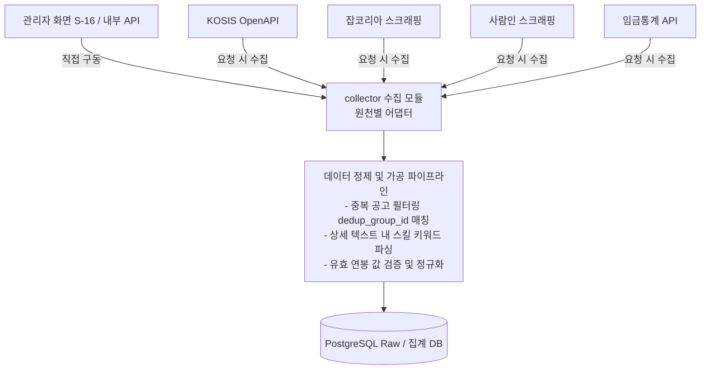

# Carix 데이터 수집 용이성 분석 및 가이드 (Data Collection Feasibility)

이 문서는 Carix 플랫폼에서 핵심 지수(구매력 지수, 시장가치 지수)를 산출하기 위해 필요한 외부 데이터(소비자물가지수, 채용공고 및 연봉)의 **수집 용이성, 수집 방법, 제약 요인 및 대응 전략**을 분석하여 기록합니다.

> **조사 기록이며 정본이 아니다.** 현재 유효한 원천 상태와 호출 규격은
> [외부 원천 API 연동 명세](../specs/external-api-integration.md), 파이프라인 구조는
> [데이터 아키텍처](../specs/data-architecture.md), 파싱·상수 규약은
> [상세 기술 명세](../specs/technical-specification.md)를 따른다.

---

## 1. 소비자물가지수 (KOSIS CPI)

### 1.1 API 개요 및 수집 방법
*   **제공 기관:** 통계청 국가통계포털 (KOSIS)
*   **공식 서비스:** [KOSIS 공유서비스 OpenAPI](https://kosis.kr/openapi/index/index.jsp)
*   **인증 방식:** 회원가입 후 즉시 Open API 사용자 키(인증키) 발급 가능 (일일 호출 제한량 여유로움)
*   **수집 대상 데이터:** 지출목적별 소비자물가지수 (월별 품목/분류별 물가지수 데이터)
*   **API 종류:** 통계데이터 조회 API (`http://kosis.kr/openapi/Param/statisticsParameterDP.do`)

### 1.2 수집 용이성 평가: 쉬움 (★★☆☆☆)
*   **장점:** 
    *   API가 매우 안정적이며 데이터 포맷(JSON, XML)이 표준화되어 있습니다.
    *   조회 파라미터가 명확하여 품목 코드 목록만 확보하면 쉽게 수집 파이프라인을 구축할 수 있습니다.
*   **제약 요인:**
    *   **공시 주기:** CPI 데이터는 매월 전월분이 발표되는 것으로 알려져 있어 실시간 수집이 아닌 **관리자의 월 1회 직접 구동**으로 충분합니다(`@Scheduled` 정기 실행은 도입하지 않기로 확정 — [애플리케이션 워크플로 §2](../specs/application-workflow.md)). 정확한 공표 일정은 선행 검증에서 KOSIS 공표 캘린더로 확인 후 확정합니다.

### 1.3 기술적 대응 전략
*   **매핑 테이블 구축:** 통계청의 12대 지출목적 코드(예: `01` 식료품, `04` 주거/수도/광열 등)와 Carix의 6대 소비 카테고리를 N:1로 매핑하는 데이터 사전을 구성합니다.
*   **기본 가중치 적용:** 사용자가 특정 소비 카테고리 입력을 생략한 경우, KOSIS 가계동향조사의 **전체 가구 월평균 소비지출 비중**을 Fallback값으로 지정합니다 (MVP는 가구원수를 수집하지 않으므로 가구원수별 세분 가중치는 사용하지 않음 — 도메인 정의서 §1과 동일 기준).

---

## 2. 채용 공고 및 공개 연봉 (잡코리아·사람인 스크래핑)

### 2.1 수집 개요 및 수집 방법
*   **대상 사이트:** 잡코리아, 사람인
*   **수집 방식:** 공개 채용정보 페이지 스크래핑(`backend/collector`의 `JobKoreaCrawler`·`SaraminCrawler`) — OpenAPI 연동 아님
*   **수집 대상 데이터:** 채용공고 목록·상세 페이지

### 2.2 수집 용이성 평가: 보통 ~ 어려움 (★★★★☆)
*   **어려운 이유:** 스크래핑 자체는 가능하나, 가치 있는 지표로 가공하기 위한 **데이터의 노이즈와 결측률이 매우 높습니다.**

### 2.3 제약 요인 및 대응 전략

#### ① 높은 연봉 정보 결측률 (Missing Salary)
*   **현실:** 대부분의 구인공고는 구체적인 금액 대신 "회사 내규에 따름", "면접 후 결정"으로 등록됩니다.
*   **대응 전략:**
    *   연봉 정보가 제공되는 공고(예: 연봉 하한선/상한선이 숫자로 명시된 공고)만 모수(Sample Size)로 잡고 통계를 냅니다.
    *   신뢰성 확보를 위해 화면상에 **"총 N개의 공고 중 연봉이 공개된 X개의 공고 기준 분석(결측률 Y%)"**과 같이 메타데이터를 필수 표기합니다.
    *   특정 스킬/지역의 표본이 최소 기준(N ≥ 10, 후보값 — 상세 기술 명세 §2.1과 동일) 미만일 경우, 조건을 인접 조건(예: 서울 강남구 ➡️ 서울시 전체)으로 완화하거나 "표본 부족"으로 안전하게 UI를 처리합니다.

#### ② 구조화된 스킬 필드의 부재 (Skill Parsing)
*   **현실:** 채용공고 페이지에서 개발 언어나 프레임워크(React, Java 등)를 잘 정돈된 리스트 형태로 제공하지 않습니다. 대개 채용공고 상세 본문 텍스트 내에 묻혀 있습니다.
*   **대응 전략:**
    *   **텍스트 파싱 규칙 엔진 구현:** 상세 요강 텍스트(`dvoContent`, `jobCont` 등)를 수집하여 토큰 경계 기반 별칭 매칭(상세 기술 명세 §3.2 규약 — 무경계 부분 문자열·단순 정규식 매칭 금지)으로 스킬을 추출합니다.
    *   **스킬 유사어 사전 구축:** `Spring Boot`, `springboot`, `스프링 부트` 등 표기 변형을 통합 처리하는 별칭 사전(`SkillAlias`) 테이블을 설계합니다. 단독 `spring`·`스프링`은 오탐 방지 충돌 정책상 `Spring Boot`로 매핑하지 않습니다 (상세 기술 명세 §3.2).

#### ③ IT 스타트업/테크 기업 표본 편향
*   **현실:** 잡코리아·사람인은 종합 구인 플랫폼 성격이 강하므로, 트렌디한 IT 기업(네카라쿠배토 등)의 공고 점유율이 원티드, 리멤버, 프로그래머스 등의 사설 플랫폼에 비해 낮습니다.
*   **대응 전략:**
    *   Carix 지표를 '전체 노동 시장의 표준 평균'이 아닌, **'공개 정보 기반 시장 지표(정부 공공 통계 중심)'**로 설명 영역에 한계를 명확히 규정합니다.
    *   추후 비공개 베타 이후 사설 채용 정보 사이트 크롤링이나 추가 API 연동을 통한 데이터 수집 채널 확장을 로드맵에 반영합니다.

---

## 3. 데이터 수집 아키텍처 가이드 (Data Pipeline)

### 3.1 장애 대책 (Fallback Strategy)
*   **API 일시 중단:** 외부 API 장애 등으로 수집에 실패하더라도 기존에 저장된 **최신 성공 시점의 집계 데이터**를 서비스 백업으로 사용하며, 화면에는 "데이터 업데이트 지연 (마지막 업데이트: YYYY-MM-DD)" 문구를 표시합니다.
*   **데이터 오염 방지:** 연봉 0원 또는 비현실적으로 높거나 낮은 금액(예: 연봉 1억 미만 신입인데 입력 오류로 10억 등)의 공고는 수집 가공 단계에서 이상치(Outlier)로 감지하여 자동 제외합니다.
