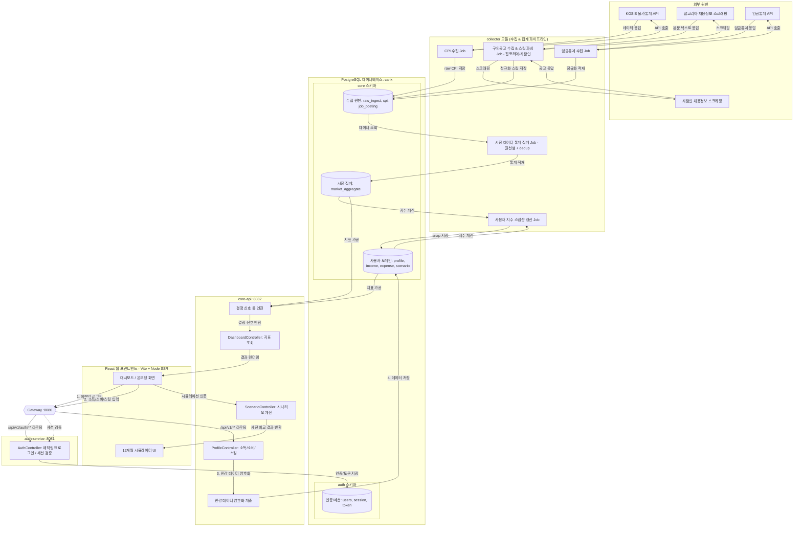
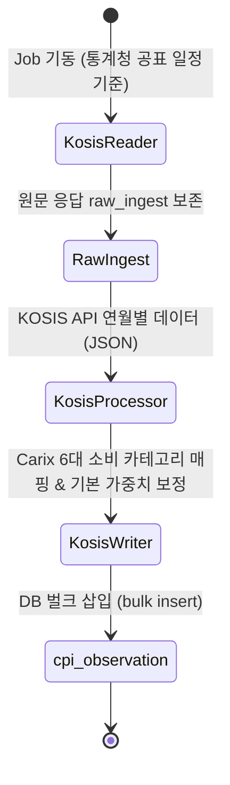
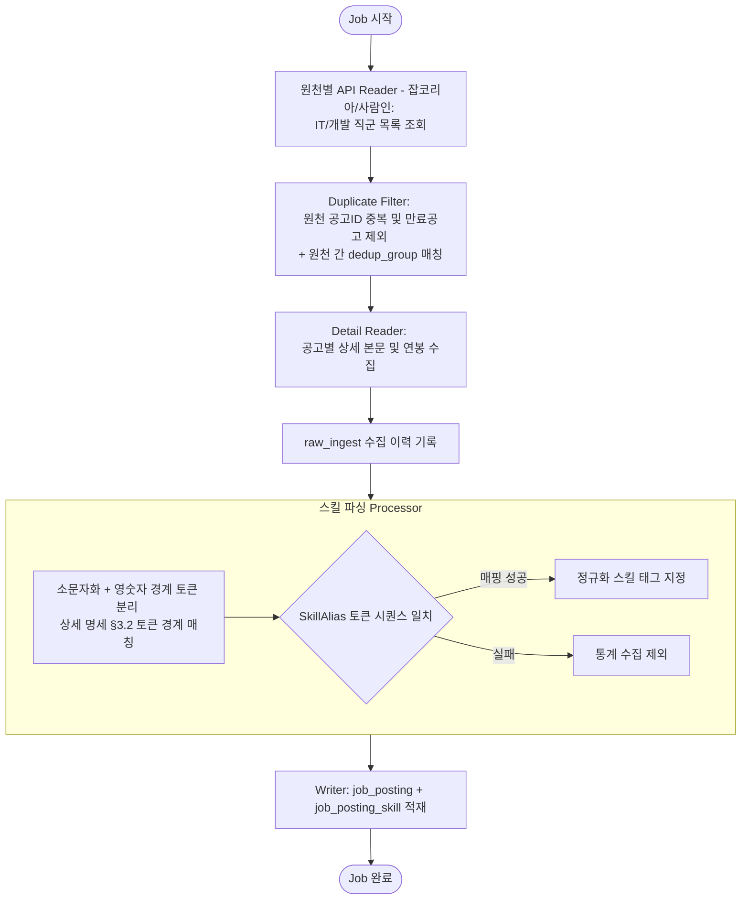
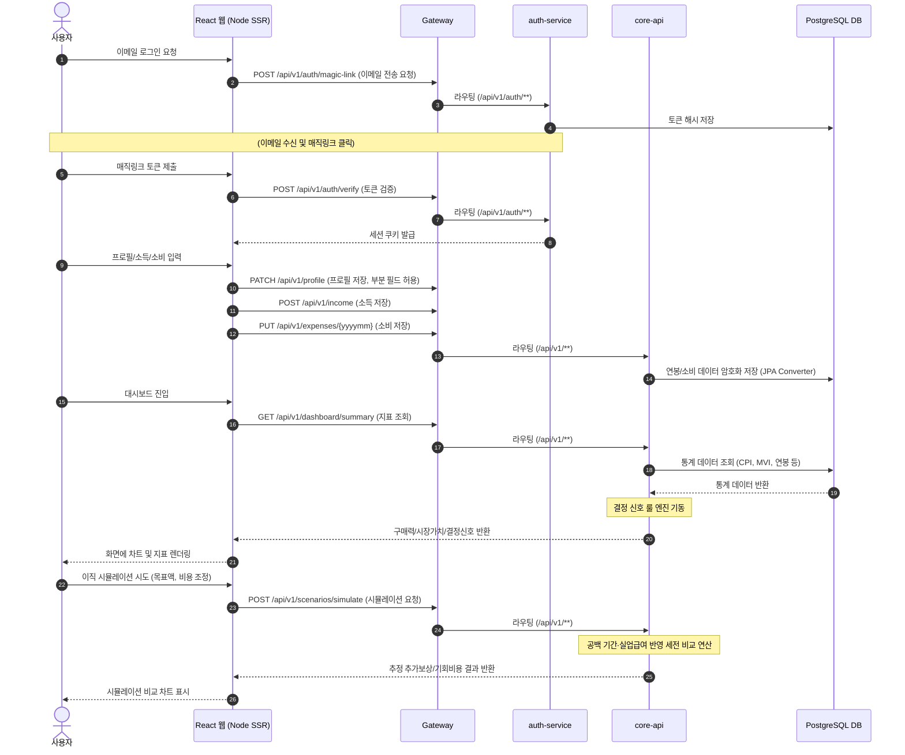

# Carix 전체 애플리케이션 작업 흐름 명세 (Application Workflow Specification)

이 문서는 Carix 플랫폼의 사용자 라이프사이클, 외부 원천 데이터 수집 배치의 파이프라인, 그리고 사용자 커리어 지표 및 시뮬레이션 산출에 이르는 **전체적인 데이터 흐름(E2E Data Flow)**을 명세화합니다.

---

## 1. Carix 전체 서비스 아키텍처 및 흐름도

사용자의 실시간 요청을 처리하는 **API 영역**과 주기적으로 대량의 외부 데이터를 수집·가공하는 **배치 워커 영역**이 유기적으로 연결된 데이터 파이프라인 구조입니다. 가로 너비를 최소화하고 세로 흐름을 따라 배치되었습니다.

---

## 2. Spring Batch 수집 및 집계 파이프라인 (2번 상세 흐름)

외부 수집 데이터는 대량 데이터의 무결성 보장과 유휴 트래픽 분산을 위해 **Spring Batch Job 파이프라인**(CPI 수집, 공고 수집·파싱, 임금통계 수집, 집계·스냅샷)으로 나누어 실행됩니다. 모든 원천 응답은 정규화 전에 `raw_ingest`에 원문 보존됩니다.

### 2.1 Job 1: CPI 소비자물가지수 수집 (월 1회 실행)
통계청 공표 일정에 맞춰 기동합니다. 구체적 스케줄은 선행 검증에서 KOSIS 공표 일정을 확인한 뒤 확정합니다.

### 2.2 Job 2: 구인공고 수집 및 스킬 정규화 (일/주 1회 실행)
가장 많은 연산과 파싱이 필요한 핵심 배치 파이프라인입니다. 잡코리아와 사람인 어댑터가 동일 구조로 실행되며, 수집 후 원천 간 중복 공고를 `dedup_group_id`로 매칭합니다. 파싱된 스킬은 `job_posting_skill`에 공고별로 저장합니다.

### 2.3 Job 3·Job 4: 시장 데이터 통계 집계와 사용자 스냅샷 (수집 Job 완료 직후 연쇄 실행)
Job 3(원천별 집계)과 Job 4(사용자 스냅샷)는 별도 Job이며 Job 3 성공 시 Job 4가 이어서 실행됩니다. 아래 흐름도는 두 Job의 연쇄를 하나로 표현한 것입니다. 수집된 원천 공고 및 CPI 데이터를 사용자의 동료집단(Peer Group) 단위로 그룹핑하고 통계를 집계합니다.

롤업 집합(GROUPING SETS) 열거 — 롤업 차원은 `employment_type`, `company_size`, `skill_id` 3개이며, 원천×월×직무×지역×경력구간마다 다음 6개 집합을 생성합니다 (`NULL` = 전체 롤업, 원천 미상 `'UNKNOWN'`은 세분 값의 하나로 취급):

| # | employment_type | company_size | skill_id | 용도 |
| --- | --- | --- | --- | --- |
| 1 | 세분 값 | 세분 값 | 세분 값 | 완화 Level 1 |
| 2 | 세분 값 | NULL | 세분 값 | 완화 Level 2~4 |
| 3 | NULL | NULL | 세분 값 | 완화 Level 5 |
| 4 | 세분 값 | 세분 값 | NULL | 스킬 무관 전체 (Level 1 분모·분포) |
| 5 | 세분 값 | NULL | NULL | 스킬 무관 전체 (Level 2~4) |
| 6 | NULL | NULL | NULL | 스킬 무관 전체 (Level 5) |

```mermaid
flowchart TD
    Start([집계 시작]) --> AggregatePeer[동료집단 그룹핑 - GROUPING SETS: <br>직무 + 지역 + 경력구간 + 고용형태 + 회사규모 <br>완화 대응 롤업 행: NULL=전체, 원천 미상='UNKNOWN' 버킷 분리 <br>원천별 저장]
    
    subgraph Stats [통계 계산기]
        CalDemand[스킬 수요율 계산: <br>특정 스킬 공고 / 비교군 전체 공고]
        CalMedian[연봉 중앙값 계산: <br>면접후 결정 제외한 유효 연봉]
        CalMissing[연봉 결측률 집계: <br>연봉 미공개 공고 비율 %]
    end
    
    AggregatePeer --> Stats
    Stats --> SaveAgg[market_aggregate 테이블 저장]
    
    subgraph Snapshot [사용자 스냅샷 생성]
        MapUser[사용자 보유 스킬 및 프로필 매칭] --> CalPPI[실질 구매력 지수 계산]
        MapUser --> CalMVI[스킬 시장가치 지수 계산]
        CalPPI & CalMVI --> GetSignal[결정 신호 룰 엔진 가동]
    end
    
    SaveAgg --> Snapshot
    Snapshot --> SaveSnap[index_snapshot 테이블 저장]
    SaveSnap --> End([완료])
```

---

## 3. 사용자 경험 시나리오 흐름 (User Experience Flow)

실제 사용자가 매직링크로 유입되어 의사결정 시뮬레이션을 받기까지의 API 통신 순서입니다.

