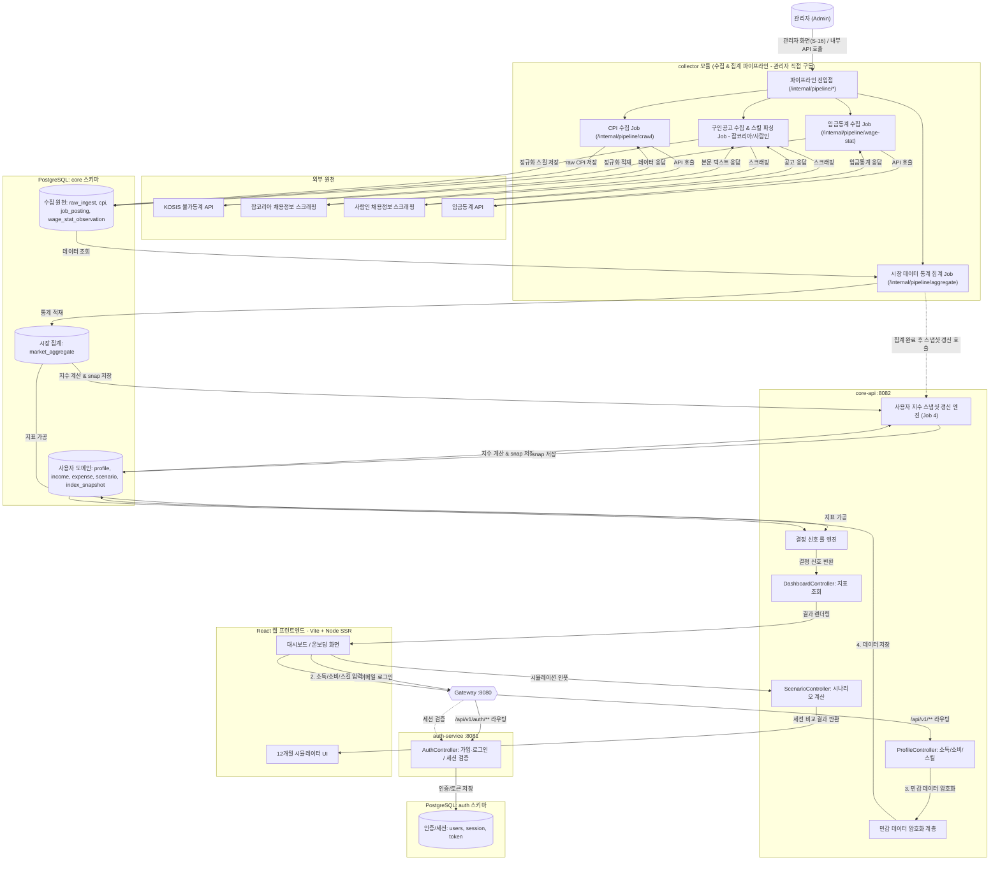
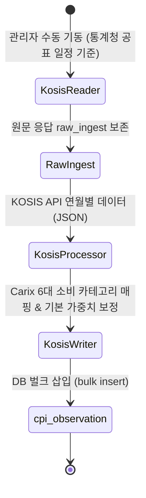
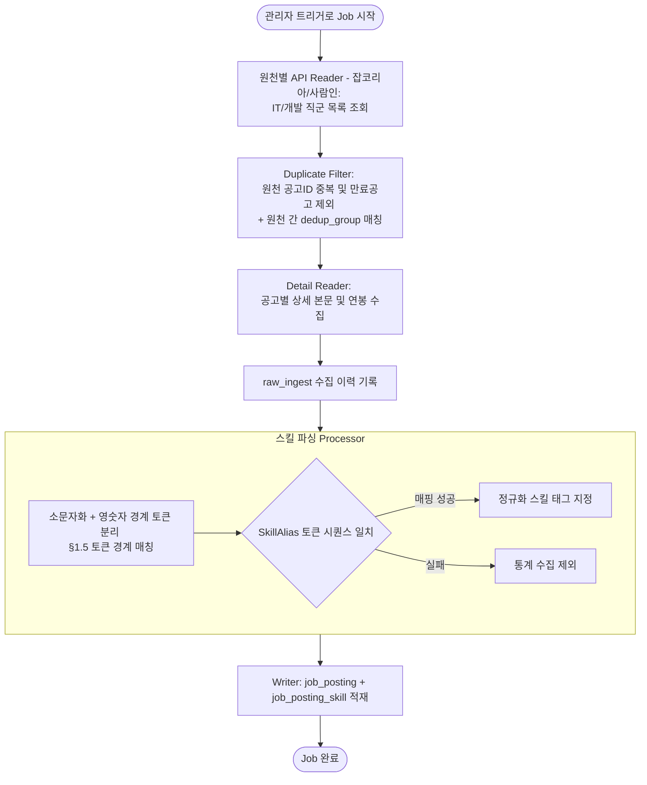
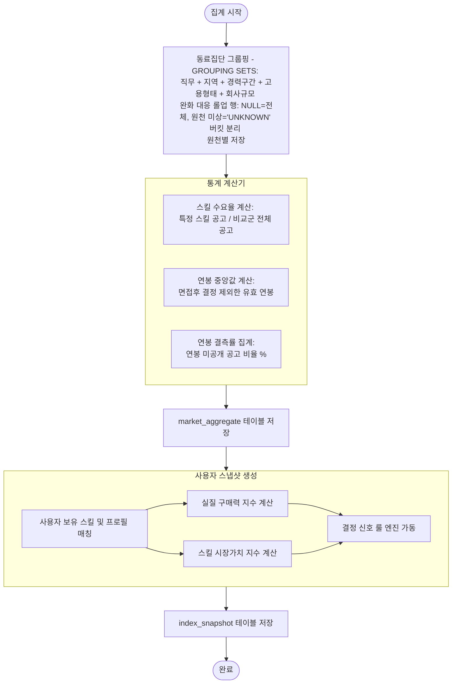
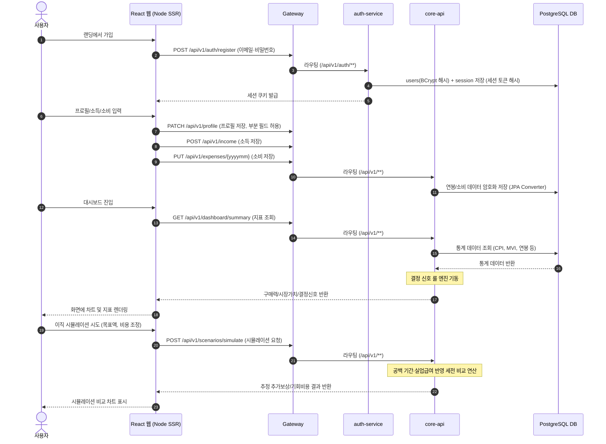

# Carix 데이터 아키텍처와 실행 흐름

원천·파이프라인·지수 규칙(§1~§2)과 그것을 실제로 돌리는 서비스 흐름·Job 구성(§4~§6)을
함께 갖는다. §1~§2 는 파이프라인 재설계가 **바꾼 것만** 적는다 — 안 바꾼 것의 소관은
§2 머리말에 있다.

> **시스템 구조**(기술 스택·모듈 구성·데이터 모델)는 이 문서가 갖지 않는다 —
> 루트 [`README.md` 「채택 사유」](../../README.md#채택-사유),
> [Spring Cloud 아키텍처](spring-cloud-architecture.md), [ERD](erd.md)가 갖는다.

## 1. 데이터 아키텍처

### 1.1 원천 구성

| 원천 | 역할 | 비고 |
| --- | --- | --- |
| KOSIS CPI (지출목적별) | 개인물가 → 구매력 지수 | 공식 통계 |
| 잡코리아 채용공고 스크래핑 | 스킬 수요율 원천 1 | 개발·데이터·AI 직군 채용공고 수집 |
| 사람인 채용공고 스크래핑 | 스킬 수요율 원천 2 | IT 공고 커버리지 보완 |
| 임금직무정보시스템 또는 KOSIS 직종별 임금 | 연봉 기준선 | 공식 통계 (제공 여부·결측 수준은 선행 검증 대상) |

핵심 결정: 연봉 비교 기준을 공고 공개연봉에서 공식 임금통계로 교체한다.
공고 공개연봉은 표본이 충분할 때 참고 범위로만 병기하고 지수·신호 입력에서
제외한다.

### 1.2 파이프라인

```text
[KosisAdapter] [JobKoreaAdapter] [SaraminAdapter] [WageStatAdapter]
       │              │               │               │
       └── 원천별 원문 보존 (RawIngest: 출처, 원문ID, 원문, 수집시각) ──┘
                              │
                    정규화 (공통 도메인 모델)
                    - 직무·지역·경력 코드 통일
                    - 스킬 사전 + 별칭 매칭
                    - 원천 간 중복 공고 매칭 (dedup_group)
                              │
                    월별 시장 집계 (MarketAggregate, 원천별 행만)
                              │
                    사용자 지수 스냅샷 (IndexSnapshot)
```

- 어댑터는 도메인 지식 없이 원문을 표준 DTO로만 변환한다. 원천 스키마 변경을
  어댑터 안에 격리한다.
- 검증 결과가 나쁜 원천은 어댑터만 비활성화한다. 구조는 변경하지 않는다.
- 스킬 사전과 별칭은 저장소 내 버전 관리되는 시드 파일로 관리한다.
- 원천 장애 시 마지막 성공 집계를 사용하고 대시보드에 `업데이트 지연`과
  기준일을 표시한다.
- 수집/집계 권장 주기는 원천별로 다르다: CPI 월 1회, 공고 수집 일/주 1회, 임금통계는
  발표 주기 추종. 관리자가 관리자 화면(Admin UI/API)에서 직접 수동 구동하며,
  필요 시 Spring Scheduler(`@Scheduled`)를 통한 정기 실행 도입도 함께 고려한다.
  상세 흐름은 워크플로우 명세를 따른다. 사용자 입력 변경
  시에는 최신 성공 집계를 사용해 해당 사용자의 지수 스냅샷만 즉시 재계산한다.

### 1.3 공고 생명주기와 멱등성

- RawIngest 유니크 키는 `(source, source_item_id)`이며 `first_seen_month`,
  `last_seen_month`를 갱신한다. `JobPosting` 역시 이후 월에 재수집될 때 `last_seen_month`를 갱신한다.
- 월별 집계(`market_aggregate`, `b18`)는 활동월(`first_seen_month <= base_year_month <= last_seen_month`) 기준으로 공고를 귀속한다.
  - 시작월/종료월 결측 시 `posted_start_date`/`posted_end_date` 또는 `collected_at`으로 정규화 폴백한다.
  - 수집 이전 구간은 모수가 0 이라 값이 아니라 표본 부족이다.
- **월별 모수는 「그 달 신규 수집 공고」(유량)다.** 크롤러는 최근 등록순으로 원천마다 `maxPages`(기본 5,
  40건/페이지)만 훑어 이미 본 공고를 다음 달에 다시 보지 않는다 — `last_seen_month` 가 사실상
  `first_seen_month` 와 같다. 포털이 재게시 공고에 새 ID 를 주는 것도 같은 방향이다. 그래서 활동월 귀속은
  「그 달 게시 중인 공고」(저량)가 아니라 「그 달 새로 들어온 공고」를 센다.
  - **수요율 = 그 달 신규 수집 공고 중 그 스킬을 요구하는 공고의 비율**(원천별, 동료집단 안). 채용 수요의
    유입을 재는 지표로 정의하고, 저량으로 해석하지 않는다.
  - 유량이라 월별 모수가 크롤링 실행 규모를 그대로 따른다. **크롤링은 매월 같은 규모(같은 `maxPages`·같은
    원천)로 돌린다** — 규모가 달마다 다르면 수요율은 같아도 표본 수와 표본 부족 판정이 흔들린다(`b21`).
  - 저량(게시 중 공고)으로 바꾸려면 기존 공고를 매월 다시 관측(전수 순회)하거나 게시 기간
    (`posted_start_date`~`posted_end_date`)으로 귀속해야 한다. 후자는 시작일 결측(약 56%)이 먼저 풀려야
    한다.
- 집계·스냅샷은 재실행 시 기존 해당 월 데이터를 삭제 후 재생성(`deleteByBaseYearMonth`)하는 멱등 upsert로 동일 결과를 만든다.

### 1.4 원천 간 중복 제거 (Deduplication v1)

- **식별자**: `JobPosting`에 `dedup_group_id (UUID)` 및 `dedup_rule_version (varchar)`을 기록한다.
- **매칭 알고리즘 (`JobPostingDeduplicator`)**:
  1. **회사명 정규화 (`CompanyNormalizer`)**: 법인 표기(`(주)`, `주식회사`, `Inc.`, `Corp.` 등) 및 특수문자 제거, 소문자화
  2. **제목 정규화 (`TitleNormalizer`)**: 불용어(채용, 모집, 신입, 경력 등)를 제외한 핵심 키워드 토큰화
  3. **유사도 및 클러스터링**: 동일 정규화 회사명 내에서 Jaccard 유사도 $\ge 0.4$ 또는 부분집합 포함 관계 시 Union-Find 알고리즘으로 단일 `dedup_group_id` 클러스터링 (단독 공고는 자체 UUID 부여)
- **원천별 vs 통합 집계 원칙**:
  - 원천별 집계(`JOBKOREA`, `SARAMIN`): 원본 행 기준
  - 통합 관점 집계(`ALL`): `dedup_group_id` 기준 고유 공고 수 산출

### 1.5 문자열 매칭 & 정규식 고속화 엔진

1. **Aho-Corasick Trie (`org.ahocorasick:ahocorasick`)**:
   - `SkillTaxonomy`: 104개 표준 스킬 및 177개 별칭 사전을 Trie 오토마타로 메모리에 빌드하여 공고 본문을 단 1-Pass($O(N)$)로 순회하며 모든 스킬을 동시 검출.
2. **Google RE2J (`com.google.re2j:re2j`)**:
   - `CompanyNormalizer`, `TitleNormalizer`, `JobPostingDateParser`: 선형 시간 $O(N)$을 보장하는 DFA 정규식 엔진으로 ReDoS 백트래킹 지수 시간 위험 원천 차단.

### 1.6 원문 보존 정책

- RawIngest 원문은 JSONB로 저장하고 `schema_version`을 기록한다.
- 보존 기간은 24개월로 하며, 초과분은 원문만 삭제하고 메타데이터를 유지한다.

## 2. 지수와 결정 규칙

이 절은 파이프라인 재설계가 **바꾼 것만** 갖는다. 구매력 지수는
[도메인 정의서 §1](domain-logic.md)과 [기능 명세 §4.3](functional-specification.md),
동료집단 완화는 [도메인 정의서 §2](domain-logic.md), 12개월 시나리오는
[기능 명세 §12.5](functional-specification.md)가 갖는다.

### 2.1 스킬 수요 지수 (구 시장가치 지수)

```text
원천별 스킬 수요율   = 원천 내 스킬 언급 공고 수 ÷ 원천 내 동료집단 전체 공고 수
원천별 스킬 수요 지수 = 최근 3개월 수요율 ÷ 그 이전 12개월 수요율 × 100
통합 스킬 수요 지수   = 원천별 지수의 표본수 가중 평균
                       (가중치 = 해당 원천의 최근 3개월 동료집단 전체 공고 수)
사용자 스킬 수요 지수 = Σ(스킬별 통합 지수 × 사용기간·최근사용 가중치)
```

- 결합은 수요율이 아니라 원천별 모멘텀 지수 단위로 한다. 원천마다 스킬 언급
  성향이 달라도 원천 내 비율이라 편향이 분자·분모에서 상쇄된다. 단, 이 상쇄는
  **원천의 커버리지와 언급 성향이 두 기간 창에서 안정적이라는 가정**에 의존한다.
  이 가정은 선행 검증과 월별 데이터 품질 검사(수집 건수 급변 감지)로 모니터링한다.
- 기간 창은 비중첩이다. 비교 기준 12개월은 최근 3개월을 제외한 그 이전
  12개월(4~15개월 전)이다.
- 원천 1개만 표본 기준을 충족하면 그 원천만 사용하고 `단일 원천`으로 표시한다.
- 표본 부족 스킬은 제외하고 별도 표시한다. 제외 시 포함 스킬로 가중치를
  재정규화하고 `보유 스킬 중 N% 반영` 커버리지를 표시한다.
- 채용 계절성(1분기 집중 등)은 MVP에서 보정하지 않으며 알려진 한계로
  문서화한다.

### 2.2 연봉 격차

```text
기준 연봉 = 공식 임금통계의 직종 × 경력구간 × 지역 중앙값
연봉 격차 = (기준 연봉 - 사용자 세전연봉) ÷ 사용자 세전연봉
```

연봉 격차는 사용자 연봉이 기준 연봉보다 낮을 때 양수다 (결정표의
`SalaryGapRatio ≥ 0.15` 규약과 동일).

- 격차는 점 추정 대신 해당 경력구간의 범위로 표시한다. 사용자 경력이 구간
  경계 ±1년이면 인접 구간을 병기한다.
- 임금통계의 임금 정의(`wage_definition`, 표준값 `ANNUAL_GROSS_MEDIAN`: 연간 세전 중위임금)를
  화면에 명시한다. 사용자 입력(세전 연봉)과 공식 통계 간의 산정 기준(초과급여·상여 등)을 투명하게
  안내하며, 정의가 다를 경우 `정의 차이 존재` 캐비앳을 고정 표시한다. 상여 포함 여부 입력을
  추가할지는 아직 정하지 않았다 — 판단 조건은 §3 에 있다.

### 2.3 결정 신호

기존 5.4 규칙 엔진 구조를 유지한다. 신호 5종(`협상 검토`, `이직 탐색`,
`현 상태 유지`, `스킬 보강 우선`, `데이터 부족`)과 버전 관리되는 결정표를
그대로 사용한다. 입력만 다음으로 교체한다.

- 구매력 지수 변화
- 스킬 수요 지수 변화
- 연봉 격차 (공식 임금통계 기준)
- 데이터 신뢰 상태

규칙 평가에는 사용자 경력구간의 기준 연봉 중앙값으로 계산한 점 추정 격차를
사용한다. 범위와 인접 구간 병기는 표시 전용이다.

## 3. 선행 검증 잔여

선행 검증 여섯 중 셋이 남아 있다. 닫힌 셋은 소관이 따로 생겼다 — 채용공고 원천 비교는
사람인 API 를 폐기하며 전제가 사라졌고(§1.1), CPI 카테고리 매핑은 `CpiIngestService` 가,
최소 표본 기준(`N ≥ 10`)은 [기능 명세 §6](functional-specification.md)이 가져갔다.

- **스크래핑 대상 사이트 이용약관 미검토.** 잡코리아·사람인 두 사이트를 스크래핑해
  공고를 적재하고 있는데 이용약관을 검토한 기록이 없다. API 원천의 이용 조건은
  결론이 나 있다 (`verification/notes/source-availability.md`) — 남은 것은 스크래핑
  쪽이다.
- **스킬 사전 매칭 재현율 미측정.** 표본 공고로 정밀도·재현율을 재어 별칭 사전과 규칙을
  보정하는 일이 남았다 ([도메인 정의서 §7.2](domain-logic.md)). 이 수치가 부족할
  때 GiST·`pg_trgm` 도입을 판단하므로 [아키텍처 로드맵](../plans/architecture-roadmap.md)의 확장안이
  여기에 걸려 있다.
- **상여 포함 여부 미결.** 임금통계의 임금 정의에 상여가 어떻게 들어가는지 확인한 뒤
  §2.2 의 상여 포함 여부 입력을 추가할지 정한다.

검증 결과는 `verification/` 에 기록한다. 측정값과
판단 근거를 남겨 이후 설정값(최소 표본, 가중치)의 출처로 삼는다.

검증 결과가 부족한 원천은 어댑터 비활성화로 대응한다. 데이터가 없는 기능을
추정값으로 채워 만들지 않는다.

---

## 4. 전체 서비스 아키텍처 및 흐름도

사용자의 실시간 요청을 처리하는 **API 영역**과 관리자가 관리자 화면(Admin UI/API)에서 직접 구동해 대량의 외부 데이터를 수집·가공하는 **수집/집계 파이프라인(collector) 영역**이 유기적으로 연결된 데이터 파이프라인 구조입니다. 가로 너비를 최소화하고 세로 흐름을 따라 배치되었습니다.



---

## 5. 수집·집계 파이프라인 (관리자 직접 구동)

외부 수집 데이터는 **관리자 화면에서 직접 구동하는 방식(Admin UI/API)**으로만 실행됩니다. 파이프라인 Job(CPI 수집, 공고 수집·파싱, 임금통계 수집, 집계)을 내부 API(`/internal/pipeline/**`)로 관리자가 트리거합니다.

**`@Scheduled` 정기 실행은 도입하지 않기로 확정했습니다.** 정기 실행에는 수집 실패 재시도, 중복 실행 방지, 실패 관측 경로가 함께 따라오는데 MVP 표본 규모에서 그만한 값을 하지 않습니다. 정기 실행이 필요해지면 그때 다시 판단합니다.

### 5.1 Job 1: CPI 소비자물가지수 수집 (관리자 직접 구동, 월 1회 권장)
통계청 공표 일정에 맞춰 관리자가 관리자 화면에서 직접 기동합니다.



### 5.2 Job 2: 구인공고 수집 및 스킬 정규화 (관리자 직접 구동, 일·주 1회 권장)
가장 많은 연산과 파싱이 필요한 핵심 수집 파이프라인입니다. 잡코리아와 사람인 어댑터가 동일 구조로 실행되며, 관리자가 트리거 시 수집 후 원천 간 중복 공고를 `dedup_group_id`로 매칭합니다. 파싱된 스킬은 `job_posting_skill`에 공고별로 저장합니다.



### 5.3 Job 3(시장 데이터 집계) 및 Job 4(사용자 스냅샷 갱신 — core-api 전담)
Job 3(원천별 집계)은 `collector`가 실행하며, Job 4(사용자 스냅샷 갱신)는 `core-api` 안에서 사용자 프로필·소득·소비·스킬 변경 시 **트랜잭션 안의 동기 직접 호출**(`recalculateSnapshot(userId, fromYm)`)로 실행됩니다. 스케줄러나 비동기 이벤트는 쓰지 않습니다 ([도메인 정의서 §5](domain-logic.md)). 사용자 스냅샷 계산 및 저장은 `core-api`가 전담 소유합니다. 아래 흐름도는 두 Job의 연쇄 데이터 흐름을 표현한 것입니다. 수집된 원천 공고 및 CPI 데이터를 사용자의 동료집단(Peer Group) 단위로 그룹핑하고 통계를 집계한 뒤 사용자 스냅샷을 갱신합니다.

롤업 집합(GROUPING SETS) 열거 — 롤업 차원은 `employment_type`, `company_size`, `skill_id` 3개이며, 원천×월×직무×지역×경력구간마다 다음 6개 집합을 생성합니다 (`NULL` = 전체 롤업, 원천 미상 `'UNKNOWN'`은 세분 값의 하나로 취급):

| # | employment_type | company_size | skill_id | 용도 |
| --- | --- | --- | --- | --- |
| 1 | 세분 값 | 세분 값 | 세분 값 | 완화 Level 1 |
| 2 | 세분 값 | NULL | 세분 값 | 완화 Level 2~4 |
| 3 | NULL | NULL | 세분 값 | 완화 Level 5 |
| 4 | 세분 값 | 세분 값 | NULL | 스킬 무관 전체 (Level 1 분모·분포) |
| 5 | 세분 값 | NULL | NULL | 스킬 무관 전체 (Level 2~4) |
| 6 | NULL | NULL | NULL | 스킬 무관 전체 (Level 5) |



---

## 6. 사용자 경험 시나리오 흐름

방문자가 가입 없이 유입되어 의사결정 시뮬레이션을 받기까지의 API 통신 순서입니다.


