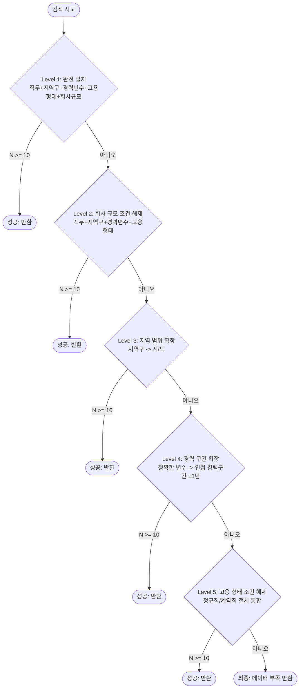

# Carix 도메인 및 계산 공식 세부 정의서 (Domain Logic & Math Formulations)

이 문서는 Carix 핵심 지표산출 엔진 및 시나리오 시뮬레이터 구현에 필요한 알고리즘, 수학 공식, 예외 처리 정책 및 가중치 전파 논리를 상세히 정의합니다.

---

## 1. 시계열 소비 가중치 상속 및 전파 논리 (Expense Weight Propagation)

사용자는 매달 소비 패턴을 기록하지 않을 가능성이 높습니다. 시계열 실질 구매력 지수(PPI)를 누적 계산할 때 소비 가중치 데이터 공백을 해결하기 위한 상속 알고리즘을 다음과 같이 정의합니다.

### 1.1 가중치 산출 및 전파 알고리즘
기준월 $t$에 대하여 사용자의 소비 가중치 벡터 $W(t)$를 산출하는 순서입니다.

1.  **사용자 직접 입력 검사:**
    해당 월 $t$에 **6개 카테고리가 모두 입력되고 금액 합계가 0보다 큰 경우에만** 입력된 금액 비율을 기준으로 가중치 $W_i(t)$를 계산합니다. 일부 카테고리만 입력된 월은 아래 4번(부분 입력 혼합)으로, 합계가 0인 월(전 항목 0원 포함)은 4번의 합계 0 처리 규칙으로 처리합니다 — 이 검사가 항상 선행하므로 0 나눗셈은 발생하지 않습니다.
    $$W_i(t) = \frac{\text{Amount}_i(t)}{\sum_{j=1}^{6} \text{Amount}_j(t)}$$
    *(상태 라벨: `USER_DEFINED`)*

2.  **직전 과거 이력 상속 (Propagation):**
    월 $t$에 소비 데이터가 없다면, 과거로 역추적하여 가장 가까운 최근 월 $t-k \, (k \ge 1)$의 성공적인 소비 기록 $W(t-k)$를 그대로 복사하여 $W(t)$로 사용합니다.
    *(상태 라벨: `PROPAGATED`)*

3.  **기본 통계 가중치 대체 (Default Fallback):**
    과거 기록이 전무한 가입 초기 온보딩 단계 등에서는 통계청(KOSIS) 전체 가구 월평균 소비지출 비중 데이터를 기본값으로 주입합니다. MVP는 가구원수를 수집하지 않으므로 전체 가구 평균을 사용합니다. 기본 가중치 시드는 저장소 내 `config/default-expense-weights.yml`(스키마: `version`, `sourceStatTable`, `basePeriod`, 카테고리별 비중 6개 — 합 1.0)로 관리합니다. 적재 방식은 구현 시 정합니다 — core-api 는 Flyway 를 쓰지 않으므로 마이그레이션 시드로 넣을 수 없습니다. 6개 비중 값은 선행 검증에서 KOSIS 최신 가계동향조사 수치로 채웁니다.
    *(상태 라벨: `DEFAULT_CPI`)*

4.  **부분 입력 혼합 (Partial Input Blending):**
    일부 카테고리만 입력된 월은 카테고리 단위로 상태를 혼합합니다.
    *   입력 카테고리 금액은 그대로 사용합니다 *(카테고리 상태: `USER_DEFINED`)*.
    *   미입력 카테고리 $i$의 금액은 기본 가중치 비율로 보간합니다:
        $$\text{Amount}_i = \text{DefaultW}_i \times \frac{\sum \text{입력 금액}}{\sum_{j \in \text{입력}} \text{DefaultW}_j}$$
        *(카테고리 상태: `DEFAULT_CPI`)*
    *   최종 가중치는 실제·보간 금액을 합산한 전체 6개 카테고리 기준으로 정규화합니다.
    *   상태 라벨은 월 단위 단일값이 아니라 **카테고리별**로 도출·반환합니다. 상태는 DB에 저장하지 않고 입력 행 존재 여부로 계산 시점에 도출합니다 (`expense_item` DDL 주석과 동일). 월 요약 라벨은 `USER_DEFINED` > `DEFAULT_CPI` 혼재 시 `PARTIALLY_ESTIMATED`로 표시합니다.
    *   **입력 합계 0 처리:** 입력된 금액의 합이 0이면(전 항목 0원 포함) 보간·정규화가 불가능하므로 해당 월 기록은 저장하되 가중치 산출에는 사용하지 않고, 직전 이력 상속(`PROPAGATED`)으로 폴백합니다. 과거 이력도 없으면 `DEFAULT_CPI` 전체 대체를 적용합니다. UI에는 `지출 합계 0원 — 가중치 계산에서 제외됨`을 안내합니다.

### 1.2 UI 표기 정책
대시보드 상에 계산된 구매력 지수 옆에 위 상태 라벨에 따른 뱃지를 다음과 같이 매칭하여 데이터 신뢰도를 사용자에게 투명하게 알립니다.
*   `USER_DEFINED` ➡️ **"내 지출 기준"** (신뢰도 높음)
*   `PARTIALLY_ESTIMATED` ➡️ **"일부 추정 포함"** (입력 + 기본값 혼합)
*   `PROPAGATED` ➡️ **"이전 지출 기준"** (중간)
*   `DEFAULT_CPI` ➡️ **"통계청 평균 기준"** (참고용)

월 요약 상태 enum은 위 4종으로 통일하며, `SEMI_ESTIMATED` 등 다른 표기는 사용하지 않는다.

---

## 2. 동료집단(Peer Group) 완화 알고리즘 계층 구조 (Fallback Hierarchy)

공개 채용 공고 데이터를 특정 세부 필터(직무 + 지역 + 경력 + 고용형태 + 회사규모)로 묶었을 때 표본 수가 최소 기준($N \ge 10$) 미만으로 떨어지는 **데이터 희소성 문제**를 해결하기 위한 단계적 쿼리 완화 전략입니다.



### 2.1 완화 단계별 쿼리 정책

완화는 사전 집계 테이블(`market_aggregate`)의 경력 브래킷(`JUNIOR` 0~3 / `MID` 4~7 / `SENIOR` 8+) 단위로 수행합니다. 사용자 년차는 먼저 브래킷으로 변환합니다.

1.  **Level 1 (Exact Match):**
    ```sql
    WHERE job_family = :job AND region = :region_detail AND experience_bracket = :bracket AND company_size = :size AND employment_type = :type
    ```
2.  **Level 2 (Drop Company Size):**
    ```sql
    WHERE job_family = :job AND region = :region_detail AND experience_bracket = :bracket AND company_size IS NULL AND employment_type = :type
    ```
    조건을 단순 생략하면 롤업 행과 세분 행이 함께 잡혀 집계가 중복된다. 완화된 차원은 반드시 `IS NULL`(전체 롤업 행)로 **명시 선택**한다.
3.  **Level 3 (Expand Region):**
    `region_detail` (예: 서울 강남구) ➡️ `region_broad` (예: 서울특별시 전체)로 넓혀 쿼리합니다.
4.  **Level 4 (Expand Experience Bracket):**
    사용자 브래킷에 **인접 브래킷을 추가**해 조회합니다 (예: `MID` ➡️ `experience_bracket IN ('JUNIOR', 'MID', 'SENIOR')` 중 인접 구간). 사용자 년차가 브래킷 경계 ±1년이면 Level 4 이전에도 인접 브래킷을 병기 표시합니다.
5.  **Level 5 (All Employment Types):**
    `employment_type IS NULL`인 전체 롤업 행을 선택합니다 (조건 제거가 아님 — Level 2와 동일한 명시 선택 규칙).

### 2.2 메타데이터 반환 규격
지표 API 응답 시 실제 적용된 Fallback 단계를 함께 반환하여, 프론트엔드가 대시보드 하단에 **"비교군: 서울 전체 / 경력 4~7년(MID) 기준 (회사규모 무관)"**과 같이 저장 브래킷 단위로 표기할 수 있도록 지원합니다.

---

## 3. 사용자 스킬 가중치($W_{skill}$) 산출 수학 공식

사용자가 다수의 스킬을 입력했을 때, 각 스킬의 실무 사용 경력(Months)과 최근성(Recency)을 계산하여 상대적 중요도 가중치를 분배하는 수학적 모형입니다.

### 3.1 변수 정의
*   $E_i$: $i$번째 스킬의 실무 경력 (개월 수, $1 \le E_i \le 600$ — 입력 검증 범위와 동일)
*   $R_i$: $i$번째 스킬의 마지막 사용 이후 경과된 기간 (개월 수, $R_i \ge 0$)
    *   *이번 달까지 사용한 경우 $R_i = 0$*

### 3.2 스킬 숙련도 점수 산출 공식
1.  **경력 기간 요인 ($F_{dur}$):** 경력이 길어질수록 숙련도가 올라가나, 한계효용 체감을 반영하기 위해 자연로그 함수를 적용합니다.
    $$F_{dur}(E_i) = \ln(E_i + 1)$$
2.  **최근성 감쇄 요인 ($F_{rec}$):** 사용하지 않은 지 오래될수록 기억 및 시장 숙련도가 떨어지는 망각 곡선을 반비례(쌍곡선형) 감쇄 공식으로 모델링합니다.
    $$F_{rec}(R_i) = \frac{1}{1 + \alpha \cdot R_i} \quad (\text{기본 감쇄율 } \alpha = 0.1)$$
3.  **스킬별 원천 점수 ($S_i$):**
    $$S_i = F_{dur}(E_i) \times F_{rec}(R_i) = \ln(E_i + 1) \times \frac{1}{1 + 0.1 \cdot R_i}$$
4.  **정규화 가중치 ($W_i$):** 사용자가 보유한 전체 $N$개 스킬에 대하여 총합이 1이 되도록 비중을 나눕니다.
    $$W_i = \frac{S_i}{\sum_{j=1}^{N} S_j}$$

### 3.3 산출 예시
*   **스킬 A:** 24개월 사용, 0개월 방치 (현재 사용) ➡️ $S_A = \ln(25) \times 1 \approx 3.22$
*   **스킬 B:** 12개월 사용, 10개월 방치 ➡️ $S_B = \ln(13) \times \frac{1}{2} \approx 2.56 \times 0.5 = 1.28$
*   **총합 ($\sum S$):** $3.22 + 1.28 = 4.50$
*   **최종 가중치:** 스킬 A ($71.5\%$), 스킬 B ($28.5\%$)

---

## 4. 시나리오 시뮬레이터 고도화 및 공백 기간 반영 계산 공식

이직 시 발생하는 실업 공백 및 실업급여 수급 조건을 시나리오 시뮬레이션에 반영하여 현실성을 높입니다. 모든 계산은 세전 기준이며 세금은 추정하지 않습니다.

### 4.1 한국 실업급여(구직급여) 모킹 공식
수급 요건 충족 여부는 사용자가 시나리오 입력(`isEligibleForUnemploymentBenefit`, 기본값 true)으로 지정합니다. 미충족(false) 선택 시 실업급여를 0으로 계산하고 화면에 `실업급여 미반영` 안내를 표시합니다. 충족 시 아래 공식을 적용합니다.

*   **1일 구직급여 지급액:**
    $$\text{DailyBenefit} = \min\left(\text{UpperLimit}, \max\left(\text{LowerLimit}, 0.6 \times \text{AvgDailyWage}\right)\right)$$
    *   평균임금 (`AvgDailyWage`): 현재 세전 연봉 ÷ 365 (소득 이력의 최신 유효 연봉 사용)
    *   상한액 (`UpperLimit`): 일 66,000 원 *(가정치)*
    *   하한액 (`LowerLimit`): 최저임금의 80% 수준 — 일 60,120 원 *(가정치)*
    *   위 상수는 법정 공시값이 아닌 시뮬레이션 가정치다. 구현 시 고용보험 공시 기준으로 갱신하고 설정 파일에 기준 시점을 기록하며, 화면에 `가정 기반 추정` 라벨을 표시한다.
*   **지급 기간 (구직급여 소정급여일수):**
    MVP에서는 연령 및 가입 기간 조건 테이블을 단순화하여 **평균 150일(5개월)**을 수급 한도로 지정하고, 사용자가 입력한 구직 공백 기간 $U$(개월)만큼 비례 지급합니다.
    $$\text{TotalBenefit}(U) = \min(U, 5) \times (\text{DailyBenefit} \times 30)$$

### 4.2 12개월 시나리오 세전 누적 보상 연산식
사용자가 입력한 예상 공백 기간 $U$(개월, $0 \le U \le 6$)을 기준으로 비교 연산합니다.

#### ① 잔류 시나리오 (Stay Scenario)
$$Stay_{12m} = \text{CurrentSalary} \times \left(1 + \frac{\text{expectedRaiseRate}}{100}\right)$$

#### ② 이직 시나리오 (Move Scenario)
$$Move_{12m} = \left(\text{TargetSalary} \times \frac{12 - U}{12}\right) + \text{TotalBenefit}(U) - \text{MoveOneTimeCost}$$

#### ③ 차이값 (Difference)
$$\text{Difference} = Move_{12m} - Stay_{12m}$$
*   차가 0 이상일 경우 ➡️ **추정 추가보상 (`ESTIMATED_GAIN`)**
*   차가 음수일 경우 ➡️ **추정 기회비용 (`ESTIMATED_OPPORTUNITY_COST`)**

용어는 화면·API에서 이 두 가지로 통일하며, `추정 기회이익` 등 다른 표기는 사용하지 않습니다.
