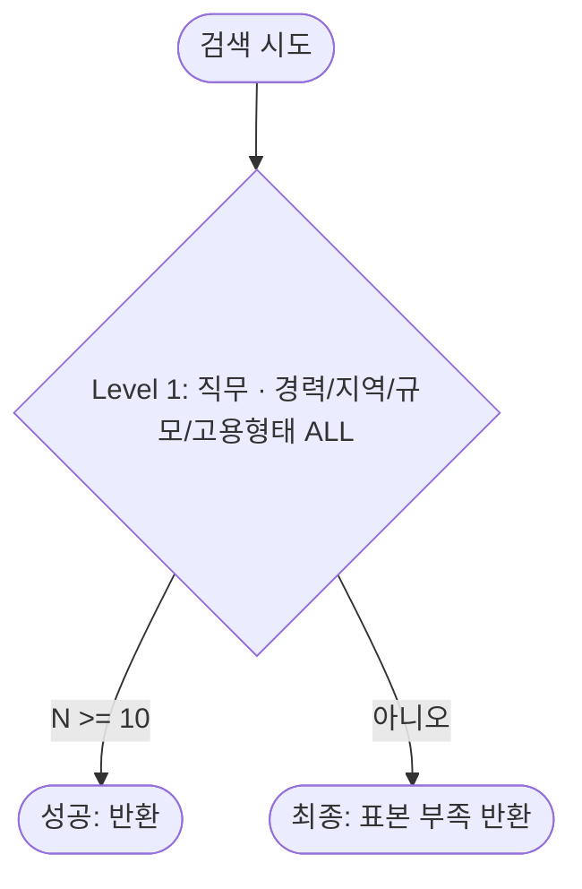

# Carix 도메인 및 계산 공식 세부 정의서 (Domain Logic & Math Formulations)

이 문서는 Carix 핵심 지표산출 엔진 및 시나리오 시뮬레이터 구현에 필요한 알고리즘, 수학 공식, 예외 처리 정책 및 가중치 전파 논리를 상세히 정의합니다.

---

## 1. 시계열 소비 가중치 상속 및 전파 논리 (Expense Weight Propagation)

사용자는 매달 소비 패턴을 기록하지 않을 가능성이 높습니다. 시계열 실질 구매력 지수(PPI)를 누적 계산할 때 소비 가중치 데이터 공백을 해결하기 위한 상속 알고리즘을 다음과 같이 정의합니다.

### 1.1 가중치 산출 및 전파 알고리즘
기준월 $t$에 대하여 사용자의 소비 가중치 벡터 $W(t)$를 산출하는 순서입니다.

1.  **사용자 직접 입력 검사:**
    해당 월 $t$에 **6개 카테고리가 모두 입력되고 금액 합계가 0보다 큰 경우에만** 입력된 금액 비율을 기준으로 가중치 $W_i(t)$를 계산합니다. 일부 카테고리만 입력된 월은 아래 4번(부분 입력 혼합)으로, 합계가 0인 월(전 항목 0원 포함)은 4번의 합계 0 처리 규칙으로 처리합니다 — 이 검사가 항상 선행하므로 0 나눗셈은 발생하지 않습니다.
    $$W_i(t) = \frac{\text{Amount}_i(t)}{\sum_{j=1}^{6} \text{Amount}_j(t)}$$
    *(상태 라벨: `USER_DEFINED`)*

2.  **직전 과거 이력 상속 (Propagation):**
    월 $t$에 소비 데이터가 없다면, 과거로 역추적하여 가장 가까운 최근 월 $t-k \, (k \ge 1)$의 성공적인 소비 기록 $W(t-k)$를 그대로 복사하여 $W(t)$로 사용합니다.
    *(상태 라벨: `PROPAGATED`)*

3.  **기본 통계 가중치 대체 (Default Fallback):**
    과거 기록이 전무한 가입 초기 온보딩 단계 등에서는 통계청(KOSIS) 전체 가구 월평균 소비지출 비중 데이터를 기본값으로 주입합니다. MVP는 가구원수를 수집하지 않으므로 전체 가구 평균을 사용합니다. 기본 가중치 시드는 저장소 내 `config/default-expense-weights.yml`(스키마: `version`, `sourceStatTable`, `basePeriod`, 카테고리별 비중 6개 — 합 1.0)로 관리합니다. 적재 방식은 구현 시 정합니다 — core-api 는 Flyway 를 쓰지 않으므로 마이그레이션 시드로 넣을 수 없습니다. 6개 비중 값은 선행 검증에서 KOSIS 최신 가계동향조사 수치로 채웁니다.
    *(상태 라벨: `DEFAULT_CPI`)*

4.  **부분 입력 혼합 (Partial Input Blending):**
    일부 카테고리만 입력된 월은 카테고리 단위로 상태를 혼합합니다.
    *   입력 카테고리 금액은 그대로 사용합니다 *(카테고리 상태: `USER_DEFINED`)*.
    *   미입력 카테고리 $i$의 금액은 기본 가중치 비율로 보간합니다:
        $$\text{Amount}_i = \text{DefaultW}_i \times \frac{\sum \text{입력 금액}}{\sum_{j \in \text{입력}} \text{DefaultW}_j}$$
        *(카테고리 상태: `DEFAULT_CPI`)*
    *   최종 가중치는 실제·보간 금액을 합산한 전체 6개 카테고리 기준으로 정규화합니다.
    *   상태 라벨은 월 단위 단일값이 아니라 **카테고리별**로 도출·반환합니다. 상태는 DB에 저장하지 않고 입력 행 존재 여부로 계산 시점에 도출합니다 (`expense_item` DDL 주석과 동일). 월 요약 라벨은 `USER_DEFINED` > `DEFAULT_CPI` 혼재 시 `PARTIALLY_ESTIMATED`로 표시합니다.
    *   **입력 합계 0 처리:** 입력된 금액의 합이 0이면(전 항목 0원 포함) 보간·정규화가 불가능하므로 해당 월 기록은 저장하되 가중치 산출에는 사용하지 않고, 직전 이력 상속(`PROPAGATED`)으로 폴백합니다. 과거 이력도 없으면 `DEFAULT_CPI` 전체 대체를 적용합니다. UI에는 `지출 합계 0원 — 가중치 계산에서 제외됨`을 안내합니다.

### 1.2 UI 표기 정책
대시보드 상에 계산된 구매력 지수 옆에 위 상태 라벨에 따른 뱃지를 다음과 같이 매칭하여 데이터 신뢰도를 사용자에게 투명하게 알립니다.
*   `USER_DEFINED` ➡️ **"내 지출 기준"** (신뢰도 높음)
*   `PARTIALLY_ESTIMATED` ➡️ **"일부 추정 포함"** (입력 + 기본값 혼합)
*   `PROPAGATED` ➡️ **"이전 지출 기준"** (중간)
*   `DEFAULT_CPI` ➡️ **"통계청 평균 기준"** (참고용)

월 요약 상태 enum은 위 4종으로 통일하며, `SEMI_ESTIMATED` 등 다른 표기는 사용하지 않는다.

### 1.3 구매력 지수 산출 파이프라인 (PPI & Current Salary Provider)

현재 연봉 공급자와 구매력 지수 산출기입니다.

1. **현재 연봉 공급자 (`IncomeCurrentSalaryProvider`):**
   - 소득 이력(`core.income_history`)에서 사용자의 기준월 말일(`baseYearMonth`의 말일) 이하 중 가장 최근 유효 연봉(`gross_salary > 0`)을 조회합니다.
   - 복호화 경계를 소득 도메인 내부에 격리한 채 `CurrentSalary` DTO로 공급하여 결정 신호 엔진의 소득 격차 비율 분모로 활용합니다.
   - 유효한 연봉이 없으면 `Optional.empty()`를 반환하며, 이 경우 결정 신호는 `INSUFFICIENT_DATA`로 분기합니다.

2. **구매력 지수 산출기 (`DefaultPurchasingPowerIndexProvider`):**
   - 기준월: 연봉이 처음 있는 달과 CPI 가 처음 있는 달 중 늦은 달. 기준 소득은 그 달까지 유효한 마지막 연봉이다. 소비 가중치는 기본값이 항상 있다.
   - 기준월 이전 대상월은 CPI 시차와 무관하게 `NOT_AVAILABLE`.
   - 개인물가 = 기준월부터 Π(1 + Σ 그 달 가중치 × 카테고리 전월 대비 CPI 변화율). 카테고리 합성은 `CategoryCpiRateService`, 가중치는 §1.1.
   - 구매력 지수 = 소득지수 ÷ 개인물가 × 100 (소수 1자리). 소득은 양쪽 실수령액이 있으면 실수령액, 아니면 세전.
   - 기준월부터 12개월 미만은 값과 `INSUFFICIENT_HISTORY`, 이상은 `OK`. 연봉 이력 1건이어도 계산한다.
   - 대상월 CPI 가 없으면 2개월 이내 마지막 CPI 월까지 누적하고 `cpiAsOf` 에 그 달 말일을 담는다. `cpiAsOf` 는 스냅샷 근거(`rationale`)에 기록되고 대시보드에는 따로 표시하지 않는다. 더 늦으면 `UPDATE_DELAYED`.
   - 구간 안 CPI 카테고리 결측은 `NOT_AVAILABLE`.
   - 가중치 출처는 대상월 카테고리 상태의 롤업(§1.2 4종).

---

## 2. 동료집단(Peer Group) 완화 알고리즘 계층 구조 (Fallback Hierarchy)

공개 채용 공고 데이터를 특정 세부 필터(직무 + 지역 + 경력 + 고용형태 + 회사규모)로 묶었을 때 표본 수가 최소 기준($N \ge 10$) 미만으로 떨어지는 **데이터 희소성 문제**를 해결하기 위한 단계적 쿼리 완화 전략입니다. 여기서 $N$은 **동료집단 셀의 공고 수**(집계 분모)를 가리킵니다. 스킬 행의 `posting_count`에는 같은 값을 쓰되 판정 단위가 다릅니다 — 원천별 × 스킬별 × 기간 창별로 봅니다(§6.1). 그 기준이 실제로 무엇을 걸러내는지는 §2.3.

**시장가치 지수(MVI) 경로는 직무 하나로만 묶는다.** collector 가 `market_aggregate` 를 직무 × 경력 구간으로만 나누고
지역·고용형태·회사규모는 `ALL` 로 집계하는데, MVI 는 경력도 `ALL`(경력 전체) 행을 쓴다. 잡코리아 수요율은 월 250건 무작위
표본으로 재므로(데이터 아키텍처 §1.3) 경력 넷으로 쪼개면 스킬별 건수가 한 자릿수로 떨어지고, 지수 잡음(±30~40%)이 판정
기준선 간격(5~20)을 넘는다. 「이 스킬의 수요가 늘었나」는 경력 구간마다 크게 다르지 않다 — 경력이 갈라야 하는 건 연봉 기준선이고,
그쪽은 임금통계를 경력 구간별로 잡는다(§1.3 연봉 격차). 지역·규모·고용형태를 실제로 거르는 경로는 원 공고(`job_posting`)를
직접 집계하는 연봉 분포·개방창 지수다(기능 명세 §4.5·§4.6) — 같은 화면에서 비교 조건이 경로마다 다를 수 있고, 각 경로는 자기
조건을 그대로 밝힌다.



### 2.1 완화 단계별 쿼리 정책

MVI 는 완화 단계가 하나다. 직무 전체도 표본이 부족하면 더 넓힐 축이 없다.

1.  **Level 1 (직무):**
    ```sql
    WHERE job_family = :job AND experience_bracket = 'ALL'
      AND region = 'ALL' AND employment_type = 'ALL' AND company_size = 'ALL'
    ```

collector 가 지역·규모·고용형태 행을 만들기 시작하면 쿼리는 해당 값과 `ALL` 을 **동시에** 잡지 않도록 정확 일치로
바꿔야 한다 — 함께 잡으면 같은 공고가 두 번 합산된다(개발 계획 `b25`).

### 2.2 메타데이터 반환 규격
지표 API 응답에 실제 적용된 단계와 **실제 조회 조건** 문구를 함께 반환한다. MVI 는 **"전국 / 경력 전체 / 회사규모 무관 /
고용형태 무관"** 이다. 경력을 쓰는 경로(연봉 분포·개방창)는 연차로만 쓰고 원시 enum 을 섞지 않는다. 화면은 이 문구를 그대로
보이고 프로필 값으로 칩을 다시 만들지 않는다 — 다시 만들면 집계에 없는 조건을 비교한 것처럼 보인다.

### 2.3 표본 실측 제약

`core.job_posting` 800건(JOBKOREA 400 / SARAMIN 400)으로 위 계층을 실측했다.

**완화는 셀을 늘리지만, 늘리는 것은 지역 확장뿐이다.** 단계별 $N \ge 10$ 셀 수는 아래와 같다. 키에는 `source` 가 항상 들어간다(원천별 행만 저장하므로).

| 단계 | 집계 키 | $N \ge 10$ 셀 |
| --- | --- | --- |
| Level 1 | 직무 × **구** × 브래킷 × 고용형태 × 회사규모 | 9 |
| Level 2 | 직무 × **구** × 브래킷 × 고용형태 (회사규모 롤업) | 12 |
| Level 3 | 직무 × **시도** × 브래킷 × 고용형태 | 17 |
| Level 5 | 직무 × **시도** × 브래킷 (고용형태 롤업) | 17 |

*   **지역 확장(Level 3)이 완화의 주력이다** (+5). 구 키가 120종이라 Level 1 은 서울 강남구처럼 공고가 몰린 소수만 통과한다.
*   회사규모 해제(Level 2)는 +3, 고용형태 해제(Level 5)는 **+0** 이다. FULL_TIME 이 800건 중 744건이라 고용형태를 풀어도 새로 기준을 넘는 셀이 없다.
*   집계 키를 만들 때 `서울 강남구 외` 의 `외` 꼬리표를 떼야 한다. 떼지 않으면 `서울 강남구`(49건)와 `서울 강남구 외`(25건)가 다른 키로 갈려 Level 1 이 실제보다 더 떨어진다.

**진짜 병목은 스킬 행이다.** 가장 큰 Level 5 셀인 `JOBKOREA / DEVELOPER / 서울 / JUNIOR`($N = 117$)에 붙은 스킬이 239종인데, 그중 공고 10건 이상인 스킬은 **9종**뿐이다. `demand_rate = posting_count / total_aggregate_postings` 의 분자가 스킬별 공고 수이므로, $N \ge 10$ 을 스킬 행에 그대로 적용하면 완화를 끝까지 밀어 얻은 가장 두꺼운 셀에서도 스킬 9종만 남는다.

*   스킬 행에도 기간 창별로 같은 기준($N \ge 10$)을 적용한다(§6.1). 미달 스킬은 MVI 가중합에서 빼고 [데이터 아키텍처](data-architecture.md)의 데이터 상태 표시 규칙대로 `표본 부족`으로 노출한다. 한 원천에서만 미달이면 통과한 원천으로 결합하고, **모든 원천에서 미달일 때만** 제외한다.
*   **이 기준은 위 실측대로 대부분의 스킬을 걸러낸다.** 값은 후보값이며 운영 데이터가 쌓이면 동료집단 셀 기준과 분리해 재산정한다. 다만 최근 창의 **스킬** 관측이 0 인 경우는 여기 해당하지 않는다 — 기준선 표본이 충분하고 최근 창에 모수가 있는데 스킬만 0 이면 표본 문제가 아니라 수요가 사라진 신호이고, [기능 명세 §4.1](functional-specification.md)이 그 경우를 `최근 수요 없음`으로 따로 규정한다. 반대로 최근 창의 **모수**가 0 이면 수요율이 0/0 이라 판정이 불가능하므로 `집계 없음`으로 빼고, 수요가 없다고 단정하지 않는다. 이 사유는 `표본 부족`과 달리 사용자 입력으로 해소되지 않아 화면 안내가 갈린다.
*   셀이 $N \ge 10$ 을 넘겨도 그 안의 스킬 대부분은 기준 미달이다. "완화 성공"이 "스킬 수요를 보여줄 수 있음"을 뜻하지 않는다.

**완화는 원천별로 따로 돈다.** `market_aggregate` 는 원천별 행만 저장하고 통합 지수는 표본수 가중 결합으로 도출한다([데이터 아키텍처](data-architecture.md) §2.1). 완화도 원천마다 독립으로 수행되므로 같은 조회에서 JOBKOREA 는 Level 1, SARAMIN 은 Level 5 처럼 서로 다른 단계에 안착할 수 있다. §2.2 메타데이터는 원천별 단계를 각각 반환해야 한다.

**`company_size = 'UNKNOWN'` 은 Level 1 을 통과하지 못한다.** SARAMIN 400건이 전부 UNKNOWN 이라(목록페이지에 기업 규모가 없다) 사용자의 회사 규모와 일치할 일이 없다. SARAMIN 표본은 사실상 Level 2(회사규모 롤업)부터 들어온다.

**연봉 분위수는 공개연봉 10건을 채워야 낸다.** 공고 연봉 대부분은 비공개라(공개 연봉만 `salary_min/max` 에 남는다 — [데이터 아키텍처](data-architecture.md) §1.3) 공고 수가 충분해도 공개연봉이 모자랄 수 있다. 연봉 분포의 동료집단은 공고 10건과 공개연봉 10건을 둘 다 채우는 단계까지 넓히고, 못 채우면 표본 부족이다. DATA 직무는 공개연봉이 적어 표본 부족이 잦다. 분위수는 `market_aggregate` 를 합산하지 않고 원 공고에서 직접 매긴다([API 규격](api-specification.md) `GET /dashboard/salary-distribution`).

---

## 3. 사용자 스킬 가중치($W_{skill}$) 산출 수학 공식

사용자가 다수의 스킬을 입력했을 때, 각 스킬의 실무 사용 경력(Months)과 최근성(Recency)을 계산하여 상대적 중요도 가중치를 분배하는 수학적 모형입니다.

### 3.1 변수 정의
*   $E_i$: $i$번째 스킬의 실무 경력 (개월 수, $1 \le E_i \le 600$ — 입력 검증 범위와 동일)
*   $R_i$: $i$번째 스킬의 마지막 사용 이후 경과된 기간 (개월 수, $R_i \ge 0$)
    *   *이번 달까지 사용한 경우 $R_i = 0$*

### 3.2 스킬 숙련도 점수 산출 공식
1.  **경력 기간 요인 ($F_{dur}$):** 경력이 길어질수록 숙련도가 올라가나, 한계효용 체감을 반영하기 위해 자연로그 함수를 적용합니다.
    $$F_{dur}(E_i) = \ln(E_i + 1)$$
2.  **최근성 감쇄 요인 ($F_{rec}$):** 사용하지 않은 지 오래될수록 기억 및 시장 숙련도가 떨어지는 망각 곡선을 반비례(쌍곡선형) 감쇄 공식으로 모델링합니다.
    $$F_{rec}(R_i) = \frac{1}{1 + \alpha \cdot R_i} \quad (\text{기본 감쇄율 } \alpha = 0.1)$$
3.  **스킬별 원천 점수 ($S_i$):**
    $$S_i = F_{dur}(E_i) \times F_{rec}(R_i) = \ln(E_i + 1) \times \frac{1}{1 + 0.1 \cdot R_i}$$
4.  **정규화 가중치 ($W_i$):** 사용자가 보유한 전체 $N$개 스킬에 대하여 총합이 1이 되도록 비중을 나눕니다.
    $$W_i = \frac{S_i}{\sum_{j=1}^{N} S_j}$$

### 3.3 산출 예시
*   **스킬 A:** 24개월 사용, 0개월 방치 (현재 사용) ➡️ $S_A = \ln(25) \times 1 \approx 3.22$
*   **스킬 B:** 12개월 사용, 10개월 방치 ➡️ $S_B = \ln(13) \times \frac{1}{2} \approx 2.56 \times 0.5 = 1.28$
*   **총합 ($\sum S$):** $3.22 + 1.28 = 4.50$
*   **최종 가중치:** 스킬 A ($71.5\%$), 스킬 B ($28.5\%$)

---

## 4. 시나리오 시뮬레이터 고도화 및 공백 기간 반영 계산 공식

이직 시 발생하는 실업 공백 및 실업급여 수급 조건을 시나리오 시뮬레이션에 반영하여 현실성을 높입니다. 모든 계산은 세전 기준이며 세금은 추정하지 않습니다.

### 4.1 한국 실업급여(구직급여) 모킹 공식
수급 요건 충족 여부는 사용자가 시나리오 입력(`isEligibleForUnemploymentBenefit`, 기본값 true)으로 지정합니다. 미충족(false) 선택 시 실업급여를 0으로 계산하고 화면에 `실업급여 미반영` 안내를 표시합니다. 충족 시 아래 공식을 적용합니다.

*   **1일 구직급여 지급액:**
    $$\text{DailyBenefit} = \min\left(\text{UpperLimit}, \max\left(\text{LowerLimit}, 0.6 \times \text{AvgDailyWage}\right)\right)$$
    *   평균임금 (`AvgDailyWage`): 현재 세전 연봉 ÷ 365 (소득 이력의 최신 유효 연봉 사용)
    *   상한액 (`UpperLimit`): 일 66,000 원 *(가정치)*
    *   하한액 (`LowerLimit`): 최저임금의 80% 수준 — 일 60,120 원 *(가정치)*
    *   위 상수는 법정 공시값이 아닌 시뮬레이션 가정치다. 구현 시 고용보험 공시 기준으로 갱신하고 설정 파일에 기준 시점을 기록하며, 화면에 `가정 기반 추정` 라벨을 표시한다.
*   **지급 기간 (구직급여 소정급여일수):**
    MVP에서는 연령 및 가입 기간 조건 테이블을 단순화하여 **평균 150일(5개월)**을 수급 한도로 지정하고, 사용자가 입력한 구직 공백 기간 $U$(개월)만큼 비례 지급합니다.
    $$\text{TotalBenefit}(U) = \min(U, 5) \times (\text{DailyBenefit} \times 30)$$

### 4.2 12개월 시나리오 세전 누적 보상 연산식
사용자가 입력한 예상 공백 기간 $U$(개월, $0 \le U \le 6$)을 기준으로 비교 연산합니다.

#### ① 잔류 시나리오 (Stay Scenario)
$$Stay_{12m} = \text{CurrentSalary} \times \left(1 + \frac{\text{expectedRaiseRate}}{100}\right)$$

#### ② 이직 시나리오 (Move Scenario)
$$Move_{12m} = \left(\text{TargetSalary} \times \frac{12 - U}{12}\right) + \text{TotalBenefit}(U) - \text{MoveOneTimeCost}$$

#### ③ 차이값 (Difference)
$$\text{Difference} = Move_{12m} - Stay_{12m}$$
*   차가 0 이상일 경우 ➡️ **추정 추가보상 (`ESTIMATED_GAIN`)**
*   차가 음수일 경우 ➡️ **추정 기회비용 (`ESTIMATED_OPPORTUNITY_COST`)**

용어는 화면·API에서 이 두 가지로 통일하며, `추정 기회이익` 등 다른 표기는 사용하지 않습니다.

---

## 5. 스냅샷 갱신 의미론 (Snapshot Replacement Semantics)

*   동일 `(user_id, base_year_month, data_version, rule_version)` 키의 재실행은 기존 행을 대체(upsert)하며 중복 행을 만들지 않는다.
*   사용자 입력 변경(과거 소득·소비·스킬 수정 포함) 시 새 `data_version`을 발급하고, 변경의 가장 이른 유효월부터 현재까지의 스냅샷을 새 버전으로 재계산해 저장한다.
*   조회의 짝 선택 순서: 월별로 먼저 최신 `data_version`을 고르고, 그 안에서 최신 `rule_version`(숫자 세그먼트 비교)을 고른다. 규칙 버전만 배포된 경우 다음 정기 스냅샷 갱신 때 최신 데이터 버전으로 재계산되어 반영된다. 이전 버전 행은 근거 추적을 위해 보존한다.
*   보존된 이전 버전 행은 **회차 비교 조회의 원천**이기도 하다. 같은 `(user_id, base_year_month)`의 서로 다른 `data_version` 두 행을 비교하면 사용자 입력 변경이 지수·결정 신호에 미친 영향이 시간 경과 효과와 분리된다. 이 조회는 위의 짝 선택을 우회하므로 응답이 어느 회차인지 명시해야 하며, 화면은 비교 대상 회차를 현재 값으로 표시하지 않는다.
*   시나리오는 사용자당 최근 1건을 유효 시나리오로 취급하며, `GET /api/v1/scenarios/latest`는 `calculated_at DESC, id DESC` 순 첫 행을 반환한다 (동일 시각 타이브레이커: `id`).
*   `data_version`은 **스냅샷 계산 실행 단위**로 발급한다: 사용자 입력 변경에 따른 재계산과 배치 정기 재계산(외부 데이터 갱신 — CPI, 공고 집계, 임금통계 vintage, dedup 규칙 변경 포함) 모두 새 버전을 발급받는다. 형식은 발급 시각 기반 `YYYYMMDDHHMMSS-NNN`(UTC, `NNN`은 같은 초 내 충돌 시 0부터 증가하는 3자리 시퀀스)이며, 발급은 사용자 단위 직렬화로 유일성과 단조 증가를 보장한다 — 잠글 행을 전제하지 않는 `pg_advisory_xact_lock(hashtextextended(user_id::text, 0))`을 쓴다. 온보딩 중인 사용자는 `career_profile` 행이 아직 없을 수 있고, 해시 충돌은 무관한 두 사용자를 직렬화할 뿐 정합성을 해치지 않는다. "최신 버전" 판정은 사전순 비교를 따른다. 스냅샷 `rationale`에 계산에 사용된 원천 기준일·배치 실행 ID를 기록해 외부 데이터 상태를 재현 가능하게 한다.
*   **`rationale`에 금액을 쓰지 않는다.** 이 컬럼은 평문 JSONB이고 연봉은 `income_history`에서 AES-256-GCM으로 보호된다(§1.1). 같은 값을 여기 적으면 컬럼 암호화가 무력화된다. 기록 대상은 임계값 문구·원천 기준일·배치 실행 ID·원천별 커버리지·스킬별 기여도, 그리고 **소득 격차의 구간 코드**다.
*   **소득 격차는 비율이 아니라 구간으로 적는다.** 비율(소수점)을 남기면 평문 `wage_stat_observation.wage_median`·평문 `career_profile` 동료집단과 조인해 $연봉 = 중앙값 / (1 + 격차비율)$ 로 원 단위 복원된다 — 중앙값을 안 적어도 조인으로 구해지므로 "둘 중 하나만"으로는 막히지 않는다. `SalaryGapBucket` 구간(경계 -0.05/0.05/0.15, 결정 규칙표와 같다)만 저장하고 비율 자체는 `DecisionOutcome` 안에만 둔다. 구간으로 접어도 화면 근거에서 잃는 정보는 없다 — `rulesApplied` 가 이미 같은 구간을 문구로 담고 있고 소수점 비율은 복원 정밀도만 더했다. **저장하지 않고 조회 시 재계산하는 안(案)은 기각했다** — 완화 결과가 계산 당시 프로필에 의존해 나중에 재계산하면 이력이 깨진다. 화면이 금액이 포함된 문장을 보여줘야 하면 프런트엔드가 보유한 값으로 조립한다.
*   **개방창 근거(`openingWindow`)를 기록한다.** 동료집단 표본 수(`peerSampleSize`), 마감일 보유 표본 수(`deadlineSampleSize`), 동료집단 중앙 개방일수(`medianWindowDays`), 상시채용 비율(`openEndedRatePercent`), 완화 단계(`fallbackLevel`), 안착 조건 문구(`appliedConditions`), 기준 모수 중앙 개방일수(`marketMedianWindowDays`) 일곱을 모두 저장한다 — 화면에 나가는 것은 [API 규격 §5.1](api-specification.md) 의 셋(`medianWindowDays`·`openEndedRatePercent`·`deadlineSampleSize`)뿐이지만, 완화 결과는 계산 당시 프로필에 의존해 나중에 재계산하면 같은 값이 안 나온다. 지수 자체는 `opening_window_index` 컬럼이 갖고 여기에는 근거만 둔다. 금액이 아니라 §1.1 암호화 경로를 열지 않는다.
*   **개방창 지수(OWI) 산출 및 비동기 병렬 최적화 (`OpeningWindowIndexProvider`).** 동료집단 중앙 개방일수와 전체시장 중앙 개방일수를 집계할 때, I/O 대기 최소화와 소급 재계산 처리량 극대화를 위해 Java 21 가상 스레드(`Executors.newVirtualThreadPerTaskExecutor()`) 기반 비동기 병렬 처리를 적용한다. 또한 기준 모수인 전체시장 월별 중앙 개방일수(`marketMedianWindowDays`)는 사용자 조건에 무관한 전사 공통값이므로 `ConcurrentHashMap` 인메모리 캐시를 적용하여 다월 소급 재계산 시의 불필요한 전체시장 집계 쿼리를 1회로 단축한다.
*   **원천별 커버리지(`sourceCoverages`)와 스킬별 기여도(`skillContributions`)를 함께 기록한다.** 완화 단계·표본 수·결측률과 스킬별 가중치×수요 지수는 계산 시점의 프로필에 의존해 나중에 재계산하면 같은 값이 안 나온다. 저장하지 않으면 그 달의 근거가 영구히 사라지고 소급도 불가능하다. 둘 다 금액이 아니라 §1.1 암호화 경로를 열지 않는다.
*   **월 행 생성 범위.** CPI **최신월** 결측이 허용 시차(2개월)를 넘으면 그 월의 스냅샷 행을 만들지 않는다 — 화면은 마지막 계산월과 `업데이트 지연`을 표시한다([기능 명세 §4.3](functional-specification.md)). 그 외의 산출 불가는 행을 만들고 지수 컬럼을 `NULL`, `decision_signal`을 `INSUFFICIENT_DATA`로 기록한다. 모든 산출 불가를 행 스킵으로 처리하면 §2.2 우선순위 1이 저장될 자리를 잃는다.
*   **재계산 트리거는 트랜잭션 안의 동기 직접 호출이다.** 호출 대상은 `SnapshotRecalculationService.recalculateSnapshot(UUID userId, String fromYearMonth)` 이고 호출부는 소득 3경로·소비 1·스킬 3·프로필 1 이다. 스케줄러나 비동기 이벤트는 쓰지 않는다 — 스레드풀·재시도·실패 관측 경로를 늘리지 않기 위해서이며, 멱등성은 `pg_advisory_xact_lock` 과 `data_version` 이 이미 보증한다. 응답 지연이 실측으로 문제가 되면 그때 비동기로 옮긴다.
*   **`fromYm` 규약은 `com.carix.snapshot.YearMonths` 한 곳에 있다.** 값에 유효월이 있으면(소득·소비) 그 달, 없으면(스킬·프로필) 변경 시점의 달이다. 유효월을 앞으로 당기는 수정은 옛 달부터 다시 계산한다. 한 번의 호출이 그 월부터 현재월까지를 하나의 `data_version` 으로 다시 쓴다.
*   **스냅샷 행이 없는 것은 오류가 아니다.** 온보딩 직후나 재계산이 한 번도 돌지 않은 사용자는 행이 없는 것이 정상이고, 조회는 빈 상태를 돌려준다 — 0 이나 100 으로 채우지 않는다.
*   **세 가지가 운영 쓰기에서만 처음 실행된다** — `@JdbcTypeCode(SqlTypes.JSON)` 의 `jsonb` 바인딩, `pg_advisory_xact_lock`, `DataVersionIssuer` 의 `MANDATORY` 전파. 통합 테스트는 H2 라 앞의 둘을 검증하지 못한다(자문 잠금이 없어 `H2DataVersionIssuerConfiguration` 으로 대체된다). 운영 `ddl-auto` 가 `none` 이라 매핑 오류는 기동이 아니라 **쓰기 시점**에 터지고, **이 경로는 배치가 아니라 소득·소비·스킬·프로필 저장에 동기로 걸려** 깨지면 사용자 쓰기가 통째로 실패한다. **셋 다 운영에서 입증됐다.** `jsonb` 바인딩은 770행 전부가 `rationale ? 'rulesApplied'`(jsonb 전용 연산자)를 통과해 컬럼이 실제로 `jsonb` 임이 확인됐고, `MANDATORY` 전파는 39종의 issuer 형식 `data_version` 이 형식 위반 없이 발급된 것으로 확인됐다. 멱등성도 성립한다 — `(user_id, base_year_month, data_version)` 중복이 0건이다. `pg_advisory_xact_lock` 은 순차 쓰기로는 경합하지 않아 발화하지 않으므로 같은 사용자의 소비 저장을 동시에 보내 검증했다. 격리 수준은 오버라이드가 없어 `read committed` 이고, 그래서 잠금을 얻은 뒤의 `max(data_version)` 조회가 앞 트랜잭션의 커밋을 본다 — 같은 초에 든 3건이 `-000`·`-001`·`-002` 로 직렬 발급됐고 버전마다 월 행이 온전히 남았다. 2건만 보내면 뒤 요청이 잠금을 기다리는 사이 초가 넘어가 둘 다 `-000` 이 되는데, 이것도 직렬화의 결과다.
*   **`rationale` 에 필드를 더하는 것은 운영 행이 쌓인 뒤에도 DDL 없이 된다.** `jsonb` 라 옛 행에는 새 키가 그냥 없고 Jackson 이 표준 생성자에 `null` 을 넘긴다. `indexStatuses` 는 컴팩트 생성자가 그 `null` 을 `unknown()` 으로 접어 읽기 경로가 널 체크를 하지 않게 하고, `openingWindow` 는 접지 않고 `null` 로 둔다 — 근거가 없는 것과 근거가 비어 있는 것은 다르기 때문이다. 대신 **옛 행은 그 필드의 값을 영원히 갖지 못하므로** 읽기 경로가 `null` 을 정상 입력으로 다뤄야 한다. 필드 이름을 바꾸거나 의미를 바꾸는 변경은 다르다 — 옛 행의 문자열이 매핑을 잃으므로 그때는 소급 처리가 필요하다.
*   `rule_version`은 결정표 배포 시 수동 증가시키는 semver다. 비교는 사전순이 아니라 `major.minor.patch` 숫자 세그먼트 비교로 정의한다 (`1.10.0` > `1.9.0`).

---

---

## 6. 결정 신호(Decision Signal) 판정 매트릭스

결정 엔진은 아래 **소득 격차 비율(SalaryGapRatio)**, **시장가치 지수(MVI)**, **구매력 지수(PPI)** 및 **통계 신뢰성 임계값**을 조합하여 신호를 산출합니다.

### 6.1 주요 변수 정의
*   **소득 격차 비율 ($SalaryGapRatio$):**
    $$SalaryGapRatio = \frac{\text{공식 임금통계 기준 연봉 중앙값} - \text{현재 사용자 연봉}}{\text{현재 사용자 연봉}}$$
    *(사용자 연봉이 기준 중앙값보다 낮을 때 양수가 됨. 기준선은 `wage_stat_observation`의 직종×경력구간×지역 중앙값을 사용하며, 공고 공개연봉은 결측률이 높아 참고 표시 전용)*
*   **현재 사용자 연봉:** `core.income_history`의 암호화 컬럼이 원천이며, 기준월 시점에 유효한(가장 늦은 `effective_date` $\le$ 기준월 말일) 세전 연봉이다. 결정 엔진은 이 컬럼을 직접 읽지 않고 `CurrentSalaryProvider`(구현체: `IncomeCurrentSalaryProvider`) 계약으로 받는다 — 복호화 경계를 소득 도메인 안에 둔다([API 규격 §5.1](api-specification.md)).
*   **시장가치 지수 ($MVI_{recent}$):** 스킬 수요율 변화량 기준 (100점 기준값, 구현체: `MarketValueIndexServiceImpl`)
*   **구매력 지수 ($PPI$):** 실질 구매력 수치 (100점 기준값, 구현체: `DefaultPurchasingPowerIndexProvider`). 소득지수 ÷ 개인물가 지수 × 100. 개인물가는 사용자 소비 가중치로 가중한 카테고리 CPI 변화율의 누적이다(§1.3).
*   **최소 표본 조건 ($MinSampleSize$):** 유효 공고 수 $\ge 10$개 (확정값). OCI 운영 DB 실측 결과 4,356건의 공고와 12,568행의 사전 집계가 적재되어 있어 동료집단 셀(예: DEVELOPER 직무 100~200건 이상)에서 기준을 충족한다. **적용 지점:** 원천별 × 스킬별 × 기간 창별(최근 3개월 / 이전 12개월 각각)로 판정한다. 기준을 통과한 원천만 지수 결합에 포함하고, 모든 원천이 미달인 스킬은 `표본 부족`으로 제외한다. 연봉 분포·전체 공고 수(스킬 무관 행)도 동일 기준을 따른다.

### 6.2 판정 우선순위 및 규칙표

| 우선순위 | 타겟 조건 (모두 AND 충족 시) | 결정 신호 | 화면에 표시될 근거 예시 |
| :---: | :--- | :--- | :--- |
| **1** | 데이터 부족 조건 충족 (아래 정의) | **데이터 부족** | "동료집단의 표본 수(N개)가 통계 기준치보다 부족하여 신호를 판단할 수 없습니다." |
| **2** | $SalaryGapRatio \ge 0.15$ <br>AND $MVI_{recent} \ge 110$ | **이직 탐색** | "공식 임금통계 중앙값 대비 연봉 격차가 15% 이상이고, 보유 스킬의 시장 수요가 10% 이상 상승했습니다. 적극적인 이직 탐색을 권장합니다." |
| **3** | $0.05 \le SalaryGapRatio < 0.15$ <br>AND $MVI_{recent} \ge 105$ | **협상 검토** | "연봉 격차가 5~15% 구간이며, 스킬 가치는 상승세입니다. 연봉 협상 테이블에서의 기대를 높이거나 협상 카드를 검토해 보세요." |
| **4** | $MVI_{recent} < 90$ <br>AND $PPI < 95$ | **스킬 보강 우선** | "실질 구매력 지수와 함께 보유 스킬의 채용 수요도 최근 감소세입니다. 연봉협상이나 이직보다는 대체 스킬 학습을 권장합니다." |
| **5** | $-0.05 < SalaryGapRatio < 0.05$ <br>AND $MVI_{recent} \ge 90$ | **현 상태 유지** | "현재 보상이 시장 수준에 근접해 있고 스킬 수요 역시 비교적 안정적입니다. 현 직장에서의 역량 집중이 유리한 시점입니다." |
| **기본** | 위 어느 조건에도 해당하지 않을 때 | **현 상태 유지** | "시장에 뚜렷한 보상 격차나 급격한 가치 상승 신호가 포착되지 않아 현 상태 유지를 추천합니다." |

**부분 판정 — 시장가치 없이 연봉 격차만으로 (규칙 버전 1.1.0).** 시장가치 지수가 없고(이전 12개월 창이 비는 수집 초기 등) 그 원인이 수집 공백이 아니며 나머지 근거(표본·구매력·기준선·연봉)가 다 있으면, 우선순위 2~5 대신 아래만 평가한다. 근거에 `시장가치 미반영` 을 함께 단다. 이직 탐색(MVI ≥ 110)과 스킬 보강 우선(MVI < 90)은 시장가치가 있어야 해서 이 경로에서 나오지 않는다 — 격차가 15% 이상이어도 협상 검토다.

| 조건 | 결정 신호 | 근거 |
| :--- | :--- | :--- |
| $SalaryGapRatio \ge 0.15$ | **협상 검토** | `연봉 격차 15% 이상` · `시장가치 미반영` |
| $0.05 \le SalaryGapRatio < 0.15$ | **협상 검토** | `연봉 격차 5~15% 구간` · `시장가치 미반영` |
| $-0.05 < SalaryGapRatio < 0.05$ | **현 상태 유지** | `연봉이 시장 수준에 근접` · `시장가치 미반영` |
| $SalaryGapRatio \le -0.05$ | **현 상태 유지** | `뚜렷한 보상 격차 없음` · `시장가치 미반영` |

**규칙 버전 1.2.0.** 규칙표는 같고 구매력 지수가 실제 물가를 보기 시작했다 — `PPI < 95` 의 뜻이 바뀌어 이전 스냅샷과 구분한다.

**시장가치 신뢰 가드 (규칙 버전 1.4.0).** 시장가치 지수는 표본으로 잰 두 비율의 나눗셈이라 잡음이 있다. 산출기가 스킬별 최근·이전 창 건수로 표준오차($SE$, 지수 포인트)를 함께 낸다 — 스킬 지수의 상대 분산 $\approx 1/a + 1/b$($a$·$b$ = 최근·이전 창 스킬 공고 수)를 재정규화 가중치와 원천 표본 비중으로 더한다. 시장가치를 조건으로 쓰는 판정은 기준선을 **오차 폭 밖으로** 넘을 때만 낸다.

**시장가치 원천 결합 가중치 (규칙 버전 1.4.0).** 원천별 지수를 결합하는 가중치는 원천별 동료집단 표본 수다. 무작위 표본으로 재는 원천(잡코리아)은 그 표본 수를 그대로 쓰고, 정기 수집 원천(사람인 — 점핏 보강분 포함)은 같은 계산에서 결합에 참여하는 표본 원천의 가장 큰 표본 수를 상한으로 센다 — $w_{crawl} = \min(n_{crawl},\ \max n_{sampled})$. 표본 원천이 없으면 상한이 없다. 정기 수집분이 결합을 지배해 지수가 목록 쏠림으로 끌려가는 것을 막는다. 상한은 지수·표준오차·스킬 기여도·스킬 수요 상세의 원천 비중에 같은 가중치로 적용하고, 원천별로 보여주는 표본 수는 상한을 적용하지 않은 실제 수다.

| 판정 | 조건 (점추정) | 추가 조건 |
| :--- | :--- | :--- |
| 이직 탐색 | $MVI \ge 110$ | $MVI - SE \ge 110$ |
| 협상 검토 | $MVI \ge 105$ | $MVI - SE \ge 105$ |
| 스킬 보강 우선 | $MVI < 90$ | $MVI + SE < 90$ |

추가 조건을 못 넘으면 부분 판정(위)과 같이 연봉 격차만으로 판정하고 근거에 `시장가치 불확실` 을 단다. 오차 배수는 1(1σ)이다. 표준오차를 모르면(계산할 원천이 없으면) 점추정으로 판정한다.

**`데이터 부족` 발동 조건 (우선순위 1):** 다음 중 하나라도 해당할 때만 발동한다.
1. 완화 Level 5까지 적용한 최종 동료집단의 전체 공고 수(전 원천 합산)가 $N < 10$
2. 시장가치 지수가 없고 그 원인이 **시장 집계 미수집 구간**(제외 스킬 사유가 전부 집계 공백)이다. 다른 원인으로 시장가치가 없으면 데이터 부족이 아니라 위 부분 판정이다
3. CPI 누락으로 구매력 지수 산출 불가 (최신월 CPI 가 허용 시차(2개월) 안에서 없으면 마지막 CPI 월까지로 그 달을 계산하므로 여기 해당하지 않는다. 허용 시차를 넘어 없으면 §1.3의 월 행 생성 범위를 따라 그 월은 행을 만들지 않는다)
4. 연봉 격차 기준선(임금통계) 미확보
5. 현재 사용자 연봉 미확보로 소득 격차 비율 산출 불가 (조건 4의 반대편이다 — 분자·분모 중 하나만 없어도 규칙 2·3·5를 평가할 수 없다)

개별 스킬의 표본 미달·단일 원천 사용은 신호를 `데이터 부족`으로 바꾸지 않고 화면 표시(제외 목록, `단일 원천` 라벨)로만 처리한다.

---

---

## 7. 표준 스킬 사전 및 에일리어싱(Aliasing) 정책

비정형 채용 공고 텍스트에서 스킬을 균일하게 정규화하여 시장 수요를 매핑하기 위한 Seed 데이터와 가공 규칙입니다.

### 7.1 표준 스킬 사전

**시드 정본은 [`deploy/postgres/schema/05_standard_skills_seed.sql`](../../deploy/postgres/schema/05_standard_skills_seed.sql)이다** — 100+ 스킬과 별칭이 거기 있고, 여기 목록을 두면 사본이 갈린다.

분류 체계만 여기 둔다. `core.skill.category` 는 `BACKEND`·`FRONTEND`·`MOBILE`·`DEVOPS`·`DATABASE`·`AI_ML`·`DATA_ENG`·`TOOLS` 여덟이다.

> **`skill.category` 의 실물은 이 여덟이 아닐 수 있다.** [ERD 「스키마 설계 주석」](erd.md)이 적듯 수집 태그의
> 성격 구분(`SKILL`·`JOB_CATEGORY`·`INDUSTRY`)이 같은 컬럼에 들어와 있다. 시드가 쓰는 값과
> 크롤러가 쓰는 값이 한 컬럼을 공유한다.

### 7.2 에일리어싱(Aliasing) 매칭 알고리즘

무경계 부분 문자열(Contains) 매칭은 짧은 별칭(`go`, `ts`, `gpt`)이 무관한 단어(`django` 등)에 오탐되므로 사용하지 않는다. **토큰 경계 기반 매칭**을 사용한다.

1.  **텍스트 전처리:** 상세 요강에서 소문자 통일 후, 영숫자 경계 기준으로 토큰 분리. 인접 토큰은 별칭 매칭을 위해 최대 3-토큰 시퀀스로 결합해 검사.
    *   *예: "Spring Boot 개발 경험" ➡️ 토큰 `[spring, boot, 개발, 경험]`, 시퀀스 `spring boot` 생성*
2.  **검색 매칭:** 별칭도 원문과 **동일한 전처리**(소문자화 + 영숫자 경계 토큰 분리)를 거쳐 토큰 시퀀스로 저장한다 (`node.js` ➡️ `[node, js]`, `react.js` ➡️ `[react, js]`). 매칭은 별칭 토큰 시퀀스와 원문 토큰 시퀀스의 **완전 일치**로 판정. `django` 안의 `go`는 토큰이 아니므로 매칭되지 않는다.
3.  **충돌 정책:** 3글자 이하 영문 별칭(`go`, `ts` 등)은 단독 토큰 완전 일치만 허용한다. `spring` 단독 토큰은 `Spring Boot`가 아닌 별도 표기 관측으로 두고, `spring boot` 시퀀스만 `Spring Boot`로 매핑한다. 한글 별칭은 어절 단위 일치를 기본으로 한다.
4.  선행 검증에서 표본 공고로 정밀도·재현율을 측정해 별칭 사전과 규칙을 보정한다.
