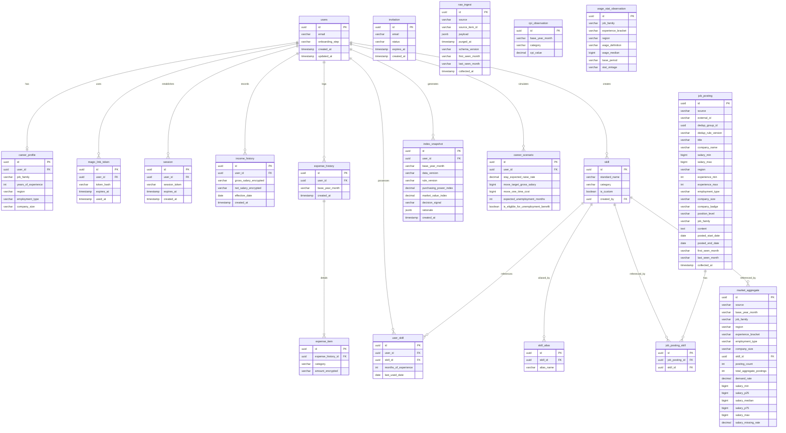

# Carix 데이터베이스 ERD (Entity-Relationship Diagram)

이 문서는 Carix 데이터베이스의 테이블 간 관계 및 각 테이블의 엔티티 구조를 시각화한 ERD입니다.

> **2026-08-09 확장:** `job_posting`에 `company_badge`, `position_level` 컬럼 추가. 근거는
> [2026-08-09 채용공고 크롤링 데이터 영속화 설계](../superpowers/specs/2026-08-09-job-posting-persistence-design.md) —
> 실측 크롤링 데이터를 원래 스키마에 넣어보다가 ERD에 자리가 없어 버려지던 필드를 확인하고 확장했다.
>
> **2026-08-09 운영 현황:** `job_posting`/`job_posting_skill`/`skill`/`skill_alias`/`raw_ingest`
> 5개 테이블 전부 원격 공유 Postgres(`carix` DB, `core` 스키마)에 실제로 만들어져 있고,
> 잡코리아·사람인 크롤링 결과 800건 + 스킬 699개 + raw_ingest 410건이 영구 적재돼 있다.
> **2026-08-19 스키마 관리 방식:** core-api에서 Flyway를 제거했다. `core` 스키마는
> 이 문서와 [상세 기술 명세 §1](technical-specification.md)의 DDL을 정본으로 삼아 `psql`로
> 직접 적용한다(절차는 [DEVELOPMENT.md §3.2](../DEVELOPMENT.md)). 마이그레이션 파일 관리
> 부담이 이득보다 크다는 판단이며, `auth` 스키마는 Flyway를 그대로 쓴다. 스키마를 바꾸면
> 적용 이력이 자동으로 남지 않으므로 아래 운영 현황 절에 직접 기록한다.
>
> **2026-08-19 데이터 정정:** 첫 적재가 원천 정보를 다 쓰지 못해 `raw_ingest` 원문으로
> 재파싱했다. 공개연봉 36 -> 317건, `job_family` 0 -> 800건(DEVELOPER 567 / OTHER 125 /
> AI 70 / DATA 38), 스킬에서 인성 역량과 직무 카테고리를 분리(스킬 699 -> 683, 연결
> 4300 -> 3860, `is_custom` 전건 false). 재실행 수단은
> `com.carix.jobposting.backfill.JobPostingBackfill`이다.

