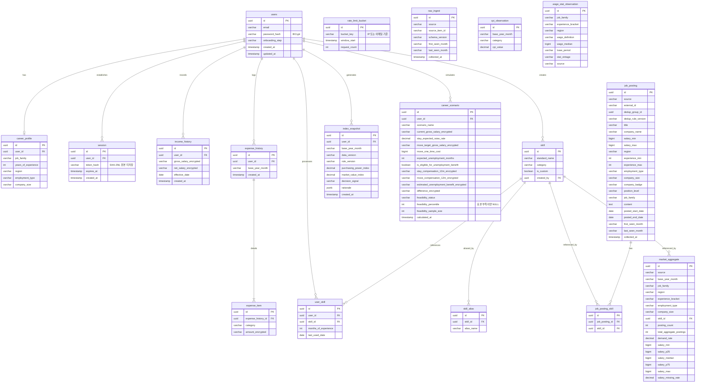

# Carix 데이터베이스 ERD (Entity-Relationship Diagram)

이 문서는 Carix 데이터베이스의 테이블 간 관계 및 각 테이블의 엔티티 구조를 시각화한 ERD입니다.

## 운영 스키마 적용 이력

`core` 스키마는 Flyway 를 쓰지 않아 적용 이력이 자동으로 남지 않는다
([DEVELOPMENT.md §3.2](../DEVELOPMENT.md)). 운영 DB 에 무엇을 적용했는지 여기 남긴다.

| 적용일 | 대상 | 내용 |
| :--- | :--- | :--- |
| 2026-09-06 | `core.career_scenario` | 금액 여섯 컬럼을 `bigint` → `varchar(512)` 암호문으로 바꾸고 `scenario_name`·`feasibility_*` 를 더했다. 0행이라 `DROP` 후 정본 정의로 재생성했다. `career_scenario_user_latest_idx` 도 함께 다시 만들었다 |
| 2026-09-15 | `core.wage_stat_observation` | 출처 컬럼 `source varchar(20) NOT NULL DEFAULT 'UNKNOWN'` 을 더했다. 기존 360행은 기본값으로 `UNKNOWN` 이 됐다 — 컬럼 도입 이전 적재분이라 KOSIS 실측인지 폴백 상수인지 알 수 없다 |
| 2026-09-17 | `core.wage_stat_observation` | 벽시계 vintage 로 쌓인 `base_period=2025` 의 `202608`(24행)·`202609`(48행)을 삭제했다. `202609` 는 폴백 상수였고 `stat_vintage DESC` 정렬에서 실측 `202508` 을 이겨 2025 기준선을 상수로 만들고 있었다 |

> **`core.wage_stat_observation.source` 는 쓰기 경로까지 들어왔다.** 수집이 연도별로 출처를
> 기록하고, KOSIS 실측만 기존 행을 덮는다 — 폴백 상수는 기존 행을 건드리지 않는다. 컬럼 도입
> 이전 적재분(2026-09-15 적용 당시 360행, 아래 정리 뒤 288행)은 **재수집 전까지 `UNKNOWN` 으로
> 남는다.**
>
> **벽시계 vintage 는 막았고 쌓인 행도 정리했다.** 폴백 경로가 `stat_vintage` 를 실행 시점의
> `yyyyMM` 으로 쓰던 것을 KOSIS 경로와 같은 `base_period + "08"` 로 고정했다. 좌표가 안정돼
> 승격 가드가 실제로 발화하므로 앞으로는 행이 늘지 않는다.
>
> 고정 이전에 쌓여 있던 `base_period=2025` 의 `202608`·`202609` 72행은 **삭제했다**(위 적용
> 이력 참조). `202609` 의 값이 `FALLBACK_MEDIAN_BY_BRACKET` 상수와 일치했고
> `findLatestBaseline`(`base_period DESC, stat_vintage DESC`)이 그것을 골라 2025 기준선이
> 상수로 퇴화해 있었다. 지금은 `base_period` 당 vintage 가 하나씩이다.
