# Carix 데이터베이스 ERD (Entity-Relationship Diagram)

이 문서는 Carix 데이터베이스의 테이블 간 관계 및 각 테이블의 엔티티 구조를 시각화한 ERD입니다.

```mermaid
erDiagram
    users ||--o| career_profile : has
    users ||--o{ session : establishes
    users ||--o{ income_history : records
    users ||--o{ expense_history : logs
    users ||--o{ user_skill : possesses
    users ||--o{ skill : creates
    users ||--o{ index_snapshot : generates
    users ||--o{ career_scenario : simulates

    expense_history ||--|{ expense_item : details

    skill ||--o{ skill_alias : aliased_by
    skill ||--o{ user_skill : references
    skill ||--o{ job_posting_skill : referenced_by
    skill ||--o{ market_aggregate : referenced_by

    job_posting ||--o{ job_posting_skill : has

    users {
        uuid id PK
        varchar email
        varchar password_hash "BCrypt"
        varchar onboarding_step
        timestamp created_at
        timestamp updated_at
    }

    rate_limit_bucket {
        uuid id PK
        varchar bucket_key "IP 또는 이메일 기준"
        timestamp window_start
        int request_count
    }

    session {
        uuid id PK
        uuid user_id FK
        varchar token_hash "SHA-256, 원본 미저장"
        timestamp expires_at
        timestamp created_at
    }

    career_profile {
        uuid id PK
        uuid user_id FK
        varchar job_family
        int years_of_experience
        varchar region
        varchar employment_type
        varchar company_size
    }

    income_history {
        uuid id PK
        uuid user_id FK
        varchar gross_salary_encrypted
        varchar net_salary_encrypted
        date effective_date
        varchar change_reason
        timestamp created_at
    }

    expense_history {
        uuid id PK
        uuid user_id FK
        varchar base_year_month
        timestamp created_at
    }

    expense_item {
        uuid id PK
        uuid expense_history_id FK
        varchar category
        varchar amount_encrypted
    }

    skill {
        uuid id PK
        varchar standard_name
        varchar category
        boolean is_custom
        uuid created_by FK
    }

    skill_alias {
        uuid id PK
        uuid skill_id FK
        varchar alias_name
    }

    user_skill {
        uuid id PK
        uuid user_id FK
        uuid skill_id FK
        int months_of_experience
        date last_used_date
    }

    raw_ingest {
        uuid id PK
        varchar source
        varchar source_item_id
        varchar schema_version
        varchar first_seen_month
        varchar last_seen_month
        timestamp collected_at
    }

    cpi_observation {
        uuid id PK
        varchar base_year_month
        varchar category
        decimal cpi_value
    }

    wage_stat_observation {
        uuid id PK
        varchar job_family
        varchar experience_bracket
        varchar region
        varchar wage_definition
        bigint wage_median
        varchar base_period
        varchar stat_vintage
        varchar source
    }

    job_posting {
        uuid id PK
        varchar source
        varchar external_id
        uuid dedup_group_id
        varchar dedup_rule_version
        varchar title
        varchar company_name
        bigint salary_min
        bigint salary_max
        varchar region
        int experience_min
        int experience_max
        varchar employment_type
        varchar company_size
        varchar company_badge
        varchar position_level
        varchar job_family
        text content
        date posted_start_date
        date posted_end_date
        varchar first_seen_month
        varchar last_seen_month
        timestamp collected_at
    }

    job_posting_skill {
        uuid id PK
        uuid job_posting_id FK
        uuid skill_id FK
    }

    market_aggregate {
        uuid id PK
        varchar source
        varchar base_year_month
        varchar job_family
        varchar region
        varchar experience_bracket
        varchar employment_type
        varchar company_size
        uuid skill_id FK
        int posting_count
        int total_aggregate_postings
        decimal demand_rate
        decimal salary_missing_rate
    }

    index_snapshot {
        uuid id PK
        uuid user_id FK
        varchar base_year_month
        varchar data_version
        varchar rule_version
        decimal purchasing_power_index
        decimal market_value_index
        decimal opening_window_index
        varchar decision_signal
        jsonb rationale
        timestamp created_at
    }

    career_scenario {
        uuid id PK
        uuid user_id FK
        varchar scenario_name
        varchar current_gross_salary_encrypted
        decimal stay_expected_raise_rate
        varchar move_target_gross_salary_encrypted
        bigint move_one_time_cost
        int expected_unemployment_months
        boolean is_eligible_for_unemployment_benefit
        varchar stay_compensation_12m_encrypted
        varchar move_compensation_12m_encrypted
        varchar estimated_unemployment_benefit_encrypted
        varchar difference_encrypted
        varchar feasibility_status
        int feasibility_percentile "표본 부족이면 NULL"
        int feasibility_sample_size
        timestamp calculated_at
    }
```

## 스키마 설계 주석

> **실행 정본은 [`deploy/postgres/schema/`](../../deploy/postgres/schema/)의 `.sql` 파일이고,
> 테이블·컬럼 목록은 위 ERD 가 갖는다**(적용 절차는 [DEVELOPMENT.md §3.2](../DEVELOPMENT.md)).
> 이 절은 둘 중 어느 쪽에도 안 남는 것만 적는다 — 설계 의도, 실물과 갈린 지점, 수집되지만
> 아무도 안 읽는 컬럼.
>
> **`users` 외래키는 걸지 않는다.** `users`는 auth-service가 `auth` 스키마에 소유하고,
> `core` 테이블은 core-api가 소유한다. 스키마를 가로지르는 외래키는 두 서비스의 배포를
> 묶어 버리므로 `user_id UUID NOT NULL`만 두고 참조 무결성은 애플리케이션이 지킨다.
>
> **채용공고 수집 5개 테이블은 원 설계와 다르다.** 크롤링 실측에 맞춰 완화된 상태로
> 운영 중이며, 정확한 정의는 [`01_job_posting.sql`](../../deploy/postgres/schema/01_job_posting.sql)에 있다.
>
> | 테이블 | 원 설계 | 실물 |
> | --- | --- | --- |
> | `job_posting` | `title VARCHAR(255)`, `company_name`·`region`·`experience_min`·`employment_type`·`company_size`·`job_family` 전부 NOT NULL | `title VARCHAR(500)`, 해당 컬럼 전부 NULL 허용. `company_badge`·`position_level` 컬럼 추가 |
> | `job_posting.salary_*` | 원 단위 | **원 단위로 저장한다.** 원천 표기가 만원이라 적재 경로가 변환한다 — `JobKoreaListingEnricher`·`JobKoreaPayParser` 가 `값 < 1,000,000` 이면 `× 10,000`. 옛 만원 단위 행은 `06_fix_salary_units.sql` 이 같은 기준으로 올렸다. **읽을 때 다시 환산하지 않는다.** 휴리스틱이라 연 100만원 미만 실제 금액은 잘못 곱해지지만 채용공고 연봉에는 그런 값이 없다 |
> | `job_posting.salary_*` (사람인) | — | **사람인은 연봉을 주지 않는다.** `SaraminListingFields` 에 필드가 없어 사람인 행은 전부 `null` 이고, 그 원천의 `market_aggregate` 5수치도 전부 `null`·결측률 100% 다 |
> | `skill` | `standard_name VARCHAR(100)` 단독 UNIQUE, `category NOT NULL` | `VARCHAR(255)`, `UNIQUE (standard_name, category)`, `category` NULL 허용 |
> | `skill.category` | `'BACKEND'`·`'FRONTEND'` 등 기술 분야 | `'SKILL'`·`'JOB_CATEGORY'`·`'INDUSTRY'` — 수집 태그의 성격 구분 |
> | `skill_alias` | `alias_name VARCHAR(100) UNIQUE` | `VARCHAR(255)`, UNIQUE 없음. `SkillService`·`SkillRepository` 가 자동완성 검색에서 읽는다(`US-O5`) |
> | `raw_ingest` | 원문 보관 + 24개월 purge | **원문을 보관하지 않는다.** `payload`·`purged_at`·`schema_version` 컬럼 없음. 수집 이력만 남는다 |
> | `job_posting.content` | 공고 상세 본문 텍스트 | **컬럼 없음.** 스킬 파싱은 `raw_ingest` 원문에서 직접 한다 |
> | `job_posting.first_seen_month`·`last_seen_month` | 공고를 처음·마지막 본 월 | 크롤러가 처음 본 월로 채우고 재관측 시 `last_seen_month` 를 갱신한다. 다만 크롤러가 최근 등록순 몇 페이지만 훑어 재관측이 거의 없어 **두 값이 사실상 같다** — 관측 기간을 재는 데 쓸 수 없다. 등록·마감은 `posted_start_date`·`posted_end_date` 를 쓴다. 등록일은 약 56% 가 비어 있다 — 원천이 싣지 않은 공고에 더해, 사람인 목록의 마감일을 등록일로 읽어 만들어진 값(마감일과 월일이 같은 365일 창)을 비웠기 때문이다. 사람인 등록일은 목록의 `.job_sector .job_day` 에서 읽는다 |
>
> **`market_aggregate.base_year_month` 는 그 달 신규 수집 공고(유량)의 집계 기준월이다.**
> `MarketAggregateService` 가 활동월(`first_seen_month <= m <= last_seen_month`) 기준으로
> 공고를 필터링하는데(개발 계획 `b18`), 위 행의 이유로 활동월이 곧 첫 수집월이라 결과는 유량이다 —
> 정의는 [데이터 아키텍처 §1.3](data-architecture.md). 전체 일괄 집계로 인한 MVI 100.0 고정
> 결손이 해소되었으며, 집계월 시계열은 `SELECT DISTINCT base_year_month FROM core.market_aggregate ORDER BY 1;` 로
> 확인한다. 원 공고의 일자 단위 직접 시계열 집계(OWI·연봉분포)는 기존과 같이 `job_posting.posted_start_date` 로 버킷한다(§4.5·§4.6).
>
> **수집하지만 `core-api` 가 읽지 않는 컬럼들.** 크롤러가 채우고 어느 화면도 쓰지 않는다 —
> 지우자는 판단이 아니라, 새 기능을 설계할 때 **이미 있는 재료**임을 잃지 않으려고 적는다.
>
> | 컬럼 | 상태 |
> | --- | --- |
> | `job_posting.title`·`company_name` | 적재만 된다. 집계는 차원만 쓰고 화면은 공고 개별을 보여주지 않는다 |
> | `job_posting.position_level` | 직급 문자열. **잡코리아 원천에만 있다** — 사람인 행은 `null` 이라 절반 모수다. 경력 브래킷과 별개의 세 번째 연차 신호이지만 반쪽이라 그대로는 못 쓴다 |
> | `job_posting.company_badge` | 잡코리아 전용 배지. 사람인 `null` |
> | `job_posting.dedup_rule_version` | 중복제거 규칙 버전. 규칙을 바꿔 재집계할 때 어느 행이 옛 규칙 산물인지 가리려던 컬럼인데 읽는 코드가 없다 |
> | `cpi_observation` 전체 | `collector` 가 적재하고 `core-api` 의 물가 기여도 뱃지(`c12`)와 구매력 지수 엔진(`a2`)이 읽는다 |
>
> **`wage_stat_observation.wage_median` 은 경력별 실측이 아니다.** KOSIS 연령대를 경력구간으로
> 프록시한 값이고(`25~29세 → JUNIOR`, `WageStatIngestService.AGE_CODE_TO_EXPERIENCE_BRACKET`),
> API 를 호출하지 못하면 하드코딩 `FALLBACK_MEDIAN_BY_BRACKET` 로 떨어진다. `region` 은 항상
> `ALL` 이다. 연봉 격차 판정의 기준선으로는 채택된 값이지만, **이 값을 분모로 비율을 만들면 그
> 비율이 시장이 아니라 프록시 정합도를 절반쯤 잰다.**

**`career_scenario` 의 금액 컬럼**은 `income_history` 와 같은 AES-256-GCM 으로 저장한다.
평문이면 `stay_compensation_12m` 을 `stay_expected_raise_rate` 로 나눠 현재 연봉이 원
단위까지 복원되어, 연봉을 암호화한 이유가 이 테이블에서 사라진다. 금액으로 조회·정렬하는 인덱스가
없어 질의 비용은 없다.

실현 가능성은 재계산하지 않고 저장한다. 동료집단 분포는 그 시점의 공고에 의존해 나중에 다시
구하면 사용자가 실제로 본 판단이 나오지 않는다.

**`income_history.change_reason` 에 `INITIAL` 이 없다.** 컬럼은 사용자가 고른
`RAISE`·`JOB_CHANGE` 와 고르지 않은 `NULL` 만 담고, 최초 소득 행이라는 사실은
`IncomeService` 가 읽기 시점에 `min(effective_date)` 로 판정해 응답에 얹는다. 저장하면
사용자가 나중에 더 이른 과거 이력을 넣을 때마다 `INITIAL` 을 행 사이로 옮겨야 하고, 그
`UPDATE` 가 이미 그 행에 있던 사용자 선택값을 덮는다. `CHECK` 제약이 그 값이 컬럼에
들어오는 경로를 DB 에서 막는다.

파생이 원값을 가리지 않도록 응답은 필드를 둘 싣는다 — 표시용 `changeReason`(파생,
`INITIAL` 포함)과 편집 폼이 쓰는 `selectedChangeReason`(컬럼 원값). 하나만 실으면 최초 행을
수정 저장할 때 `PUT` 전체 교체가 컬럼의 값을 지운다.

## 운영 스키마 적용 이력

`core` 스키마는 Flyway 를 쓰지 않아 적용 이력이 자동으로 남지 않는다
([DEVELOPMENT.md §3.2](../DEVELOPMENT.md)). 운영 DB 에 무엇을 적용했는지 여기 남긴다.

| 적용일 | 대상 | 내용 |
| :--- | :--- | :--- |
| 2026-09-06 | `core.career_scenario` | 금액 여섯 컬럼을 `bigint` → `varchar(512)` 암호문으로 바꾸고 `scenario_name`·`feasibility_*` 를 더했다. 0행이라 `DROP` 후 정본 정의로 재생성했다. `career_scenario_user_latest_idx` 도 함께 다시 만들었다 |
| 2026-09-15 | `core.wage_stat_observation` | 출처 컬럼 `source varchar(20) NOT NULL DEFAULT 'UNKNOWN'` 을 더했다. 기존 360행은 기본값으로 `UNKNOWN` 이 됐다 — 컬럼 도입 이전 적재분이라 KOSIS 실측인지 폴백 상수인지 알 수 없다 |
| 2026-09-17 | `core.wage_stat_observation` | 벽시계 vintage 로 쌓인 `base_period=2025` 의 `202608`(24행)·`202609`(48행)을 삭제했다. `202609` 는 폴백 상수였고 `stat_vintage DESC` 정렬에서 실측 `202508` 을 이겨 2025 기준선을 상수로 만들고 있었다 |
| 2026-09-19 | `core.index_snapshot` | 개방창 지수 컬럼 `opening_window_index numeric(6,2)` 를 더했다. nullable·기본값 없음이라 카탈로그만 바뀌고 테이블 재작성이 없었다. 기존 186행은 새 컬럼이 `NULL` 이고 다른 컬럼·인덱스·제약은 건드리지 않았다. 신규 환경용 실행 정본(`deploy/postgres/schema/04_snapshot_and_scenario.sql`)에도 같은 컬럼을 넣었다 |
| 2026-09-21 | `core.income_history` | 변경 사유 컬럼 `change_reason varchar(20)` 과 `CHECK (change_reason IN ('RAISE', 'JOB_CHANGE'))`, 컬럼 주석을 더했다. nullable·기본값 없음이라 카탈로그만 바뀌고 테이블 재작성이 없었다. 기존 2행은 새 컬럼이 `NULL` 이고 인덱스 셋(`income_history_pkey`·`income_history_user_effective_idx`·`income_history_user_id_effective_date_key`)은 그대로다. 제약 이름은 `income_history_change_reason_check`. 신규 환경용 실행 정본(`deploy/postgres/schema/02_user_domain.sql`)에도 같은 컬럼을 넣었다 |

> **`core.wage_stat_observation.source` 는 쓰기 경로까지 들어왔다.** 수집이 연도별로 출처를
> 기록하고, KOSIS 실측만 기존 행을 덮는다 — 폴백 상수는 기존 행을 건드리지 않는다. 컬럼 도입
> 이전 적재분(2026-09-15 적용 당시 360행, 아래 정리 뒤 288행)은 재수집으로 **전부 `KOSIS` 실측**이 됐다
> — `UNKNOWN` 행은 남아 있지 않다.
>
> **벽시계 vintage 는 막았고 쌓인 행도 정리했다.** 폴백 경로가 `stat_vintage` 를 실행 시점의
> `yyyyMM` 으로 쓰던 것을 KOSIS 경로와 같은 `base_period + "08"` 로 고정했다. 좌표가 안정돼
> 승격 가드가 실제로 발화하므로 앞으로는 행이 늘지 않는다.
>
> 고정 이전에 쌓여 있던 `base_period=2025` 의 `202608`·`202609` 72행은 **삭제했다**(위 적용
> 이력 참조). `202609` 의 값이 `FALLBACK_MEDIAN_BY_BRACKET` 상수와 일치했고
> `findLatestBaseline`(`base_period DESC, stat_vintage DESC`)이 그것을 골라 2025 기준선이
> 상수로 퇴화해 있었다. 지금은 `base_period` 당 vintage 가 하나씩이다.
