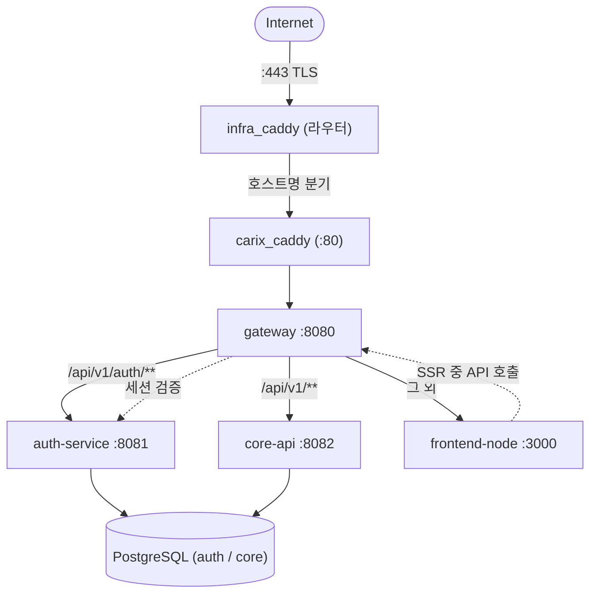

# Vite and Node.js Frontend Design

## 목적

Carix의 프런트엔드를 Vite 기반 React 애플리케이션과 Node.js SSR 서버로
구성한다. 공개 랜딩·콘텐츠 페이지의 검색 노출과 로그인 후 대시보드의 높은
상호작용성을 한 애플리케이션에서 지원한다.

이 문서는 기존 설계 문서의 Next.js 관련 프런트엔드 선택을 대체한다. Spring Boot,
PostgreSQL, Collector 모듈과 관련된 기존 백엔드·데이터 설계는 유지한다.

**Next.js App Router를 접은 이유:** 풀스택 프레임워크라 Node 계층이 API·데이터 접근으로
번지기 쉽고, Spring Boot와의 역할 경계가 흐려진다. Node는 HTML 렌더링·SEO만 맡고 인증·도메인·
API·데이터 접근은 전부 Spring Boot가 담당하는 경계를 유지하기 위해 Vite + React Router로
바꿨다. MVP 는 그중 Node SSR 을 켜지 않은 구성이다 — 아래 §렌더링 전략 참조.

## 기술 구성

- 런타임: Node.js 24 LTS
- 빌드 도구: Vite
- UI: React, TypeScript
- 라우팅·렌더링: React Router Framework Mode
- Node 서버: Express, `@react-router/express`
- 서버 상태: React Router 7 framework mode 의 `clientLoader`·`clientAction`. 프레임워크가
  조회·제출·재검증을 이미 갖고 있어 TanStack Query 를 더하면 같은 역할이 겹친다 — 별도 서버
  상태 캐시를 두지 않는다
- 검증: Zod. `clientAction` 이 제출을 받아 Zod 로 파싱하면 React Hook Form 이 더할 역할이
  제어 컴포넌트 상태 관리뿐이고 온보딩 화면들은 필드가 적어 넣지 않는다
- 스타일·컴포넌트: Tailwind CSS, shadcn/ui
- 차트: Recharts
- 프런트엔드 테스트: Vitest, Testing Library, Playwright. API 모듈 함수를 `vi.spyOn`으로 직접
  모킹해 네트워크 계층을 가로챌 MSW 가 필요 없다

구현 시작 시 각 라이브러리는 상호 호환되는 지원 중인 안정 버전으로 잠근다.

## 시스템 경계

- 엣지는 2단이다. 호스트 레벨의 라우터 Caddy(`infra_caddy`)가 80/443과 TLS 종료·호스트명 분기를 담당하고, 프로젝트 전용 `carix_caddy`가 `gateway:8080`으로 트래픽을 전달한다. 애플리케이션 계층의 경로별 라우팅과 세션 검증은 Spring Cloud Gateway가 전담한다 ([Spring Cloud 아키텍처](spring-cloud-architecture.md)).
- 별도 정적 파일 서버는 없다. `/assets/*`도 `frontend-node`가 서빙하고 Caddy는
  장기 캐시 헤더만 붙인다.
- Node 서버는 HTML SSR, SEO metadata, 공개 콘텐츠 렌더링을 담당한다.
- Spring Boot는 인증, 도메인 로직, REST API, 데이터 접근을 담당한다.
- Collector는 외부 데이터 수집과 집계를 담당하며 관리자 화면(Admin UI/API) 직접 구동 및 Spring Scheduler 연계를 고려한다.
- 브라우저는 동일 출처의 `/api/*`를 호출해 CORS 구성을 최소화한다.
- Node 서버는 DB에 직접 접근하거나 Spring Boot의 비즈니스 로직을 복제하지
  않는다.

## 렌더링 전략

### MVP 현행

| 경로 | 방식 | 목적 |
| --- | --- | --- |
| `/` | 빌드 시 사전 렌더링 | 빠른 첫 화면과 검색 노출 |
| `/admin/collector` | SPA 셸 후 클라이언트 렌더링 | 관리자 수집/집계 파이프라인 제어 콘솔 (별칭: `/admin/pipeline`) |
| 그 외 전 경로 | SPA 셸 후 클라이언트 렌더링 | 세션 화면이라 SEO 대상이 아니다 |

`react-router.config` 는 `ssr: false` + `prerender: ["/"]` 이고 `frontend/server.js` 는
`node:http` 정적 서버다. 사전 렌더링된 `/` 를 그대로 주고 나머지는 SPA 셸로 넘긴다.

### MVP 이후 목표

Node SSR 전환(Express + `@react-router/express`)은 MVP 범위 밖으로 미뤘다. `S-05`~`S-15` 는
전부 세션을 요구해 SEO 대상이 아니고 진입 가드는 이미 클라이언트에서 동작한다. 남는 실익이
초기 로드뿐인데 전환은 C 레인에 14일을 더해 통합 종료를 밀어낸다. 그래서 현행 `ssr: false` +
`/` 사전 렌더링 + SPA 셸을 유지한다. 이 결정이 화면별 렌더링 지정을 무효로 만들었고,
[기능 명세 §1 화면 맵](functional-specification.md)·[README 렌더링 전략](../../README.md)도
현행 구성 기준으로 갱신돼 있다.

전환 시 적용할 구성:

| 경로 | 방식 | 목적 |
| --- | --- | --- |
| `/`, `/about` | 빌드 시 사전 렌더링 | 빠른 첫 화면과 검색 노출 |
| `/content/:slug` | Node SSR | 동적 공개 콘텐츠와 SEO |
| `/login` | Node SSR | 빠른 초기 표시 |
| `/dashboard/*` | SSR shell 후 hydration | 개인화 대시보드 상호작용 |
| `/mypage/*` | SSR shell 후 hydration | 인증 사용자 설정 |

공개 페이지는 title, description, canonical URL, Open Graph metadata, sitemap,
robots 정책과 필요한 구조화 데이터를 제공한다. 대시보드의 차트·필터·사용자
데이터는 hydration 이후 route loader 재검증(자동 revalidation·`useRevalidator`)으로 갱신한다
— §기술 구성 참조.

## 데이터 흐름

### MVP 현행

1. 문서 요청은 라우터 Caddy와 `carix_caddy`를 거쳐 `frontend/server.js`(`node:http`
   정적 서버)로 전달된다.
2. 사전 렌더링된 `/` 는 그대로 주고, 나머지 경로는 SPA 셸(`__spa-fallback.html`)로 넘긴다.
3. 라우팅과 데이터 로딩은 전부 브라우저에서 일어난다. API 요청은 동일 출처 `/api/*` 를 통해
   Spring Boot로 전달된다.
4. Spring Boot가 인증·검증·계산·데이터 접근을 수행하고 JSON으로 응답한다.

### Node SSR 전환 시 (MVP 이후)

1. 문서 요청은 라우터 Caddy와 `carix_caddy`를 거쳐 Node SSR 서버로 전달된다.
2. 공개 동적 페이지의 route loader는 내부 네트워크에서 Spring Boot API를
   호출한다.
3. Node 서버는 응답 데이터와 SEO metadata를 포함한 HTML을 반환한다.
4. 브라우저 hydration 이후 API 요청은 동일 출처 `/api/*`를 통해 Spring
   Boot로 전달된다.
5. Spring Boot가 인증·검증·계산·데이터 접근을 수행하고 JSON으로 응답한다.

## 오류 처리

- Node SSR 중 Spring Boot 호출이 실패하면 상태 코드와 요청 식별자를 보존한 오류
  페이지를 반환한다.
- 공개 콘텐츠의 404는 검색엔진이 오인하지 않도록 실제 HTTP 404로 응답한다.
- 대시보드 API 오류는 오류 경계와 재시도 가능한 사용자 메시지로 표시한다.
- Caddy, Node, Spring Boot는 동일 요청 식별자를 로그에 기록한다.
- 민감한 오류 상세와 내부 URL은 브라우저 응답에 포함하지 않는다.

## 배포

OCI VM에서 다음 컨테이너를 Docker Compose로 운영한다.

- `carix-caddy` — 애플리케이션 라우팅 진입점. 위 시스템 경계에서 설명한 대로 `gateway`로만
  전달하고, 경로별 분기는 Gateway가 담당한다
- `gateway` — 경로별 분기(`core-api`/`auth-service`/`frontend-node`) 담당
- `frontend-node`
- `core-api` — Config Server·Eureka 클라이언트. 구성은 위 Spring Cloud 아키텍처 참조
- `auth-service` — Config Server·Eureka 클라이언트. 계정 가입·로그인·세션 발급 담당
- `config-server`, `eureka`
- `postgres`
- `collector` — 수집·정규화·집계. Gateway 라우팅 대상이 아니다. compose·배포 배선은
  아직 없다

> 초안은 `nginx`였으나 `carix-caddy`로 대체됐다. 이 호스트는 여러 프로젝트를 함께 돌리는데,
> 80/443은 한 컨테이너만 바인딩할 수 있고 Let's Encrypt는 그 두 포트로만 검증하러 온다.
> 포트를 나누면 한쪽이 정상 인증서를 못 받으므로, 라우터(`infra_caddy`)를 한 단 두고 각 프로젝트는
> 자기 Caddy에서 애플리케이션 라우팅만 소유한다. 채택 사유는
> [`README.md` 「채택 사유」](../../README.md#채택-사유).

`frontend-node`는 Vite가 만든 client assets와 React Router server bundle을
포함한다. 컨테이너는 non-root 사용자로 실행하고 health check를 제공해야 한다 —
현재 스텁 `Dockerfile`에는 `USER`·`HEALTHCHECK` 지시어가 없어 아직 반영되지
않았다.

## README 반영 범위

- 기존 제품 설명, 지수 정의, MVP 범위와 데이터 원칙은 유지한다.
- 별도 `기술 구성` 섹션을 추가해 전체 스택과 각 계층의 책임을 요약한다.
- Caddy, Node SSR, Spring Boot, PostgreSQL의 요청 흐름을 텍스트 다이어그램으로
  추가한다.
- 공개 페이지와 인증 대시보드의 렌더링 전략을 간단히 설명한다.
- OCI Docker Compose 배포 단위를 명시한다.
- README 마지막의 Next.js 기술 스택 문구를 새 구성으로 교체한다.
- 이 설계 문서 링크를 상세 문서 목록에 추가한다.

## 완료 기준

- README만 읽어도 Vite, React Router, Express, Spring Boot의 역할 차이를 알 수
  있다.
- 공개 페이지 SEO와 인증 대시보드 렌더링 방식이 구분된다.
- Node와 Spring Boot 사이에 비즈니스 로직 중복이 없다고 명시된다.
- OCI 배포 컨테이너 구성이 확인된다.
- README에서 Next.js를 현재 구현 스택으로 표현하지 않는다.
- 기존 제품·데이터 요구사항은 변경하지 않는다.
