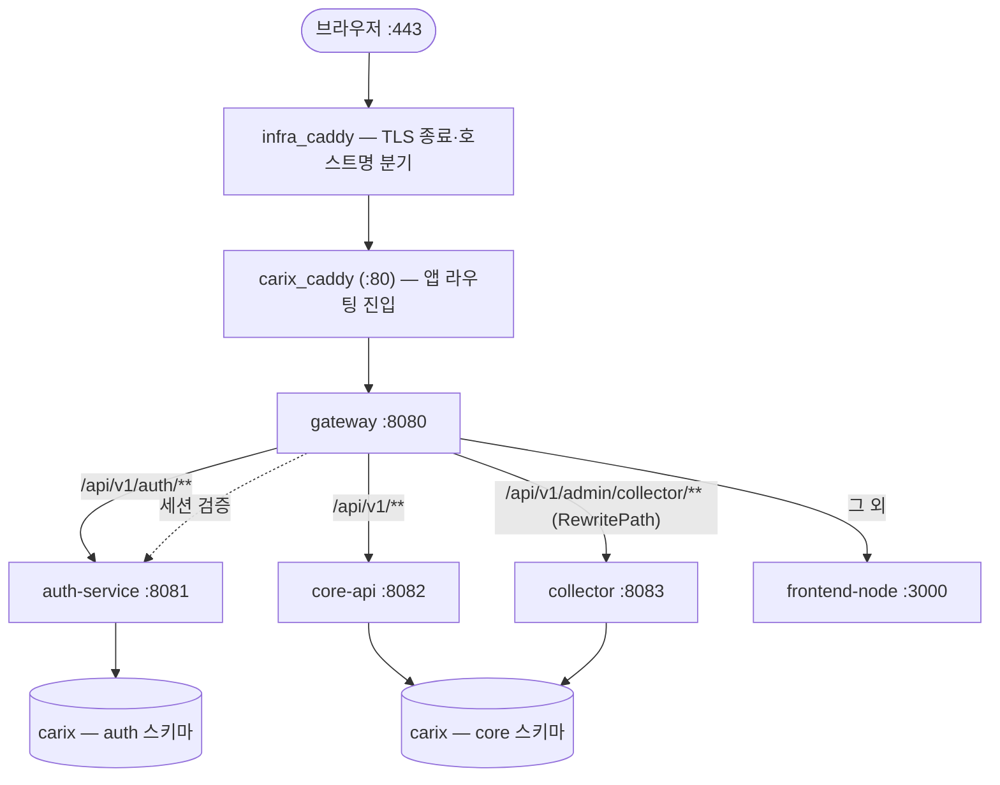

# Spring Cloud 기반 백엔드 아키텍처 설계

## 1. 목적과 전제

이 프로젝트는 **학습·포트폴리오가 주목적**이다. 따라서 "이 도메인에 MSA가 과하다"는 지적은
설계 판단 기준이 아니다. 복잡도를 다뤄보는 것이 성과물이다.

다만 무한정 늘리지는 않는다. 팀은 2~3명이고 **서비스 소유를 나누지 않는다** — 전원이 전체
코드베이스를 만진다. 따라서 서비스 수는 곧 모두의 유지보수 부담이다.

**학습 대상으로 선택한 것:** Spring Cloud Gateway(라우팅·필터·인증), Config Server, Eureka.

**선택하지 않은 것:** Feign·Resilience4j 기반 서비스 간 통신, Spring Cloud Stream 이벤트.
설계는 이 둘을 요구하지 않는 방향으로 잡는다.

## 2. 서비스 구성

| 서비스 | 포트 | 책임 | Eureka |
| --- | --- | --- | --- |
| gateway | 8080 | 라우팅, 세션 검증 필터, 상관관계 ID 주입 | 클라이언트 |
| config-server | 8888 | 설정 제공 | 등록 |
| eureka | 8761 | 서비스 레지스트리 | — |
| auth-service | 8081 | 계정 가입·로그인, 세션 수명주기 | 등록 |
| core-api | 8082 | 프로필·소득·지출·스킬·지수·시나리오 | 등록 |
| collector | 8083 | 채용공고 수집·정규화·집계, 내부 파이프라인 관리 API(`/internal/pipeline/**`) | 등록 |

포트 열은 **컨테이너 내부** 포트이자 현재 상태다. Eureka 등록과, 해당하는 경우 Gateway
연결도 같은 포트 번호를 쓴다.

Eureka 열은 해당 서비스가 Eureka 레지스트리에 등록되는지만 나타낸다. Gateway가 실제로
그 서비스로 라우팅하는지 여부의 신호가 아니다.

호스트 바인딩은 대부분 같은 번호를 쓰지만 `config-server`만 **8890**이다. 호스트 8888은
저장소 밖 `infra-dozzle-1`이 이미 잡고 있다. `config-server`·`eureka`(8761)·`postgres`(5432)는
`0.0.0.0`에 바인딩하고 OCI Security List로 접근을 제한한다(§6, DEVELOPMENT.md §3).

JVM 6개. 여기에 postgres·frontend-node·라우터 Caddy가 더해진다.

### 왜 이 개수인가

도메인 서비스를 더 쪼개면 서비스 간 호출이 늘어난다. 그 호출을 제대로 다루려면
Feign·Resilience4j가 필요한데, 학습 대상으로 선택하지 않았다. 반대로 `auth-service`를
합치면 Gateway 인증 필터가 검증할 대상이 사라져 학습 대상 하나가 껍데기가 된다.

`auth` 분리가 최소한이면서 선택한 셋을 모두 실제로 동작시키는 지점이다.

### 포트를 고정하는 이유

Eureka를 쓰면 포트를 랜덤으로 둘 수 있으나 고정한다. Gateway 작업 시 로컬에서 하류 서비스
라우트를 정적 URI로 덮어써야 하는데(§6), 포트가 매번 바뀌면 그 오버라이드를 유지보수할 수
없다. Eureka는 등록된 포트를 그대로 알려주므로 고정이어도 정상 동작한다.

## 3. 데이터 소유

DB는 하나(`carix`, 근거는 DEVELOPMENT.md §3), 스키마는 **둘**로 나눈다.

| 스키마 | 소유 | 테이블 |
| --- | --- | --- |
| `auth` | auth-service | `users` `session` `rate_limit_bucket` |
| `core` | core-api, collector | 나머지 15개 — 사용자 도메인, 지수, 수집 원천, 집계 |

### 왜 둘인가

스키마 분리는 소유 경계를 따라간다. 미리 깔아두지 않는다.

`auth-service`만이 독립된 바운디드 컨텍스트다. 인증 데이터는 다른 서비스가 쓰기는커녕
읽을 일도 없다(FK 참조 제외).

`core-api`와 `collector`는 **같은 스키마를 쓰기·읽기로 나눠 쓰는 두 프로세스**다. 쓰기는
전부 `collector` 가 한다 — `raw_ingest`, `job_posting`, `job_posting_skill`, `skill`,
`skill_alias`, `market_aggregate`. `core-api` 는 그중 `market_aggregate` 만 읽고, 나머지
`core` 테이블(사용자 도메인·지수)을 소유한다. 읽기 접점이 테이블 하나뿐이라 스키마를
나누지 않는다. 나누면 경계를 긋자마자 교차 접근으로 넘어야 한다.

### 남는 결합

`core.*`가 `auth.users(id)`를 FK로 참조한다. 단일 DB라 가능하고, 사용자 식별자는 전역이다.
서비스별 DB로 가려면 이 지점부터 끊어야 한다.

### 향후 분리 시

`raw_ingest`는 외부 API 원문을 담아 대량·고빈도다. 보존 정책이나 vacuum 부담이 사용자 도메인
테이블과 달라지면 그때 `market` 스키마로 떼어낸다. **운영 특성이 갈릴 때가 분리 시점**이지,
서비스가 나뉘어서가 아니다.

## 4. 요청 흐름



**Gateway 는 관리자 콘솔을 위해 `collector` 를 라우팅한다 (`/api/v1/admin/collector/**` $\rightarrow$ `lb://collector/internal/pipeline/**`).**
- **순서(Order)**: `-12` (`core`의 `-10`보다 앞서 매칭되도록 보장)
- **필터**: `RewritePath=/api/v1/admin/collector/(?<segment>.*), /internal/pipeline/${segment}`
- **보안**: `collector`의 `AdminKeyInterceptor`가 모든 요청에 대해 `X-Admin-Key` 헤더를 검증하여 인가되지 않은 외부 호출을 차단합니다 (`403 Forbidden`).

### Gateway 필터 체인

전역 필터 둘이 먼저 돌고(둘 다 `HIGHEST_PRECEDENCE`, 상호 순서는 무관) 그 뒤에 라우트 필터가 돈다.

1. **상관관계 ID** (`CorrelationIdGlobalFilter`) — `X-Request-Id`를 생성해 하류와 로그에 전파한다.
   [프론트엔드 설계](frontend-design.md)의 "동일 요청 식별자를 로그에 기록한다" 요구사항을 구현한다.
2. **인바운드 `X-User-Id` 제거** (`UserIdHeaderStripGlobalFilter`) — 전 라우트에서 무조건 벗긴다.
   하류가 이 헤더를 인증된 사용자로 신뢰하므로 출처는 게이트웨이여야 한다. 벗기지 않으면 외부에서
   임의 UUID 를 실어 그 사용자로 행세할 수 있다. **세션 검증 플래그와 무관하게 항상 동작한다** —
   플래그가 꺼진 기간에 스푸핑이 열리면 안 되므로 벗기는 일을 세션 검증 필터에 맡기지 않는다.
3. **세션 검증** (`SessionValidationGatewayFilterFactory`, 라우트 필터) — 쿠키의 불투명 세션 토큰을
   `auth-service`에 확인한다.
   - 유효 → `X-User-Id` 헤더를 붙여 하류로
   - 무효·쿠키 없음 → 401 반환, 하류 호출 없음
   - **`core` 라우트에만 붙는다.** `auth`(`/api/v1/auth/**`), `core-health`(`/api/health`),
     `web`(`/**`)에는 필터가 없어 우회한다. `/api/health` 를 뺀 이유는 배포 워크플로가 쿠키 없이
     200 을 요구하기 때문이다
   - `carix.gateway.session-validation.enabled` 로 켜고 끈다. **꺼져 있으면 요청을 그대로 통과시킨다.**
     현재 운영 값은 `false` 이고, 전환·롤백 절차는 [개발 계획 §5-B](../plans/carix-dev-plan.md)가 규정한다

### 경로 규약

[API 규격](api-specification.md) §1.1의 base URL 은 `/api/v1`이다. 현재 백엔드는
`server.servlet.context-path=/api` + 컨트롤러 `/v1/**`로 그 경로를 만든다.

**Gateway 는 경로를 자르지 않고 그대로 넘긴다.** 하류 서비스가 같은 컨텍스트 패스 규약을
유지하므로 `StripPrefix` 필터가 필요 없고, 서비스를 Gateway 없이 직접 호출할 때도 경로가
같아 로컬 개발이 단순해진다.

### OpenAPI 문서 취합

현재는 `/api/swagger-ui`, `/api/v3/api-docs`가 단일 서비스에 있다. 서비스가 나뉘면 각자
자기 문서를 갖는다. 위 라우팅 규칙(`/api/v1/**`)에 걸리지 않으므로 **별도 라우트가 필요하다.**

Gateway 가 springdoc 으로 취합한다.

```yaml
springdoc.swagger-ui.urls:
  - { name: auth, url: /api/v1/auth/v3/api-docs }
  - { name: core, url: /api/v1/v3/api-docs }
```

Gateway 에서 Swagger UI 하나로 두 서비스 문서를 전환해 본다. `collector` 는 외부에
노출하지 않으므로 취합 대상이 아니다.

> OpenAPI 취합은 아직 적용돼 있지 않다 — `gateway/build.gradle`에
> springdoc 의존성이 없고, `gateway/application.yml`·`config/spring/gateway.yml`에도
> `springdoc.swagger-ui.urls`가 없다. 실제 라우팅은 `core` 라우트의 경로 조건이
> `/api/swagger-ui/**`·`/api/v3/api-docs/**`를 core-api로만 그대로 넘기는 형태이고, `auth`
> 라우트는 `/api/v1/auth/**`만 매칭해 auth-service 자체 문서는 Gateway를 통해 노출되지 않는다.
>
> `/api/swagger-ui/**`·`/api/v3/api-docs/**`가 `core` 라우트에 있으므로 세션 검증 플래그를 켜면
> 문서도 세션을 요구한다. 같은 출처 요청이라 로그인한 브라우저는 쿠키를 실어 보내 그대로 열리고,
> 쿠키 없는 접근에는 닫힌다. 별도 라우트로 빼지 않기로 한 판단은 [개발 계획 §5-B](../plans/carix-dev-plan.md)에 있다.

**하류 서비스는 세션을 모른다.** `X-User-Id`만 신뢰한다. 그 전제는 **Gateway를 거치지 않으면
도달할 수 없는 네트워크 구성**이다 — 도메인 서비스는 호스트 포트를 발행하지 않고 compose
내부 네트워크에만 노출한다.

### 세션 검증 캐시

매 요청마다 `auth-service`를 호출하면 병목이 된다. Gateway에 **TTL 30초 인메모리 캐시**를 둔다.
Redis는 쓰지 않는다 — 인스턴스가 하나고 학습 대상도 아니다.

대가: 로그아웃이 최대 30초 지연 반영된다. 즉시 반영이 필요해지면 그때 Redis 또는 무효화
채널을 재검토한다.

### `frontend-node`는 Eureka에 없다

Node 서비스라 등록할 수 없다. Gateway가 정적 URI(`http://frontend-node:3000`)로 라우팅한다.
Eureka 기반(`lb://`)과 정적 URI를 한 Gateway에서 섞는 구성이 된다.

## 5. 설정 관리

### 저장소 구조

본 저장소에 둔다. 별도 저장소는 만들지 않는다.

```
config/
├── cpi-category-map.yml          기존 — 도메인 데이터
├── default-expense-weights.yml   기존
└── spring/                       신규 — Spring Cloud Config
    ├── application.yml           공통
    ├── gateway.yml
    ├── auth-service.yml
    ├── core-api.yml
    └── collector.yml
```

### Config Server는 서버 체크아웃을 파일로 읽는다

```yaml
spring:
  profiles:
    active: native
  cloud:
    config:
      server:
        native:
          search-locations: file:/etc/carix-repo/config/spring
```

`/etc/carix-repo`는 서버의 저장소 체크아웃(`/home/opc/carix`)을 읽기 전용으로 마운트한 것이다.
배포 스크립트의 `git reset --hard`가 그 내용을 갱신한다.

**native(파일시스템) 백엔드를 채택한 사유**:
JGit 기반 git 백엔드는 ED25519 deploy key 형식 제약 및 로컬 마운트 참조 시 불필요한 원격 fetch 시도 등의 오버헤드가 있습니다. 반면 native 백엔드는 파일시스템의 설정 디렉토리를 직접 읽으므로 자격증명 종속성이 없고, 배포 파이프라인(`git reset --hard`)과 결합하여 안전하고 단순하게 동작합니다.

**대가**: 설정만 바꾼 커밋도 배포 워크플로를 한 번 태워야 `/etc/carix-repo`가 갱신된다.
다만 그 실행은 이미지를 만들지 않고 컨테이너도 재생성하지 않는다 — 태그가 그대로라
`docker compose up -d`가 no-op이다. 체크아웃 동기화만 일어나고, 값 반영은 `/actuator/refresh`가
한다. 재시작 없는 갱신이라는 성질은 그대로다.

### 시크릿은 Config Server가 담당하지 않는다

| 위치 | 담는 것 |
| --- | --- |
| Config Server (`config/spring/`) | 라우트 정의, 타임아웃, 로그 레벨, 기능 플래그, 지수 계산 임계값·가중치, 수집 파이프라인/스케줄 설정 |
| `.env` (compose) | DB 자격증명, `CARIX_ENCRYPTION_KEY`, 외부 API 키, 이미지 태그 |

Config Server의 `{cipher}` 암호화는 쓰지 않는다. "설정 중앙화"를 위해 "복호화 키 관리"를
새로 만드는 것이라 순 이득이 없다.

### 갱신 범위 — 기대치를 정확히

설정 커밋이 실행 중인 서비스에 자동 반영되지는 않는다. Spring Cloud Bus를 쓰지 않으므로
각 서비스의 `/actuator/refresh`를 호출해야 한다.

| 대상 | 재배포 없이 갱신 |
| --- | --- |
| 지수 계산 임계값·가중치 | 가능 (`@RefreshScope` + refresh 호출) |
| 로그 레벨 | 가능 (`/actuator/loggers`는 refresh도 불필요) |
| 기능 플래그 | 가능 |
| Gateway 라우트 | 가능 (`/actuator/gateway/refresh`) |
| 수집 파이프라인 설정 | 가능 (`@RefreshScope` + refresh 호출). 스케줄러는 도입하지 않았다 ([개발 계획 §5-C](../plans/carix-dev-plan.md)) |
| DataSource·커넥션 풀 | **불가 — 재기동 필요** |

지수 가중치 튜닝이 잦을 프로젝트이므로 이 범위만으로도 실익이 있다.

**설정 프로퍼티는 record 가 아니라 가변 JavaBean 으로 둔다.** Spring Cloud 의
`ConfigurationPropertiesRebinder` 가 무인자 생성자로 기본값을 읽은 뒤 값을 다시 바인딩하는데,
record 는 무인자 생성자가 없어 갱신 시점에 깨진다. 리바인더가 같은 인스턴스를 갱신하므로
주입받은 쪽에 `@RefreshScope` 도 필요 없다.

**Eureka 클라이언트는 refresh 대상에서 뺀다** (`eureka.client.refresh.enable: false`).
기본값이면 refresh 마다 `eurekaClient` 가 재생성되는데, 새 `DiscoveryClient` 가 자기
`instanceId`를 null로 들고 조회하여 NullPointerException이 발생합니다. 갱신하려는 것은 도메인 설정이지
레지스트리 접속 정보가 아니다.

### 부팅 의존성

`fail-fast: true`를 유지한다. 설정 없이 기본값으로 기동하면 잘못된 임계값으로 지수를 계산해
조용히 틀린 결과를 낸다. 대신 재시도를 넉넉히 둔다.

```yaml
spring.cloud.config:
  fail-fast: true
  retry: { max-attempts: 6, initial-interval: 2000 }
```

compose `depends_on`은 컨테이너 시작 순서만 보장하고 준비 완료를 보장하지 않는다.
재시도가 실질 방어선이다.

**기동 순서:** config-server → eureka → auth-service·core-api·collector → gateway.
Gateway가 마지막이다. 하류가 준비되기 전에 트래픽을 받으면 안 된다.

## 6. 로컬 개발

로컬에 Docker를 두지 않는다(README.md 채택 사유 유지).
**서버 인프라를 공유**하고 작업 대상 서비스만 노트북에서 띄운다. `config-server`(8890)·
`eureka`(8761)는 서버 것을 원격으로 쓴다 — OCI Security List IP 허용목록으로 열었다
(Postgres 5432와 같은 바인딩 방식이나 TLS는 없다 — 시크릿을 다루지 않는 두 서비스는
Security List 단독 방어로 충분하다고 판단했다).

### 가장 큰 위험 — 로컬 인스턴스가 운영 트래픽을 받는다

로컬 `core-api`가 서버 Eureka에 등록되면 서버 Gateway가 그쪽으로 실사용자 요청을 보낼 수 있습니다.
노트북 환경 종료 시 서비스 요청이 실패할 수 있으므로,
`local` 프로파일을 반드시 활성화합니다 (`application-local.yml`의 `register-with-eureka: false`).

```yaml
# application-local.yml
eureka.client:
  register-with-eureka: false    # 등록하지 않는다
  fetch-registry: true           # 조회는 한다
```

### 작업 대상별 구성

| 작업 대상 | 로컬에서 띄우는 것 | 서버에서 쓰는 것 |
| --- | --- | --- |
| core-api | core-api | config-server, eureka, DB |
| auth-service | auth-service | config-server, eureka, DB |
| collector | collector | config-server, DB, 외부 API |
| gateway | auth-service, core-api, gateway | config-server, eureka, DB(하류 서비스 경유) |

Gateway 작업만 하류 서비스(auth-service, core-api)까지 로컬에서 띄운다. 서버 Eureka가
알려주는 주소는 서버 컨테이너 내부 IP(`172.x`)라 노트북에서 닿지 않으므로, 로컬
프로파일에서 라우트를 정적 URI(`localhost`)로 덮는다 — 8081·8082는 인터넷에 열지
않았고 로컬에서 직접 기동한 인스턴스를 가리켜야 한다.

```yaml
# gateway/application-local.yml
spring.cloud.gateway.routes:
  - id: auth
    uri: http://localhost:8081
```

각 서비스 로컬 기동 절차(오프라인 폴백 포함)는 [backend/README.md](../../backend/README.md)를 따른다.

### 남는 제약

- **운영 DB를 공유한다**(근거는 DEVELOPMENT.md §3). 로컬에서 돌린 마이그레이션과 쿼리가 운영에 반영된다.
- DB 접근은 TLS + OCI Security List IP 허용목록이다 — 상세는 DEVELOPMENT.md §3.
- 오프라인 개발이 불가능하다(DB 원격 연결 필요).

## 7. 엣지 프록시 및 게이트웨이 역할 정립

프로젝트 전용 Caddy(`carix_caddy :80`)는 외부 트래픽을 단일 진입점으로 받아 `gateway:8080`으로 단순 중계하며, 애플리케이션 계층의 경로별 라우팅과 세션 검증 필터링은 Spring Cloud Gateway가 전담합니다.

**라우터 Caddy(`infra_caddy`)는 유지한다.** 그 근거 — ACME 자동화, 80/443 단일 바인딩 제약, 타 프로젝트와의 포트 공유 — 가 그대로 유효하며, Gateway는 평문 HTTP 내부 통신에 집중합니다.

### 트레이드오프 및 고려사항

- **기동 시간**: Caddy 대비 Gateway(JVM)의 기동 시간이 수 초 소요되므로 배포 헬스체크 및 의존성 순서 관리가 필요하다.
- **런타임 모델**: 애플리케이션 서비스는 Spring MVC, Gateway는 비동기 논블로킹 WebFlux 모델로 운영된다.

## 8. 자원 영향

측정값: 총 22.9GB 중 available 10.9GB, 디스크 25GB 여유.

JVM 6개가 실사용 250~400MB씩이면 1.5~2.4GB 증가한다. 여유 범위 안이다.

**각 서비스에 `mem_limit`와 `-XX:MaxRAMPercentage`를 반드시 건다.** 없으면 JVM이 호스트
전체 메모리를 기준으로 힙을 잡는다. `core-api`·`config-server`·`eureka` 모두 이 방식이다.

이미지는 베이스 JRE 레이어를 공유한다. 컴포넌트별 태그 방식(마지막 변경 커밋 기준)이
이미 구현돼 있어, 서비스 하나만 바뀐 커밋은 나머지를 다시 빌드하지 않는다.

## 9. 구현하지 않는 것

| 항목 | 이유 |
| --- | --- |
| Feign·Resilience4j | 학습 대상으로 선택하지 않음. 설계가 서비스 간 호출을 Gateway→auth 하나로 제한한다 |
| Spring Cloud Stream·브로커 | 같음. 지수 재계산은 사용자 입력 시 `core-api` 안에서 동기로 계산하고, 시장 데이터 집계는 관리자가 `S-16` 콘솔에서 직접 구동한다 |
| Spring Cloud Bus | 설정 갱신 브로드캐스트. 서비스 4개면 `/actuator/refresh` 직접 호출로 충분 |
| Redis | 세션 캐시는 인메모리, rate limit은 도입하지 않음 |
| 서비스별 DB 인스턴스 | 단일 DB(DEVELOPMENT.md §3)이므로 `auth`만 스키마로 분리한다 |
