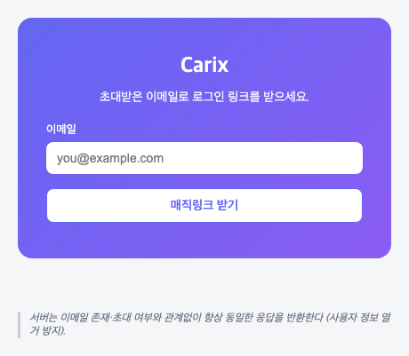
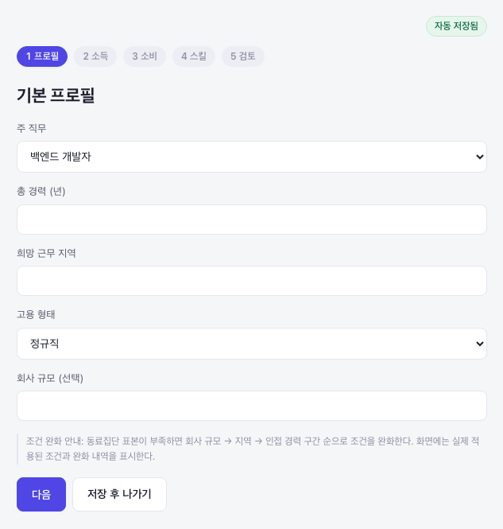
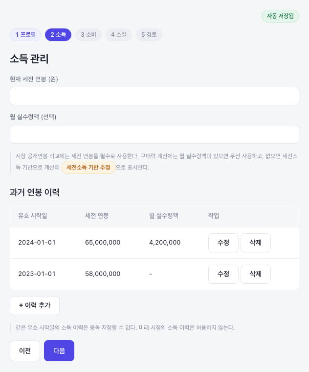
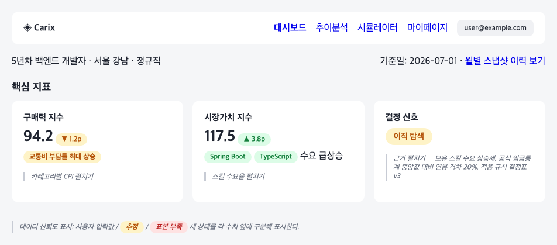
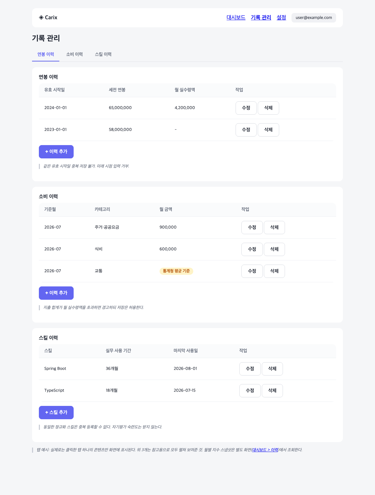
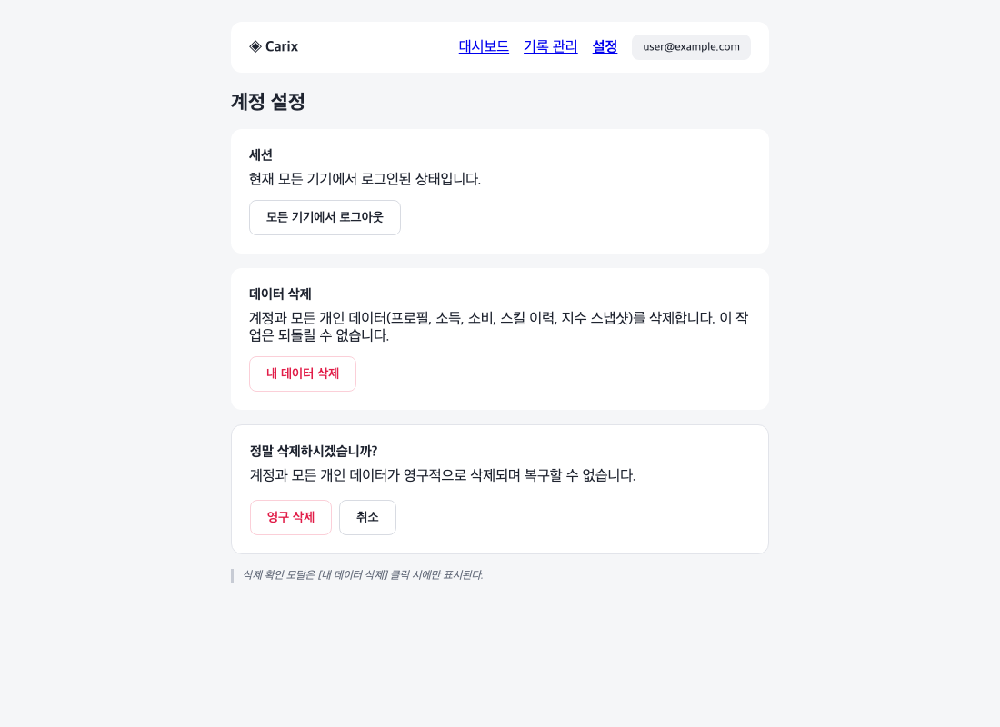

# Wireframes

순수 HTML(+ 공용 `_shared.css`)로 작성. `.html`이 소스이자 실제 화면 — 별도 렌더 도구 없이 브라우저로 바로 열림.

GitHub는 `.html`을 인라인 렌더하지 않으므로, `screenshots/`에 각 화면 스냅샷을 모아 이 README에서 바로 보이게 함. `.html`을 수정하면 스크린샷도 다시 떠서 같이 커밋해야 한다(자동 동기화 아님).

```bash
"/Applications/Google Chrome.app/Contents/MacOS/Google Chrome" \
  --headless --disable-gpu --hide-scrollbars --window-size=1100,<height> \
  --screenshot=screenshots/<name>.png "file://$(pwd)/<file>.html"
```

라우트 ID(S-01~S-13)는 [functional-specification.md §1 화면 맵과 라우트](../functional-specification.md)를 따름. 화면별 빈/열화 상태는 같은 문서 §5 기준.

### [홈](home.html) — S-01 `/`


### 인증 — S-02~S-04

[요청](auth/01-request.html) `/login` → [발송 확인](auth/02-check-email.html) `/login/sent` → [검증](auth/03-verifying.html) `/auth/verify`




### 온보딩 — S-05~S-09

[프로필](onboarding/01-profile.html) → [소득](onboarding/02-income.html) → [소비](onboarding/03-expenses.html) → [스킬](onboarding/04-skills.html) → [검토](onboarding/05-review.html)





### [대시보드](dashboard.html) — S-10 `/dashboard`



### [월별 스냅샷 이력](dashboard-history.html) — S-11 `/dashboard/history`

대시보드와 별도 화면. 이력 관리(S-12)와 혼동 주의 — 여긴 지수 스냅샷 조회 전용.


### [기록 관리](records.html) — S-12 `/settings/records`

연봉·소비·스킬 이력 추가/수정. 지수 스냅샷은 여기 없음(위 S-11 참고).



### [계정 설정](settings.html) — S-13 `/settings/profile`


