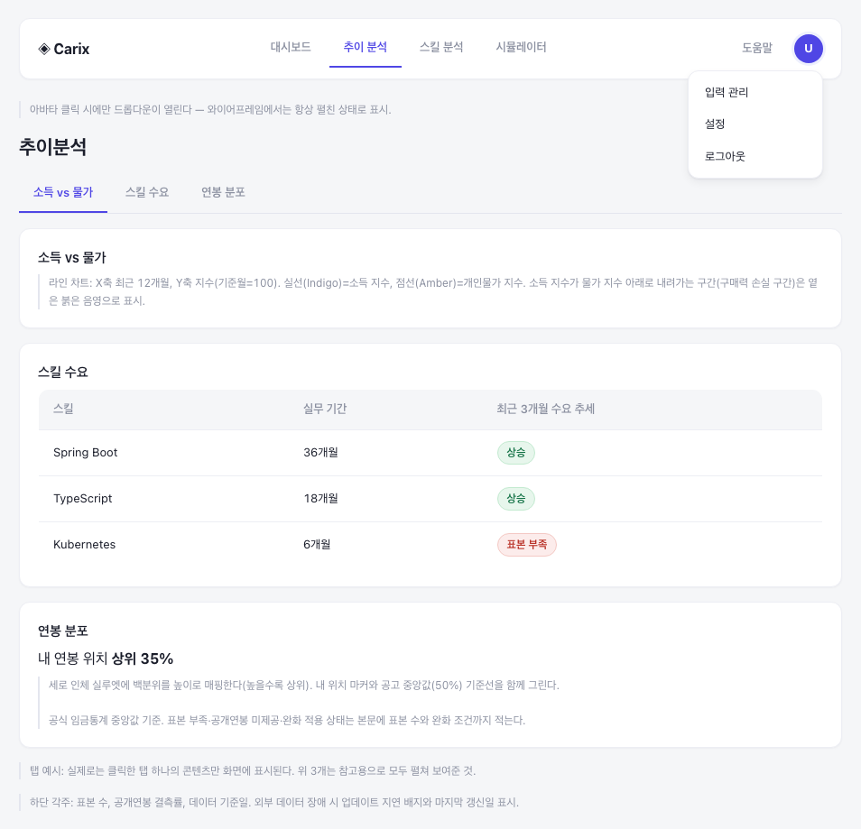
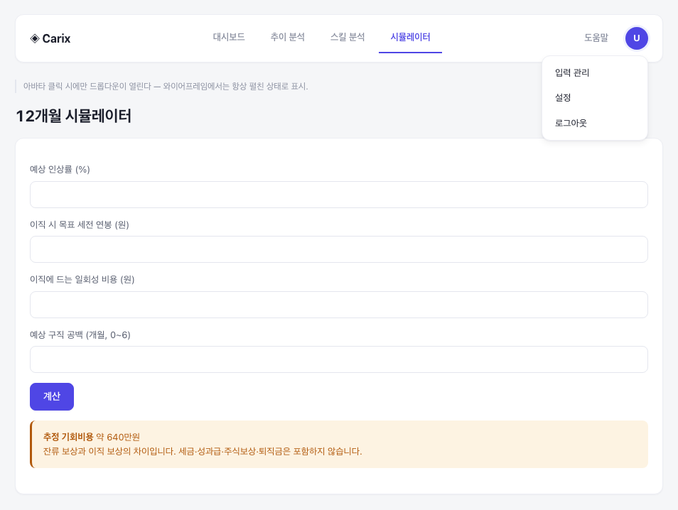
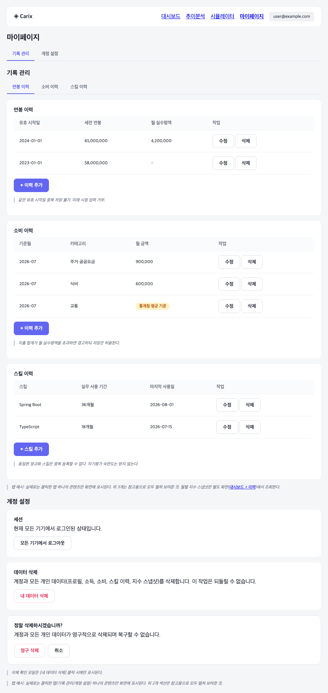

# Wireframes

순수 HTML(+ 공용 `_shared.css`)로 작성. `.html`이 소스이자 실제 화면 — 별도 렌더 도구 없이 브라우저로 바로 열림.

GitHub는 `.html`을 인라인 렌더하지 않으므로, `screenshots/`에 각 화면 스냅샷을 모아 이 README에서 바로 보이게 함. `.html`을 수정하면 스크린샷도 다시 떠서 같이 커밋해야 한다(자동 동기화 아님).

```bash
# 1) 넉넉한 높이로 캡처(빈 여백 있어도 됨)
"/Applications/Google Chrome.app/Contents/MacOS/Google Chrome" \
  --headless --disable-gpu --hide-scrollbars --window-size=1100,3000 \
  --screenshot=screenshots/<name>.png "file://$(pwd)/<file>.html"

# 2) 배경색(#f5f6f8) 기준으로 실제 콘텐츠 영역만 자동 크롭 (Pillow 필요: pip install Pillow)
python3 autocrop.py screenshots/<name>.png
```

라우트 ID(S-01~S-15)는 [functional-specification.md §1 화면 맵과 라우트](../functional-specification.md)를 따름. 화면별 빈/열화 상태는 같은 문서 §5 기준.

### [홈](home.html) — S-01 `/`


### 인증 — S-02~S-03

[로그인](auth/01-login.html) `/login` → [계정 등록](auth/02-register.html) `/register`

방문자는 S-01 랜딩에서 가입 없이 바로 시작한다. 이 두 화면은 이미 계정이 있는
사용자의 재로그인과, 익명으로 쓰던 사용자의 계정 승격을 위한 것이다.

> 스크린샷 없음 — 인증 방식 변경으로 옛 이미지를 걷었다. 화면 구현 시 다시 만든다.

### 온보딩 — S-05~S-09

[프로필](onboarding/01-profile.html) → [소득](onboarding/02-income.html) → [소비](onboarding/03-expenses.html) → [스킬](onboarding/04-skills.html) → [검토](onboarding/05-review.html)

<table>
<tr>
<td align="center"><strong>1. 프로필</strong><br/></td>
<td align="center"><strong>2. 소득</strong><br/></td>
<td align="center"><strong>3. 소비</strong><br/></td>
<td align="center"><strong>4. 스킬</strong><br/></td>
<td align="center"><strong>5. 검토</strong><br/></td>
</tr>
</table>

### [대시보드](dashboard.html) — S-10 `/dashboard`

핵심 지표 3카드만 표시. 추이 차트와 시뮬레이터는 아래 별도 화면 참고.


### [추이분석](trends.html) — S-14 `/dashboard/trends`



### [시뮬레이터](simulator.html) — S-15 `/dashboard/simulator`



### [월별 스냅샷 이력](dashboard-history.html) — S-11 `/dashboard/history`

대시보드와 별도 화면. 이력 관리(S-12)와 혼동 주의 — 여긴 지수 스냅샷 조회 전용.


### [마이페이지](mypage.html) — S-12·S-13 `/mypage/records`, `/mypage/profile`

내부 탭 2개: 기록 관리(연봉·소비·스킬 이력 추가/수정, 지수 스냅샷은 여기 없음 — 위 S-11 참고) / 계정 설정(세션·데이터 삭제).


