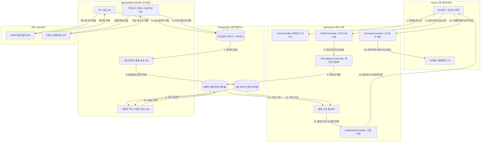
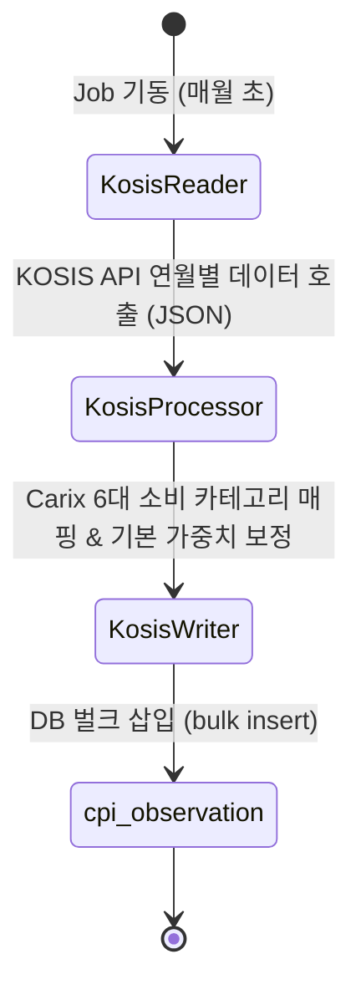
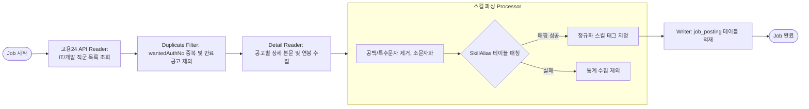
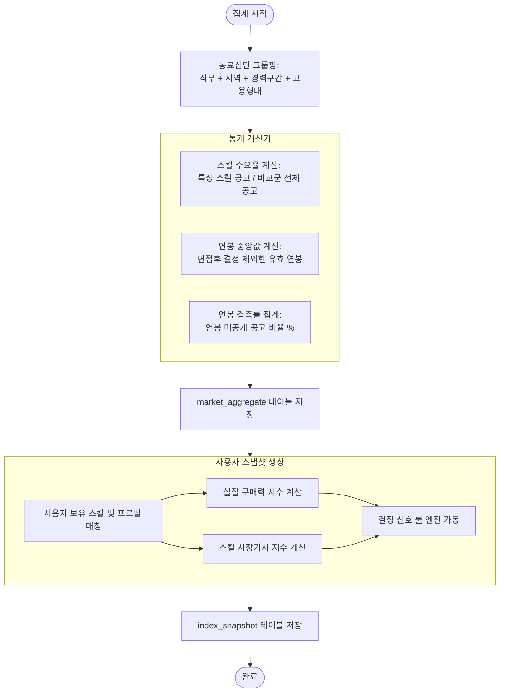

# Carix 전체 애플리케이션 작업 흐름 명세 (Application Workflow Specification)

이 문서는 Carix 플랫폼의 사용자 라이프사이클, 외부 OpenAPI 데이터 수집 배치의 파이프라인, 그리고 사용자 커리어 지표 및 시뮬레이션 산출에 이르는 **전체적인 데이터 흐름(E2E Data Flow)**을 명세화합니다.

---

## 1. Carix 전체 서비스 아키텍처 및 흐름도

사용자의 실시간 요청을 처리하는 **API 영역**과 주기적으로 대량의 외부 데이터를 수집·가공하는 **배치 워커 영역**이 유기적으로 연결된 데이터 파이프라인 구조입니다.



---

## 2. Spring Batch 수집 및 집계 파이프라인 (2번 상세 흐름)

외부 수집 데이터는 대량 데이터의 무결성 보장과 유휴 트래픽 분산을 위해 **Spring Batch 3단계 Job**으로 나누어 실행됩니다.

### 2.1 Job 1: CPI 소비자물가지수 수집 (월 1회 실행)
통계청 물가지수가 매월 초 갱신되는 시점에 기동합니다.



### 2.2 Job 2: 고용24 구인공고 수집 및 스킬 정규화 (일/주 1회 실행)
가장 많은 연산과 파싱이 필요한 핵심 배치 파이프라인입니다.



### 2.3 Job 3: 시장 데이터 통계 집계 및 사용자 스냅샷 (주 1회 또는 배치 직후)
수집된 원천 공고 및 CPI 데이터를 사용자의 동료집단(Peer Group) 단위로 정교하게 그룹핑하고 통계를 집계합니다.



---

## 3. 사용자 경험 시나리오 흐름 (User Experience Flow)

실제 사용자가 매직링크로 유입되어 의사결정 시뮬레이션을 받기까지의 API 통신 순서입니다.

```text
[사용자]                 [Next.js 웹]             [Spring API]            [DB (PG)]
   │                          │                        │                     │
   │ 1. 이메일 로그인 요청 ────▶│                        │                     │
   │                          │ 2. POST /auth/magic ──▶│                     │
   │                          │                        │ 3. 토큰 해시 저장 ──▶│
   │◀─────────────────────────┼────────────────────────┼─────────────────────│ (이메일 수신 및 링크 클릭)
   │ 4. 매직링크 토큰 제출 ──▶│                        │                     │
   │                          │ 5. POST /auth/verify ─▶│                     │
   │                          │◀───────────────────────┼ 6. 세션 쿠키 발급 ──│
   │                          │                        │                     │
   │ 7. 프로필/소득/소비 입력 ─▶│                        │                     │
   │                          │ 8. PUT /profile ──────▶│                     │
   │                          │                        │ 9. 대칭키 암호화 ───▶│ (연봉/소비 데이터 암호화)
   │                          │                        │                     │
   │ 10. 대시보드 진입 ──────▶│                        │                     │
   │                          │ 11. GET /db/summary ──▶│                     │
   │                          │                        │ 12. 통계 데이터 ◀───│ (집계된 MVI, CPI, 연봉조회)
   │                          │                        │ 13. 결정룰 엔진 기동│
   │                          │◀───────────────────────┼─────────────────────│ (구매력/시장가치/결정신호 반환)
   │ 14. 화면에 차트 렌더링   │                        │                     │
   │                          │                        │                     │
   │ 15. 이직 시뮬레이션 시도 ─▶│                        │                     │
   │ (목표액, 이직비용 조정)  │ 16. POST /scenarios ──▶│                     │
   │                          │                        │ 17. 세후 소득 계산 │
   │                          │◀───────────────────────┼─────────────────────│ (추정 기회비용 피드백 제공)
```
